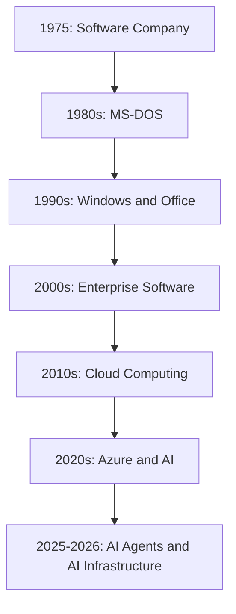
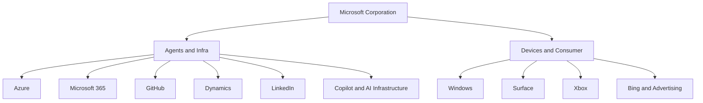

# Day 004 – Microsoft Corporation
## Complete Company Case Study: Business Model, Azure, Artificial Intelligence, Copilot, OpenAI, Cloud Infrastructure & Agentic AI

| Information | Details |
|---|---|
| Company | Microsoft Corporation |
| Founded | April 4, 1975 |
| Founders | Bill Gates and Paul Allen |
| Headquarters | Redmond, Washington, USA |
| Chairman and CEO | Satya Nadella |
| Industry | Software, Cloud, AI, Enterprise Technology |
| Stock Symbol | MSFT |
| Exchange | NASDAQ |
| Main Cloud Platform | Microsoft Azure |
| Main AI Platform | Microsoft Foundry |
| AI Assistant | Microsoft Copilot |
| Developer Platform | GitHub |
| Gaming Business | Xbox |
| Main Competitors | Google, Amazon, Apple, Salesforce, Oracle |
| Case Study | Day 004 of 100 |
| Research Date | November 6, 2026 |

> **Central research question:** How does Microsoft make money by combining cloud infrastructure, enterprise software, artificial intelligence, developer tools and digital services?

---

# Table of Contents

1. Executive Summary
2. Company History
3. Leadership and Organizational Structure
4. What Does Microsoft Actually Do?
5. Products and Services
6. Business Model – How Microsoft Makes Money
7. Financial Analysis – FY2026 and Q1 FY2027
8. Microsoft Azure
9. Microsoft's AI Strategy
10. Microsoft Copilot
11. OpenAI Partnership
12. Microsoft Foundry
13. AI Agents and Agentic AI
14. Microsoft's Own AI Models
15. Maia and Cobalt – Custom AI Chips
16. Microsoft Data Center Architecture
17. Technology Stack
18. Data Engineering and Microsoft Fabric
19. Cybersecurity and Enterprise Governance
20. GitHub and Developer Ecosystem
21. Real-World AI Applications
22. Competitor Analysis
23. SWOT Analysis
24. Challenges and Risks
25. Future Strategy
26. Career Opportunities
27. Engineering Project Ideas
28. Key Business Lessons
29. Research Sources

---

# 1. Executive Summary

Microsoft is one of the world's largest technology companies.

It develops software, cloud platforms, operating systems, productivity tools, enterprise applications and AI technologies.

Its products are used by individuals, developers, startups, governments and multinational enterprises.

Microsoft's business can be understood through five major technology areas:

| Business Area | Main Products |
|---|---|
| Operating Systems | Windows |
| Productivity | Microsoft 365, Word, Excel, PowerPoint |
| Cloud Computing | Azure |
| Artificial Intelligence | Copilot, Foundry, Azure AI |
| Developer Ecosystem | GitHub, Visual Studio |

It also operates in:

- Cybersecurity.
- Enterprise databases.
- Business intelligence.
- Gaming.
- Professional networking.
- Healthcare technology.
- Advertising.

## Microsoft's business transformation

## What makes Microsoft different?

Microsoft owns a broad technology ecosystem.

Consider a business that uses:

- Windows for employee computers.
- Microsoft 365 for productivity.
- Teams for communication.
- Azure for cloud infrastructure.
- GitHub for software development.
- Microsoft Defender for cybersecurity.
- Power BI for analytics.
- Copilot for AI assistance.

All these products can integrate with one another.

This creates a powerful enterprise ecosystem.

**Microsoft's strategy is not simply to sell individual software products. It is to become the technology platform on which organizations operate.**

---

# 2. Company History

## 2.1 Foundation – 1975

Microsoft was founded on April 4, 1975, by Bill Gates and Paul Allen.

The company initially focused on developing software for early personal computers.

Its first major product was a BASIC interpreter for the Altair 8800 computer.

The original vision was to make software accessible to a growing personal computing market.

## 2.2 MS-DOS – 1980s

Microsoft developed and licensed MS-DOS, an operating system that became widely used on IBM-compatible personal computers.

This helped establish Microsoft as a major software company.

## 2.3 Windows – 1985 onwards

Microsoft introduced Windows in 1985.

Windows provided a graphical user interface that made personal computers easier to use.

Windows eventually became one of the world's most widely used desktop operating systems.

## 2.4 Microsoft Office – 1990s

Microsoft expanded into productivity software.

Major products included:

- Word.
- Excel.
- PowerPoint.
- Outlook.

Office became essential for businesses, schools and individuals.

Its licensing and subscription business later became a major source of recurring revenue.

## 2.5 Enterprise Expansion – 2000s

Microsoft expanded into enterprise technology.

Important products included:

- Windows Server.
- SQL Server.
- SharePoint.
- Exchange Server.
- Visual Studio.
- Dynamics.

The company increasingly served enterprise customers rather than focusing only on personal computers.

## 2.6 Cloud Transformation – 2010s

Satya Nadella became CEO in February 2014.

Microsoft accelerated its shift towards cloud computing.

Important developments:

- Azure expansion.
- Office 365.
- Microsoft 365.
- GitHub acquisition in 2018.
- LinkedIn acquisition in 2016.
- Open-source development.
- Cross-platform software.

Azure became one of Microsoft's most important businesses.

## 2.7 AI Transformation – 2020 to 2026

Microsoft significantly expanded its investment in artificial intelligence.

Major developments:

- OpenAI partnership expansion.
- Azure OpenAI Service.
- Microsoft Copilot.
- GitHub Copilot.
- Microsoft 365 Copilot.
- Microsoft Foundry.
- Phi model family.
- Maia AI accelerators.
- Cobalt CPUs.
- Agentic AI infrastructure.

### Historical Milestones

| Year | Development |
|---|---|
| 1975 | Microsoft founded |
| 1981 | MS-DOS became central to IBM PC software |
| 1985 | Windows 1.0 launched |
| 1989 | Microsoft Office introduced |
| 1995 | Windows 95 launched |
| 2001 | Xbox introduced |
| 2008 | Azure announced |
| 2010 | Azure commercial services launched |
| 2014 | Satya Nadella became CEO |
| 2016 | LinkedIn acquisition |
| 2018 | GitHub acquisition |
| 2019 | Major expanded OpenAI partnership |
| 2023 | Microsoft 365 Copilot introduced |
| 2024 | Phi-3 model family announced |
| 2025 | Microsoft Foundry platform expansion |
| 2026 | Maia 200 entered production |
| 2026 | Agent-first enterprise strategy expanded |

---

# 3. Leadership and Organizational Structure

## 3.1 Leadership

| Person | Position |
|---|---|
| Satya Nadella | Chairman and CEO |
| Amy Hood | EVP and CFO |
| Brad Smith | Vice Chair and President |
| Kevin Scott | EVP and CTO |
| Scott Guthrie | EVP, Cloud and AI |
| Judson Althoff | CEO, Commercial Business |

## 3.2 Microsoft's Business Segments

For FY2027, Microsoft introduced a new reporting structure.

Its two reported segments are:

1. Agents and Infra.
2. Devices and Consumer.

This is an important change from the previous three-segment reporting structure.

### A. Agents and Infra

This includes:

- Azure.
- Microsoft 365 Commercial.
- Microsoft Copilot.
- GitHub.
- Dynamics.
- LinkedIn.
- Enterprise cloud services.
- AI infrastructure.
- Enterprise support.

### B. Devices and Consumer

This includes:

- Windows.
- Surface.
- Xbox.
- Gaming content and services.
- Consumer products.
- Search and advertising.

### Organizational Diagram

---

# 4. What Does Microsoft Actually Do?

Microsoft operates across multiple technology markets.

## 4.1 Operating Systems

Windows is Microsoft's operating system for personal computers and business devices.

It supports:

- Desktop applications.
- Business software.
- Development tools.
- Enterprise device management.
- Gaming.

## 4.2 Productivity Software

Microsoft 365 includes:

- Word.
- Excel.
- PowerPoint.
- Outlook.
- Teams.
- SharePoint.
- OneDrive.

It allows organizations to manage communication, collaboration and documents.

## 4.3 Cloud Computing

Azure provides cloud infrastructure.

Companies can rent:

- Virtual machines.
- Storage.
- Databases.
- Networking.
- Containers.
- AI computing.
- Analytics services.

## 4.4 Artificial Intelligence

Microsoft develops AI assistants, AI development platforms, models and enterprise AI infrastructure.

Examples:

- Microsoft Copilot.
- GitHub Copilot.
- Microsoft Foundry.
- Azure AI services.
- Phi models.
- Maia accelerators.

## 4.5 Developer Tools

Microsoft owns GitHub and develops Visual Studio and Visual Studio Code.

These tools help developers build, test, deploy and maintain applications.

---

# 5. Products and Services

## 5.1 Windows

Windows is Microsoft's desktop operating system.

Applications:

- Personal computing.
- Enterprise desktops.
- Development.
- Gaming.
- Office productivity.

## 5.2 Microsoft 365

Microsoft 365 is a productivity platform.

Its products include:

| Product | Purpose |
|---|---|
| Word | Document creation |
| Excel | Spreadsheet analysis |
| PowerPoint | Presentations |
