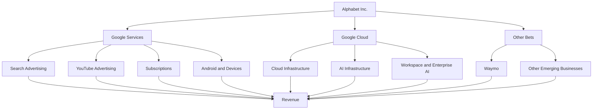
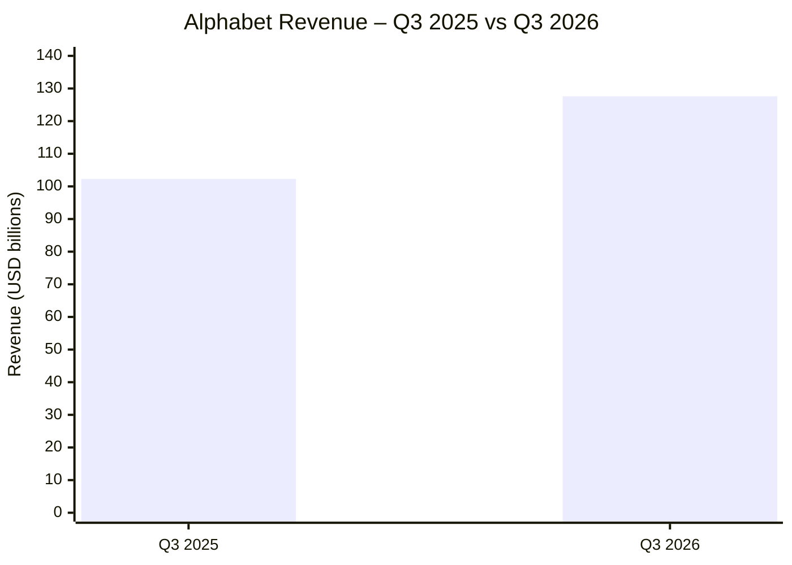
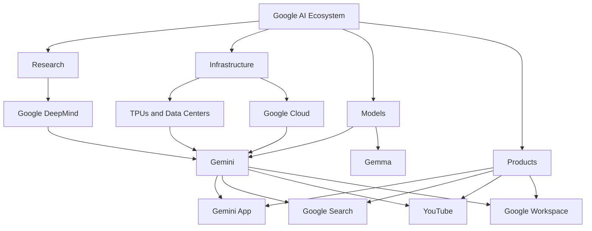
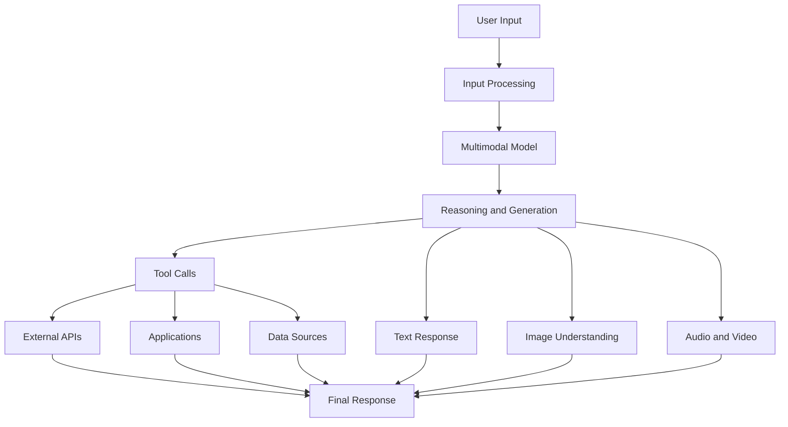
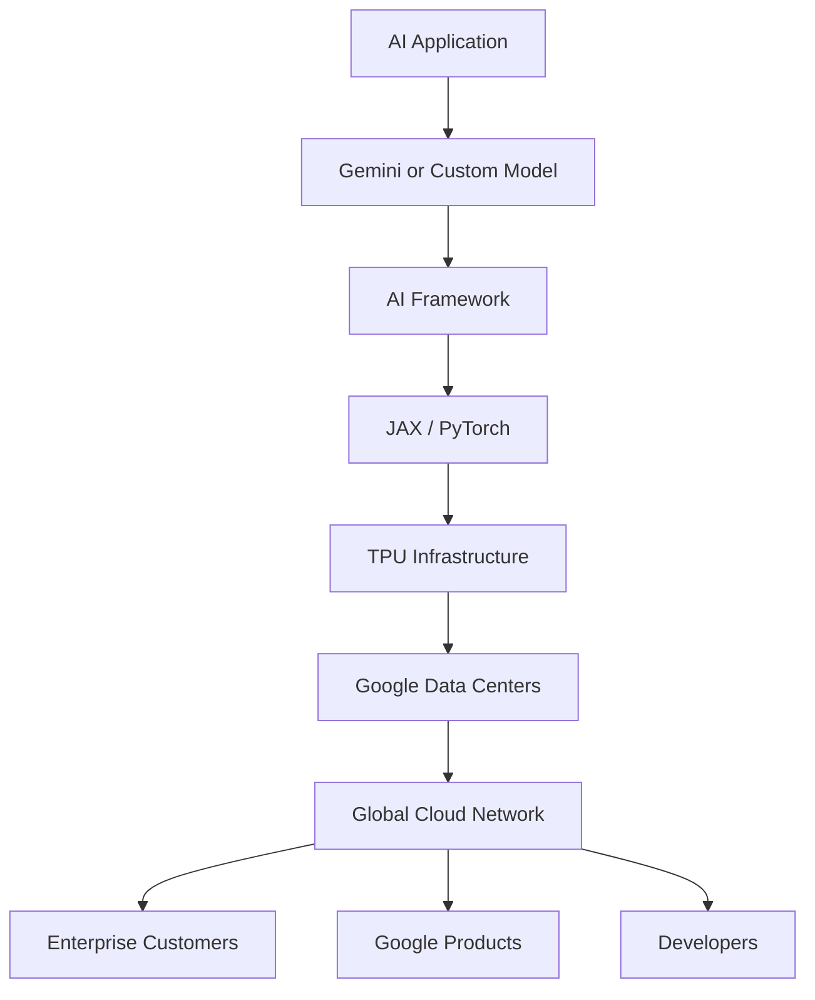
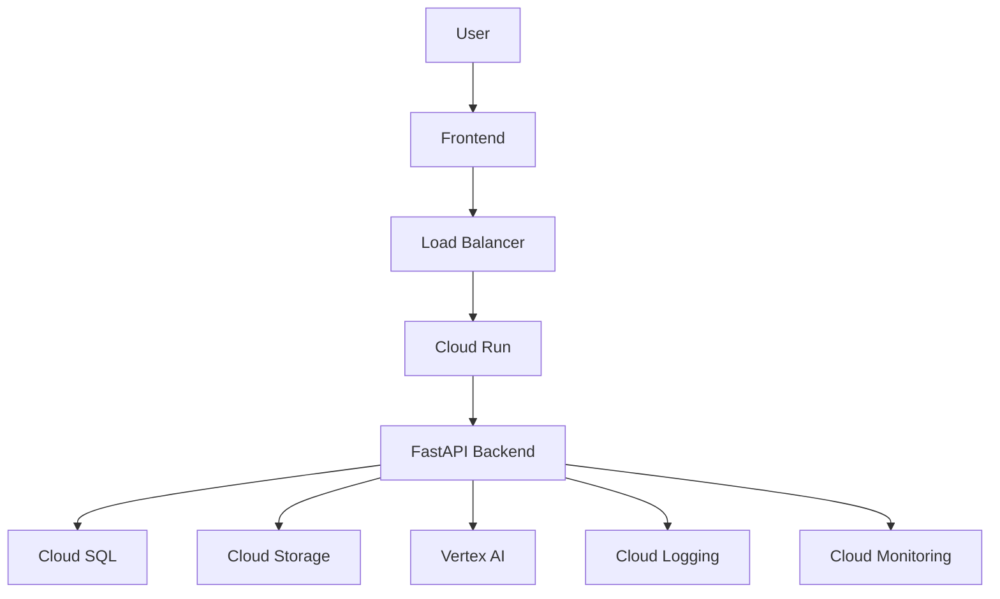
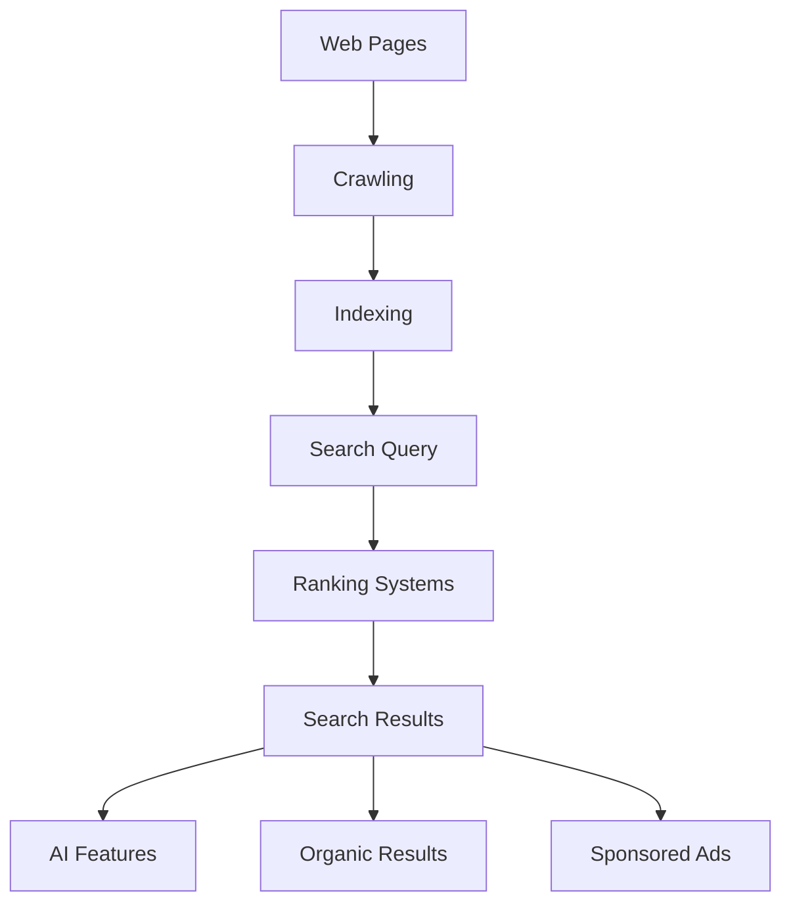
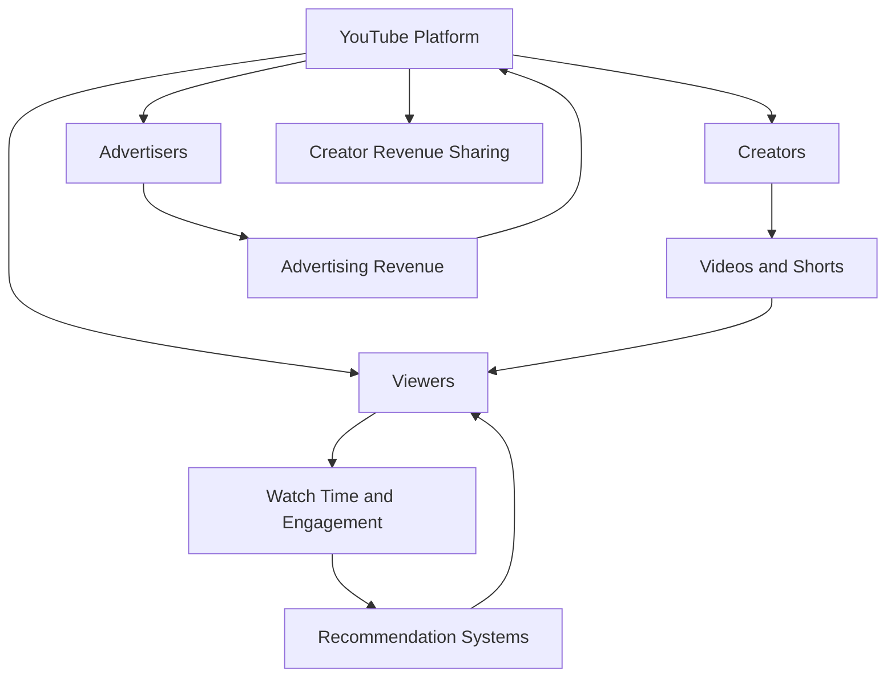
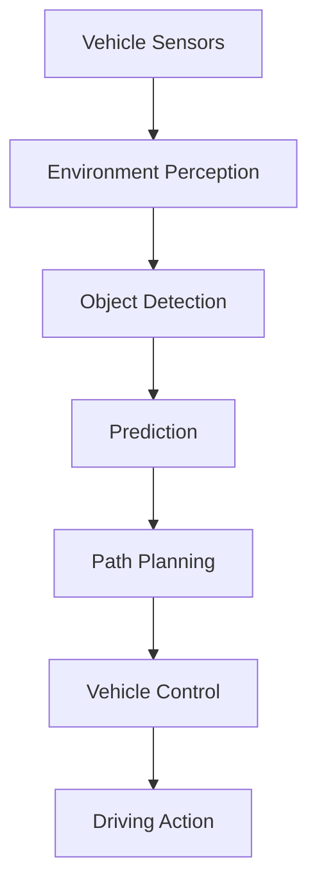

# Day 005 – Google (Alphabet Inc.) Case Study

**Project:** 100 Days, 100 Companies  
**Day:** 005  
**Company:** Google / Alphabet Inc.  
**Industry:** Technology, Artificial Intelligence, Cloud Computing, Digital Advertising, Consumer Electronics  
**Headquarters:** Mountain View, California, USA  
**CEO:** Sundar Pichai  
**Stock Tickers:** GOOGL (Class A), GOOG (Class C)  
**Official Website:** https://about.google/  
**Research updated:** 6 November 2026

---

# 1. Company Overview

Google is one of the world's largest technology companies. It started as a search engine and developed into a global technology ecosystem covering advertising, cloud computing, artificial intelligence, mobile operating systems, video streaming, maps, productivity software, and autonomous vehicles.

Google was founded in September 1998 by Larry Page and Sergey Brin while they were PhD students at Stanford University.

In 2015, Google reorganized under a parent company called **Alphabet Inc.** Google became Alphabet's largest business.

### What does Google actually do?

Google builds products and infrastructure that help people:

- Search for information.
- Communicate and collaborate.
- Watch and publish videos.
- Navigate and explore locations.
- Store files and manage data.
- Develop and deploy software.
- Use artificial intelligence.
- Run business applications and cloud infrastructure.

### Google's major business areas

| Business | Main products |
|---|---|
| Search & Advertising | Google Search, Google Ads |
| Video & Entertainment | YouTube, YouTube Music |
| Cloud Computing | Google Cloud Platform |
| Artificial Intelligence | Gemini, Google DeepMind |
| Mobile Ecosystem | Android, Google Play |
| Productivity | Gmail, Docs, Sheets, Meet |
| Hardware | Pixel, Nest, Fitbit |
| Autonomous Vehicles | Waymo |
| Mapping | Google Maps, Google Earth |

---

# 2. Google's Business Model

Google primarily earns money through advertising, subscriptions, cloud services, and hardware.

Its business model can be understood through four major revenue sources.

## A. Advertising

Advertising is Google's largest revenue source.

Examples:
- Google Search Ads
- YouTube Ads
- Display advertising
- Shopping advertisements
- Performance advertising

**How it works:**

1. A business wants to reach potential customers.
2. It creates an advertising campaign using Google Ads.
3. Google displays relevant advertisements across its platforms.
4. Advertisers pay based on advertising models such as clicks, impressions, or campaign outcomes.

Example:

A shoe company wants to advertise its products.

A person searches for "best running shoes." Google can display sponsored shoe advertisements alongside search results.

Google earns revenue when advertisers pay for these placements.

## B. Subscription Revenue

Google offers paid subscriptions.

| Product | Revenue model |
|---|---|
| YouTube Premium | Monthly subscription |
| YouTube Music | Monthly subscription |
| Google One | Cloud storage and AI plans |
| Google Workspace | Business subscriptions |
| Google AI plans | Paid AI features and services |

## C. Google Cloud

Google provides computing infrastructure and software services to businesses.

Customers pay for:
- Virtual machines.
- Storage.
- Databases.
- Networking.
- AI infrastructure.
- Machine learning platforms.
- Data analytics.
- Security services.

Example: A startup can host its backend, database, and AI application on Google Cloud instead of purchasing physical servers.

## D. Hardware

Google also sells physical products:

- Pixel smartphones.
- Pixel Watch.
- Pixel Buds.
- Nest smart-home products.

---

# 3. How Google Makes Money



**The important business insight:** Google's products reinforce one another. Search, YouTube, Android, Maps, and Chrome create distribution and user engagement. Advertising monetizes much of that activity, while Cloud and subscriptions provide additional revenue streams.

---

# 4. Financial Performance – Q3 2026

The latest reported financial results as of 6 November 2026 are for the third quarter of 2026.

**Reporting period:** 1 July – 30 September 2026  
**Announcement date:** 28 October 2026  
**Currency:** US dollars

## Alphabet's financial highlights

| Metric | Q3 2026 |
|---|---:|
| Total revenue | $127.6 billion |
| Revenue growth YoY | 25% |
| Operating income | $40.6 billion |
| Operating margin | 31.8% |
| Net income | $26.2 billion |
| Diluted EPS | $2.12 |
| Google Services revenue | $96.3 billion |
| Google Cloud revenue | $30.7 billion |
| Other Bets revenue | $372 million |

Source: Alphabet Q3 2026 financial results.

## Revenue comparison by business segment

| Segment | Q3 2025 | Q3 2026 |
|---|---:|---:|
| Google Services | $87.1B | $96.3B |
| Google Cloud | $15.2B | $30.7B |
| Other Bets | $344M | $372M |
| Total Alphabet | $102.3B | $127.6B |

*Figures rounded. Segment revenue and total revenue may not add exactly due to rounding and other items.*

## Revenue growth chart



## Google Cloud's growth

Google Cloud revenue increased from $15.2 billion to $30.7 billion year over year.

That represents approximately **103% growth**.

This is particularly important because Google Cloud is becoming a major growth engine for Alphabet, driven by enterprise AI infrastructure, AI solutions, and core cloud services.

## Advertising revenue breakdown – Q3 2026

| Revenue category | Revenue |
|---|---:|
| Google Search & other | $63.35B |
| YouTube Ads | $11.21B |
| Google Network | $7.46B |
| Google advertising total | $82.01B |

Search remains Google's largest advertising business.

## AI infrastructure investment

Alphabet reported:
- Q3 capital expenditure of approximately $51.4 billion.
- Full-year 2026 capital expenditure guidance of $195–205 billion.
- Significant investment in servers, networking equipment, and data centers.

This spending supports Google's AI infrastructure expansion.

**Important financial interpretation:** Q3 net income was lower year over year despite revenue and operating income growth. Alphabet reported a negative $8.2 billion in other income and expenses, primarily related to unrealized losses on an equity investment. This is different from a decline in its core operating income.

---

# 5. Google's Artificial Intelligence Strategy

AI is now one of Google's most important strategic priorities.

Google has a major advantage: it controls several layers of the AI ecosystem.

1. AI research and model development.
2. Custom AI chips.
3. Data centers and cloud infrastructure.
4. AI development platforms.
5. Consumer applications.
6. Enterprise software distribution.

This allows Google to develop AI models and distribute them across its existing products.

## Google's AI ecosystem



## A. Google DeepMind

Google DeepMind is Google's AI research organization.

It combines research and engineering to develop advanced AI systems.

Its work includes:
- Large language models.
- Multimodal AI.
- Robotics.
- Scientific discovery.
- Protein structure prediction.
- AI safety and evaluation.
- Reinforcement learning.

Notable research systems and projects include:

| Project | Purpose |
|---|---|
| AlphaGo | Game-playing AI |
| AlphaFold | Protein structure prediction |
| AlphaGenome | AI for understanding the genome |
| WeatherNext | AI-powered weather forecasting |
| Gemini | General-purpose multimodal AI |
| Gemini Robotics | AI systems for robotics |

## B. Gemini

**Gemini is Google's family of AI models and its consumer AI assistant.**

It can work with different types of information, including:
- Text.
- Images.
- Audio.
- Video.
- Code.
- Documents.

As of November 2026, Google's official model page features the Gemini 4 generation, including Gemini 4 Argon and Gemini 4 Carbon.

Google also provides different model variants for different workloads, including faster and more cost-efficient models.

### What can Gemini do?

1. Answer questions.
2. Explain technical concepts.
3. Generate and debug code.
4. Summarize documents.
5. Analyze images.
6. Understand audio and video.
7. Assist with research.
8. Support agent-based workflows.

### Gemini architecture – conceptual view



This is a simplified conceptual diagram, not Google's proprietary internal architecture.

## C. Gemma

Gemma is Google's family of open-weight models.

Developers can use Gemma models to:
- Build AI applications.
- Experiment with model customization.
- Create local AI solutions.
- Develop domain-specific assistants.
- Explore efficient inference.

Gemma is particularly relevant for developers who want to experiment with models instead of relying entirely on hosted APIs.

## D. Google AI Studio

Google AI Studio helps developers experiment with Google's generative AI models.

Developers can:
- Test prompts.
- Experiment with model configurations.
- Generate API code.
- Build prototypes.
- Connect applications to Gemini APIs.

Website: https://aistudio.google.com/

## E. Google Antigravity

Google Antigravity is Google's agent-first development platform.

It focuses on AI-assisted software development, where agents can help with tasks beyond code completion.

Potential workflows include:
- Understanding a codebase.
- Planning development tasks.
- Writing code.
- Running tests.
- Assisting with debugging.
- Coordinating development activities.

It represents Google's move toward agentic software development.

---

# 6. Google's AI Infrastructure – TPUs

One of Google's biggest competitive advantages is its custom AI hardware.

Google develops its own chips called **Tensor Processing Units (TPUs)**.

## What is a TPU?

A TPU is a specialized processor designed to accelerate machine learning workloads.

Traditional CPUs are general-purpose processors.

GPUs are highly parallel processors used for graphics and AI workloads.

TPUs are specifically designed to accelerate tensor and machine learning computations.

### CPU vs GPU vs TPU

| Processor | Main purpose |
|---|---|
| CPU | General-purpose computing |
| GPU | Parallel processing and AI workloads |
| TPU | Specialized machine learning acceleration |

## Google's TPU generations

| TPU generation | Key information |
|---|---|
| Trillium | Sixth-generation TPU |
| Ironwood | Seventh-generation TPU |
| TPU 8t | New generation, optimized for large-scale training |
| TPU 8i | New generation, optimized for inference and reinforcement learning |

As of the research date, Ironwood is generally available, while TPU 8t and TPU 8i are listed as coming soon on Google's TPU information page.

Google describes Ironwood as a seventh-generation TPU designed for large-scale training, reasoning, and inference.

## Why does Google develop its own chips?

There are several reasons:

1. Reduce dependence on external hardware suppliers.
2. Optimize AI training and inference.
3. Improve performance per dollar.
4. Build infrastructure specifically for Gemini and other AI workloads.
5. Offer AI computing capacity to Google Cloud customers.

### Google's AI infrastructure stack



---

# 7. Google Cloud Platform (GCP)

Google Cloud is Google's cloud computing business.

It provides infrastructure, databases, networking, analytics, AI services, security, and application development tools.

## Major GCP services

| Service | Purpose |
|---|---|
| Compute Engine | Virtual machines |
| Cloud Storage | Object storage |
| Cloud SQL | Managed relational databases |
| BigQuery | Data warehouse and analytics |
| Google Kubernetes Engine | Container orchestration |
| Cloud Run | Serverless container deployment |
| Cloud Functions | Event-driven functions |
| Vertex AI | AI and ML platform |
| Cloud Logging | Logging and monitoring |
| Cloud Monitoring | Infrastructure monitoring |
| Cloud CDN | Content delivery |
| VPC | Private cloud networking |
| IAM | Identity and access management |

## Example: Deploying a web application on GCP

Suppose a developer creates a job-search platform.

The architecture could look like this:



### How the components work

- Frontend: Provides the user interface.
- Load Balancer: Distributes incoming traffic.
- Cloud Run: Runs the application in containers.
- FastAPI: Handles backend API requests.
- Cloud SQL: Stores application data.
- Cloud Storage: Stores uploaded documents.
- Vertex AI: Provides access to AI models.
- Cloud Logging: Collects application logs.
- Cloud Monitoring: Tracks application health.

## Vertex AI

Vertex AI is Google's platform for building, deploying, and managing AI applications.

It supports:
- Foundation models.
- Model evaluation.
- Fine-tuning.
- Model deployment.
- Embeddings.
- RAG applications.
- Agent development.

It is especially relevant to enterprise AI development.

## BigQuery

BigQuery is Google's serverless data warehouse.

It allows companies to analyze large datasets using SQL.

Example:

A company stores millions of sales records and wants to calculate monthly revenue.

Instead of managing its own database infrastructure, it can use BigQuery to run analytical queries.

Example SQL:

```sql
SELECT
    DATE_TRUNC(order_date, MONTH) AS month,
    SUM(revenue) AS total_revenue
FROM sales
GROUP BY month
ORDER BY month;
```

BigQuery is particularly useful for data analysts, data engineers, and analytics teams.

---

# 8. Google Search – Its Most Important Product

Google Search is one of the foundations of Google's business.

It helps users discover information across the web.

Its business value comes from:
- Search advertising.
- Shopping discovery.
- Commercial intent.
- Website discovery.
- Search ecosystem integration.

## How Search works – simplified



### Three important stages

**1. Crawling**

Google discovers pages using automated crawlers such as Googlebot.

**2. Indexing**

Google processes information from discovered pages and may add eligible pages to its index.

**3. Ranking**

Google's systems determine which results are most relevant to a particular search query.

### AI's impact on Search

Google is integrating AI into Search to improve how users explore complex questions and discover information.

Its challenge is to introduce AI-powered search experiences while maintaining:
- Search quality.
- User trust.
- Publisher ecosystem health.
- Advertising revenue.
- Useful links to original information.

---

# 9. YouTube – Google's Video Business

YouTube is one of the world's largest video platforms.

It generates revenue through:
- Advertising.
- YouTube Premium.
- YouTube Music.
- YouTube TV.
- Creator monetization.

### YouTube ecosystem



### Why YouTube is strategically important

1. It attracts a large global audience.
2. It creates recurring advertising opportunities.
3. It supports paid subscriptions.
4. It provides a distribution platform for creators.
5. It gives Google a strong position in digital video.

Google is also integrating AI capabilities into video discovery, content understanding, and creator tools.

---

# 10. Android – Google's Mobile Ecosystem

Android is Google's mobile operating system.

It powers smartphones, tablets, televisions, wearables, and other connected devices.

Its ecosystem includes:
- Android OS.
- Google Play.
- Google Maps.
- Google Assistant and Gemini integrations.
- Google Mobile Services.
- Developer tools.

### Why Android matters to Google

Android provides a major distribution channel for Google products.

For example:
- Google Search is available across Android devices.
- Google Play supports app distribution.
- Google Maps provides navigation.
- Google services connect users to Google's wider ecosystem.

Android also helps Google reach smartphone users across different device manufacturers and price segments.

---

# 11. Waymo – Autonomous Driving

Waymo is an Alphabet company focused on autonomous driving technology.

It develops self-driving systems and robotaxi services.

### How autonomous driving works – simplified



### Core technologies

- Cameras.
- LiDAR.
- Radar.
- Computer vision.
- Machine learning.
- Sensor fusion.
- Motion planning.
- Robotics.

Waymo demonstrates how Alphabet invests in businesses outside traditional internet services.

It is part of Alphabet's Other Bets segment.

---

# 12. Google's Technology Stack

Google operates technology across several layers.

The following table is a practical view of its public developer ecosystem, not a claim that every internal Google product uses exactly the same stack.

| Area | Technologies |
|---|---|
| AI Models | Gemini, Gemma |
| AI Research | Google DeepMind, Google Research |
| AI Hardware | TPUs |
| ML Frameworks | JAX, TensorFlow, PyTorch |
| Cloud | Google Cloud Platform |
| Containers | Docker, Kubernetes, GKE |
| Data Analytics | BigQuery, Looker |
| Databases | Cloud SQL, Spanner, Firestore, Bigtable |
| Storage | Cloud Storage |
| Development | Android Studio, Google AI Studio, Antigravity |
| Mobile | Android |
| Programming | Python, Java, Go, C++, JavaScript |
| Data Processing | Dataflow, Dataproc, BigQuery |

## Technologies worth learning

For an engineering student interested in AI and cloud engineering:

1. Python.
2. SQL.
3. Docker.
4. Kubernetes.
5. FastAPI.
6. Google Cloud.
7. BigQuery.
8. Vertex AI.
9. Gemini API.
10. RAG and vector search.

---

# 13. Google's Competitive Landscape

Google competes with companies across multiple technology markets.

| Competitor | Main competition area |
|---|---|
| Microsoft | Cloud, AI, productivity, search |
| OpenAI | Generative AI and AI assistants |
| Amazon | Cloud computing and advertising |
| Meta | AI models, social media, advertising |
| Apple | Mobile ecosystem, devices, AI |
| NVIDIA | AI computing hardware |
| Anthropic | Enterprise AI and language models |
| TikTok / ByteDance | Video discovery and advertising |
| Baidu | Search and AI |
| Tesla | Autonomous driving |

## Google vs Microsoft

| Area | Google | Microsoft |
|---|---|---|
| AI assistant | Gemini | Copilot |
| Cloud | Google Cloud | Azure |
| AI models | Gemini, Gemma | OpenAI models, Phi |
| Search | Google Search | Bing |
| Productivity | Google Workspace | Microsoft 365 |
| Mobile | Android | Windows ecosystem |
| AI hardware | TPU | Maia and other infrastructure initiatives |
| Developer ecosystem | Google Cloud, Android, Antigravity | GitHub, Azure, Visual Studio |

## Google vs OpenAI

| Area | Google | OpenAI |
|---|---|---|
| Main AI products | Gemini | ChatGPT |
| Model development | Google DeepMind | OpenAI |
| Cloud infrastructure | Google Cloud | Cloud partnerships and infrastructure providers |
| Search ecosystem | Google Search | AI search and browsing experiences |
| Mobile distribution | Android and Google apps | Mobile applications |
| Developer platform | Gemini API, Vertex AI | OpenAI API |
| Consumer ecosystem | Search, YouTube, Android, Workspace | ChatGPT and connected products |

**Key insight:** Google has a major distribution advantage because it can integrate AI into products that already have enormous user bases. However, distribution alone does not guarantee that users will prefer Google's AI products.

---

# 14. SWOT Analysis

## Strengths

- Strong global brand.
- Large user base across Search, YouTube, Android, and Chrome.
- Strong advertising business.
- Significant AI research capabilities.
- Custom TPU hardware.
- Global data center infrastructure.
- Growing Google Cloud business.
- Strong developer ecosystem.

## Weaknesses

- Heavy dependence on advertising revenue.
- High infrastructure and AI capital expenditure.
- Regulatory and antitrust pressure.
- Complex product ecosystem.
- Risk of AI features disrupting existing search monetization.
- Intense competition for AI talent and compute resources.

## Opportunities

- Enterprise AI adoption.
- Gemini subscriptions.
- AI-powered Search.
- Google Cloud expansion.
- AI agents and automation.
- Autonomous transportation.
- Healthcare and scientific AI.
- Custom AI hardware.

## Threats

- Microsoft and OpenAI competition.
- Anthropic and other AI model developers.
- Search behavior shifting toward AI assistants.
- Advertising market changes.
- Government regulation.
- Privacy and data protection requirements.
- AI infrastructure supply constraints.

---

# 15. Google's Future Strategy

Based on its current products, investments, and public announcements, Google's strategic priorities include:

### 1. Expand Gemini

Improve model capabilities and integrate Gemini into more Google products.

### 2. Expand Google Cloud

Attract enterprises that need AI infrastructure, data platforms, and AI application development tools.

### 3. Invest in AI hardware

Develop more efficient TPUs and expand computing infrastructure.

### 4. Build AI agents

Move from AI systems that only answer questions toward systems that can perform multi-step tasks with appropriate permissions and oversight.

### 5. Improve Search

Combine traditional search capabilities with AI-powered information discovery.

### 6. Monetize AI

Generate revenue through enterprise AI services, consumer subscriptions, and AI-powered products.

### 7. Advance scientific AI

Use AI for applications in biology, medicine, climate science, and other research areas.

---

# 16. Career Opportunities at Google

Google hires across software engineering, AI, cloud, data, security, product, and infrastructure roles.

## Relevant job roles

| Role | Skills to develop |
|---|---|
| Software Engineer | DSA, programming, system design |
| Machine Learning Engineer | Python, ML, deep learning |
| AI Engineer | LLMs, RAG, APIs, agents |
| Data Engineer | SQL, Python, Spark, data pipelines |
| Cloud Engineer | GCP, Linux, networking, Docker |
| Site Reliability Engineer | Linux, automation, monitoring, distributed systems |
| Security Engineer | Networking, application security, cloud security |
| Data Analyst | SQL, Python, statistics, dashboards |

## Skills roadmap

**For Software Engineering:**
- Data structures and algorithms.
- Python, Java, or C++.
- Operating systems.
- Computer networks.
- Database systems.
- System design fundamentals.

**For AI Engineering:**
- Python.
- Machine learning.
- Deep learning.
- LLM fundamentals.
- Prompt engineering.
- RAG.
- Vector databases.
- AI evaluation.
- Agentic workflows.
- Model deployment.

**For Cloud and Data Engineering:**
- Linux.
- SQL.
- Python.
- Docker.
- Kubernetes.
- GCP.
- BigQuery.
- Data pipelines.
- Monitoring and security.

## Useful official career resources

- Google Careers: https://www.google.com/about/careers/
- Google Cloud Training: https://cloud.google.com/learn/training
- Google Developers: https://developers.google.com/
- Google DeepMind Careers: https://deepmind.google/careers/

---

# 17. Engineering Projects Inspired by Google

These projects can help demonstrate practical knowledge of Google's technology ecosystem.

## Project 1 – AI Search Engine

**Difficulty:** Advanced

Build a search engine that uses semantic search and LLMs to answer questions from indexed documents.

**Technology stack:**
- Python.
- FastAPI.
- Gemini API.
- PostgreSQL.
- FAISS or another vector database.
- Next.js.
- Docker.

**Features:**
- Document ingestion.
- Text extraction.
- Embeddings.
- Semantic retrieval.
- RAG-based answers.
- Source citations.

## Project 2 – Google Cloud Data Analytics Pipeline

**Difficulty:** Intermediate to Advanced

Build an end-to-end analytics pipeline using GCP.

**Architecture:**


**Skills demonstrated:**
- Data ingestion.
- Data transformation.
- Cloud storage.
- Data warehousing.
- SQL analytics.
- Dashboard development.

## Project 3 – Gemini AI Assistant

**Difficulty:** Intermediate

Build a conversational AI assistant using the Gemini API.

Features:
- Chat interface.
- Document summarization.
- Question answering.
- Conversation history.
- Tool calling.
- User authentication.

## Project 4 – AI Job Recommendation System

**Difficulty:** Advanced

Build a platform that matches job descriptions with candidate skills.

Features:
- Job data ingestion.
- Resume parsing.
- Embeddings.
- Semantic matching.
- Skill gap analysis.
- AI-generated recommendations.

**Suggested stack:**
- Python.
- FastAPI.
- PostgreSQL.
- Gemini API.
- FAISS.
- Next.js.
- Docker.

## Project 5 – Cloud-Native AI Application

**Difficulty:** Advanced

Deploy an AI application using Google Cloud.

Features:
- FastAPI backend.
- Docker containers.
- Cloud Run deployment.
- Cloud SQL database.
- Cloud Storage.
- Gemini API integration.
- Cloud Logging and Monitoring.

---

# 18. Key Lessons from Google's Business

1. **Build an ecosystem:** Products become more valuable when they work together.
2. **Own critical infrastructure:** Custom hardware can improve performance and reduce dependence on external suppliers.
3. **Invest in research:** Long-term research can create entirely new business opportunities.
4. **Monetize distribution:** A large user base creates opportunities for advertising, subscriptions, and enterprise products.
5. **Think beyond one product:** Google has expanded from search into cloud, AI, hardware, and autonomous driving.
6. **AI requires infrastructure:** Successful AI businesses need models, computing resources, data, software, and distribution.

---

# 19. Final Analysis

Google's biggest advantage is its combination of AI research, custom hardware, global cloud infrastructure, and consumer distribution.

Its business is no longer just a search engine and advertising company. It is becoming a full-stack AI and cloud platform.

The Q3 2026 financial results show two important trends:

- Google Services continues to generate the majority of Alphabet's revenue.
- Google Cloud is growing rapidly, supported by demand for AI infrastructure and enterprise AI solutions.

However, Google's future success will depend on how effectively it converts its AI investments into sustainable revenue while protecting the quality and economics of its existing products.

**My conclusion:** Google is one of the strongest examples of a company using an established technology ecosystem to compete in the next generation of AI.

---

# 20. Sources and References

## Official company and financial sources

1. [Alphabet – Official Website](https://abc.xyz/)
2. [Alphabet Q3 2026 Financial Results](https://abc.xyz/investor/news/news-details/2026/Alphabet-Announces-Third-Quarter-2026-Results-2026-FCcqxfIfmh/default.aspx)
3. [Alphabet Q3 2026 SEC Earnings Release](https://www.sec.gov/Archives/edgar/data/1652044/000165204426000080/googexhibit991q32026.htm)
4. [Alphabet 2025 Annual Report](https://www.sec.gov/Archives/edgar/data/1652044/000165204426000018/goog-20251231.htm)

## AI and research

5. [Google DeepMind](https://deepmind.google/)
6. [Gemini Models](https://deepmind.google/models/gemini/)
7. [Google AI](https://ai.google/)
8. [Google AI Studio](https://aistudio.google.com/)
9. [Google Antigravity](https://antigravity.google/)

## Cloud and infrastructure

10. [Google Cloud](https://cloud.google.com/)
11. [Google Cloud TPUs](https://cloud.google.com/tpu)
12. [Vertex AI](https://cloud.google.com/vertex-ai)
13. [BigQuery](https://cloud.google.com/bigquery)

## Products and careers

14. [Google Search](https://www.google.com/)
15. [YouTube](https://www.youtube.com/)
16. [Android](https://www.android.com/)
17. [Waymo](https://waymo.com/)
18. [Google Careers](https://www.google.com/about/careers/)

---

**Case Study Completed: Day 005 – Google (Alphabet Inc.)**

**Next: Day 006 – Amazon**

