# Day 005 – Google (Alphabet Inc.)
## Complete Company Case Study: Business Model, Artificial Intelligence, Technology, Infrastructure, Operations & Future Strategy


| Information | Details |
|---|---|
| Company | Google LLC / Alphabet Inc. |
| Founded | September 1998 |
| Founders | Larry Page and Sergey Brin |
| Headquarters | Mountain View, California, USA |
| Parent Company | Alphabet Inc. |
| CEO | Sundar Pichai |
| Industry | Technology, AI, Cloud Computing, Advertising |
| Employees | 204,757 (Alphabet, September 2026) |
| Stock Tickers | GOOGL, GOOG |
| Major Businesses | Search, YouTube, Cloud, AI, Android |
| Case Study | Day 05 of 100 |
| Research Date | November 6, 2026 |

> **Central research question:** How did a search engine become one of the world's most influential technology ecosystems, and how is Google using AI, custom chips, cloud infrastructure and global distribution to compete in the next generation of computing?

---

# Table of Contents

1. Executive Summary
2. History and Evolution
3. Company Structure
4. Products and Services
5. Business Model
6. Financial Analysis
7. Artificial Intelligence Strategy
8. Real-World AI Implementations
9. Google DeepMind and Gemini – AI Research and Models
10. AI Work Model
11. Technology Architecture
12. Data Engineering and Cloud
13. AI Infrastructure, TPUs and Robotics
14. Competitor Analysis
15. SWOT Analysis
16. Challenges and Risks
17. Future Strategy
18. Career Opportunities
19. Engineering Project Ideas
20. Key Business Lessons
21. Research Sources

---

# 1. Executive Summary

Google is one of the world's largest technology companies.

It began as an internet search engine and evolved into a global ecosystem covering:

- Search and digital advertising.
- Artificial intelligence.
- Cloud computing.
- Mobile operating systems.
- Video streaming.
- Digital productivity.
- Consumer hardware.
- Mapping and navigation.
- Autonomous transportation.
- Scientific research.

Google operates under its parent company, Alphabet Inc., which was established in 2015.

The company's business has three major operating segments:

1. **Google Services:** Search, YouTube, Android, subscriptions, advertising and consumer products.
2. **Google Cloud:** Cloud infrastructure, enterprise AI, databases, analytics and Workspace.
3. **Other Bets:** Emerging businesses such as Waymo and other long-term technology initiatives.

## The biggest transformation

Google is moving from being primarily an internet search and advertising company toward becoming a full-stack AI and cloud infrastructure provider.

Its AI strategy combines six important layers:

1. AI research.
2. Foundation models.
3. Custom AI hardware.
4. Data centers and cloud computing.
5. AI development platforms.
6. Distribution through products used by billions of people.

## Google's AI ecosystem

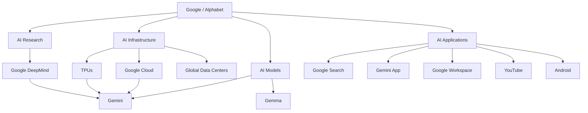

## Latest financial snapshot – Q3 2026

| Metric | Q3 2026 |
|---|---:|
| Alphabet Revenue | $127.6 billion |
| Revenue Growth | 25% YoY |
| Operating Income | $40.6 billion |
| Operating Margin | 31.8% |
| Net Income | $26.47 billion |
| Diluted EPS | $2.12 |
| Google Services Revenue | $96.3 billion |
| Google Cloud Revenue | $30.7 billion |
| Other Bets Revenue | $372 million |

Google Cloud revenue grew approximately 103% year over year.

The company's Q3 results also highlighted that Gemini 4 Argon and Gemini 4 Carbon had entered Google's frontier model lineup, and the Gemini application had reached one billion users.

Source: Alphabet Q3 2026 SEC earnings release.

---

# 2. History and Evolution

Google's evolution demonstrates how a company can expand from one product into an entire technology ecosystem.

## 2.1 Foundation – 1998

Google was founded in September 1998 by Larry Page and Sergey Brin.

The founders developed a search technology called BackRub while studying at Stanford University.

Their search engine used links between webpages as an important signal for determining the relevance and importance of pages.

Google was initially focused on helping users find useful information on the internet.

## 2.2 Early Expansion – 2000 to 2010

Google introduced and acquired several important products.

| Year | Development |
|---|---|
| 2000 | Google Ads introduced |
| 2001 | Eric Schmidt became CEO |
| 2004 | Gmail launched |
| 2004 | Google became publicly traded |
| 2005 | Google Maps launched |
| 2005 | Android acquisition |
| 2006 | Google acquired YouTube |
| 2008 | Chrome browser launched |
| 2008 | First Android smartphone released |
| 2010 | Google expanded its cloud and mobile ecosystem |

### Why these acquisitions mattered

Google did not remain limited to search.

It expanded into:

- Email.
- Video.
- Mobile operating systems.
- Browsers.
- Navigation.
- Online advertising.

These products created new distribution channels and business opportunities.

## 2.3 Cloud and AI Expansion – 2011 to 2020

Google increasingly invested in artificial intelligence, cloud computing and machine learning.

| Year | Development |
|---|---|
| 2011 | Google Cloud infrastructure expanded |
| 2012 | Google acquired Motorola Mobility |
| 2014 | Google acquired DeepMind |
| 2015 | Alphabet corporate restructuring |
| 2016 | Google Assistant introduced |
| 2017 | Transformer architecture research published |
| 2018 | Google introduced TPU v3 |
| 2019 | Google introduced TPU v3 availability through Cloud |
| 2020 | AlphaFold achieved major protein-structure prediction advances |

### Important development: Transformer architecture

In 2017, Google researchers published the research paper:

**Attention Is All You Need.**

The paper introduced the Transformer architecture.

Transformers became foundational to modern large language models.

They influenced the development of many systems used across the AI industry.

## 2.4 Generative AI Era – 2021 to 2026

Google expanded its AI research and products.

| Year | Development |
|---|---|
| 2021 | AlphaFold protein structure prediction expanded |
| 2022 | Google introduced PaLM |
| 2023 | Bard launched and later became Gemini |
| 2023 | Google introduced Gemini model family |
| 2024 | Gemini 1.5 and Gemini 2 generations |
| 2024 | Google introduced Gemma open-weight models |
| 2025 | Gemini 2.5 and Gemini 3 generations |
| 2025 | Google expanded AI-powered Search |
| 2026 | Gemini 3.5, Gemini Omni and agentic AI experiences |
| 2026 | Gemini 4 Argon and Carbon announced in October |
| 2026 | Google expanded its TPU infrastructure strategy |

## 2.5 Google's transformation

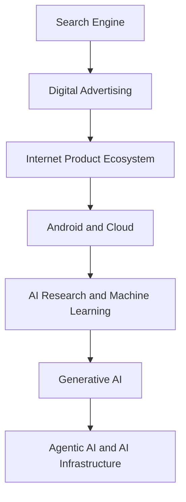

### Business lesson

Google expanded by combining research, acquisitions, infrastructure and product distribution.

Its growth demonstrates the importance of developing an ecosystem rather than depending on one successful product.

---

# 3. Company Structure

## 3.1 Alphabet Inc.

Alphabet Inc. is the parent company of Google.

In 2015, Google reorganized under Alphabet to separate its core internet businesses from other long-term initiatives.

Google became Alphabet's largest operating business.

Sundar Pichai leads both Google and Alphabet.

## 3.2 Alphabet's organizational structure

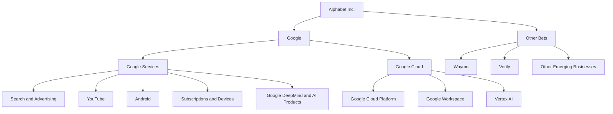

## 3.3 Google Services

Google Services is the largest business segment.

It includes:

- Google Search.
- Google Ads.
- YouTube.
- Android.
- Google Play.
- Chrome.
- Google Maps.
- Google Photos.
- Google One.
- Pixel devices.
- YouTube subscriptions.

Its revenue primarily comes from advertising, subscriptions, platforms and devices.

## 3.4 Google Cloud

Google Cloud provides infrastructure and enterprise software.

Its major offerings include:

- Compute Engine.
- Cloud Storage.
- BigQuery.
- Google Kubernetes Engine.
- Vertex AI.
- Google Workspace.
- Cloud databases.
- AI infrastructure.

Google Cloud is an important growth engine because enterprises increasingly require cloud and AI infrastructure.

## 3.5 Other Bets

Other Bets represents businesses and initiatives outside Google's core operating segments.

Important examples include:

| Business | Purpose |
|---|---|
| Waymo | Autonomous driving |
| Verily | Life sciences and healthcare technology |
| Other research ventures | Long-term technology development |

Waymo is particularly important because it demonstrates Google's investment in autonomous transportation.

## 3.6 Google DeepMind

Google DeepMind is Google's AI research organization.

It develops advanced AI models and systems.

Its research areas include:

- Large language models.
- Multimodal AI.
- Robotics.
- Scientific discovery.
- Reinforcement learning.
- AI safety.
- Protein structure prediction.

DeepMind's research contributes to Google's wider AI ecosystem.

---

# 4. Products and Services

Google provides products to consumers, developers, businesses and enterprises.

## 4.1 Search and Information


| Product | Purpose |
|---|---|
| Google Search | Information discovery |
| Google Maps | Navigation and location services |
| Google News | News discovery |
| Google Lens | Visual search |
| Google Shopping | Product discovery |
| Google Translate | Language translation |

Google Search is one of its most important products and a major advertising revenue generator.

## 4.2 Productivity Products

| Product | Purpose |
|---|---|
| Gmail | Email |
| Google Docs | Document editing |
| Google Sheets | Spreadsheet management |
| Google Slides | Presentations |
| Google Drive | Cloud storage |
| Google Meet | Video conferencing |
| Google Calendar | Scheduling |
| Google Chat | Team communication |

These products are available to individuals and businesses.

Google Workspace provides enterprise subscriptions and administration features.

## 4.3 Entertainment


Google's entertainment ecosystem includes:

- YouTube.
- YouTube Music.
- YouTube Premium.
- YouTube TV.
- Google TV.

YouTube is particularly important because it generates advertising and subscription revenue while supporting a large creator ecosystem.

## 4.4 Mobile and Hardware

| Product | Purpose |
|---|---|
| Android | Mobile operating system |
| Pixel | Smartphones and devices |
| Pixel Watch | Wearable technology |
| Pixel Buds | Audio devices |
| Nest | Smart-home devices |
| Fitbit | Health and fitness devices |
| Chromebook ecosystem | Computing devices |

Android is an important distribution platform for Google's services.

## 4.5 AI Products

| Product | Purpose |
|---|---|
| Gemini | AI assistant and model family |
| Gemma | Open-weight AI models |
| Google AI Studio | AI prototyping and development |
| Vertex AI | Enterprise AI platform |
| NotebookLM | AI-assisted research and document understanding |
| Google Antigravity | Agent-first software development |
| Gemini API | Developer access to Gemini |

## 4.6 Cloud Products

Google Cloud provides:

- Virtual machines.
- Object storage.
- Managed databases.
- Data warehouses.
- Container orchestration.
- Machine learning infrastructure.
- AI model hosting.
- Networking.
- Security.

These products help companies develop and deploy applications without owning physical data centers.

---

# 5. Business Model

Google operates multiple business models simultaneously.

Its largest revenue source is advertising.

However, subscriptions, enterprise cloud services and hardware are increasingly important.

## 5.1 Advertising – B2B

Google sells advertising services to businesses.

Examples:

- Google Search Ads.
- YouTube Ads.
- Google Display Network.
- Shopping Ads.
- App advertising.

### How it works

1. A business wants to reach potential customers.
2. It creates an advertising campaign.
3. It selects keywords, audiences or placements.
4. Google displays relevant advertisements.
5. The advertiser pays according to the advertising model.

### Example

A shoe company wants to promote running shoes.

A customer searches for:

"Best running shoes for beginners."

Google may display sponsored shoe advertisements alongside organic search results.

The advertiser pays according to the applicable advertising arrangement.

## 5.2 Subscription Business

Google offers several subscription-based products.

| Product | Business model |
|---|---|
| YouTube Premium | Monthly subscription |
| YouTube Music | Subscription |
| Google One | Cloud storage and AI plans |
| Google Workspace | Business subscriptions |
| Google AI plans | Paid AI features and services |

Subscription revenue provides an additional source of recurring income.

## 5.3 Google Cloud – Consumption-Based Model

Google Cloud charges customers for cloud resources and enterprise services.

Examples:

- Compute usage.
- Storage.
- Database operations.
- Networking.
- AI inference.
- Data analytics.
- Enterprise subscriptions.

A startup can deploy an application on Google Cloud and pay for the resources it consumes.

## 5.4 Hardware Sales

Google sells consumer devices.

Examples:

- Pixel smartphones.
- Pixel Watch.
- Pixel Buds.
- Nest devices.

Revenue comes from device sales and associated services.

## 5.5 Other Bets

Alphabet also invests in businesses that can create long-term value.

Waymo, for example, is developing autonomous transportation services.

## 5.6 Google's Business Model

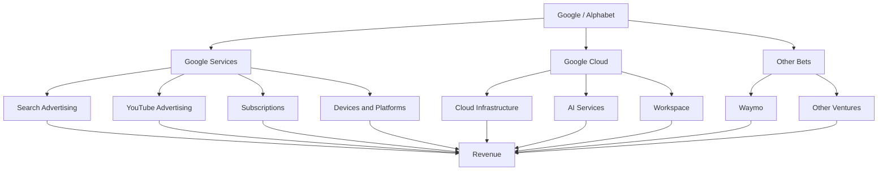

## 5.7 The Ecosystem Effect

Google's products reinforce each other.

For example:

1. Android provides distribution for Google applications.
2. Search helps users discover information.
3. YouTube attracts viewers and creators.
4. Google Ads monetizes advertising opportunities.
5. Google Cloud sells infrastructure to businesses.
6. Gemini adds AI capabilities across multiple products.

This ecosystem creates a strong competitive advantage.

---

# 6. Financial Analysis

Financial performance helps us understand how Google's business model generates revenue and where the company is investing.

## 6.1 FY2025 Financial Performance

Alphabet's financial year ended December 31, 2025.

| Financial Metric | FY2025 |
|---|---:|
| Total Revenue | $402.84 billion |
| Operating Income | $129.04 billion |
| Operating Margin | 32% |
| Net Income | $132.17 billion |
| Diluted EPS | $10.81 |
| Capital Expenditure | $91.4 billion |
| Operating Cash Flow | $164.7 billion |

Source: Alphabet 2025 Form 10-K.

## 6.2 FY2024 vs FY2025

| Metric | FY2024 | FY2025 |
|---|---:|---:|
| Revenue | $350.02B | $402.84B |
| Operating Income | $112.39B | $129.04B |
| Operating Margin | 32% | 32% |
| Net Income | $100.12B | $132.17B |

### Revenue chart

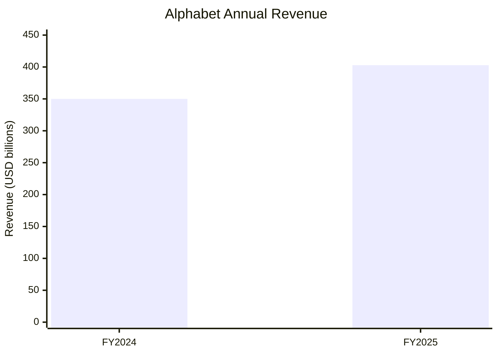

### Operating income chart

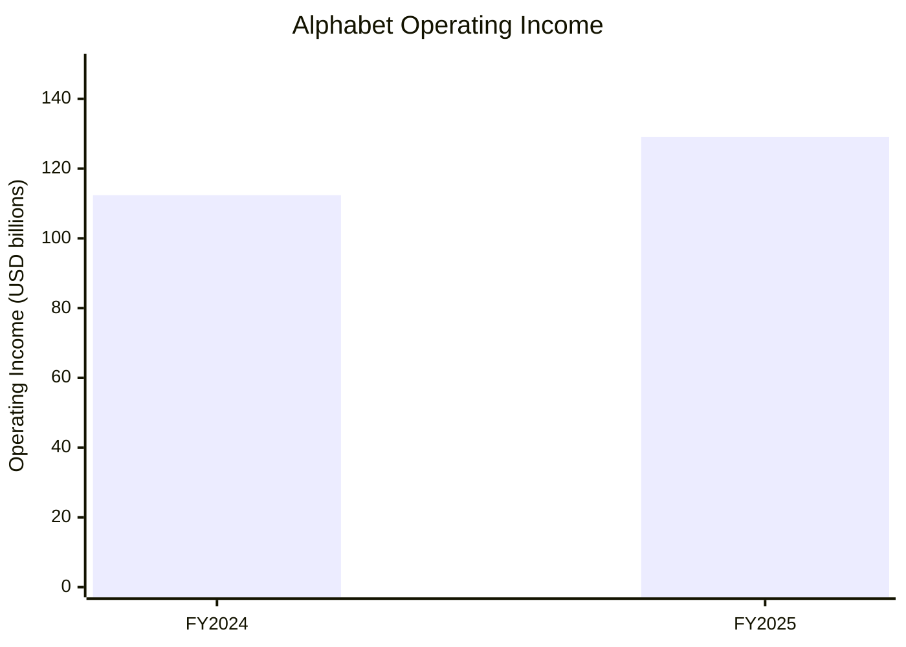

### Financial interpretation

Three important observations:

1. Alphabet's revenue increased by approximately 15%.
2. Operating income increased by approximately 15%.
3. Net income increased by approximately 32%.

Net income was also affected by changes in other income and expenses, including investment-related items.

Revenue growth alone should not be treated as a complete measure of financial performance.

## 6.3 Q3 2026 Financial Performance

The latest reported quarter as of November 6, 2026, is Q3 2026.

**Reporting period:** July 1 – September 30, 2026.

**Announcement date:** October 28, 2026.

| Metric | Q3 2025 | Q3 2026 |
|---|---:|---:|
| Revenue | $102.35B | $127.58B |
| Operating Income | $31.23B | $40.58B |
| Operating Margin | 31% | 31.8% |
| Net Income | $34.98B | $26.47B |
| Diluted EPS | $2.87 | $2.12 |

Revenue grew approximately 25% year over year.

Operating income grew approximately 30%.

Net income declined because other income and expenses included a substantial negative investment-related impact.

## 6.4 Revenue by Business Segment – Q3 2026

| Business Segment | Revenue |
|---|---:|
| Google Services | $96.30B |
| Google Cloud | $30.71B |
| Other Bets | $0.37B |
| Hedging Gains | $0.19B |
| Total | $127.58B |

### Segment revenue chart

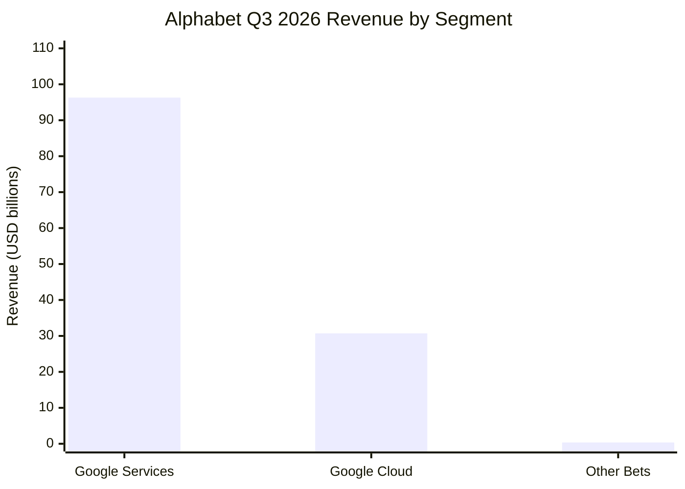

## 6.5 Advertising Revenue Breakdown – Q3 2026

| Advertising Category | Revenue |
|---|---:|
| Google Search and Other | $63.35B |
| YouTube Ads | $11.21B |
| Google Network | $7.46B |
| Total Google Advertising | $82.01B |

Search remains Google's largest advertising business.

## 6.6 Google Cloud Growth

| Metric | Q3 2025 | Q3 2026 |
|---|---:|---:|
| Revenue | $15.16B | $30.71B |
| Operating Income | $3.59B | $11.12B |

Google Cloud revenue grew approximately 103% year over year.

This growth reflects demand for:

- AI infrastructure.
- Enterprise AI applications.
- TPU systems.
- Core cloud services.
- Data analytics.
- Enterprise software.

### Business interpretation

Google Cloud is becoming an increasingly important contributor to Alphabet's business.

Its expansion also demonstrates how Google's AI investments can generate revenue outside its advertising business.

## 6.7 AI Infrastructure Investment

Alphabet reported approximately $51.4 billion in purchases of property and equipment during Q3 2026.

Its 2026 capital expenditure guidance was approximately $195–205 billion.

These investments support:

- Data centers.
- Servers.
- Networking.
- AI accelerators.
- Computing infrastructure.
- Global cloud capacity.

**Important:** Capital expenditure is an investment in long-term infrastructure, not simply an operating expense for one quarter.

---

# 7. Artificial Intelligence Strategy


Artificial intelligence is one of Google's most important strategic priorities.

Google's AI strategy covers both research and commercial products.

It develops AI models, hardware, infrastructure, developer platforms and consumer applications.

## 7.1 Google's AI Strategy – Six Layers

| Layer | Purpose |
|---|---|
| AI Research | Develop advanced AI capabilities |
| Foundation Models | Build Gemini and Gemma |
| AI Hardware | Develop TPUs |
| Cloud Infrastructure | Train and deploy models |
| Developer Platforms | Provide APIs and AI tools |
| Applications | Integrate AI into Google products |

## 7.2 Google DeepMind

Google DeepMind is responsible for major AI research and model development.

Its research covers:

- Multimodal AI.
- Language models.
- Robotics.
- Reinforcement learning.
- Scientific discovery.
- Biology.
- Weather forecasting.
- AI safety.

## 7.3 Gemini

Gemini is Google's family of multimodal AI models and its consumer AI assistant.

It can process different types of information, including:

- Text.
- Images.
- Audio.
- Video.
- Code.
- Documents.

The Gemini ecosystem supports consumer applications, developers and enterprise customers.

## 7.4 Google AI Studio

Google AI Studio is a development environment for experimenting with Google's generative AI models.

Developers can:

- Test prompts.
- Experiment with models.
- Generate API code.
- Prototype applications.
- Configure model parameters.
- Build AI-powered solutions.

Official website:

https://aistudio.google.com/

## 7.5 Google Antigravity

Google Antigravity is an agent-first development platform.

It represents Google's movement beyond traditional AI code completion toward agent-assisted software development.

Possible development workflows include:

- Understanding codebases.
- Planning tasks.
- Editing multiple files.
- Running tests.
- Debugging.
- Reviewing development results.

## 7.6 Agentic AI

Traditional AI assistants primarily answer questions.

Agentic AI systems can perform multiple steps toward a goal using tools and appropriate permissions.

For example, a development agent may:

1. Understand a software requirement.
2. Inspect an existing codebase.
3. Create an implementation plan.
4. Modify source files.
5. Run tests.
6. Analyze failures.
7. Suggest or apply corrections.

Google is extending agentic experiences across Search, Gemini, Chrome, Android and Workspace.

## 7.7 Google's AI ecosystem

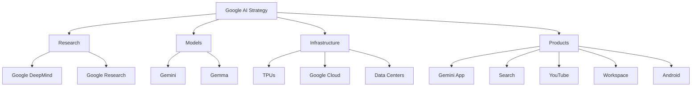

### Why Google's strategy is important

Google controls several parts of the AI value chain.

It can research models, design custom processors, operate data centers, provide cloud infrastructure and distribute AI through existing products.

This integrated strategy is one of its major competitive advantages.

---

# 8. Real-World AI Implementations

This section examines how Google applies AI in actual products and services.

## 8.1 AI-Powered Google Search

Google is integrating AI into its Search experience.

Traditional search:

1. User enters keywords.
2. Search engine retrieves relevant pages.
3. Ranking systems order the results.
4. User visits websites.

AI-powered search can additionally:

- Understand complex questions.
- Summarize information.
- Connect information across sources.
- Support follow-up questions.
- Help users complete research tasks.

### Business value

AI can make Search more useful for complex queries.

However, Google must balance AI-generated responses with:

- Source visibility.
- Search quality.
- Publisher relationships.
- Advertising monetization.
- User trust.

## 8.2 Gemini in Google Workspace

Gemini can assist users within Google's productivity ecosystem.

Examples:

| Application | AI Use |
|---|---|
| Gmail | Email assistance |
| Docs | Writing and summarization |
| Sheets | Data analysis and assistance |
| Slides | Presentation creation |
| Meet | Meeting assistance |
| Drive | Document understanding |

### Example

An employee receives 50 emails about a project.

An AI assistant can help summarize the discussion, extract important decisions and prepare a response.

The employee reviews the generated output before using it.

## 8.3 YouTube AI

YouTube uses machine learning across multiple areas.

Applications include:

- Video recommendations.
- Content discovery.
- Search relevance.
- Automatic captions.
- Content moderation.
- Creator tools.
- Video understanding.

### Recommendation workflow

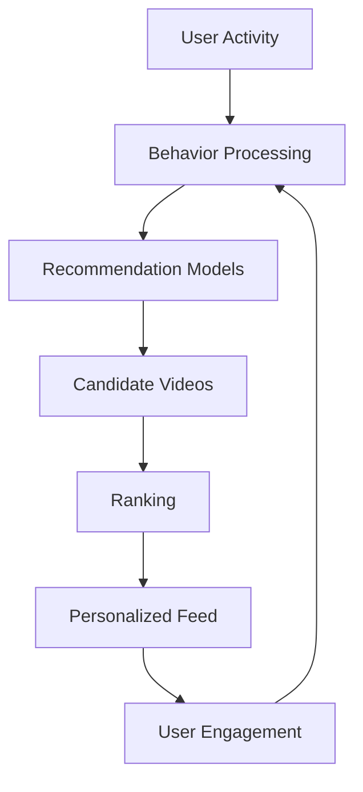

This is a conceptual recommendation architecture, not a disclosure of YouTube's proprietary algorithms.

## 8.4 Google Maps AI

Google Maps uses machine learning and geospatial information for features such as:

- Route optimization.
- Traffic prediction.
- Estimated arrival times.
- Place discovery.
- Visual navigation.
- Location understanding.

AI helps process large amounts of geographic and traffic-related information.

## 8.5 Google Photos

Google Photos uses AI for:

- Image classification.
- Search.
- Object recognition.
- Photo organization.
- Image editing.
- Face-grouping features, subject to product settings and availability.

## 8.6 AlphaFold – Scientific AI


AlphaFold is one of Google's most important scientific AI projects.

It uses AI to predict protein structures.

Protein structures are important because the shape of a protein influences its biological functions.

### Why is this important?

Understanding protein structures can support:

- Biological research.
- Drug discovery.
- Disease research.
- Protein engineering.
- Scientific investigation.

AlphaFold demonstrates that AI can contribute to scientific discovery beyond consumer applications.

## 8.7 Waymo – Autonomous Driving

Waymo is an Alphabet company developing autonomous driving technology.

Its systems use:

- Cameras.
- LiDAR.
- Radar.
- Computer vision.
- Machine learning.
- Sensor fusion.
- Prediction.
- Motion planning.

Waymo's Q3 2026 update reported more than 300 million fully autonomous miles and operations across 15 major US cities.

### Autonomous driving workflow

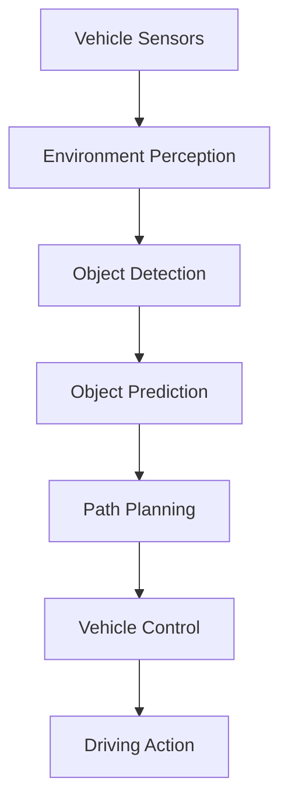

### Business value

Waymo demonstrates how Alphabet can develop entirely new businesses using AI research and advanced engineering.

---

# 9. Google DeepMind and Gemini – AI Research and Models

This is one of the most important sections of the Google case study.

## 9.1 What is Google DeepMind?

Google DeepMind combines AI research and engineering.

It develops advanced AI technologies for Google's products and wider scientific applications.

Its research includes:

- Large language models.
- Multimodal models.
- Reinforcement learning.
- Robotics.
- Scientific AI.
- AI safety.

## 9.2 Gemini Model Family

Gemini is Google's flagship family of AI models.

As of November 6, 2026, Google's official model information features the Gemini 4 generation.

Its October 2026 announcements include:

| Model | Positioning |
|---|---|
| Gemini 4 Argon | Frontier intelligence for demanding tasks |
| Gemini 4 Carbon | New frontier model in the Gemini 4 family |
| Gemini 3.8 Flash | Faster model family |
| Gemini 3.8 Flash Cyber | Cybersecurity-focused model variant |

Model availability and features vary by product and API.

## 9.3 What makes Gemini important?

Gemini supports multimodal AI.

This means it can work with multiple types of information.

For example:

A user uploads a video and asks:

"Explain what is happening in this video."

The model can analyze video content and produce a textual explanation.

Other applications include:

- Code generation.
- Document analysis.
- Research.
- Audio understanding.
- Image analysis.
- Video understanding.
- Tool calling.

## 9.4 Gemma

Gemma is Google's family of open-weight models.

Developers can use supported Gemma models to build customized AI applications.

Applications include:

- Local AI assistants.
- Document question-answering.
- Code assistance.
- Domain-specific AI.
- Model experimentation.

Gemma is particularly useful for developers who want greater control over model deployment and customization.

## 9.5 Google AI Studio

AI Studio allows developers to experiment with Gemini models.

A developer can:

1. Open Google AI Studio.
2. Select a supported model.
3. Write a prompt.
4. Test the output.
5. Adjust settings.
6. Generate API code.
7. Integrate the model into an application.

## 9.6 Vertex AI

Vertex AI is Google's managed AI development platform.

It provides tools for:

- Model development.
- Model evaluation.
- Fine-tuning.
- Embeddings.
- Model deployment.
- RAG applications.
- Agent development.
- Enterprise AI governance.

## 9.7 Conceptual Gemini architecture

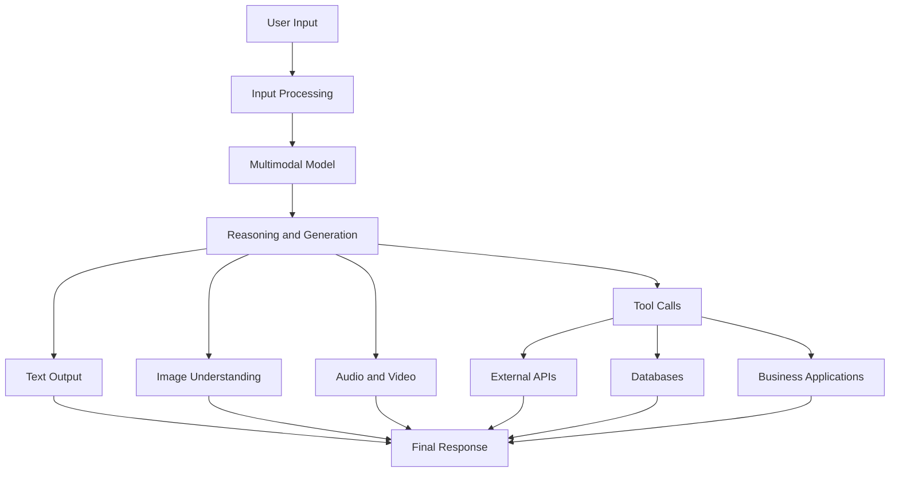

This is an educational conceptual architecture, not Google's proprietary internal model architecture.

## 9.8 Gemini's 2026 Scale

According to Alphabet's Q3 2026 earnings announcement:

- Gemini app reached one billion users.
- Google's first-party model APIs processed nearly 32 billion tokens per minute.
- Model API processing was more than four times the level of the previous year.
- Gemini 4 Argon and Carbon were highlighted as frontier models.

These metrics demonstrate the scale of Google's AI distribution and infrastructure.

---

# 10. AI Work Model

How does Google use AI across its business?

Google's AI work model can be understood through five layers.

## Layer 1 – Data Collection

Google's products generate different forms of information.

Examples:

- Search queries.
- Video metadata.
- Maps information.
- Application activity.
- Business documents.
- Cloud application data.
- Industrial and scientific datasets.

Data use is subject to product design, privacy settings, legal requirements and applicable policies.

## Layer 2 – Data Processing

Collected information needs to be processed.

Possible technologies and methods include:

- Distributed data processing.
- Data pipelines.
- Data validation.
- Data warehouses.
- Data lakes.
- Streaming systems.
- Feature engineering.

## Layer 3 – AI Model Development

Google develops and trains models for different purposes.

Examples:

- Language models.
- Image recognition.
- Recommendation systems.
- Speech recognition.
- Translation.
- Autonomous driving.
- Scientific discovery.

## Layer 4 – AI Inference

Trained models are deployed into applications.

For example:

A user asks Gemini a question.

The application sends the request to an AI service.

The model processes the input and returns a response.

## Layer 5 – Business Action

AI output creates value when integrated into real workflows.

Examples:

- Search recommendations.
- Document summarization.
- Video discovery.
- Route optimization.
- Automated development tasks.
- Enterprise workflow automation.

## Overall AI workflow

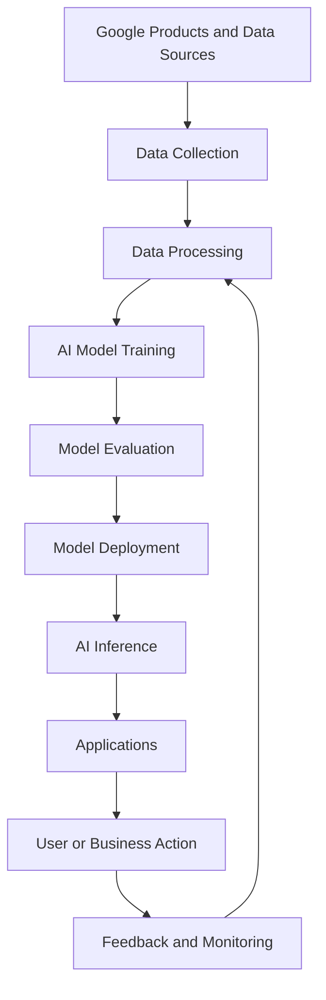

## Example: AI in Search

1. User submits a query.
2. Search systems interpret the request.
3. Relevant information is retrieved.
4. AI systems may generate a synthesized response.
5. Search results and source links are presented.
6. User interacts with the results.

## Example: Enterprise AI

1. An employee asks a business question.
2. The application authenticates the user.
3. Relevant authorized documents are retrieved.
4. Gemini generates a response.
5. The answer is checked against available sources.
6. The employee reviews the output.

**Important:** This is a generalized AI operating model. Google's complete internal AI data and training architecture is not publicly disclosed.

---

# 11. Technology Architecture

Google operates one of the world's largest distributed technology infrastructures.

Its systems need to support:

- Billions of users.
- Large-scale data processing.
- Global application delivery.
- Search infrastructure.
- Video streaming.
- AI model training.
- Enterprise cloud services.

## 11.1 Technology Stack Map

The following is a practical map of publicly available Google technologies and commonly documented engineering technologies. It is not a verified inventory of every internal production system.

| Layer | Technologies |
|---|---|
| Programming | Python, Java, Go, C++, JavaScript |
| Frontend | JavaScript, TypeScript, Web Technologies |
| Backend | Distributed Services, APIs |
| AI Models | Gemini, Gemma |
| AI Research | Google DeepMind, Google Research |
| ML Frameworks | JAX, TensorFlow, PyTorch |
| AI Hardware | TPU |
| Cloud | Google Cloud |
| Containers | Docker, Kubernetes, GKE |
| Databases | Spanner, Bigtable, Firestore, Cloud SQL |
| Storage | Cloud Storage |
| Analytics | BigQuery, Looker |
| Data Processing | Dataflow, Dataproc |
| AI Platform | Vertex AI |
| Development | Android Studio, AI Studio, Antigravity |
| Monitoring | Cloud Monitoring, Cloud Logging |

## 11.2 Google's Distributed Architecture

Google operates applications that require distributed infrastructure.

A simplified architecture:

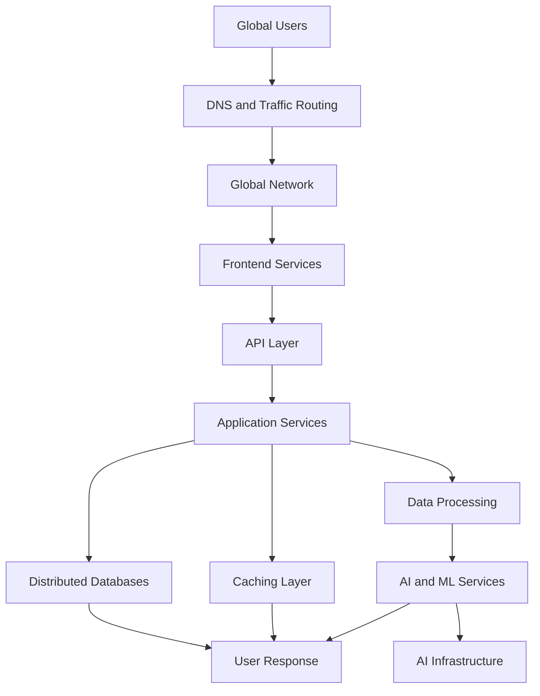

## 11.3 Important Engineering Concepts

### Distributed Systems

Multiple machines work together to provide a single service.

### Load Balancing

Requests are distributed across servers.

### Caching

Frequently accessed information is stored for faster retrieval.

### Fault Tolerance

Systems are designed to continue operating despite component failures.

### Replication

Data can be maintained across multiple locations to improve availability and resilience.

### Observability

Logs, metrics and traces help engineers understand application performance.

## 11.4 Google Spanner

Cloud Spanner is a globally distributed relational database service.

It supports:

- Relational data.
- SQL queries.
- Transactions.
- Horizontal scaling.
- High availability.
- Distributed database operations.

It is useful for applications that require relational database capabilities at large scale.

## 11.5 Bigtable

Bigtable is a distributed NoSQL database designed for large-scale workloads.

It is suitable for:

- Time-series information.
- Large operational datasets.
- High-throughput applications.
- Structured key-value-style data.

## 11.6 Google Kubernetes Engine

GKE is Google's managed Kubernetes service.

It helps organizations deploy and manage containerized applications.

A development team can deploy multiple services inside containers and manage them through Kubernetes.

---

# 12. Data Engineering and Cloud

Google's cloud and data platforms are important parts of its enterprise technology strategy.

## 12.1 Google Cloud Platform

Google Cloud provides infrastructure and services for developers and enterprises.

Major services include:

| Service | Purpose |
|---|---|
| Compute Engine | Virtual machines |
| Cloud Storage | Object storage |
| Cloud SQL | Managed relational database |
| BigQuery | Data warehouse |
| Google Kubernetes Engine | Container orchestration |
| Cloud Run | Serverless containers |
| Cloud Functions | Event-driven computing |
| Vertex AI | AI and ML platform |
| Cloud Logging | Application logs |
| Cloud Monitoring | Monitoring |
| Cloud CDN | Content delivery |
| VPC | Private cloud networking |
| IAM | Identity and access management |

## 12.2 Vertex AI

Vertex AI is a managed platform for developing and deploying AI applications.

It supports:

- Foundation models.
- Model training.
- Model evaluation.
- Fine-tuning.
- Embeddings.
- RAG.
- Agent development.
- Deployment and monitoring.

## 12.3 BigQuery

BigQuery is Google's serverless data warehouse.

It allows companies to analyze large datasets using SQL without managing traditional warehouse infrastructure.

### Example

A company stores millions of sales transactions.

It wants to calculate monthly revenue.

Instead of maintaining a large database infrastructure itself, it can use BigQuery.

Example SQL:

```sql
SELECT
    DATE_TRUNC(order_date, MONTH) AS month,
    COUNT(DISTINCT order_id) AS total_orders,
    SUM(revenue) AS total_revenue
FROM sales
GROUP BY month
ORDER BY month;
```

## 12.4 Data Engineering Pipeline

Suppose a company collects data from:

- Website activity.
- Customer transactions.
- Mobile applications.
- Payment systems.
- Marketing campaigns.

A possible architecture:

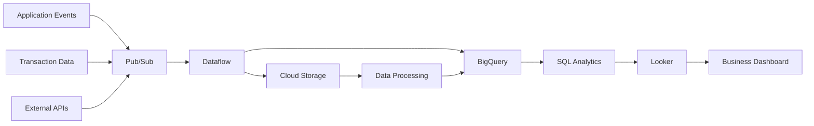

## 12.5 Example Database Design

An e-commerce analytics application might use these tables.

### customers

| Column | Type |
|---|---|
| customer_id | INT |
| customer_name | VARCHAR |
| email | VARCHAR |
| registration_date | DATE |

### orders

| Column | Type |
|---|---|
| order_id | BIGINT |
| customer_id | INT |
| order_date | TIMESTAMP |
| revenue | DECIMAL |
| status | VARCHAR |

### products

| Column | Type |
|---|---|
| product_id | INT |
| product_name | VARCHAR |
| category | VARCHAR |
| price | DECIMAL |

### SQL example

Calculate the top five product categories by revenue.

```sql
SELECT
    p.category,
    SUM(oi.quantity * oi.unit_price) AS total_revenue
FROM order_items oi
JOIN products p
    ON oi.product_id = p.product_id
GROUP BY p.category
ORDER BY total_revenue DESC
LIMIT 5;
```

## 12.6 Why Data Engineering Matters at Google

Google needs large-scale data infrastructure for:

- Search.
- Advertising.
- YouTube.
- Maps.
- AI research.
- Cloud analytics.
- Recommendation systems.

Data engineering ensures that information can be collected, processed, stored and analyzed reliably.

---

# 13. AI Infrastructure, TPUs and Robotics


One of Google's most important competitive advantages is its ability to develop its own AI infrastructure.

AI requires more than models.

It requires:

- Accelerators.
- Servers.
- Data centers.
- Networking.
- Storage.
- Cooling.
- Power infrastructure.
- Distributed software.

## 13.1 What is a TPU?

A Tensor Processing Unit is a specialized processor designed to accelerate machine learning workloads.

Google developed TPUs to support large-scale AI computation.

## 13.2 CPU vs GPU vs TPU

| Processor | Primary Purpose |
|---|---|
| CPU | General-purpose computing |
| GPU | Parallel computing and AI workloads |
| TPU | Specialized machine learning acceleration |

## 13.3 Google's TPU Generations

| TPU | Description |
|---|---|
| TPU v2 | Early cloud TPU generation |
| TPU v3 | Improved performance for AI workloads |
| TPU v4 | Large-scale AI computing |
| TPU v5e | Cost-efficient AI training and inference |
| TPU v5p | Higher-performance AI training |
| Trillium | Sixth-generation TPU |
| Ironwood | Seventh-generation TPU |
| TPU 8t | Announced next-generation training-focused system |
| TPU 8i | Announced next-generation inference-focused system |

According to Google's TPU documentation, Ironwood is designed for large-scale training and inference workloads. TPU 8t and TPU 8i were listed as upcoming systems in the referenced November 2026 product information.

## 13.4 Why Does Google Build Its Own Chips?

1. Reduce dependence on external hardware.
2. Improve AI training efficiency.
3. Optimize inference costs.
4. Improve performance per dollar.
5. Support Gemini and other AI models.
6. Offer specialized infrastructure to Google Cloud customers.

## 13.5 Google's AI Infrastructure Architecture

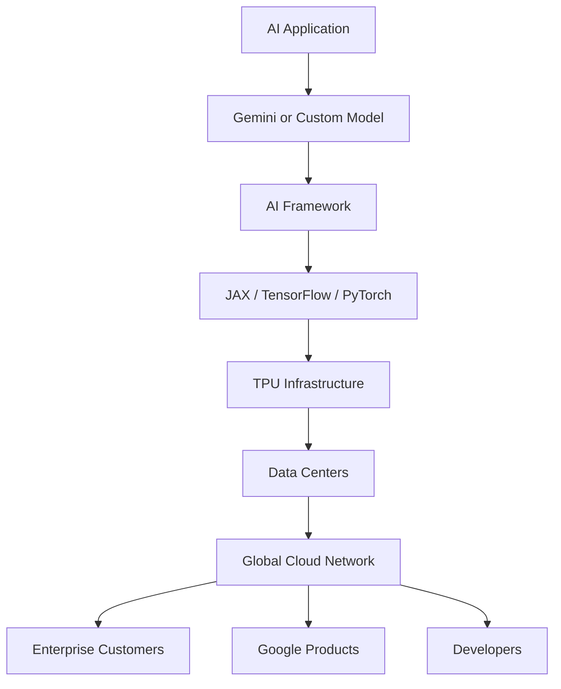

## 13.6 Robotics and Physical AI

Google DeepMind also works on robotics.

Gemini-based robotics research combines:

- Multimodal understanding.
- Language instructions.
- Visual perception.
- Spatial reasoning.
- Planning.
- Robot control.

### Example

A robot receives an instruction:

"Pick up the red object and place it inside the box."

The system needs to:

1. Understand the instruction.
2. Identify the object.
3. Understand its location.
4. Plan movement.
5. Control the robot.
6. Verify the action.

This connects AI reasoning with physical actions.

## 13.7 Project Suncatcher

Project Suncatcher is Google's research initiative exploring space-based AI computing infrastructure.

It reflects Google's interest in the long-term relationship between computing demand, energy and infrastructure.

It is an experimental initiative, not an established replacement for terrestrial data centers.

## 13.8 Waymo and Autonomous Robotics

Waymo also demonstrates how AI can control complex physical systems.

Its autonomous driving technology combines perception, prediction, planning and vehicle control.

### Engineering concepts

- Computer Vision.
- Deep Learning.
- Sensor Fusion.
- Robotics.
- Reinforcement Learning.
- Motion Planning.
- Edge Computing.
- Real-Time Systems.

---

# 14. Competitor Analysis

Google competes across several technology markets.

It does not have just one competitor.

| Competitor | Main Competition Area |
|---|---|
| Microsoft | Cloud, AI, productivity |
| OpenAI | Generative AI |
| Amazon | Cloud and advertising |
| Meta | AI models and advertising |
| Apple | Mobile ecosystem and devices |
| NVIDIA | AI computing hardware |
| Anthropic | Enterprise AI |
| TikTok / ByteDance | Video discovery |
| Baidu | Search and AI |
| Tesla | Autonomous driving |

## 14.1 Google vs Microsoft

| Area | Google | Microsoft |
|---|---|---|
| AI Assistant | Gemini | Copilot |
| Cloud | Google Cloud | Azure |
| AI Models | Gemini, Gemma | Phi and partner models |
| Search | Google Search | Bing |
| Productivity | Google Workspace | Microsoft 365 |
| Mobile | Android | Windows ecosystem |
| AI Hardware | TPU | Maia and other initiatives |
| Developer Platform | Vertex AI, Antigravity | Azure, GitHub, Visual Studio |

### Competitive advantage

Google has enormous consumer distribution through Search, Android, YouTube and Chrome.

Microsoft has strong enterprise relationships through Windows, Microsoft 365, Azure and GitHub.

## 14.2 Google vs OpenAI

| Area | Google | OpenAI |
|---|---|---|
| AI Assistant | Gemini | ChatGPT |
| Model Development | Google DeepMind | OpenAI |
| Cloud Infrastructure | Google Cloud | Cloud and infrastructure partnerships |
| Search Ecosystem | Google Search | AI search and browsing experiences |
| Mobile Distribution | Android and Google apps | ChatGPT applications |
| Developer Platform | Gemini API, Vertex AI | OpenAI API |
| Consumer Ecosystem | Search, YouTube, Workspace | ChatGPT and connected products |

### Competitive advantage

Google has access to an established consumer ecosystem and custom AI infrastructure.

OpenAI has built a major AI product ecosystem around ChatGPT and its developer platform.

## 14.3 Google vs Amazon

| Area | Google | Amazon |
|---|---|---|
| Cloud | Google Cloud | AWS |
| AI Platform | Vertex AI | Bedrock |
| Foundation Models | Gemini | Nova |
| AI Hardware | TPU | Trainium, Inferentia |
| Advertising | Google Ads | Amazon Ads |
| E-commerce | Shopping and merchant discovery | Amazon Marketplace |
| Video | YouTube | Prime Video |

## 14.4 Competitive Positioning

Google's strongest competitive advantages include:

- Search distribution.
- Android ecosystem.
- YouTube.
- AI research.
- Custom AI hardware.
- Global infrastructure.
- Enterprise cloud.
- Large developer ecosystem.

Its biggest challenge is protecting its existing business while adapting to new AI-driven products and competitors.

---

# 15. SWOT Analysis

| Strengths | Weaknesses |
|---|---|
| Strong global brand | Heavy advertising dependence |
| Large Search ecosystem | Regulatory scrutiny |
| YouTube distribution | AI infrastructure costs |
| Strong AI research | Search monetization disruption risk |
| Custom TPU hardware | Complex global product ecosystem |
| Android ecosystem | Competition for AI talent |
| Growing Google Cloud | High capital expenditure |

| Opportunities | Threats |
|---|---|
| Enterprise AI | Microsoft and OpenAI |
| Gemini subscriptions | Anthropic and other model providers |
| AI-powered Search | Changing search behavior |
| Google Cloud growth | Government regulation |
| AI agents | Privacy and security risks |
| Scientific AI | Advertising market changes |
| Custom AI chips | Computing supply constraints |
| Autonomous transportation | Autonomous driving competition |

## Strategic interpretation

Google's biggest strength is its integrated technology ecosystem.

However, the AI transition creates a major challenge.

Google must develop new AI experiences without damaging the business model that made Search and advertising successful.

---

# 16. Challenges and Risks

## 16.1 Search Business Disruption

AI assistants can change how people discover information.

If users increasingly receive answers directly from AI systems, traditional search behavior may change.

Google needs to protect Search quality and advertising revenue while introducing AI features.

## 16.2 Competition

Google faces intense competition from:

- Microsoft.
- OpenAI.
- Anthropic.
- Meta.
- Amazon.
- NVIDIA.
- Other AI startups.

## 16.3 AI Infrastructure Costs

Training and operating advanced models requires significant computing resources.

This creates costs associated with:

- Data centers.
- Servers.
- Networking.
- Energy.
- Cooling.
- Accelerators.
- Model research.

## 16.4 Privacy and Data Protection

Google handles large amounts of information.

It must protect user data and comply with applicable privacy regulations.

## 16.5 AI Hallucinations

Generative AI can produce incorrect or misleading information.

Important applications need:

- Model evaluation.
- Source verification.
- Guardrails.
- Monitoring.
- Human review.

## 16.6 Regulatory Pressure

Google faces regulatory scrutiny across areas including:

- Search competition.
- Advertising technology.
- App distribution.
- Privacy.
- Digital markets.
- AI governance.

## 16.7 Product Cannibalization

AI-powered Search could change the economics of traditional search advertising.

Google needs to find sustainable ways to monetize AI experiences.

---

# 17. Future Strategy

Based on Google's products, investments and public announcements, its future strategy focuses on several areas.

## 17.1 Expand Gemini

Google plans to continue improving model intelligence, multimodal capabilities and agentic workflows.

## 17.2 Expand Google Cloud

Google Cloud is expected to remain a major growth area.

Enterprise demand for AI infrastructure, analytics and managed AI services creates opportunities.

## 17.3 Invest in AI Hardware

Google continues developing custom TPUs to support increasingly demanding AI workloads.

## 17.4 Build AI Agents

Google is moving from AI assistants that primarily answer questions toward agents that can perform multi-step tasks.

These experiences are being developed across:

- Search.
- Gemini.
- Chrome.
- Android.
- Google Workspace.

## 17.5 Improve Search

Google is integrating AI-powered experiences into information discovery.

## 17.6 Monetize AI

Potential revenue sources include:

- Enterprise AI subscriptions.
- Gemini paid plans.
- Cloud AI infrastructure.
- Model APIs.
- AI development platforms.
- AI-powered productivity services.

## 17.7 Scientific AI

Google DeepMind continues research into:

- Biology.
- Drug discovery.
- Weather forecasting.
- Scientific simulation.
- Robotics.
- Advanced computing.

## 17.8 Autonomous Transportation

Waymo is expanding autonomous driving services and exploring new markets.

## Future strategy visualization

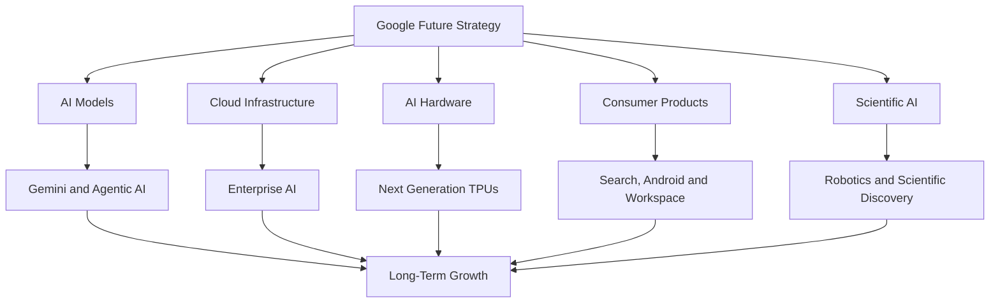

---

# 18. Career Opportunities

Google hires across software engineering, AI, cloud, data, security, product and infrastructure.

## 18.1 Software Engineer

Responsibilities:

- Develop scalable software.
- Build backend systems.
- Design APIs.
- Solve algorithmic problems.
- Improve performance.

Required skills:

- Python, Java or C++.
- Data Structures and Algorithms.
- Operating Systems.
- Computer Networks.
- Database Systems.
- System Design.

## 18.2 AI Engineer

Responsibilities:

- Develop AI applications.
- Integrate foundation models.
- Build RAG systems.
- Develop AI agents.
- Deploy AI solutions.

Required skills:

- Python.
- Machine Learning.
- Deep Learning.
- LLMs.
- RAG.
- Vector Databases.
- AI Evaluation.
- API Development.

## 18.3 Machine Learning Engineer

Responsibilities:

- Develop ML pipelines.
- Train models.
- Optimize model performance.
- Deploy models.
- Monitor model quality.

Required skills:

- Python.
- PyTorch.
- TensorFlow.
- Statistics.
- Deep Learning.
- MLOps.
- Distributed Computing.

## 18.4 Data Engineer

Responsibilities:

- Build data pipelines.
- Process large datasets.
- Manage databases.
- Develop ETL workflows.
- Support analytics infrastructure.

Required skills:

- Python.
- SQL.
- Apache Spark.
- BigQuery.
- Dataflow.
- Data Warehousing.
- Distributed Systems.
- Airflow.

## 18.5 Cloud Engineer

Responsibilities:

- Deploy applications.
- Manage cloud infrastructure.
- Configure networking.
- Implement security.
- Monitor systems.

Required skills:

- Google Cloud.
- Linux.
- Docker.
- Kubernetes.
- Networking.
- IAM.
- CI/CD.
- Infrastructure as Code.

## 18.6 Site Reliability Engineer

Responsibilities:

- Maintain production reliability.
- Monitor infrastructure.
- Automate operations.
- Troubleshoot distributed systems.
- Improve availability.

Required skills:

- Linux.
- Python or Go.
- Networking.
- Monitoring.
- Distributed Systems.
- Kubernetes.
- Incident Management.

## Career learning matrix

| Role | Important Skills |
|---|---|
| Software Engineer | DSA, Java, Python, System Design |
| AI Engineer | Python, LLMs, RAG, Agents |
| ML Engineer | PyTorch, TensorFlow, MLOps |
| Data Engineer | SQL, Spark, BigQuery |
| Cloud Engineer | GCP, Linux, Kubernetes |
| SRE | Linux, Networking, Monitoring |
| Data Analyst | SQL, Python, Looker |

## Official career resources

- Google Careers: https://www.google.com/about/careers/
- Google Cloud Training: https://cloud.google.com/learn/training
- Google Developers: https://developers.google.com/
- Google DeepMind Careers: https://deepmind.google/careers/

---

# 19. Engineering Project Ideas

The best way to understand Google's technology is to build practical applications inspired by its products and infrastructure.

Here are six projects.

## Project 1 – AI Search Engine

**Difficulty:** Advanced

### Problem

Traditional keyword search may not understand the meaning behind a question.

### Solution

Build a search engine that uses semantic search and LLMs to answer questions from indexed documents.

### Technology

- Python.
- FastAPI.
- Gemini API.
- PostgreSQL.
- FAISS.
- Next.js.
- Docker.

### Features

- Document ingestion.
- Text extraction.
- Embeddings.
- Semantic retrieval.
- RAG-based answers.
- Source citations.
- Search history.

### Architecture

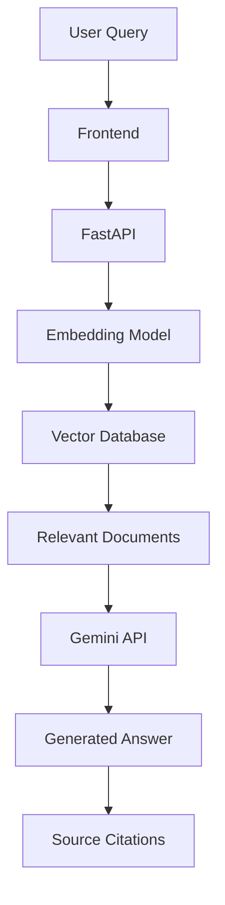

## Project 2 – Google Cloud Data Analytics Pipeline

**Difficulty:** Intermediate to Advanced

### Problem

Companies need to process large amounts of business data and create useful analytics.

### Solution

Build an end-to-end analytics pipeline using Google Cloud.

### Technology

- Python.
- Cloud Storage.
- Dataflow.
- BigQuery.
- SQL.
- Looker Studio.

### Features

- Data ingestion.
- Data transformation.
- Data validation.
- Data warehouse.
- Revenue analytics.
- Business dashboard.

### Architecture

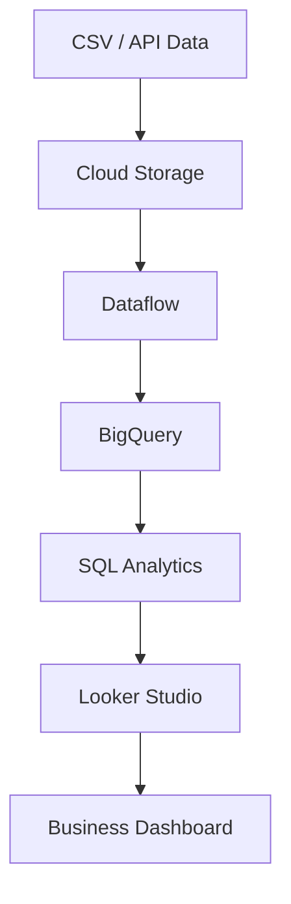

## Project 3 – Gemini AI Assistant

**Difficulty:** Intermediate

### Problem

Users need an assistant that can understand questions and work with documents.

### Solution

Build a conversational AI assistant using the Gemini API.

### Technology

- Python.
- FastAPI.
- Gemini API.
- PostgreSQL.
- Next.js.
- Docker.

### Features

- Chat interface.
- Document summarization.
- Question answering.
- Conversation history.
- Tool calling.
- Authentication.

## Project 4 – AI Job Recommendation System

**Difficulty:** Advanced

### Problem

Job seekers struggle to find opportunities matching their actual skills.

### Solution

Build a system that compares resumes with job descriptions.

### Technology

- Python.
- FastAPI.
- PostgreSQL.
- Gemini API.
- FAISS.
- Next.js.
- Docker.

### Features

- Job ingestion.
- Resume parsing.
- Embeddings.
- Semantic matching.
- Skill gap analysis.
- AI-generated recommendations.

## Project 5 – AI-Powered YouTube Analytics

**Difficulty:** Intermediate to Advanced

### Problem

Creators need to understand their content performance.

### Solution

Build an analytics platform that analyzes video metadata and channel performance using available APIs and datasets.

### Technology

- Python.
- YouTube Data API.
- PostgreSQL.
- Pandas.
- FastAPI.
- Power BI.

### Features

- Video data collection.
- Views and engagement analytics.
- Category performance.
- Channel comparison.
- Trend detection.
- Dashboard.

## Project 6 – Cloud-Native AI Application

**Difficulty:** Advanced

### Problem

An AI application needs reliable infrastructure and deployment.

### Solution

Deploy an AI application on Google Cloud.

### Technology

- FastAPI.
- Docker.
- Cloud Run.
- Cloud SQL.
- Cloud Storage.
- Gemini API.
- Cloud Logging.
- Cloud Monitoring.

### Features

- Backend APIs.
- Authentication.
- AI integration.
- Database management.
- Container deployment.
- Logging.
- Monitoring.

### Architecture

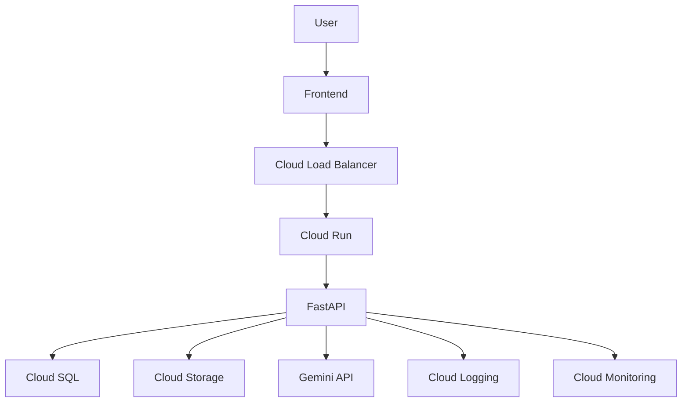

---

# 20. Key Business Lessons

## Lesson 1 – Build an Ecosystem

Google's products reinforce one another.

Search, YouTube, Android, Chrome and Workspace create multiple distribution channels.

## Lesson 2 – Invest in Research

Long-term research can create technologies that become entire industries.

The Transformer architecture is a major example.

## Lesson 3 – Own Critical Infrastructure

Google's TPUs demonstrate how custom hardware can improve performance and reduce dependence on external suppliers.

## Lesson 4 – Monetize Distribution

A large user base creates opportunities for advertising, subscriptions and enterprise products.

## Lesson 5 – Think Beyond One Product

Google expanded from search into:

- Advertising.
- Cloud.
- AI.
- Mobile.
- Hardware.
- Autonomous transportation.

## Lesson 6 – AI Requires an Entire Ecosystem

Building a successful AI business requires more than a language model.

It requires:

- Data.
- Computing infrastructure.
- Hardware.
- Software.
- APIs.
- Security.
- Distribution.

## Lesson 7 – Technology Creates New Business Models

Google Cloud demonstrates how infrastructure originally developed for technology operations can become a commercial product.

## Lesson 8 – Distribution Is a Competitive Advantage

Even a technically strong product needs a way to reach users.

Google's existing ecosystem gives it a significant distribution advantage.

## Lesson 9 – Research Must Become Useful

Scientific research becomes more valuable when it is transformed into products and practical applications.

## Lesson 10 – Innovation Requires Adaptation

Google must continuously adapt its existing products as new technologies change how users interact with information.

---

# 21. Research Sources

The following official sources provide the foundation for this case study.

## Company and Financial Sources

| Source | Research Area | Link |
|---|---|---|
| Alphabet Official Website | Company overview | https://abc.xyz/ |
| Google About | Company information | https://about.google/ |
| Alphabet Investor Relations | Financial information | https://abc.xyz/investor/ |
| Alphabet Q3 2026 Results | Latest financial results | https://www.sec.gov/Archives/edgar/data/1652044/000165204426000080/googexhibit991q32026.htm |
| Alphabet 2025 Annual Report | Annual financial analysis | https://www.sec.gov/Archives/edgar/data/1652044/000165204426000018/goog-20251231.htm |

## AI and Research

| Source | Research Area | Link |
|---|---|---|
| Google DeepMind | AI research | https://deepmind.google/ |
| Gemini Models | Gemini model family | https://deepmind.google/models/gemini/ |
| Google AI | AI ecosystem | https://ai.google/ |
| Google AI Studio | AI development | https://aistudio.google.com/ |
| Google Antigravity | Agent-first development | https://antigravity.google/ |
| Google Research | Research publications | https://research.google/ |

## Cloud and Infrastructure

| Source | Research Area | Link |
|---|---|---|
| Google Cloud | Cloud infrastructure | https://cloud.google.com/ |
| Google Cloud TPUs | AI hardware | https://cloud.google.com/tpu |
| Vertex AI | AI platform | https://cloud.google.com/vertex-ai |
| BigQuery | Data warehouse | https://cloud.google.com/bigquery |
| Google Kubernetes Engine | Container orchestration | https://cloud.google.com/kubernetes-engine |
| Cloud Spanner | Distributed database | https://cloud.google.com/spanner |

## Products and Services

| Source | Research Area | Link |
|---|---|---|
| Google Search | Search | https://www.google.com/ |
| YouTube | Video platform | https://www.youtube.com/ |
| Android | Mobile ecosystem | https://www.android.com/ |
| Google Workspace | Productivity | https://workspace.google.com/ |
| Waymo | Autonomous driving | https://waymo.com/ |
| Google Careers | Career opportunities | https://www.google.com/about/careers/ |

## Research Verification Notes

- Q3 2026 financial figures refer to the quarter ended September 30, 2026.
- The Q3 2026 earnings release was published on October 28, 2026.
- FY2025 financial figures refer to the year ended December 31, 2025.
- Google Services, Google Cloud and Other Bets are Alphabet's reported operating segments.
- Gemini 4 Argon and Carbon are based on Google's October 2026 model announcements.
- TPU specifications and availability should be checked against the current Google Cloud documentation.
- Google does not publicly disclose every internal software component or infrastructure design.
- The architecture diagrams in this report are educational reference architectures, not Google's proprietary internal designs.
- Career skill requirements are learning recommendations, not guaranteed hiring requirements.

---

# Final Assessment

| Research Dimension | Assessment |
|---|---|
| Business Model | Advertising + Cloud + Subscriptions + Hardware |
| AI Strategy | Full-stack AI ecosystem |
| Main AI Products | Gemini, Gemma, Vertex AI |
| AI Research Organization | Google DeepMind |
| AI Hardware | TPU |
| Cloud Platform | Google Cloud |
| Data Platform | BigQuery |
| Consumer Distribution | Search, YouTube, Android, Chrome |
| Autonomous Technology | Waymo |
| Main Growth Opportunity | Enterprise AI and Cloud |
| Engineering Relevance | Very High |

## Final Conclusion

Google is one of the strongest examples of how a technology company can build a complete ecosystem around a core product.

Its original business was search.

Today, it operates across advertising, cloud computing, mobile software, video, AI research, custom hardware, scientific discovery and autonomous transportation.

Its biggest competitive advantage is the combination of:

1. Global consumer distribution.
2. Advanced AI research.
3. Custom AI processors.
4. Large-scale data centers.
5. Enterprise cloud infrastructure.
6. A strong developer ecosystem.
7. Established digital products.

The Q3 2026 financial results demonstrate the importance of Google Cloud and the growing contribution of AI infrastructure to Alphabet's business.

However, Google's long-term success will depend on converting its AI investments into sustainable revenue while maintaining the quality and economics of its established products.

**The biggest lesson: A successful technology company does not simply build a great product. It builds the research, infrastructure, software, distribution and business model required to make that product valuable at global scale.**

---

## Case Study Completion

- [x] Company history researched.
- [x] Alphabet organizational structure examined.
- [x] Products and services analyzed.
- [x] Business model documented.
- [x] FY2025 financial performance reviewed.
- [x] Q3 2026 financial performance reviewed.
- [x] AI strategy investigated.
- [x] Google DeepMind examined.
- [x] Gemini and Gemma analyzed.
- [x] Google Cloud architecture mapped.
- [x] TPUs and AI infrastructure studied.
- [x] Search and YouTube AI applications examined.
- [x] Waymo investigated.
- [x] Data engineering architecture documented.
- [x] Competitors analyzed.
- [x] SWOT analysis completed.
- [x] Career opportunities documented.
- [x] Engineering project ideas prepared.
- [x] Research sources included.

**Day 05 / 100 – GOOGLE (ALPHABET INC.): COMPLETED**

**Next: Day 06 – Amazon**

*100 Days. 100 Companies. Understand the Business. Understand the Technology. Build Like an Engineer.*
