# Day 006 – Amazon.com, Inc.
## Complete Company Case Study: Business Model, Artificial Intelligence, Cloud Computing, Logistics, Technology & Future Strategy


| Information | Details |
|---|---|
| Company | Amazon.com, Inc. |
| Founded | July 1994 (company); website launched July 1995 |
| Founder | Jeff Bezos |
| Headquarters | Seattle, Washington, USA |
| CEO | Andy Jassy |
| Executive Chair | Jeff Bezos |
| Industry | E-commerce, Cloud Computing, AI, Logistics, Advertising |
| Stock Ticker | AMZN |
| Major Businesses | Amazon Stores, AWS, Advertising, Prime |
| Employees | Approximately 1.58 million at year-end 2025 |
| Case Study | Day 06 of 100 |
| Research Date | November 6, 2026 |

> **Central research question:** How did an online bookstore become a global technology and commerce company, and how is Amazon using AI, cloud infrastructure, robotics, custom chips and logistics automation to build its next generation of business?

---

# Table of Contents

1. Executive Summary
2. History and Evolution
3. Company Structure
4. Products and Services
5. Business Model
6. Financial Analysis
7. Artificial Intelligence Strategy
8. Real-World AI Implementations
9. Amazon's Major AI Platforms – Nova, Bedrock and AgentCore
10. AI Work Model
11. Technology Architecture
12. Data Engineering and Cloud
13. AI, Robotics, Automation and Logistics
14. Competitor Analysis
15. SWOT Analysis
16. Challenges and Risks
17. Future Strategy
18. Career Opportunities
19. Engineering Project Ideas
20. Key Business Lessons
21. Research Sources

---

# 1. Executive Summary

Amazon is one of the world's largest technology and commerce companies.

It started as an online bookstore in 1995 and developed into a global business operating across:

- E-commerce.
- Cloud computing.
- Artificial intelligence.
- Digital advertising.
- Logistics and delivery.
- Streaming entertainment.
- Consumer electronics.
- Subscription services.
- Grocery and healthcare.
- Robotics and autonomous transportation.
- Satellite connectivity.

Amazon's most important competitive advantage is its ability to combine technology, infrastructure, logistics and customer experience.

## What does Amazon actually do?

Amazon connects several groups of customers:

| Customer | What Amazon Provides |
|---|---|
| Consumers | Products, delivery, entertainment |
| Third-party sellers | Marketplace, payments, fulfillment |
| Developers | Cloud infrastructure and AI tools |
| Enterprises | AWS, databases, analytics and AI |
| Advertisers | Sponsored and display advertising |
| Content creators | Publishing and distribution platforms |
| Businesses | Logistics, technology and operational services |

## Amazon's three reported operating segments

Amazon organizes its business into three major reporting segments.

1. **North America:** Online stores, physical stores and related services in North America.
2. **International:** Stores and related services outside North America.
3. **Amazon Web Services (AWS):** Cloud infrastructure and technology services.

Advertising, subscriptions and other services contribute to revenue across the business, but they are not separate reported operating segments.

## Amazon's AI strategy

Amazon's AI strategy combines:

1. Foundation models.
2. Custom AI chips.
3. AWS cloud infrastructure.
4. Enterprise AI platforms.
5. AI agents.
6. AI-powered shopping.
7. Warehouse robotics.
8. Logistics optimization.

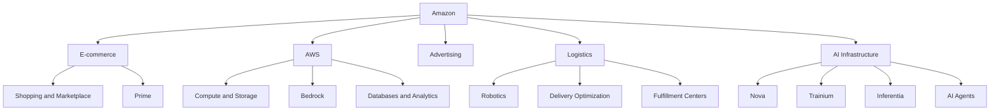

## Latest financial snapshot – Q3 2026

| Metric | Q3 2026 |
|---|---:|
| Net Sales | $201.9 billion |
| Revenue Growth | 12% YoY |
| Operating Income | $28.1 billion |
| Operating Margin | 13.9% |
| Net Income | $20.7 billion |
| Diluted EPS | $1.89 |
| North America Revenue | $112.9 billion |
| International Revenue | $43.1 billion |
| AWS Revenue | $46.0 billion |
| AWS Operating Income | $17.8 billion |

AWS revenue grew approximately 39.3% year over year, its fastest growth in nearly five years according to Amazon's Q3 2026 announcement.

AWS reached an annualized revenue run rate of approximately $184 billion.

Source: [Amazon Q3 2026 earnings release](https://ir.aboutamazon.com/news-release/news-release-details/2026/Amazon-com-Announces-Third-Quarter-Results/).

---

# 2. History and Evolution

Amazon's history is an example of long-term thinking, customer obsession and continuous business expansion.

## 2.1 Foundation – 1994 to 1995

Jeff Bezos founded Amazon in 1994.

The company initially operated as an online bookstore.

Amazon's website opened in July 1995.

### Why books?

Books were suitable for early online commerce because:

- There were millions of book titles.
- Physical stores had limited shelf space.
- Online catalogs could offer a much wider selection.
- Customers could search for books without visiting a store.

Amazon's early strategy focused on offering a larger selection and convenient online purchasing.

## 2.2 Public Listing – 1997

Amazon completed its initial public offering in May 1997.

Its stock trades on Nasdaq under the symbol AMZN.

## 2.3 Expansion Beyond Books – 1998 to 2005

Amazon expanded into more product categories.

| Year | Development |
|---|---|
| 1994 | Amazon founded |
| 1995 | Online bookstore launched |
| 1997 | IPO |
| 1998 | Expansion into music and video |
| 1999 | Expansion into additional product categories |
| 2000 | Amazon Marketplace launched |
| 2002 | AWS began emerging as an internal infrastructure initiative |
| 2005 | Amazon Prime introduced |
| 2006 | AWS S3 and EC2 launched |

### Amazon Marketplace

Marketplace allowed third-party sellers to list products on Amazon.

This changed Amazon from a retailer that primarily sold its own inventory into a platform that also connected independent sellers with customers.

### Why this mattered

Amazon could increase product selection without purchasing and holding every product itself.

It also created new revenue opportunities through seller fees and related services.

## 2.4 AWS – 2006 to 2015

AWS became one of Amazon's most important strategic developments.

Before cloud computing became mainstream, companies often purchased and maintained their own servers.

AWS offered computing infrastructure over the internet.

Important early services included:

- Amazon S3.
- Amazon EC2.
- Amazon SQS.

This created a new business model: companies could rent computing resources instead of building all infrastructure themselves.

## 2.5 Devices and Digital Services – 2007 to 2015

| Year | Development |
|---|---|
| 2007 | First Kindle launched |
| 2011 | Amazon introduced the Kindle Fire |
| 2014 | Fire TV and Echo devices expanded |
| 2014 | Alexa introduced |
| 2015 | Amazon launched Prime Video in additional markets |

Amazon was no longer just a shopping website.

It was developing its own consumer hardware and entertainment ecosystem.

## 2.6 Global Expansion – 2016 to 2020

Amazon expanded:

- Fulfillment centers.
- Delivery infrastructure.
- Grocery operations.
- Cloud infrastructure.
- Advertising services.
- Video streaming.
- AI-powered recommendation systems.

In 2017, Amazon announced its acquisition of Whole Foods Market.

The acquisition expanded Amazon's physical retail and grocery presence.

## 2.7 AI and Automation Era – 2021 to 2026

| Year | Development |
|---|---|
| 2021 | Andy Jassy became CEO |
| 2022 | Amazon expanded its custom AI chip strategy |
| 2023 | Amazon introduced Bedrock and expanded generative AI investments |
| 2024 | Amazon expanded its Nova model family |
| 2025 | Amazon expanded Trainium and Bedrock capabilities |
| 2026 | Amazon expanded agentic AI, custom AI infrastructure and Alexa shopping |
| 2026 | Amazon announced a major OpenAI partnership |
| 2026 | Amazon expanded AgentCore and managed AI agent capabilities |

## 2.8 Amazon's transformation

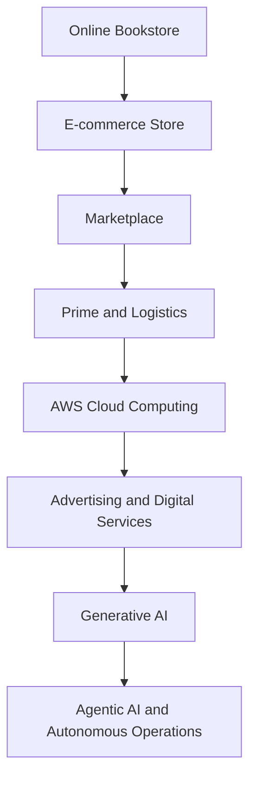

### Business lesson

Amazon repeatedly expanded into businesses that could strengthen its existing ecosystem.

It did not abandon e-commerce when it developed AWS.

Instead, it built additional businesses around infrastructure, customer relationships, technology and operational capabilities.

---

# 3. Company Structure

## 3.1 Amazon.com, Inc.

Amazon.com, Inc. is the parent company of Amazon's businesses.

Its corporate headquarters are located in Seattle, Washington.

### Leadership

| Person | Position |
|---|---|
| Jeff Bezos | Founder and Executive Chair |
| Andy Jassy | President and CEO |
| Brian Olsavsky | Senior Vice President and CFO |
| Matthew Garman | CEO, Amazon Web Services |

Leadership roles can change; the company's official investor relations leadership page should be checked for the latest appointments.

## 3.2 Organizational Structure

Amazon reports three major operating segments.

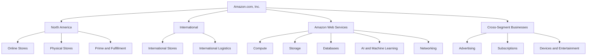

## 3.3 North America

North America includes Amazon's retail and related operations in the United States, Canada and Mexico.

Its activities include:

- Online shopping.
- Marketplace.
- Fulfillment.
- Delivery.
- Grocery.
- Prime.
- Physical stores.
- Advertising and related services.

## 3.4 International

The International segment covers Amazon's retail operations outside North America.

It includes:

- International marketplaces.
- Regional logistics.
- Local delivery networks.
- Seller services.
- Prime offerings.
- Regional customer support.

## 3.5 Amazon Web Services

AWS provides cloud computing services to:

- Startups.
- Developers.
- Enterprises.
- Government organizations.
- Educational institutions.
- Financial institutions.
- Technology companies.

Its services include computing, storage, databases, networking, security, analytics and AI.

## 3.6 Amazon's Additional Businesses

| Business | Purpose |
|---|---|
| Amazon Ads | Digital advertising |
| Prime Video | Streaming entertainment |
| Kindle | Digital reading |
| Alexa | Voice assistant and smart-home ecosystem |
| Amazon Pharmacy | Online pharmacy |
| Whole Foods Market | Grocery retail |
| Zoox | Autonomous transportation |
| Amazon Leo | Low Earth orbit satellite connectivity |
| Twitch | Live-streaming platform |
| Audible | Audiobooks and spoken-word entertainment |

These businesses contribute to Amazon's broader ecosystem, but not all are separate financial reporting segments.

---

# 4. Products and Services

Amazon offers products and services to consumers, sellers, developers and enterprises.

## 4.1 E-commerce


Amazon's online store provides:

- Electronics.
- Clothing.
- Books.
- Groceries.
- Household products.
- Furniture.
- Beauty products.
- Industrial products.
- Digital products.

### How shopping works

1. Customer searches for a product.
2. Amazon retrieves matching listings.
3. Customer compares price, reviews and delivery.
4. Customer places an order.
5. Payment is processed.
6. The order enters fulfillment.
7. The product is delivered.

## 4.2 Amazon Marketplace

Marketplace enables third-party sellers to sell products through Amazon.

Seller services include:

- Product listings.
- Advertising.
- Payment processing.
- Fulfillment by Amazon.
- Seller analytics.
- Inventory management.

### Fulfillment by Amazon (FBA)

Under FBA, sellers send inventory to Amazon fulfillment centers.

Amazon can then:

- Store products.
- Pick orders.
- Pack orders.
- Ship products.
- Handle certain customer service and returns processes.

This creates a logistics service for independent sellers.

## 4.3 Amazon Prime

Prime is a subscription program.

Benefits vary by country and plan.

They may include:

- Faster delivery.
- Prime Video.
- Prime-exclusive deals.
- Prime Music benefits in certain markets.
- Additional shopping benefits.

Prime encourages repeat purchases and stronger customer relationships.

## 4.4 Amazon Web Services

AWS is Amazon's cloud computing business.

Major services include:

| Service | Purpose |
|---|---|
| EC2 | Virtual machines |
| S3 | Object storage |
| RDS | Managed relational databases |
| Lambda | Serverless computing |
| DynamoDB | NoSQL database |
| VPC | Virtual private networking |
| IAM | Identity and access management |
| EKS | Managed Kubernetes |
| CloudFront | Content delivery |
| Redshift | Data warehouse |
| Bedrock | Foundation model platform |
| SageMaker AI | Machine learning platform |

## 4.5 Amazon Devices

| Product | Purpose |
|---|---|
| Kindle | E-book reader |
| Echo | Smart speaker |
| Fire TV | Streaming device |
| Fire tablets | Consumer tablets |
| Ring | Smart security |
| Blink | Home security |
| eero | Home networking |

## 4.6 Entertainment

Amazon's entertainment services include:

- Prime Video.
- Amazon Music.
- Audible.
- Twitch.
- Amazon MGM Studios.

These businesses help Amazon increase customer engagement and subscription value.

## 4.7 Advertising

Amazon Ads provides advertising solutions to brands and sellers.

Products include:

- Sponsored Products.
- Sponsored Brands.
- Sponsored Display.
- Video advertising.
- Streaming TV advertising.
- Amazon DSP.

## 4.8 Healthcare and Grocery

Amazon has expanded into:

- Amazon Pharmacy.
- Amazon Fresh.
- Whole Foods Market.
- Grocery delivery.
- Healthcare-related services.

These businesses extend Amazon's reach into everyday consumer needs.

---

# 5. Business Model

Amazon operates multiple business models simultaneously.

Its revenue comes from product sales, seller services, subscriptions, advertising and cloud computing.

## 5.1 Online Retail – B2C

Amazon sells products directly to consumers.

### Example

A customer purchases a laptop for ₹60,000.

Amazon may earn revenue from the product sale, depending on whether it owns the inventory or acts as an intermediary.

If Amazon owns the inventory, it records the product sale as product revenue.

## 5.2 Marketplace – B2B2C

Third-party sellers list products on Amazon.

Amazon provides:

- Marketplace access.
- Payment processing.
- Advertising.
- Fulfillment.
- Seller tools.

Amazon earns service revenue from seller fees, commissions and related services.

### Example

A seller lists a ₹2,000 product.

A customer purchases it.

Amazon may earn a marketplace commission and additional service fees.

The seller receives the remaining proceeds after applicable fees and other adjustments.

## 5.3 AWS – B2B

AWS sells cloud infrastructure to businesses and developers.

Customers pay for resources and services they consume.

Examples:

- Virtual machines.
- Storage.
- Database usage.
- Networking.
- AI inference.
- Model training.
- Managed application services.

### Example

A startup hosts its backend on EC2.

It pays AWS according to its selected instance, usage and pricing arrangement.

As the startup grows, its infrastructure spending may grow too.

## 5.4 Advertising – B2B

Amazon sells advertising to brands and sellers.

Example:

A mobile phone brand wants to promote a new phone.

It pays Amazon to display sponsored product placements to relevant shoppers.

Amazon's shopping context is valuable to advertisers because users may already be considering a purchase.

## 5.5 Subscription Model

Amazon Prime generates recurring membership revenue.

Other subscription-related services include:

- Audible memberships.
- Kindle-related subscriptions.
- Digital media subscriptions.
- Business subscriptions.

## 5.6 Logistics and Fulfillment Services

Amazon provides fulfillment and shipping services to sellers.

This can generate revenue while allowing sellers to access Amazon's logistics network.

## 5.7 Revenue Model

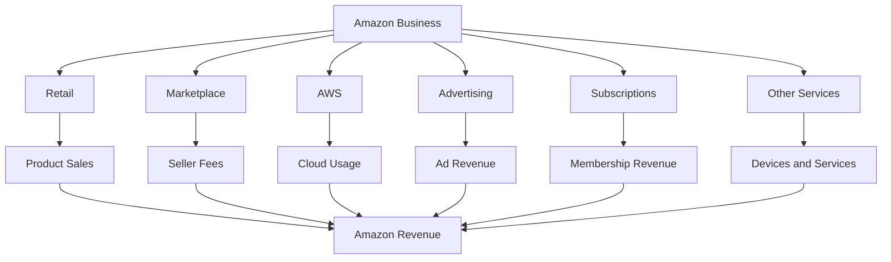

## 5.8 The Flywheel Model

Amazon's business is often explained through its flywheel.

The flywheel describes how one improvement can reinforce other parts of the business.

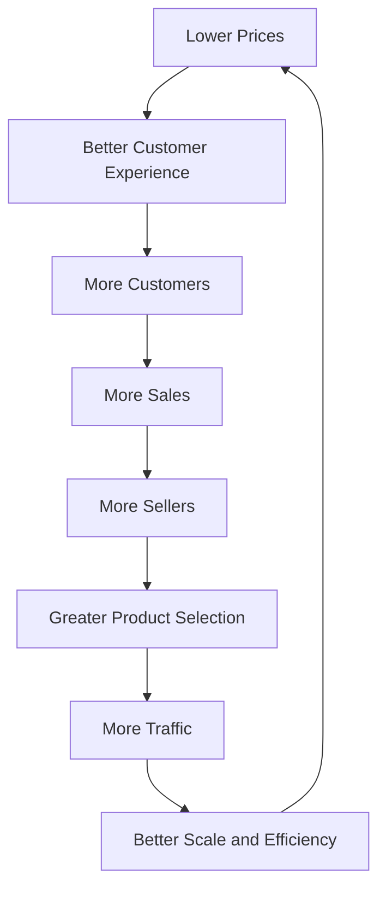

### How the flywheel works

1. Competitive prices attract customers.
2. More customers generate more transactions.
3. More transactions attract sellers.
4. More sellers increase product selection.
5. Greater selection attracts more customers.
6. Scale can improve logistics and operational efficiency.
7. Efficiency can support competitive pricing.

The flywheel is a strategic model, not a guarantee that every part of the business improves automatically.

---

# 6. Financial Analysis

Amazon's financial performance demonstrates the importance of scale, cloud infrastructure and operational efficiency.

## 6.1 FY2025 Financial Performance

Amazon's financial year ended December 31, 2025.

| Financial Metric | FY2025 |
|---|---:|
| Net Sales | $716.9 billion |
| Operating Income | $80.0 billion |
| Operating Margin | 11.2% |
| Net Income | $77.7 billion |
| Diluted EPS | $7.17 |
| Operating Cash Flow | $139.5 billion |
| Free Cash Flow | $11.2 billion |

Source: Amazon 2025 Form 10-K and annual earnings release.

## 6.2 FY2024 vs FY2025

| Metric | FY2024 | FY2025 |
|---|---:|---:|
| Net Sales | $638.0B | $716.9B |
| Operating Income | $68.6B | $80.0B |
| Operating Margin | 10.8% | 11.2% |
| Net Income | $59.2B | $77.7B |
| Operating Cash Flow | $115.9B | $139.5B |
| Free Cash Flow | $38.2B | $11.2B |

### Revenue chart

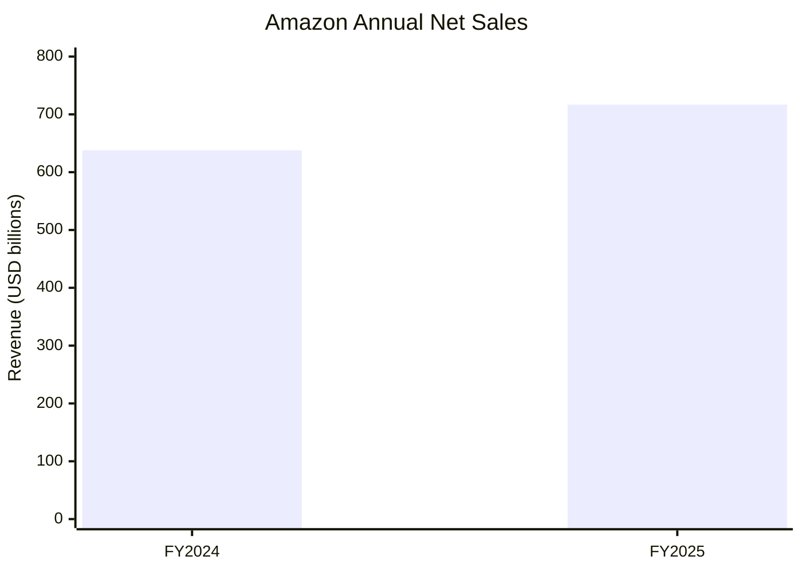

### Operating income chart

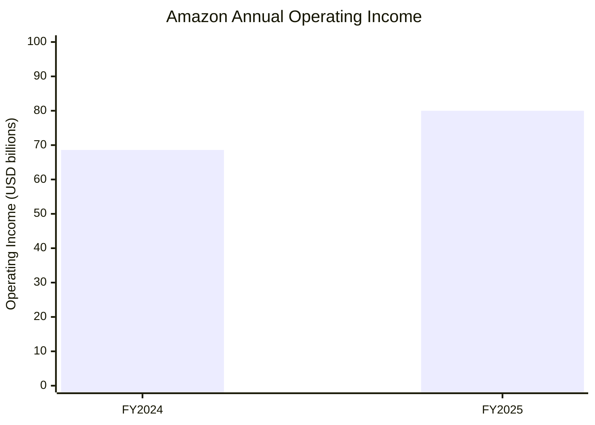

### Financial interpretation

Three important observations:

1. Revenue increased approximately 12%.
2. Operating income increased approximately 17%.
3. Free cash flow decreased significantly.

The free cash flow decline was primarily associated with increased purchases of property and equipment, particularly investments in AI infrastructure.

This illustrates why revenue growth and operating income alone do not fully explain a company's cash position.

## 6.3 Revenue by Segment – FY2025

| Segment | Revenue |
|---|---:|
| North America | $426.3B |
| International | $161.9B |
| AWS | $128.7B |
| Total | $716.9B |

### Segment revenue chart

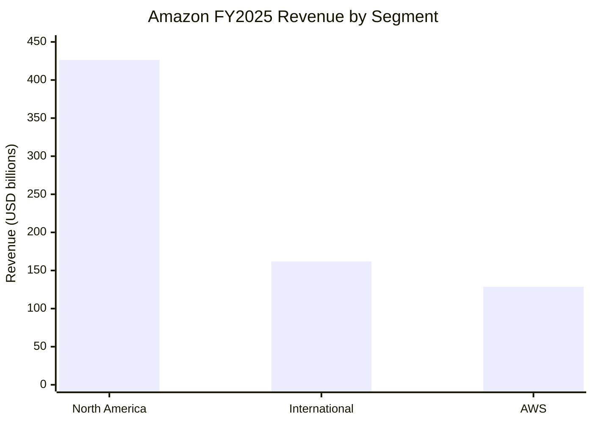

## 6.4 Operating Income by Segment – FY2025

| Segment | Operating Income |
|---|---:|
| North America | $29.6B |
| International | $4.8B |
| AWS | $45.6B |
| Total | $80.0B |

AWS contributed approximately 57% of Amazon's consolidated operating income in FY2025.

This is important because AWS generates a larger share of operating profit than its share of consolidated revenue.

## 6.5 Q3 2026 Financial Performance

The latest reported quarter as of November 6, 2026, is Q3 2026.

**Reporting period:** July 1 – September 30, 2026.

**Announcement date:** October 29, 2026.

| Metric | Q3 2025 | Q3 2026 |
|---|---:|---:|
| Net Sales | $180.2B | $201.9B |
| Operating Income | $17.4B | $28.1B |
| Operating Margin | 9.7% | 13.9% |
| Net Income | $21.2B | $20.7B |
| Diluted EPS | $1.95 | $1.89 |

Revenue grew approximately 12% year over year.

Operating income increased substantially.

Net income declined slightly, primarily because Q3 2025 included significant non-operating gains from Amazon's investments in Anthropic.

## 6.6 Q3 2026 Revenue by Segment

| Segment | Q3 2025 | Q3 2026 |
|---|---:|---:|
| North America | $106.3B | $112.9B |
| International | $40.9B | $43.1B |
| AWS | $33.0B | $46.0B |
| Total | $180.2B | $201.9B |

### Q3 2026 segment revenue chart

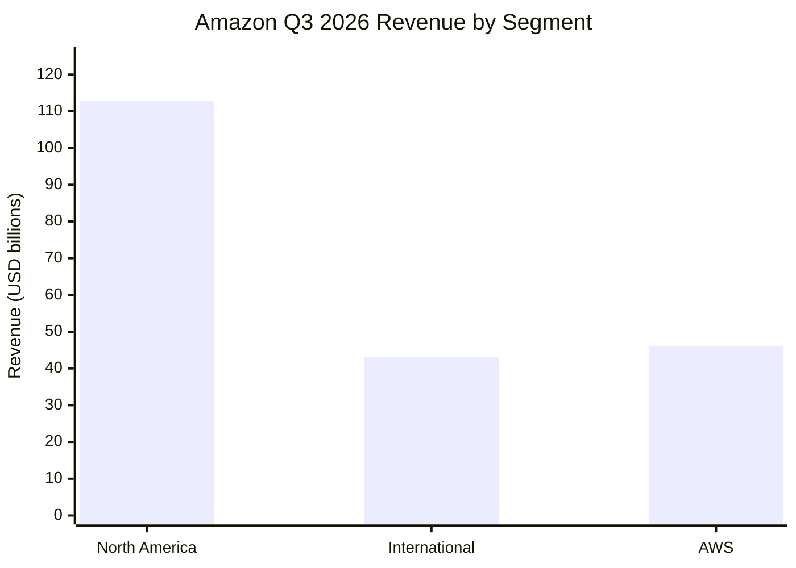

## 6.7 Q3 2026 Operating Income by Segment

| Segment | Operating Income |
|---|---:|
| North America | $8.7B |
| International | $1.6B |
| AWS | $17.8B |
| Total | $28.1B |

AWS generated approximately 63% of consolidated operating income in Q3 2026.

### Why AWS is important

AWS has a different economic structure from traditional retail.

Retail requires substantial spending on:

- Inventory.
- Fulfillment.
- Warehouses.
- Delivery.
- Returns.
- Customer service.

AWS sells technology infrastructure and managed services.

Its economics depend on infrastructure investment, utilization, pricing, operational efficiency and customer demand.

## 6.8 AWS Growth

| Metric | Q3 2025 | Q3 2026 |
|---|---:|---:|
| AWS Revenue | $33.0B | $46.0B |
| AWS Operating Income | $11.4B | $17.8B |

AWS revenue grew approximately 39.3% year over year.

Amazon reported an AWS annualized revenue run rate of approximately $184 billion.

## 6.9 Capital Expenditure and AI Investment

Amazon reported that trailing-twelve-month free cash flow declined to an outflow of $42.4 billion at the end of Q3 2026.

The decline was driven primarily by a year-over-year increase of $94.8 billion in purchases of property and equipment, net of sales and incentives.

Amazon attributed the increase primarily to AI investment.

These investments support:

- Data centers.
- Servers.
- Networking.
- AI accelerators.
- Power infrastructure.
- Cloud capacity.
- AI model training and inference.

### Financial lesson

Amazon is investing heavily in infrastructure because it expects future demand for AI and cloud computing to justify the investment.

However, high capital expenditure also increases financial risk if demand, utilization or returns do not develop as expected.

---

# 7. Artificial Intelligence Strategy


AI is one of Amazon's most important long-term technology priorities.

Amazon applies AI across two major areas:

1. AI for Amazon's own business operations.
2. AI products and infrastructure sold to external customers.

## 7.1 Two Sides of Amazon's AI Business

| Internal AI | External AI |
|---|---|
| Product recommendations | Amazon Bedrock |
| Demand forecasting | Amazon Nova |
| Warehouse robotics | SageMaker AI |
| Delivery optimization | Trainium |
| Alexa | AgentCore |
| Fraud detection | AI APIs |
| Inventory management | Enterprise AI services |
| Advertising optimization | Managed AI infrastructure |

## 7.2 Amazon's AI Strategy – Seven Layers

| Layer | Purpose |
|---|---|
| AI Research | Develop models and technologies |
| Foundation Models | Nova and third-party models |
| Custom Hardware | Trainium and Inferentia |
| Cloud Infrastructure | AWS data centers and networking |
| AI Platforms | Bedrock and SageMaker AI |
| Agent Infrastructure | Bedrock AgentCore and agent tools |
| Applications | Shopping, Alexa, advertising and enterprise AI |

## 7.3 Amazon Nova

Amazon Nova is Amazon's family of foundation models.

It supports generative AI applications across text, image, audio and video-related tasks, depending on the model.

## 7.4 Amazon Bedrock

Amazon Bedrock is a managed service for building generative AI applications.

Developers can access supported foundation models through a unified platform.

Its capabilities include:

- Model access.
- Inference.
- Knowledge bases.
- Guardrails.
- Model evaluation.
- Agent development.
- Enterprise integration.

## 7.5 Amazon SageMaker AI

SageMaker AI provides infrastructure and tools for machine learning development.

It supports:

- Data preparation.
- Model training.
- Model tuning.
- Deployment.
- Model monitoring.
- ML workflows.

## 7.6 Amazon Bedrock AgentCore

AgentCore provides infrastructure for developing and running AI agents.

It supports agent-related capabilities such as:

- Runtime.
- Identity and access.
- Tool integration.
- Memory.
- Observability.
- Security controls.

It helps developers move agent applications from prototypes toward production environments.

## 7.7 Amazon's Custom AI Chips

Amazon develops its own AI processors.

| Chip Family | Purpose |
|---|---|
| Trainium | AI model training |
| Inferentia | AI inference |
| Graviton | General-purpose cloud computing |

These processors help AWS offer differentiated computing infrastructure.

## 7.8 AI Strategy Architecture

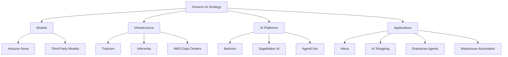

### Why Amazon's strategy matters

Amazon is not relying on one model.

It is building a platform where customers can choose models, run them on AWS infrastructure and connect them to business applications.

This creates opportunities to earn revenue from infrastructure, model services, data services and enterprise applications.

---

# 8. Real-World AI Implementations

This section examines how Amazon uses AI in its actual products and operations.

## 8.1 AI Product Recommendations

Amazon uses machine learning to personalize product discovery.

Recommendations may use signals such as:

- Product views.
- Purchases.
- Search activity.
- Product relationships.
- Shopping preferences.
- Availability.

### Recommendation workflow

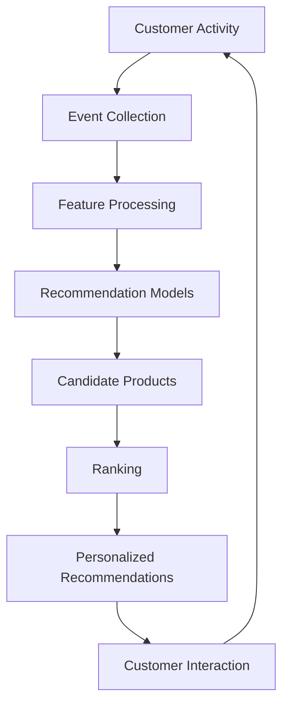

This is a conceptual recommendation architecture, not a disclosure of Amazon's proprietary ranking algorithms.

## 8.2 AI-Powered Shopping – Rufus and Alexa for Shopping

Amazon has developed conversational shopping experiences.

These systems help customers discover products and interact with shopping services.

Examples of tasks include:

- Finding suitable products.
- Comparing products.
- Understanding product characteristics.
- Getting shopping suggestions.
- Managing shopping-related tasks.
- Receiving recommendations.

Amazon's Q3 2026 update reported rapid adoption of Alexa for Shopping, with more than 400 million customers using it over the previous 12 months.

Amazon also reported that customer interactions had increased 570% year over year.

## 8.3 AI in Warehouse Operations


Amazon uses automation and robotics in fulfillment operations.

AI and machine learning can support:

- Inventory placement.
- Product identification.
- Package sorting.
- Warehouse routing.
- Demand forecasting.
- Robotic movement.
- Operational planning.

### Warehouse workflow

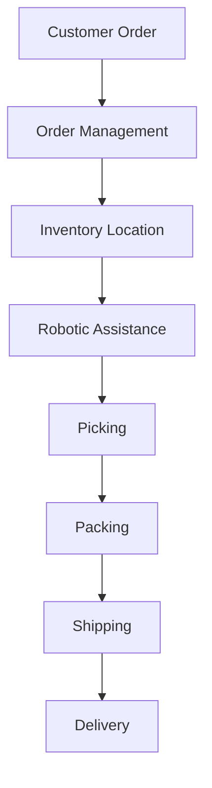

## 8.4 Demand Forecasting

Amazon must predict demand across many product categories.

Machine learning can help estimate:

- Which products customers may purchase.
- How much inventory is needed.
- Where inventory should be located.
- Seasonal demand.
- Regional product demand.

### Example

If demand for air conditioners is expected to increase in a particular region, forecasting systems can help Amazon plan inventory and logistics capacity.

## 8.5 Fraud Detection

AI can help detect suspicious activity.

Potential signals include:

- Unusual transaction patterns.
- Account behavior.
- Payment anomalies.
- Abnormal order patterns.
- Suspicious seller activity.

These systems can support fraud prevention and risk management.

## 8.6 AI in Advertising

Amazon Ads uses data and machine learning to support:

- Audience selection.
- Campaign optimization.
- Advertising recommendations.
- Performance measurement.
- Creative assistance.

In Q3 2026, Amazon announced Amazon Ads Agent, an AI-first platform designed to help advertisers analyze campaigns and take actions through conversational workflows.

## 8.7 Alexa and Voice AI

Alexa processes voice interactions and connects them to supported services.

Common applications include:

- Music playback.
- Smart-home control.
- Reminders.
- Questions and answers.
- Shopping.
- Device management.

Amazon has continued expanding Alexa+ and agentic experiences.

## 8.8 Amazon Pharmacy

Amazon applies technology to pharmacy operations and delivery.

Its Q3 2026 update reported that three-hour prescription delivery was available in more than 350 cities.

The company also reported growth in Amazon Pharmacy customers.

This is an example of how Amazon combines digital services with physical logistics.

## 8.9 Zoox – Autonomous Transportation

Zoox is an Amazon-owned autonomous mobility company.

Its autonomous vehicles combine:

- Cameras.
- LiDAR.
- Radar.
- Computer vision.
- Sensor fusion.
- Prediction.
- Motion planning.
- Vehicle control.

Amazon's Q3 2026 update reported paid robotaxi rides in Las Vegas and testing in other US cities.

### Autonomous driving workflow

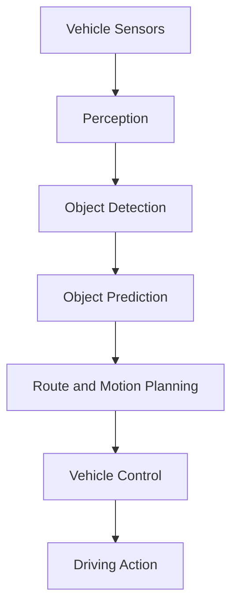

---

# 9. Amazon's Major AI Platforms – Nova, Bedrock and AgentCore

This is one of the most important sections of the Amazon case study.

## 9.1 Amazon Nova

Amazon Nova is a family of foundation models developed by Amazon.

It is designed to support generative AI applications.

Depending on the model, use cases include:

- Text generation.
- Summarization.
- Reasoning.
- Image generation.
- Audio processing.
- Video understanding.
- Multimodal applications.

### Nova model ecosystem

Amazon's model family has included different model categories and capabilities.

| Model Category | Typical Use |
|---|---|
| Nova Micro | Low-latency text workloads |
| Nova Lite | Cost-efficient multimodal workloads |
| Nova Pro | More complex multimodal tasks |
| Nova Premier | Advanced model workloads |
| Nova Canvas | Image generation |
| Nova Reel | Video generation |
| Nova Sonic | Speech and audio interactions |

Model names, availability and specifications change over time. Check current AWS documentation before implementing a particular model.

## 9.2 Amazon Bedrock

Bedrock provides access to foundation models through AWS.

A developer can use supported models without managing all the underlying model-serving infrastructure.

### What Bedrock provides

- Model access.
- Managed inference.
- Model selection.
- Knowledge bases.
- Guardrails.
- Agents.
- Evaluation.
- Enterprise integrations.

### Example

A company wants to build a customer support assistant.

Instead of training a foundation model from scratch, it can:

1. Select a supported model.
2. Connect company documents.
3. Configure a knowledge base.
4. Add retrieval.
5. Apply guardrails.
6. Build an application.
7. Monitor performance.

## 9.3 Amazon Bedrock Knowledge Bases

Knowledge Bases help developers build retrieval-augmented generation applications.

A typical workflow:

1. Upload documents.
2. Split documents into chunks.
3. Generate embeddings.
4. Store embeddings in a supported vector store.
5. Retrieve relevant information.
6. Send the context to a foundation model.
7. Generate an answer.

## 9.4 Amazon Bedrock Agents

Agents can perform multi-step tasks using tools and connected systems.

For example, a travel support agent might:

- Search booking information.
- Retrieve customer details.
- Check policies.
- Call approved APIs.
- Prepare a response.

Important actions should be governed by authorization, validation and human approval where appropriate.

## 9.5 Amazon Bedrock AgentCore

AgentCore is designed to support production AI agents.

It helps developers handle:

- Agent execution.
- Tool access.
- Identity.
- Memory.
- Observability.
- Security.
- Runtime management.

Amazon's Q3 2026 update reported tens of thousands of customers using AgentCore and significant growth in deployed agents.

## 9.6 AWS Strands

Strands is an open-source agent-building framework from AWS.

It provides tools for developers building agents using models and connected tools.

Amazon also announced Strands Box, an open-source sandbox concept intended to help enforce agent behavior and access rules.

## 9.7 OpenAI and Amazon Partnership

On February 27, 2026, Amazon and OpenAI announced a strategic partnership.

The announcement included:

- A planned stateful runtime environment using OpenAI models through Bedrock.
- AWS as the exclusive third-party cloud distribution provider for OpenAI Frontier.
- An announced $50 billion Amazon investment in OpenAI, with conditions attached to portions of the investment.
- Expanded Trainium capacity commitments.
- Joint work on customized models for Amazon applications.

These are partnership announcements and forward-looking commitments; planned delivery dates and investment conditions should not be treated as completed outcomes without further confirmation.

## 9.8 Conceptual Bedrock Architecture

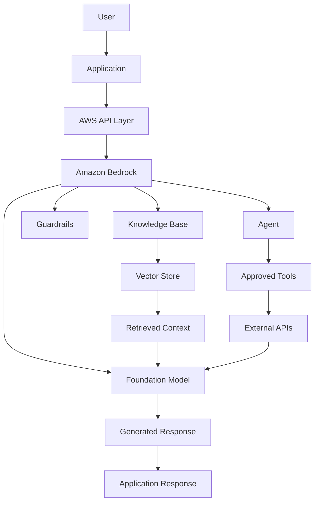

This is an educational reference architecture, not a diagram of Amazon's proprietary internal service implementation.

---

# 10. AI Work Model

How does Amazon use AI across its business?

Its AI work model can be understood through six layers.

## Layer 1 – Data Collection

Amazon receives information from many systems.

Examples:

- Product searches.
- Shopping activity.
- Product listings.
- Orders.
- Payments.
- Inventory.
- Delivery operations.
- Seller activity.
- Customer service.
- AWS workloads.

Data collection and use are governed by applicable privacy settings, policies and legal requirements.

## Layer 2 – Data Processing

Information is cleaned, transformed and prepared for analysis.

Possible technologies include:

- Distributed processing.
- Data pipelines.
- Event streaming.
- Data warehouses.
- Feature engineering.
- Data validation.
- Data lakes.

## Layer 3 – AI Model Development

Amazon develops and uses models for different purposes.

Examples:

- Product recommendation.
- Demand forecasting.
- Fraud detection.
- Natural language understanding.
- Image recognition.
- Speech recognition.
- Generative AI.
- Autonomous driving.

## Layer 4 – Model Training

Models learn patterns from suitable training data.

Training requires:

- Data preparation.
- Hardware acceleration.
- Model architecture.
- Optimization.
- Evaluation.
- Experiment tracking.

## Layer 5 – Model Inference

A trained model is deployed to process new requests.

Example:

A customer asks Alexa for help finding a gift.

The AI system interprets the request and may retrieve products or execute supported shopping workflows.

## Layer 6 – Business Action

AI output becomes useful when connected to an actual workflow.

Examples:

- Product recommendations.
- Shopping assistance.
- Inventory planning.
- Delivery optimization.
- Customer support.
- Fraud detection.
- Warehouse robotics.

## Overall AI workflow

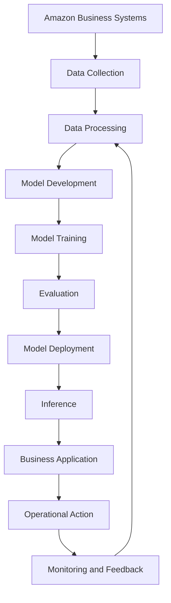

## Example: AI Shopping Assistant

1. Customer asks a shopping question.
2. The application interprets the request.
3. The system retrieves relevant product information.
4. A model generates a recommendation.
5. The application presents the result.
6. Customer chooses whether to purchase.

## Example: AI Warehouse Planning

1. Orders enter the system.
2. Inventory information is checked.
3. Demand forecasts are updated.
4. Warehouse tasks are prioritized.
5. Robots and employees complete tasks.
6. Delivery systems receive packages.
7. Operational data improves future planning.

**Important:** This is a generalized operating model. Amazon does not publicly disclose every internal model, dataset, training pipeline or decision algorithm.

---

# 11. Technology Architecture

Amazon operates a large technology ecosystem supporting retail, logistics, cloud computing, advertising and entertainment.

Its systems must support:

- High transaction volume.
- Global customer traffic.
- Payment processing.
- Inventory management.
- Distributed databases.
- Real-time order updates.
- Large-scale AI inference.
- Cloud infrastructure.

## 11.1 Technology Stack Map

The following is a practical map of public AWS technologies and commonly documented engineering technologies. It is not a verified inventory of every internal Amazon production system.

| Layer | Technologies |
|---|---|
| Programming | Java, Python, C++, Go, JavaScript |
| Frontend | JavaScript, TypeScript, Web Technologies |
| Backend | Distributed Services, APIs |
| Cloud | AWS |
| Compute | EC2, ECS, EKS, Lambda |
| Storage | S3, EBS, EFS |
| Databases | DynamoDB, Aurora, RDS |
| Data Warehouse | Redshift |
| Analytics | Athena, Glue, EMR |
| AI Platform | Bedrock, SageMaker AI |
| AI Models | Amazon Nova and supported third-party models |
| AI Hardware | Trainium, Inferentia |
| Containers | Docker, Kubernetes |
| Networking | VPC, Route 53, CloudFront |
| Security | IAM, KMS, Security Hub |
| Monitoring | CloudWatch, CloudTrail |
| Messaging | SQS, SNS, EventBridge |
| Streaming | Kinesis, MSK |

## 11.2 Amazon's Distributed Architecture

A simplified architecture for a large e-commerce application:

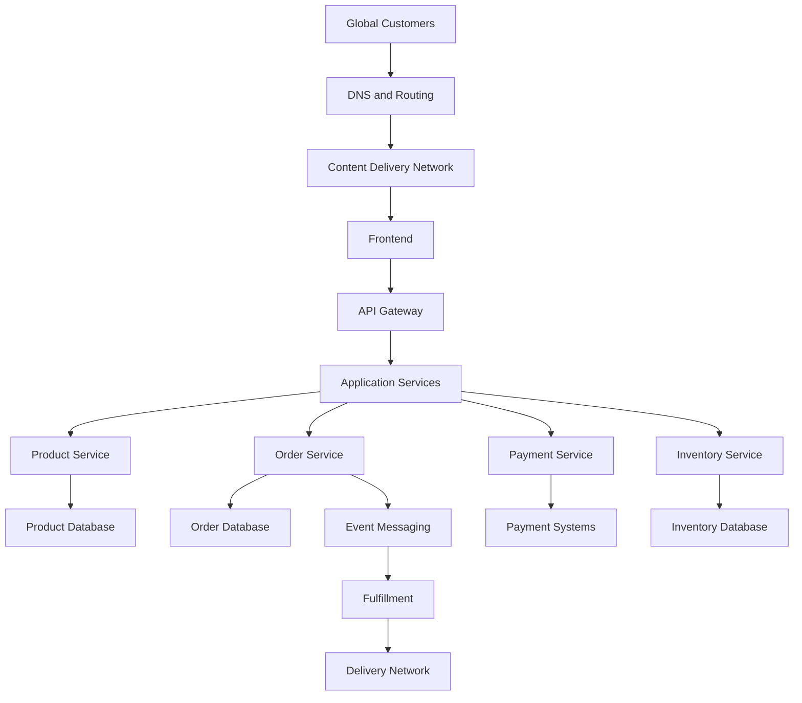

## 11.3 Microservices Architecture

Large applications can be divided into independent services.

For example:

- User service.
- Product service.
- Search service.
- Cart service.
- Payment service.
- Order service.
- Inventory service.
- Delivery service.

Each service has a defined responsibility.

This allows teams to develop, deploy and scale services independently.

## 11.4 Event-Driven Architecture

Amazon-style commerce applications can use events to connect services.

Example:

When a customer places an order:

1. Order service creates an order.
2. An order-created event is published.
3. Payment service processes payment.
4. Inventory service reserves stock.
5. Fulfillment service receives the order.
6. Notification service sends updates.

## 11.5 Example Event Workflow

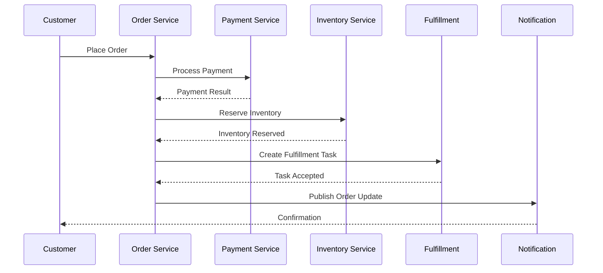

This is an educational workflow. Real systems require additional handling for retries, duplicate events, cancellations, refunds and partial failures.

---

# 12. Data Engineering and Cloud

AWS is one of Amazon's most important businesses.

It provides infrastructure and managed services for data engineering, application development and AI.

## 12.1 Amazon Web Services

AWS provides services for:

- Compute.
- Storage.
- Databases.
- Networking.
- Security.
- Analytics.
- Machine learning.
- Generative AI.
- Serverless applications.
- Application integration.

## 12.2 Core AWS Services

| Service | Purpose |
|---|---|
| EC2 | Virtual machines |
| S3 | Object storage |
| RDS | Managed relational databases |
| Aurora | Managed relational database engine |
| DynamoDB | NoSQL database |
| Lambda | Serverless functions |
| ECS | Container orchestration |
| EKS | Managed Kubernetes |
| VPC | Private networking |
| IAM | Access management |
| CloudFront | Content delivery |
| Route 53 | DNS |
| SQS | Message queue |
| SNS | Notifications |
| EventBridge | Event routing |
| CloudWatch | Monitoring |
| CloudTrail | API activity auditing |

## 12.3 AWS Data Engineering Services

| Service | Purpose |
|---|---|
| S3 | Data lake storage |
| Glue | Data integration and ETL |
| EMR | Big data processing |
| Athena | SQL queries on data |
| Redshift | Data warehouse |
| Kinesis | Streaming data |
| MSK | Managed Kafka |
| Lake Formation | Data lake governance |
| Data Firehose | Data delivery |
| Step Functions | Workflow orchestration |

## 12.4 Amazon S3

S3 is an object storage service.

Companies use it to store:

- CSV files.
- JSON files.
- Images.
- Videos.
- Logs.
- Backups.
- Data lake datasets.
- Machine learning data.

## 12.5 AWS Glue

AWS Glue is a managed data integration service.

It supports:

- Data discovery.
- ETL.
- Schema management.
- Data cataloging.
- Job orchestration.

## 12.6 Amazon Redshift

Redshift is a cloud data warehouse.

It supports analytical queries over large datasets.

Example:

```sql
SELECT
    DATE_TRUNC('month', order_date) AS month,
    COUNT(DISTINCT order_id) AS total_orders,
    SUM(order_amount) AS total_revenue
FROM orders
GROUP BY DATE_TRUNC('month', order_date)
ORDER BY month;
```

## 12.7 Amazon Athena

Athena allows users to run SQL queries over data stored in S3.

It is useful for analyzing logs, CSV files, JSON data and other supported formats without operating a traditional database server.

## 12.8 Data Engineering Pipeline

Suppose an e-commerce business collects information from:

- Website activity.
- Mobile applications.
- Customer orders.
- Payments.
- Inventory.
- Delivery systems.

A possible architecture:

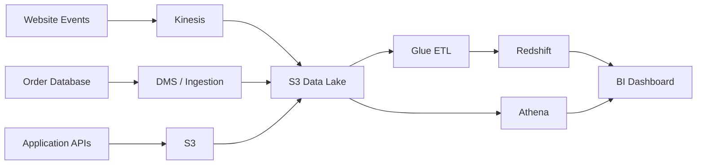

## 12.9 Example Database Design

An e-commerce analytics application might use these tables.

### customers

| Column | Type |
|---|---|
| customer_id | BIGINT |
| customer_name | VARCHAR |
| email | VARCHAR |
| registration_date | DATE |

### products

| Column | Type |
|---|---|
| product_id | BIGINT |
| product_name | VARCHAR |
| category | VARCHAR |
| price | DECIMAL |

### orders

| Column | Type |
|---|---|
| order_id | BIGINT |
| customer_id | BIGINT |
| order_date | TIMESTAMP |
| order_status | VARCHAR |

### order_items

| Column | Type |
|---|---|
| item_id | BIGINT |
| order_id | BIGINT |
| product_id | BIGINT |
| quantity | INT |
| unit_price | DECIMAL |

### SQL example

Find the five highest-revenue product categories.

```sql
SELECT
    p.category,
    SUM(oi.quantity * oi.unit_price) AS total_revenue
FROM order_items oi
JOIN products p
    ON oi.product_id = p.product_id
GROUP BY p.category
ORDER BY total_revenue DESC
LIMIT 5;
```

## 12.10 Why Data Engineering Matters at Amazon

Amazon needs large-scale data infrastructure for:

- Shopping.
- Recommendations.
- Advertising.
- Payments.
- Inventory.
- Delivery.
- Seller analytics.
- AWS.
- AI model training.

Data engineering makes it possible to collect, process, store and analyze information reliably.

---

# 13. AI, Robotics, Automation and Logistics


Amazon's competitive advantage is not limited to software.

Its physical infrastructure is equally important.

The company operates warehouses, sorting centers, delivery stations, transportation networks and other logistics facilities.

## 13.1 Fulfillment Centers

Fulfillment centers store products and process orders.

The main operations include:

1. Receiving inventory.
2. Storing products.
3. Picking products.
4. Packing orders.
5. Sorting packages.
6. Dispatching shipments.

## 13.2 Amazon Robotics

Amazon uses robotics to support warehouse operations.

Robotic systems can help move inventory, transport shelves or containers and support repetitive fulfillment tasks.

### Why robotics?

- Reduce repetitive manual movement.
- Improve operational efficiency.
- Increase warehouse throughput.
- Support inventory movement.
- Improve workflow consistency.

Robots do not eliminate the need for human employees. Human workers remain important for exceptions, maintenance, safety, judgment and many physical tasks.

## 13.3 Sequoia and Robotics Systems

Amazon has announced multiple robotics systems for fulfillment operations.

Examples include:

- Mobile robotic systems.
- Robotic arms.
- Automated sorting.
- Computer vision systems.
- Inventory movement technology.

The exact systems deployed vary by facility and operational requirements.

## 13.4 AI in Inventory Management

Amazon must determine:

- Which products need replenishment.
- Where products should be stored.
- How much inventory should be held.
- Which fulfillment center should serve an order.
- How to reduce delivery distance.

Machine learning can help forecast demand and optimize inventory placement.

## 13.5 Delivery Optimization

Amazon's logistics network includes:

- Fulfillment centers.
- Sortation centers.
- Delivery stations.
- Transportation systems.
- Delivery partners.
- Last-mile delivery.

AI and optimization algorithms can support route planning and package allocation.

## 13.6 Delivery Workflow

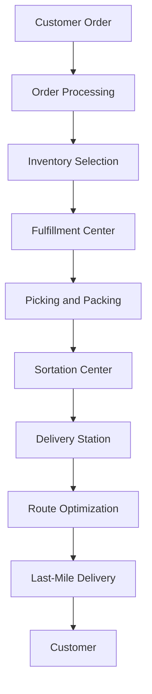

## 13.7 Amazon Leo

Amazon Leo is Amazon's low Earth orbit satellite connectivity initiative.

It is designed to provide broadband connectivity through a satellite network.

Amazon's Q3 2026 update reported that nearly 400 satellites had been launched across 14 missions and that the company remained on track for initial service later in 2026.

These are company-reported deployment and forward-looking service plans.

## 13.8 Zoox

Zoox is Amazon's autonomous mobility business.

It develops purpose-built autonomous vehicles and a robotaxi service.

Its technology involves:

- Autonomous perception.
- Sensor fusion.
- Machine learning.
- Motion planning.
- Real-time systems.
- Vehicle engineering.

## 13.9 Physical AI

Amazon's investments show how AI can move beyond screens and software.

Physical AI connects machine intelligence with real-world systems.

Examples include:

- Warehouse robots.
- Autonomous vehicles.
- Smart devices.
- Delivery systems.
- Industrial automation.

### Engineering skills involved

- Python and C++.
- Robotics.
- Computer Vision.
- Machine Learning.
- ROS concepts.
- Sensor Fusion.
- Control Systems.
- Embedded Systems.
- Distributed Computing.

---

# 14. Competitor Analysis

Amazon competes across several industries.

It does not have a single competitor.

| Competitor | Main Competition Area |
|---|---|
| Walmart | Retail and grocery |
| Alibaba | E-commerce and cloud |
| Microsoft | Cloud and enterprise technology |
| Google | Cloud, advertising and AI |
| NVIDIA | AI computing infrastructure |
| Shopify | E-commerce infrastructure |
| Flipkart | Indian e-commerce |
| Temu | Online retail |
| Netflix | Streaming |
| Microsoft Azure | Cloud computing |
| Google Cloud | Cloud computing |
| Oracle | Enterprise cloud and databases |

## 14.1 Amazon vs Walmart

| Area | Amazon | Walmart |
|---|---|---|
| Main Strength | E-commerce and technology | Physical retail and grocery |
| Online Shopping | Major platform | Major platform |
| Physical Stores | Growing physical presence | Large store network |
| Cloud | AWS | Not a comparable core cloud business |
| Advertising | Amazon Ads | Walmart Connect |
| Logistics | Fulfillment and delivery network | Store-based and distribution network |
| Subscription | Prime | Walmart+ |

### Competitive advantage

Amazon has a strong online marketplace, technology platform and cloud business.

Walmart has a large physical retail footprint and grocery presence.

## 14.2 Amazon vs Microsoft Azure

| Area | AWS | Microsoft Azure |
|---|---|---|
| Cloud Compute | EC2 | Azure Virtual Machines |
| Object Storage | S3 | Blob Storage |
| Database | RDS, DynamoDB | Azure SQL, Cosmos DB |
| AI Platform | Bedrock, SageMaker AI | Azure AI services |
| Containers | ECS, EKS | AKS |
| Serverless | Lambda | Azure Functions |
| Enterprise Ecosystem | AWS partners | Microsoft enterprise ecosystem |

### Competitive advantage

AWS has a broad cloud service portfolio and extensive infrastructure.

Azure benefits from Microsoft's enterprise relationships and software ecosystem.

## 14.3 Amazon vs Google Cloud

| Area | AWS | Google Cloud |
|---|---|---|
| Compute | EC2 | Compute Engine |
| Storage | S3 | Cloud Storage |
| Data Warehouse | Redshift | BigQuery |
| AI Platform | Bedrock | Vertex AI |
| Kubernetes | EKS | GKE |
| AI Chips | Trainium, Inferentia | TPU |
| Cloud Market | Large established platform | Growing enterprise platform |

## 14.4 Amazon vs Alibaba

| Area | Amazon | Alibaba |
|---|---|---|
| E-commerce | Amazon Stores | Taobao, Tmall |
| Cloud | AWS | Alibaba Cloud |
| Logistics | Amazon logistics network | Cainiao ecosystem |
| Payments | Amazon payment services | Alipay ecosystem |
| AI | Nova, Bedrock | Qwen and AI services |
| Geography | Strong global presence | Strong China and Asia presence |

## 14.5 Competitive Positioning

Amazon's strongest advantages include:

- AWS.
- Global marketplace.
- Fulfillment infrastructure.
- Prime.
- Advertising.
- Custom AI chips.
- Seller ecosystem.
- Logistics technology.

Its biggest challenge is maintaining operational efficiency while investing heavily in AI, cloud infrastructure and global logistics.

---

# 15. SWOT Analysis

| Strengths | Weaknesses |
|---|---|
| Strong global brand | High infrastructure costs |
| AWS leadership | Complex operational structure |
| Large marketplace | Thin retail margins in many categories |
| Logistics infrastructure | Dependence on large fulfillment network |
| Prime ecosystem | Significant capital expenditure |
| AI and custom chips | Competition across many industries |
| Seller ecosystem | Regulatory scrutiny |

| Opportunities | Threats |
|---|---|
| Enterprise AI | Microsoft and Google Cloud |
| Agentic AI | New AI infrastructure competitors |
| AWS expansion | Cloud pricing competition |
| AI shopping | Search and retail behavior changes |
| Robotics | Automation investment risk |
| Amazon Leo | Satellite connectivity competition |
| Healthcare and grocery | Regulatory pressure |
| Advertising | Retail advertising competition |

## Strategic interpretation

Amazon's strongest advantage is its combination of technology and physical operations.

AWS provides high-value cloud infrastructure.

Retail creates a large customer and seller ecosystem.

Logistics supports customer convenience.

AI can improve both businesses and create new products.

However, Amazon must manage significant capital expenditure, competition and operational complexity.

---

# 16. Challenges and Risks

## 16.1 Competition

Amazon competes with:

- Walmart.
- Alibaba.
- Microsoft.
- Google.
- NVIDIA.
- Shopify.
- Netflix.
- Other retailers and cloud providers.

It must continuously improve price, selection, convenience and technology.

## 16.2 AWS Infrastructure Costs

Cloud computing requires investment in:

- Data centers.
- Servers.
- Networking.
- Storage.
- Power.
- Cooling.
- Custom chips.

High infrastructure spending can create financial pressure.

## 16.3 AI Capital Expenditure

AI workloads require expensive computing resources.

Amazon must balance investment with future customer demand and utilization.

## 16.4 Labor and Workplace Safety

Large fulfillment and logistics operations create responsibilities around:

- Employee safety.
- Training.
- Working conditions.
- Automation.
- Operational standards.

## 16.5 Data Privacy

Amazon processes information related to customers, sellers and enterprise workloads.

It must maintain appropriate security, privacy and access controls.

## 16.6 Counterfeit and Unsafe Products

Marketplaces need systems to detect:

- Counterfeit products.
- Fraudulent sellers.
- Misleading listings.
- Unsafe products.
- Policy violations.

## 16.7 Regulatory Pressure

Amazon faces regulatory scrutiny related to:

- Competition.
- Marketplace practices.
- Advertising.
- Consumer protection.
- Data use.
- Labor.
- International operations.

## 16.8 AI Reliability and Security

AI systems can:

- Generate incorrect information.
- Expose sensitive data if poorly configured.
- Execute unintended tool actions.
- Produce biased outputs.
- Create security vulnerabilities.

Enterprise AI requires:

- Access controls.
- Evaluation.
- Monitoring.
- Guardrails.
- Human oversight.
- Auditability.

## 16.9 Free Cash Flow and Investment Risk

Amazon's Q3 2026 trailing-twelve-month free cash flow was negative $42.4 billion.

The company attributed the change primarily to increased capital expenditure, especially AI investment.

The long-term return on these investments remains an important financial question.

---

# 17. Future Strategy

Based on Amazon's public announcements, products and investments, its future strategy focuses on several areas.

## 17.1 AWS Expansion

AWS is expected to remain a major growth engine.

Potential growth areas include:

- AI infrastructure.
- Enterprise cloud.
- Data analytics.
- Serverless computing.
- Managed databases.
- AI model deployment.

## 17.2 Custom AI Chips

Amazon is continuing to invest in Trainium and Inferentia.

The goal is to provide customers with more options for AI training and inference.

## 17.3 Agentic AI

Amazon is expanding agentic AI across:

- Bedrock.
- AgentCore.
- Alexa.
- Shopping.
- Advertising.
- Developer tools.
- Enterprise workflows.

## 17.4 Amazon Shopping

Amazon is improving the shopping experience through:

- Conversational discovery.
- AI-powered product recommendations.
- Automated shopping workflows.
- Better seller tools.
- Faster delivery.

## 17.5 Logistics Automation

Amazon will likely continue investing in:

- Robotics.
- Warehouse automation.
- Inventory planning.
- Delivery optimization.
- Transportation technology.

## 17.6 Amazon Leo

Amazon Leo represents a long-term opportunity to expand connectivity services.

Its success depends on satellite deployment, regulatory approvals, service economics and customer adoption.

## 17.7 Zoox

Zoox is developing autonomous transportation services.

Autonomous mobility could create new opportunities in urban transportation if the technology and business model scale successfully.

## 17.8 Healthcare and Grocery

Amazon is expanding into high-frequency consumer categories.

These businesses can increase customer engagement and create additional service revenue.

## Future strategy visualization

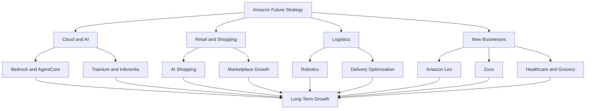

---

# 18. Career Opportunities

Amazon hires across software engineering, cloud computing, AI, data engineering, security, operations and infrastructure.

## 18.1 Software Development Engineer (SDE)

Responsibilities:

- Develop backend systems.
- Design APIs.
- Build distributed services.
- Solve engineering problems.
- Improve system reliability.
- Write production-quality code.

Required skills:

- Java, Python, C++ or similar languages.
- Data Structures and Algorithms.
- Object-Oriented Programming.
- Operating Systems.
- Computer Networks.
- Database Systems.
- System Design.

## 18.2 AI Engineer

Responsibilities:

- Develop AI applications.
- Integrate foundation models.
- Build RAG systems.
- Develop agents.
- Connect AI with business workflows.
- Evaluate model outputs.

Required skills:

- Python.
- LLMs.
- Prompt Engineering.
- RAG.
- Vector Databases.
- APIs.
- AI Evaluation.
- Agent Frameworks.

## 18.3 Machine Learning Engineer

Responsibilities:

- Develop ML pipelines.
- Train models.
- Optimize inference.
- Deploy ML systems.
- Monitor performance.

Required skills:

- Python.
- PyTorch.
- TensorFlow.
- Statistics.
- Machine Learning.
- Deep Learning.
- MLOps.
- Distributed Computing.

## 18.4 Data Engineer

Responsibilities:

- Build ETL pipelines.
- Process large datasets.
- Develop data warehouses.
- Manage data quality.
- Build streaming systems.

Required skills:

- Python.
- SQL.
- Apache Spark.
- AWS Glue.
- S3.
- Redshift.
- Kinesis.
- Airflow.
- Data Modeling.

## 18.5 Cloud Engineer

Responsibilities:

- Deploy applications.
- Configure AWS services.
- Manage networking.
- Implement security.
- Automate infrastructure.
- Monitor cloud systems.

Required skills:

- AWS.
- Linux.
- Docker.
- Kubernetes.
- VPC.
- IAM.
- CI/CD.
- Infrastructure as Code.

## 18.6 DevOps Engineer

Responsibilities:

- Build deployment pipelines.
- Manage containers.
- Automate infrastructure.
- Monitor services.
- Improve reliability.

Required skills:

- Linux.
- Docker.
- Kubernetes.
- Git.
- GitHub Actions.
- Jenkins.
- Terraform.
- AWS.
- Monitoring.

## 18.7 Site Reliability Engineer

Responsibilities:

- Maintain system availability.
- Investigate incidents.
- Automate operations.
- Improve performance.
- Manage production reliability.

Required skills:

- Linux.
- Python or Go.
- Networking.
- Distributed Systems.
- Monitoring.
- Incident Management.
- Kubernetes.

## Career learning matrix

| Role | Important Skills |
|---|---|
| SDE | DSA, Java, Python, System Design |
| AI Engineer | Python, LLMs, RAG, Agents |
| ML Engineer | PyTorch, ML, MLOps |
| Data Engineer | SQL, Spark, Glue, Redshift |
| Cloud Engineer | AWS, Linux, Networking |
| DevOps Engineer | Docker, Kubernetes, CI/CD |
| SRE | Linux, Monitoring, Distributed Systems |
| Data Analyst | SQL, Python, QuickSight |

## Official career resources

- Amazon Jobs: https://www.amazon.jobs/
- AWS Training: https://skillbuilder.aws/
- AWS Documentation: https://docs.aws.amazon.com/
- AWS Architecture Center: https://aws.amazon.com/architecture/
- AWS Developer Center: https://aws.amazon.com/developer/

---

# 19. Engineering Project Ideas

The best way to understand Amazon's technology is to build applications inspired by its business and infrastructure.

Here are six projects.

## Project 1 – Amazon-Style E-commerce Platform

**Difficulty:** Advanced

### Problem

Build an online shopping platform that supports products, customers, orders and payments.

### Solution

Develop a full-stack e-commerce system with separate backend services.

### Technology

- Next.js.
- FastAPI.
- PostgreSQL.
- Redis.
- Docker.
- AWS EC2 or ECS.
- S3.

### Features

- User authentication.
- Product catalog.
- Search and filtering.
- Shopping cart.
- Checkout.
- Order management.
- Inventory management.
- Admin dashboard.

### Architecture

```mermaid
flowchart TD
    A["Customer"] --> B["Next.js Frontend"]
    B --> C["API Gateway"]

    C --> D["User Service"]
    C --> E["Product Service"]
    C --> F["Cart Service"]
    C --> G["Order Service"]

    D --> H["PostgreSQL"]
    E --> H
    F --> I["Redis"]
    G --> H

    G --> J["Payment Integration"]
    G --> K["Inventory Service"]
```

## Project 2 – AI Product Recommendation Engine

**Difficulty:** Advanced

### Problem

Customers often struggle to discover relevant products.

### Solution

Build a recommendation system using customer interactions and product information.

### Technology

- Python.
- Pandas.
- Scikit-learn.
- FastAPI.
- PostgreSQL.
- Redis.
- Next.js.

### Features

- Product similarity.
- Collaborative filtering.
- User activity tracking.
- Personalized recommendations.
- Popular products.
- Recommendation evaluation.

### Architecture

```mermaid
flowchart TD
    A["User Activity"] --> B["Event Collection"]
    B --> C["Data Processing"]
    C --> D["Recommendation Model"]

    D --> E["Product Ranking"]
    E --> F["Recommendation API"]
    F --> G["Frontend"]

    G --> H["User Interaction"]
    H --> B
```

## Project 3 – AWS Data Engineering Pipeline

**Difficulty:** Advanced

### Problem

An e-commerce company generates large amounts of order and customer data.

### Solution

Build a data pipeline using AWS.

### Technology

- Python.
- S3.
- AWS Glue.
- Athena.
- Redshift.
- QuickSight.
- SQL.

### Features

- Data ingestion.
- Data lake.
- ETL.
- Data validation.
- Data warehouse.
- Revenue analytics.
- Business dashboard.

### Architecture

```mermaid
flowchart TD
    A["Order Data"] --> B["Amazon S3"]
    C["Customer Data"] --> B
    D["Product Data"] --> B

    B --> E["AWS Glue"]
    E --> F["Redshift"]

    B --> G["Athena"]
    F --> H["QuickSight"]
    G --> H

    H --> I["Analytics Dashboard"]
```

## Project 4 – AI Customer Support Agent

**Difficulty:** Advanced

### Problem

Customer support teams receive repetitive questions about orders, refunds and product information.

### Solution

Build an AI agent that retrieves company policies and uses approved APIs to answer customer questions.

### Technology

- Python.
- FastAPI.
- Amazon Bedrock.
- Bedrock Knowledge Bases.
- PostgreSQL.
- Redis.
- Next.js.

### Features

- Document ingestion.
- RAG.
- Order lookup.
- Refund policy retrieval.
- Tool calling.
- Human handoff.
- Conversation history.
- Source citations.

### Architecture

```mermaid
flowchart TD
    A["Customer"] --> B["Chat Interface"]
    B --> C["FastAPI"]

    C --> D["Agent"]
    D --> E["Bedrock Model"]
    D --> F["Knowledge Base"]
    D --> G["Order API"]

    F --> H["Vector Store"]
    G --> I["Order Database"]

    E --> J["Response"]
    H --> E
    I --> E

    J --> K["Customer"]
```

## Project 5 – Warehouse Inventory Management System

**Difficulty:** Intermediate to Advanced

### Problem

Warehouses need to track products, inventory movement and order fulfillment.

### Solution

Build an inventory management platform with barcode scanning and stock alerts.

### Technology

- Python.
- FastAPI.
- PostgreSQL.
- Redis.
- React or Next.js.
- Docker.

### Features

- Product registration.
- Warehouse locations.
- Stock tracking.
- Inventory movement.
- Reorder alerts.
- Order allocation.
- Stock analytics.

## Project 6 – AI Logistics and Delivery Optimization

**Difficulty:** Advanced

### Problem

Delivery operations need to reduce travel distance and improve delivery efficiency.

### Solution

Build a route optimization system using geospatial data and optimization algorithms.

### Technology

- Python.
- FastAPI.
- PostgreSQL.
- PostGIS.
- Google Maps API or OpenStreetMap tools.
- OR-Tools.
- React.

### Features

- Delivery address management.
- Route planning.
- Vehicle capacity.
- Delivery time windows.
- Distance optimization.
- Route visualization.
- Delivery status tracking.

### Architecture

```mermaid
flowchart TD
    A["Delivery Orders"] --> B["Geocoding"]
    B --> C["Location Data"]
    C --> D["Optimization Engine"]

    D --> E["Vehicle Routes"]
    E --> F["Driver Application"]
    F --> G["Delivery Status"]

    G --> H["Operations Dashboard"]
```

---

# 20. Key Business Lessons

## Lesson 1 – Start With a Clear Customer Problem

Amazon began by improving how people could find and purchase books.

It expanded after establishing a customer-focused foundation.

## Lesson 2 – Think Long Term

Amazon has repeatedly invested in infrastructure before the full business opportunity became obvious.

AWS is a major example.

## Lesson 3 – Build Platforms, Not Just Products

Marketplace transformed Amazon into a platform connecting customers and independent sellers.

AWS did something similar for developers and enterprises.

## Lesson 4 – Infrastructure Can Become a Business

Amazon developed cloud infrastructure to support technology operations.

It eventually became AWS, a major external business.

## Lesson 5 – Operational Excellence Matters

Customer experience depends on more than a website.

It also depends on inventory, warehouses, packaging, transportation and delivery.

## Lesson 6 – Use Data to Improve Decisions

Data can improve:

- Recommendations.
- Demand forecasting.
- Inventory.
- Advertising.
- Delivery.
- Fraud detection.

## Lesson 7 – Automation Creates Competitive Advantages

Robotics and automated workflows can improve operational efficiency when implemented safely and economically.

## Lesson 8 – Diversify Revenue

Amazon earns money from retail, cloud, advertising, subscriptions and services.

This reduces dependence on a single revenue model.

## Lesson 9 – AI Needs Infrastructure

AI is not only about foundation models.

It also requires:

- Computing.
- Chips.
- Storage.
- Networking.
- Data.
- Security.
- Deployment.
- Monitoring.

## Lesson 10 – Customer Experience Is a System

Fast delivery requires coordination across software, inventory, warehouses, transportation and customer support.

A good user interface alone cannot create a good end-to-end experience.

---

# 21. Research Sources

The following official sources provide the foundation for this case study.

## Company and Financial Sources

| Source | Research Area | Link |
|---|---|---|
| Amazon Investor Relations | Financial information | https://ir.aboutamazon.com/ |
| Amazon Q3 2026 Results | Latest quarterly financials | https://ir.aboutamazon.com/news-release/news-release-details/2026/Amazon-com-Announces-Third-Quarter-Results/ |
| Amazon 2025 Annual Report | Annual financial analysis | https://www.sec.gov/Archives/edgar/data/1018724/000101872426000004/amzn-20251231.htm |
| Amazon 2025 Earnings Release | Annual results | https://ir.aboutamazon.com/news-release/news-release-details/2026/Amazon-com-Announces-Fourth-Quarter-Results/ |
| Amazon Leadership | Executive information | https://ir.aboutamazon.com/officers-and-directors/ |
| Amazon About | Company overview | https://www.aboutamazon.com/ |

## AWS and AI Sources

| Source | Research Area | Link |
|---|---|---|
| AWS | Cloud platform | https://aws.amazon.com/ |
| Amazon Bedrock | Generative AI | https://aws.amazon.com/bedrock/ |
| Amazon Nova | Foundation models | https://aws.amazon.com/ai/generative-ai/nova/ |
| Amazon SageMaker AI | Machine learning | https://aws.amazon.com/sagemaker/ |
| Bedrock AgentCore | AI agents | https://aws.amazon.com/bedrock/agentcore/ |
| AWS Trainium | AI hardware | https://aws.amazon.com/ai/machine-learning/trainium/ |
| AWS Inferentia | AI inference hardware | https://aws.amazon.com/machine-learning/inferentia/ |
| AWS Architecture Center | System architecture | https://aws.amazon.com/architecture/ |
| AWS Documentation | Technical documentation | https://docs.aws.amazon.com/ |

## AI Partnership and Product Announcements

| Source | Research Area | Link |
|---|---|---|
| OpenAI and Amazon Partnership | February 2026 announcement | https://press.aboutamazon.com/2026/2/openai-and-amazon-announce-strategic-partnership |
| Amazon Q3 2026 Business Highlights | AI, shopping, logistics and cloud announcements | https://www.aboutamazon.com/news/company-news/amazon-q3-2026-earnings-preview |
| Amazon Robotics | Warehouse automation | https://www.amazonrobotics.com/ |
| Zoox | Autonomous transportation | https://zoox.com/ |
| Amazon Leo | Satellite connectivity | https://www.aboutamazon.com/what-we-do/devices-services/project-kuiper |

## Products and Careers

| Source | Research Area | Link |
|---|---|---|
| Amazon Shopping | E-commerce | https://www.amazon.com/ |
| Amazon Prime | Subscription services | https://www.amazon.com/prime |
| Amazon Ads | Advertising | https://advertising.amazon.com/ |
| Prime Video | Entertainment | https://www.primevideo.com/ |
| Amazon Jobs | Career opportunities | https://www.amazon.jobs/ |
| AWS Skill Builder | Cloud learning | https://skillbuilder.aws/ |

## Research Verification Notes

- Q3 2026 financial figures refer to the quarter ended September 30, 2026.
- The Q3 2026 earnings release was published October 29, 2026.
- FY2025 financial figures refer to the year ended December 31, 2025.
- Amazon reports North America, International and AWS as its three operating segments.
- Advertising and subscriptions are revenue activities, not separate reported operating segments.
- Amazon's AI product names and model availability can change; use current AWS documentation when implementing a specific model.
- The OpenAI partnership includes announced commitments and forward-looking plans. Do not treat every announced investment, capacity commitment or planned feature as already completed.
- Architecture diagrams are educational reference architectures, not Amazon's proprietary internal designs.
- Financial figures are rounded for readability. Refer to the original filings for exact amounts.
- Career skills are learning recommendations, not guaranteed hiring requirements.

---

# Final Assessment

| Research Dimension | Assessment |
|---|---|
| Business Model | Retail + Marketplace + AWS + Advertising + Subscriptions |
| AI Strategy | Full-stack AI and agent infrastructure |
| Main AI Model Family | Amazon Nova |
| Main AI Platform | Amazon Bedrock |
| Agent Platform | Bedrock AgentCore |
| AI Hardware | Trainium and Inferentia |
| Cloud Platform | AWS |
| Data Platform | S3, Glue, Athena, Redshift |
| Logistics | Fulfillment and delivery network |
| Automation | Robotics and AI optimization |
| Autonomous Mobility | Zoox |
| Satellite Connectivity | Amazon Leo |
| Main Growth Opportunity | AWS and enterprise AI |
| Engineering Relevance | Very High |

# Final Conclusion

Amazon is much more than an e-commerce website.

It is a technology company that combines digital commerce, cloud infrastructure, advertising, logistics, entertainment and artificial intelligence.

Its most important competitive advantages are:

1. AWS cloud infrastructure.
2. A global marketplace.
3. A large fulfillment and delivery network.
4. Prime and customer relationships.
5. Advertising capabilities.
6. Custom AI processors.
7. AI platforms such as Bedrock.
8. Data-driven operations.
9. Warehouse automation.
10. Long-term infrastructure investment.

The Q3 2026 results show two important developments.

First, AWS is growing rapidly and contributes a substantial share of Amazon's operating income.

Second, Amazon is investing heavily in AI infrastructure, which is creating pressure on free cash flow while positioning the company for potential future growth.

The long-term question is whether the returns from AI infrastructure, cloud services and automation will justify the capital investment.

**The biggest lesson: Amazon builds technology that improves its own operations, then turns some of that technology and infrastructure into services that other businesses can use.**

---

# Case Study Completion

- [x] Company history researched.
- [x] Company structure examined.
- [x] Products and services documented.
- [x] Business model analyzed.
- [x] FY2025 financial performance reviewed.
- [x] Q3 2026 financial performance reviewed.
- [x] AWS revenue and profitability examined.
- [x] AI strategy investigated.
- [x] Amazon Nova examined.
- [x] Amazon Bedrock analyzed.
- [x] AgentCore and agentic AI examined.
- [x] OpenAI partnership reviewed.
- [x] AWS architecture mapped.
- [x] Data engineering architecture documented.
- [x] Trainium and Inferentia studied.
- [x] Robotics and logistics investigated.
- [x] Zoox and Amazon Leo examined.
- [x] Competitors analyzed.
- [x] SWOT analysis completed.
- [x] Career opportunities documented.
- [x] Engineering project ideas prepared.
- [x] Research sources included.

**Day 06 / 100 – AMAZON.COM, INC.: COMPLETED**

**Next: Day 07 – Meta Platforms, Inc.**

*100 Days. 100 Companies. Understand the Business. Understand the Technology. Build Like an Engineer.*
