# Day 007 – Meta Platforms, Inc.
## Complete Company Case Study: Business Model, Artificial Intelligence, Social Media, Technology, Infrastructure & Future Strategy


| Information | Details |
|---|---|
| Company | Meta Platforms, Inc. |
| Founded | February 2004 (as Facebook) |
| Founder | Mark Zuckerberg |
| Headquarters | Menlo Park, California, USA |
| CEO | Mark Zuckerberg |
| Industry | Social Media, Advertising, Artificial Intelligence, Consumer Technology |
| Stock Ticker | META |
| Parent Company | Meta Platforms, Inc. |
| Major Products | Facebook, Instagram, WhatsApp, Messenger, Threads |
| AI Products | Meta AI, Muse, Llama |
| Hardware | Meta Quest, Ray-Ban Meta, Meta AI Glasses |
| Case Study | Day 07 of 100 |
| Research Date | November 6, 2026 |

> **Central research question:** How did Facebook become a global technology company, and how is Meta transforming social media into an AI-powered ecosystem through recommendation algorithms, foundation models, personal AI agents, smart glasses and large-scale computing infrastructure?

---

# Table of Contents

1. Executive Summary
2. History and Evolution
3. Company Structure
4. Products and Services
5. Business Model
6. Financial Analysis
7. Artificial Intelligence Strategy
8. Real-World AI Implementations
9. Meta AI, Llama and Muse – Major AI Products
10. AI Work Model
11. Technology Architecture
12. Data Engineering and Infrastructure
13. AI Hardware, Data Centers, Wearables and Reality Labs
14. Competitor Analysis
15. SWOT Analysis
16. Challenges and Risks
17. Future Strategy
18. Career Opportunities
19. Engineering Project Ideas
20. Key Business Lessons
21. Research Sources

---

# 1. Executive Summary

Meta Platforms, Inc. is one of the world's largest social media and technology companies.

It started as Facebook, a social networking platform created by Mark Zuckerberg in 2004.

Over time, it expanded into a family of products used for communication, entertainment, business promotion and digital advertising.

In October 2021, Facebook's parent company changed its name to Meta Platforms, reflecting its broader ambitions in artificial intelligence, virtual reality and the metaverse.

## What does Meta actually do?

Meta builds products and technologies that help people:

- Connect with friends and family.
- Share photos and videos.
- Communicate through messaging.
- Discover content.
- Watch short-form videos.
- Build online communities.
- Promote businesses.
- Interact with AI assistants.
- Experience augmented and virtual reality.

Its major products include:

- Facebook.
- Instagram.
- WhatsApp.
- Messenger.
- Threads.
- Meta AI.
- Meta Quest.
- Ray-Ban Meta AI glasses.

## Meta's two major reporting segments

Meta reports two operating segments:

1. **Family of Apps (FoA):** Facebook, Instagram, Messenger, WhatsApp and other services.
2. **Reality Labs (RL):** Virtual and augmented reality-related hardware, software and content.

The Family of Apps business generates substantially all of Meta's revenue, primarily through advertising.

Reality Labs represents Meta's longer-term investment in immersive computing and hardware.

## Meta's AI transformation

Meta's AI strategy combines six major layers:

1. AI research and foundation models.
2. Recommendation and ranking systems.
3. Generative AI products.
4. Personal AI agents.
5. AI hardware and data centers.
6. AI-powered consumer devices.

## Meta's AI ecosystem

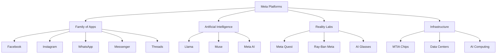

## Latest financial snapshot – Q3 2026

| Metric | Q3 2026 |
|---|---:|
| Revenue | $64.60 billion |
| Revenue Growth | 26% YoY |
| Operating Income | $12.99 billion |
| Operating Margin | 20% |
| Net Income | $9.86 billion |
| Diluted EPS | $3.83 |
| Family of Apps Revenue | $64.16 billion |
| Reality Labs Revenue | $443 million |
| Capital Expenditure | $34.91 billion |
| Family Daily Active People | 3.64 billion |

**Important financial context:** Q3 2026 operating expenses included a $9.89 billion charge associated with an agreement with 52 US state attorneys general concerning litigation related to teen mental health and social media. Excluding this charge, operating income would have been $22.88 billion and the operating margin would have been approximately 35.4%.

The reported GAAP operating margin was 20%.

Source: Meta Q3 2026 earnings release, October 21, 2026.

---

# 2. History and Evolution

Meta's history demonstrates how a social networking website can become a global technology ecosystem.

## 2.1 Foundation – 2004

Facebook was launched on February 4, 2004, by Mark Zuckerberg and fellow Harvard students.

Its initial purpose was to connect university students through an online social network.

The platform gradually expanded beyond universities.

## 2.2 Early Expansion – 2005 to 2010

| Year | Development |
|---|---|
| 2004 | Facebook launched |
| 2005 | Expansion to additional educational institutions |
| 2006 | Facebook opened registration to the general public |
| 2007 | Facebook Platform expanded third-party application development |
| 2008 | Facebook became a global social network |
| 2009 | Facebook introduced the Like button |
| 2010 | Facebook continued expanding advertising and mobile experiences |

### Why this mattered

Facebook moved beyond a website for students.

It became a platform where individuals, organizations and businesses could build communities.

## 2.3 Mobile and Acquisition Era – 2012 to 2015

| Year | Development |
|---|---|
| 2012 | Facebook completed its IPO |
| 2012 | Instagram acquisition completed |
| 2014 | WhatsApp acquisition completed |
| 2014 | Oculus acquisition completed |
| 2015 | Facebook expanded video and mobile advertising |

### Instagram acquisition

Instagram gave Facebook a major position in photo and visual content sharing.

### WhatsApp acquisition

WhatsApp expanded Facebook's position in global messaging.

### Oculus acquisition

Oculus gave Facebook an entry point into virtual reality hardware and software.

These acquisitions helped build the ecosystem that later became Meta.

## 2.4 Video and Messaging Expansion – 2016 to 2020

Meta expanded:

- Facebook video.
- Instagram Stories.
- Instagram Reels.
- Messenger.
- WhatsApp Business.
- Digital advertising.
- AI-powered recommendations.

Machine learning became increasingly important for ranking feeds and recommending content.

## 2.5 The Meta Rebrand – 2021

In October 2021, Facebook announced that its parent company would be called Meta.

The rebrand represented a broader focus on:

- Virtual reality.
- Augmented reality.
- Immersive computing.
- Digital avatars.
- Virtual environments.
- Long-term metaverse technology.

Facebook remained the name of the social media product.

Meta became the name of the parent company.

## 2.6 Generative AI Era – 2023 to 2026

| Year | Development |
|---|---|
| 2023 | Llama 2 introduced |
| 2023 | Meta AI assistant introduced |
| 2024 | Llama 3 family introduced |
| 2024 | Llama 3.1 expanded model capabilities |
| 2024 | Llama 3.2 introduced multimodal capabilities |
| 2025 | Llama 4 family introduced |
| 2025 | Meta expanded AI infrastructure investment |
| 2026 | Meta introduced Muse and its personal AI agent strategy |
| 2026 | Muse Wonder and Muse Wonder Full introduced |
| 2026 | Meta expanded AI glasses and wearable experiences |
| 2026 | Meta announced MTIA 300 training accelerator |
| 2026 | Meta expanded its AI research and superintelligence strategy |

## 2.7 Meta's transformation

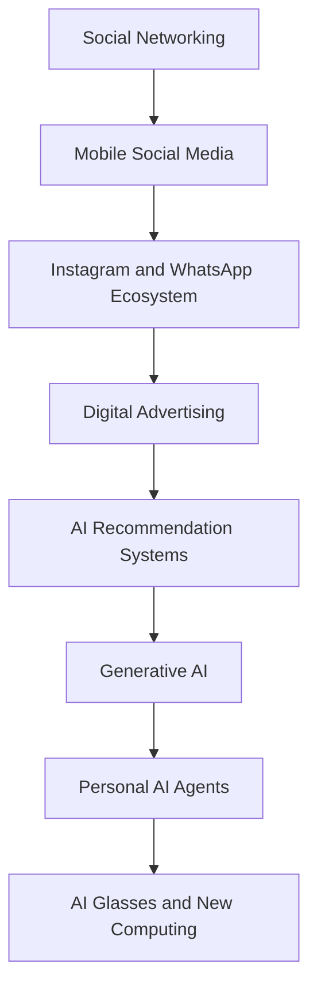

### Business lesson

Meta continuously changed its products as user behavior and technology evolved.

It moved from social networking to mobile platforms, video, messaging, advertising and AI.

---

# 3. Company Structure

## 3.1 Meta Platforms, Inc.

Meta Platforms, Inc. is the parent company behind its social networking, messaging, advertising and Reality Labs businesses.

### Leadership

| Person | Position |
|---|---|
| Mark Zuckerberg | Founder, Chairman and CEO |
| Susan Li | Chief Financial Officer |
| Andrew Bosworth | Chief Technology Officer |
| Chris Cox | Chief Product Officer |
| Javier Olivan | Chief Operating Officer |

Leadership titles can change; the official investor relations and corporate leadership pages should be checked for the latest appointments.

## 3.2 Meta's Organizational Structure

Meta reports two operating segments.

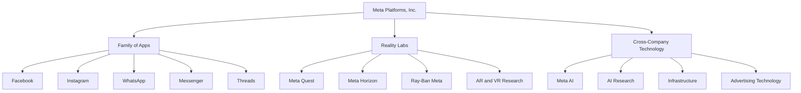

## 3.3 Family of Apps

Family of Apps is Meta's main revenue-generating segment.

It includes:

- Facebook.
- Instagram.
- Messenger.
- WhatsApp.
- Threads.
- Other related services.

Its main revenue source is advertising.

## 3.4 Reality Labs

Reality Labs focuses on technologies for immersive and next-generation computing.

Its activities include:

- Virtual reality.
- Augmented reality.
- Smart glasses.
- Meta Quest.
- Spatial computing.
- Wearable technology.
- Hardware and software research.

Reality Labs is a long-term investment area and has historically reported substantial operating losses.

## 3.5 Meta AI Research

Meta invests in AI research and infrastructure.

Its AI work includes:

- Foundation models.
- Recommendation systems.
- Computer vision.
- Natural language processing.
- Multimodal AI.
- Personal agents.
- AI safety.
- AI hardware.

## 3.6 Meta Superintelligence Labs

Meta reorganized and expanded its AI research efforts around its long-term personal superintelligence ambitions.

The company's 2026 AI strategy emphasizes models that can support personal and professional tasks, not just answer simple questions.

Muse is one of the major product initiatives associated with this strategy.

---

# 4. Products and Services

Meta offers products for consumers, creators, advertisers, developers and businesses.

## 4.1 Facebook


Facebook is a social networking platform.

Users can:

- Create profiles.
- Connect with friends.
- Share posts.
- Upload photos.
- Watch videos.
- Join groups.
- Follow pages.
- Use Marketplace.
- Participate in communities.

Businesses can create pages and advertise to audiences.

## 4.2 Instagram

Instagram is a visual social media platform.

Major features include:

- Photo sharing.
- Stories.
- Reels.
- Direct Messages.
- Live video.
- Creator tools.
- Shopping features.
- Advertising.

Instagram is particularly important for influencer marketing and visual advertising.

## 4.3 WhatsApp

WhatsApp is a messaging platform.

Its features include:

- Text messaging.
- Voice calls.
- Video calls.
- Group conversations.
- Communities.
- Channels.
- Business messaging.
- WhatsApp Business Platform.

### WhatsApp Business

Businesses can use WhatsApp to communicate with customers.

Examples:

- Order updates.
- Appointment reminders.
- Customer support.
- Product information.
- Notifications.
- Business messaging workflows.

## 4.4 Messenger

Messenger provides messaging and communication services.

It supports:

- Individual conversations.
- Group conversations.
- Voice and video calls.
- Business communication.
- Platform integrations.

## 4.5 Threads

Threads is a text-oriented social networking platform connected to the wider Meta ecosystem.

It supports:

- Public conversations.
- Posts.
- Replies.
- Reposts.
- Creator interactions.
- Discovery.

Threads also participates in the broader open social networking ecosystem through support for ActivityPub-related interoperability features, subject to product availability.

## 4.6 Meta AI

Meta AI is the company's consumer AI assistant.

It is available through supported Meta products and dedicated experiences.

Possible tasks include:

- Answering questions.
- Generating text.
- Image generation.
- Summarization.
- Research assistance.
- Creative work.
- Visual understanding.

## 4.7 Meta Quest


Meta Quest is Meta's virtual reality hardware ecosystem.

It supports:

- Virtual reality gaming.
- Fitness.
- Social experiences.
- Entertainment.
- Virtual workspaces.
- Immersive applications.

## 4.8 Ray-Ban Meta AI Glasses

Meta collaborates with EssilorLuxottica to develop smart glasses under the Ray-Ban Meta brand.

These devices combine traditional eyewear with technology such as:

- Cameras.
- Microphones.
- Speakers.
- Voice interaction.
- AI assistance.
- Media capture.
- Connectivity.

In October 2026, Meta announced Ray-Ban Meta Gen 3 availability in India, with prices starting at ₹44,300.

## 4.9 Meta for Business

Meta provides tools for businesses and advertisers.

Products include:

- Meta Ads Manager.
- Meta Business Suite.
- Meta Pixel.
- Conversions API.
- WhatsApp Business Platform.
- Meta marketing APIs.

## 4.10 Meta Developer Products

Meta provides developers with APIs and platforms for building integrations.

Examples include:

- Graph API.
- Instagram Platform.
- WhatsApp Business Platform.
- Messenger Platform.
- Meta Marketing API.
- Meta AI developer tools.

---

# 5. Business Model

Meta's business model is primarily based on advertising.

Unlike Amazon or Google Cloud, Meta does not operate a major general-purpose cloud computing business for external customers.

Its main business is monetizing attention, content discovery and communication through advertising.

## 5.1 Advertising – B2B

Advertising is Meta's largest revenue source.

Businesses pay Meta to display advertisements across its platforms.

Examples:

- Facebook Feed Ads.
- Instagram Feed Ads.
- Instagram Stories Ads.
- Reels Ads.
- Messenger Ads.
- WhatsApp-related advertising products.
- Audience Network placements.

### How it works

1. A business creates an advertising campaign.
2. It defines its campaign objective.
3. It selects an audience.
4. It uploads advertising content.
5. Meta's systems determine eligible ad placements.
6. Ads are delivered to users.
7. The advertiser pays according to the campaign's pricing model.

## 5.2 Example – Instagram Advertising

A clothing brand wants to promote a new collection.

It creates an Instagram campaign.

The campaign can target an audience based on permitted advertising signals and campaign settings.

Meta's advertising system decides which eligible users may see the advertisement.

The brand pays for advertising delivery or results under its selected pricing model.

## 5.3 Performance Advertising

Meta provides tools that help advertisers achieve goals such as:

- Website visits.
- App installs.
- Purchases.
- Lead generation.
- Brand awareness.
- Customer engagement.

## 5.4 Business Messaging

Meta offers business messaging capabilities through WhatsApp, Messenger and Instagram.

Businesses can use these products to interact with customers.

Some business messaging features and services are paid.

## 5.5 Reality Labs Revenue

Reality Labs generates revenue through:

- Meta Quest hardware.
- Software.
- Digital content.
- Other related consumer products and services.

However, Reality Labs has historically operated at a loss because of significant research, development and infrastructure spending.

## 5.6 Other Revenue

Other revenue includes products and services outside advertising, including hardware and related offerings.

## 5.7 Meta's Business Model

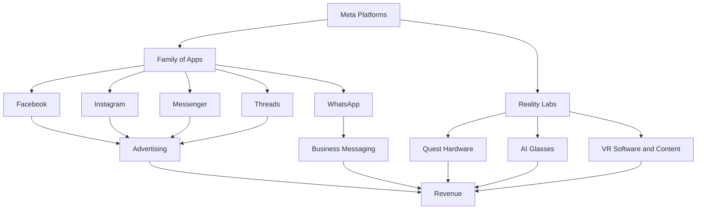

## 5.8 The Meta Advertising Flywheel

Meta's advertising model benefits from a cycle connecting users, content, engagement and advertisers.

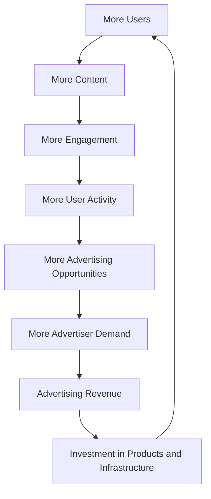

### Why the flywheel matters

1. More users create a larger potential audience.
2. More content increases engagement opportunities.
3. More engagement creates additional advertising inventory.
4. Advertisers pay to reach relevant audiences.
5. Revenue funds product development and infrastructure.
6. Better products can attract more users.

This model depends on maintaining user trust, platform quality and advertiser demand.

---

# 6. Financial Analysis

Meta's financial performance is strongly connected to digital advertising.

The company generates most of its revenue through advertising across its Family of Apps.

## 6.1 FY2025 Financial Performance

Meta's financial year ended December 31, 2025.

| Financial Metric | FY2025 |
|---|---:|
| Total Revenue | $200.97 billion |
| Operating Income | $83.28 billion |
| Operating Margin | 41% |
| Net Income | $60.46 billion |
| Diluted EPS | $23.49 |
| Advertising Revenue | $196.18 billion |
| Reality Labs Revenue | $2.21 billion |

Source: Meta 2025 Form 10-K.

## 6.2 FY2024 vs FY2025

| Metric | FY2024 | FY2025 |
|---|---:|---:|
| Revenue | $164.50B | $200.97B |
| Operating Income | $69.38B | $83.28B |
| Operating Margin | 42% | 41% |
| Net Income | $62.36B | $60.46B |
| Advertising Revenue | $160.63B | $196.18B |

### Revenue chart

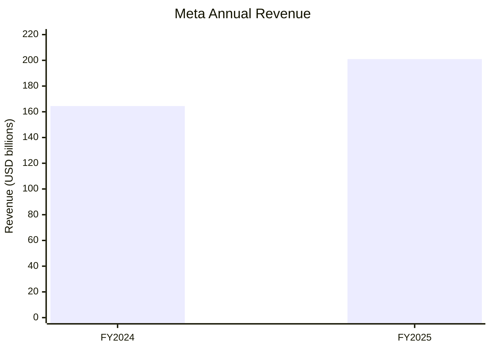

### Operating income chart

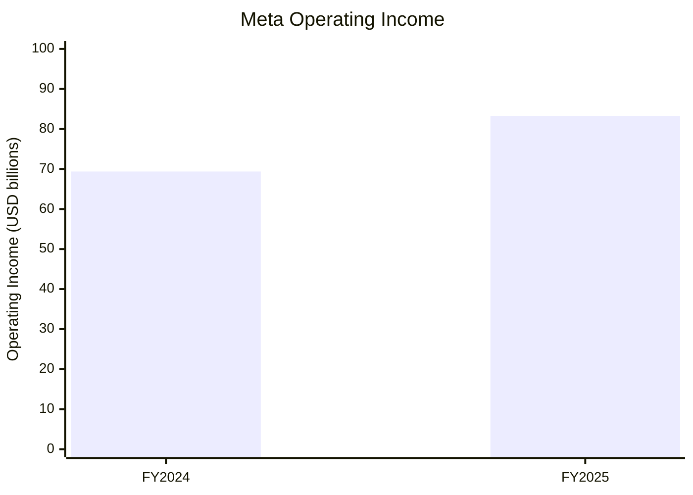

### Financial interpretation

Three important observations:

1. Revenue increased approximately 22%.
2. Operating income increased approximately 20%.
3. Net income declined approximately 3%.

The difference between operating income and net income was influenced by the significantly higher income tax provision in 2025.

## 6.3 Revenue by Business Segment – FY2025

Meta reports two segments.

| Segment | FY2025 Revenue |
|---|---:|
| Family of Apps | $198.76B |
| Reality Labs | $2.21B |
| Total | $200.97B |

Family of Apps represented approximately 98.9% of total revenue.

### Segment revenue chart

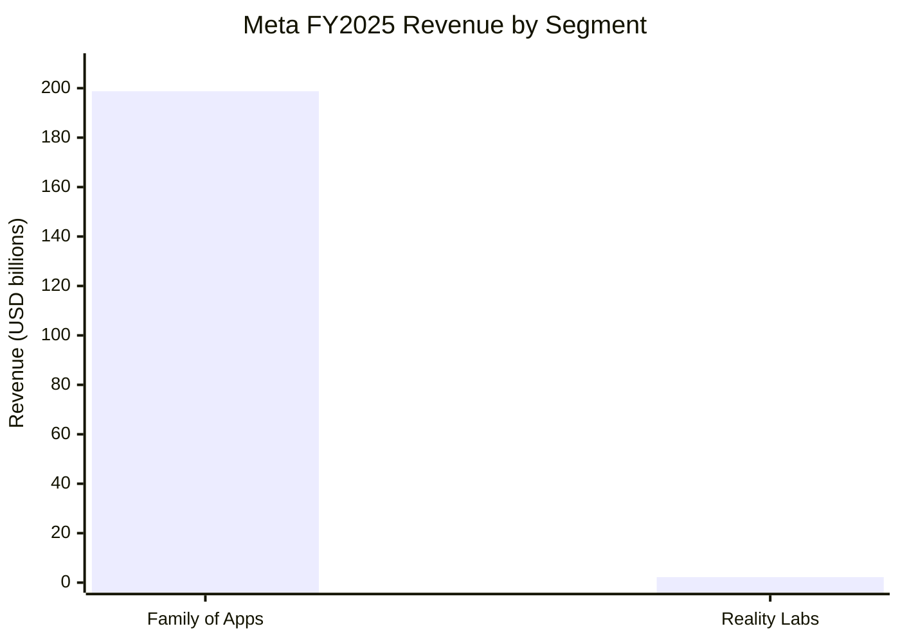

## 6.4 Advertising Revenue – FY2025

| Metric | Revenue |
|---|---:|
| Advertising | $196.18B |
| Other Family of Apps Revenue | $2.58B |
| Reality Labs | $2.21B |
| Total | $200.97B |

Advertising represented approximately 97.6% of Meta's total revenue.

This demonstrates the company's strong dependence on advertising.

## 6.5 Operating Income by Segment – FY2025

| Segment | Operating Income |
|---|---:|
| Family of Apps | $102.47B |
| Reality Labs | -$19.19B |
| Consolidated Operating Income | $83.28B |

Reality Labs generated an operating loss of approximately $19.19 billion.

This reflects Meta's substantial investment in virtual reality, augmented reality and next-generation computing.

## 6.6 Q3 2026 Financial Performance

The latest reported quarter as of November 6, 2026, is Q3 2026.

**Reporting period:** July 1 – September 30, 2026.

**Announcement date:** October 21, 2026.

| Metric | Q3 2025 | Q3 2026 |
|---|---:|---:|
| Revenue | $51.24B | $64.60B |
| Costs and Expenses | $30.71B | $51.61B |
| Operating Income | $20.54B | $12.99B |
| Operating Margin | 40% | 20% |
| Net Income | $2.71B | $9.86B |
| Diluted EPS | $1.05 | $3.83 |

Revenue grew 26% year over year.

However, operating income declined because Q3 2026 included a $9.89 billion legal-related charge.

Net income increased substantially because the prior-year quarter included a much larger tax provision.

These unusual items make a simple comparison of net income less useful without additional context.

## 6.7 Q3 2026 Segment Revenue

| Segment | Q3 2025 | Q3 2026 |
|---|---:|---:|
| Family of Apps | $50.77B | $64.16B |
| Reality Labs | $0.47B | $0.44B |
| Total | $51.24B | $64.60B |

## 6.8 Q3 2026 Segment Operating Income

| Segment | Q3 2025 | Q3 2026 |
|---|---:|---:|
| Family of Apps | $24.97B | $17.12B |
| Reality Labs | -$4.43B | -$4.13B |
| Total | $20.54B | $12.99B |

## 6.9 Advertising Performance – Q3 2026

Meta reported:

| Metric | Q3 2026 Change |
|---|---:|
| Ad Impressions | +10% YoY |
| Average Price per Ad | +14% YoY |
| Total Revenue | +26% YoY |

This means Meta increased both the number of advertisements delivered and the average price per advertisement.

## 6.10 User Scale – Q3 2026

Meta reported average Family daily active people of 3.64 billion for September 2026.

This metric is called DAP.

It measures people active across Meta's family of applications and should not be interpreted as the sum of individual platform accounts.

## 6.11 Capital Expenditure

Meta reported Q3 2026 capital expenditure, including principal payments on finance leases, of approximately $34.91 billion.

This investment supports:

- AI data centers.
- Servers.
- Networking.
- AI accelerators.
- Storage.
- Infrastructure expansion.
- Computing capacity.

Meta's AI strategy requires substantial infrastructure investment because its models and recommendation systems operate at very large scale.

### Financial lesson

Meta's financial strength comes from advertising.

Its biggest strategic challenge is deciding how much of that cash flow to invest in AI infrastructure, new AI products and Reality Labs while maintaining strong returns.

---

# 7. Artificial Intelligence Strategy


Artificial intelligence is central to Meta's future strategy.

Meta uses AI in two major ways:

1. To improve its existing social media and advertising businesses.
2. To create new AI products and computing experiences.

## 7.1 Meta's AI Strategy – Six Layers

| Layer | Purpose |
|---|---|
| AI Research | Develop advanced AI capabilities |
| Foundation Models | Llama and Muse model families |
| Recommendation Systems | Rank and recommend content |
| AI Applications | Meta AI and personal agents |
| AI Infrastructure | Data centers and MTIA |
| Consumer Devices | AI glasses and immersive hardware |

## 7.2 AI Research

Meta develops AI technology for:

- Natural language processing.
- Computer vision.
- Recommendation systems.
- Speech recognition.
- Multimodal AI.
- Generative AI.
- Personal AI agents.
- AI safety.

## 7.3 Llama

Llama is Meta's family of large language models.

Meta has released multiple generations of Llama models, including Llama 2, Llama 3 and Llama 4.

The family has helped developers build:

- Chatbots.
- Coding assistants.
- Document analysis systems.
- RAG applications.
- AI agents.
- Research applications.

Llama's open-weight approach has been important to the wider AI developer ecosystem.

The licensing terms differ by model and should be reviewed before commercial deployment.

## 7.4 Muse

Muse represents Meta's newer personal AI agent strategy.

Meta introduced Muse in September 2026.

Unlike a conventional assistant that mainly answers questions, Muse is designed to help users complete tasks and work toward longer-term goals.

Its capabilities include:

- Task assistance.
- Planning.
- Browser-based workflows.
- Connected applications.
- Memory.
- Personalization.
- Multi-step execution.

## 7.5 Recommendation AI

Recommendation systems are among Meta's most important AI technologies.

They determine what content users may see on:

- Facebook Feed.
- Instagram Feed.
- Instagram Reels.
- Explore.
- Threads.
- Video surfaces.

These systems help personalize the user experience.

## 7.6 Advertising AI

Meta uses machine learning to improve advertising.

Potential functions include:

- Ad ranking.
- Audience selection.
- Conversion prediction.
- Campaign optimization.
- Creative assistance.
- Measurement.

## 7.7 AI Infrastructure

Meta is investing in:

- GPUs.
- Custom MTIA accelerators.
- Data centers.
- High-speed networking.
- Storage.
- Large-scale distributed training.

## 7.8 AI Glasses

Meta is bringing AI assistants into physical devices.

AI glasses combine:

- Camera input.
- Audio.
- Voice commands.
- AI processing.
- Mobile connectivity.
- Wearable hardware.

## 7.9 Meta AI Ecosystem

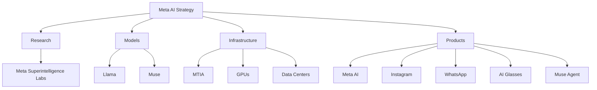

### Why Meta's AI strategy matters

Meta already has access to billions of people through its applications.

AI can improve its existing recommendation and advertising systems while also creating new products.

The combination of distribution, data, models and infrastructure gives Meta a major opportunity to compete in consumer AI.

---

# 8. Real-World AI Implementations

This section examines how Meta applies AI to its actual products and operations.

## 8.1 Facebook Feed Ranking

Facebook uses AI systems to determine which posts may be most relevant to a user.

The system can consider different signals, such as:

- User interactions.
- Post information.
- Relationships.
- Content type.
- Predicted interest.
- Feedback.

### Simplified workflow

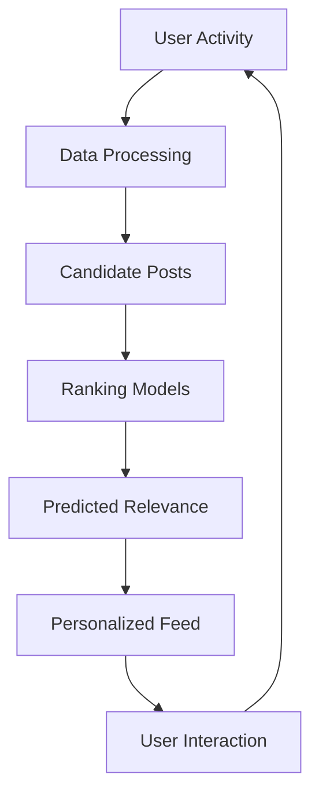

This is a conceptual ranking architecture, not a disclosure of Meta's proprietary ranking algorithms.

## 8.2 Instagram Reels Recommendations

Instagram Reels uses recommendation systems to help users discover short-form video content.

AI can support:

- Content classification.
- Video recommendations.
- Ranking.
- Interest prediction.
- Safety and moderation.
- Personalization.

### Example

A user frequently watches technology videos.

The recommendation system can learn that the user may be interested in similar content.

It may recommend more videos from technology creators.

## 8.3 Instagram Explore

Explore helps users discover content outside their immediate network.

AI systems can identify potentially relevant posts and rank them.

The goal is to show content that matches user interests while maintaining platform quality and integrity.

## 8.4 WhatsApp Business AI

Businesses can use WhatsApp Business Platform to communicate with customers.

AI-powered systems can support:

- Customer support.
- Frequently asked questions.
- Product discovery.
- Appointment assistance.
- Order information.
- Business workflows.

### Example

A customer sends:

"Where is my order?"

A connected business assistant may:

1. Identify the customer.
2. Request order information.
3. Call an approved order API.
4. Retrieve shipment status.
5. Prepare a response.
6. Send the update through WhatsApp.

## 8.5 Meta AI

Meta AI is integrated into supported Meta applications and dedicated experiences.

Users can ask questions, generate content and interact with AI.

Possible use cases include:

- Writing.
- Research.
- Brainstorming.
- Image generation.
- Translation.
- Summarization.
- Visual assistance.

## 8.6 Meta Advertising AI

Meta's advertising system uses machine learning to match advertisements with relevant audiences.

Advertisers provide:

- Campaign objectives.
- Budget.
- Creative assets.
- Targeting and placement preferences.
- Conversion goals.

Meta's systems optimize delivery based on eligible signals and predicted outcomes.

### Advertising workflow

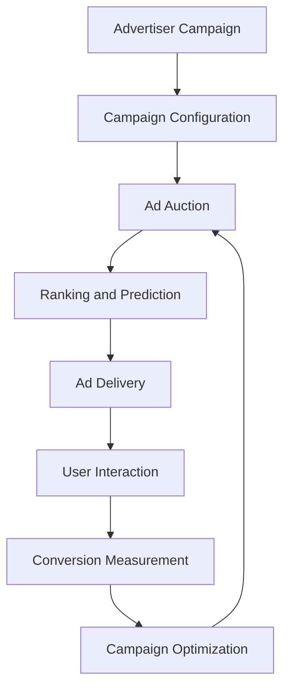

## 8.7 AI Content Moderation

Meta uses automated systems and human review processes to enforce platform policies.

AI can help identify:

- Spam.
- Fake accounts.
- Harmful content.
- Fraudulent behavior.
- Impersonation.
- Certain forms of policy violations.

Automated systems can make mistakes, so enforcement systems need appeals, review and quality monitoring.

## 8.8 AI in Ray-Ban Meta Glasses

Meta's AI glasses can provide contextual assistance using supported camera and audio features.

Examples:

- Asking about an object.
- Understanding a visual scene.
- Taking photos.
- Recording video.
- Listening to audio.
- Making calls.
- Interacting with an AI assistant.

In October 2026, Meta announced Muse coming to its AI glasses, enabling hands-free access to its personal AI agent.

## 8.9 Muse Personal AI Agent

Muse is designed to complete multi-step tasks.

Examples include:

- Planning.
- Managing tasks.
- Working with connected applications.
- Researching information.
- Organizing projects.
- Preparing actions for user approval.

Meta says Muse operates through a dedicated secure virtual machine and gives users control over connected applications and permissions.

## 8.10 Muse Wonder

Meta introduced Muse Wonder and Muse Wonder Full in October 2026.

These models are designed for agentic tasks.

Meta highlighted use cases involving:

- Legal and financial information.
- Understanding documents.
- Coding.
- Professional tasks.
- Multi-step reasoning.

The models include capabilities such as Active Memory and Active Focus, according to Meta's announcement.

---

# 9. Meta AI, Llama and Muse – Major AI Products

This is one of the most important sections of the Meta case study.

## 9.1 Meta AI

Meta AI is the company's consumer-facing AI assistant.

It is available through supported Meta applications and dedicated products.

It allows users to:

- Ask questions.
- Generate content.
- Explore ideas.
- Create images.
- Summarize information.
- Use AI assistance during communication.

## 9.2 Llama

Llama is Meta's family of large language models.

Its development has been important to the open-weight AI ecosystem.

### Llama model generations

| Generation | Description |
|---|---|
| Llama 1 | Original research model family |
| Llama 2 | Expanded model availability |
| Llama 3 | Improved model generation |
| Llama 3.1 | Larger and more capable models |
| Llama 3.2 | Expanded multimodal capabilities |
| Llama 3.3 | Additional model variants |
| Llama 4 | Newer model family with advanced capabilities |

### Why Llama matters

Llama allows developers and organizations to experiment with models and build applications with more control over deployment.

Applications include:

- AI chatbots.
- Code assistants.
- RAG.
- Document analysis.
- Research.
- Domain-specific AI.

**Licensing note:** Llama models are not all governed by identical terms. Developers should check the exact model license and acceptable-use requirements before commercial use.

## 9.3 Muse

Muse is Meta's personal AI agent initiative.

Meta announced Muse in September 2026.

Its goal is to help people move beyond asking questions toward delegating tasks.

### Muse capabilities

- Task planning.
- Personal assistance.
- Connected applications.
- Browser interaction.
- Memory.
- Long-running tasks.
- User-controlled permissions.
- Confirmation before sensitive actions.

### Muse architecture – conceptual

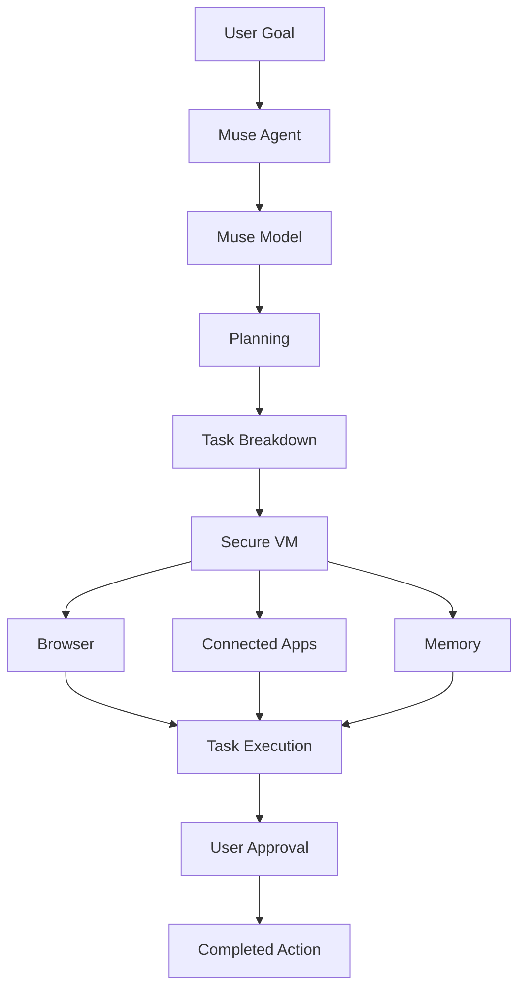

This is an educational conceptual architecture, not a diagram of Meta's internal proprietary implementation.

## 9.4 Muse Secure VM

Meta describes Muse as operating inside a dedicated secure virtual machine.

Its design includes:

- A dedicated browser.
- A controlled environment.
- Connected application access.
- User-defined permissions.
- An audit trail.
- Approval for sensitive actions.

Meta also announced plans for Muse Confidential VM, intended to provide additional protection through encryption.

## 9.5 Muse Wonder and Muse Wonder Full

Meta introduced these models in October 2026.

They are designed for advanced agentic work.

| Model | Positioning |
|---|---|
| Muse Wonder | Advanced agentic tasks |
| Muse Wonder Full | More capable frontier model for demanding tasks |

Meta highlighted:

- Coding.
- Document understanding.
- Professional tasks.
- Legal and financial assistance.
- Active Memory.
- Active Focus.

## 9.6 Meta Model API

Meta introduced developer access to Muse Wonder through its Meta Model API.

This provides a route for developers to experiment with Meta's newer models.

Developers should check current access requirements, availability and pricing before building production systems.

## 9.7 Meta AI vs Llama vs Muse

| Product | Main Purpose |
|---|---|
| Meta AI | Consumer AI assistant |
| Llama | Model family for developers and applications |
| Muse | Personal AI agent |
| Muse Wonder | Advanced agentic model family |
| Meta Model API | Developer access to supported models |

## 9.8 Why Meta's AI Strategy Is Different

Meta has an existing distribution ecosystem.

It can introduce AI features through:

- Facebook.
- Instagram.
- WhatsApp.
- Messenger.
- Threads.
- AI glasses.

This creates opportunities to reach users without requiring them to adopt a completely separate application.

---

# 10. AI Work Model

How does Meta use AI across its business?

Its AI work model can be understood through six layers.

## Layer 1 – Data Collection

Meta's applications generate different kinds of information.

Examples include:

- Posts.
- Photos.
- Videos.
- Comments.
- Reactions.
- Messaging events.
- Content interactions.
- Advertising events.
- Device information.

Data use depends on product design, privacy settings, policies and applicable laws.

## Layer 2 – Data Processing

Collected information is processed and prepared for different applications.

Possible techniques include:

- Data cleaning.
- Data validation.
- Feature extraction.
- Distributed processing.
- Event streaming.
- Data aggregation.
- Feature engineering.

## Layer 3 – AI Model Development

Meta develops models for:

- Recommendation.
- Ranking.
- Image understanding.
- Speech.
- Natural language.
- Generative AI.
- Content moderation.
- Agentic workflows.

## Layer 4 – Model Training

Models are trained using suitable datasets and computing infrastructure.

Training requires:

- Data preparation.
- Distributed training.
- GPU or accelerator hardware.
- Optimization.
- Evaluation.
- Model checkpointing.

## Layer 5 – Inference

Trained models are deployed into products.

For example:

When a user opens Instagram, recommendation systems help select and rank content.

## Layer 6 – Business Action

AI produces business value when integrated into actual products.

Examples:

- Better content discovery.
- More relevant advertising.
- Automated customer support.
- Image generation.
- Personal AI agents.
- Contextual assistance through smart glasses.

## Overall AI workflow

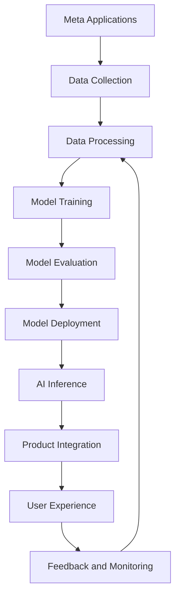

## Example: Instagram Recommendation

1. A user opens Instagram.
2. The system identifies available content candidates.
3. Models evaluate relevance signals.
4. Content is ranked.
5. The user sees a personalized feed.
6. Interactions provide additional feedback.

## Example: Meta AI Agent

1. A user gives Muse a goal.
2. The agent interprets the request.
3. The task is broken into smaller steps.
4. The agent accesses authorized tools.
5. It performs permitted actions.
6. It requests approval when needed.
7. The user receives the result.

**Important:** This is a generalized AI operating model. Meta does not publicly disclose every internal model architecture, training dataset, ranking signal or production pipeline.

---

# 11. Technology Architecture

Meta operates large-scale distributed systems supporting social media, messaging, advertising and AI.

Its applications must support:

- Billions of users.
- High-volume interactions.
- Media uploads.
- Real-time messaging.
- Content ranking.
- Advertising auctions.
- Large-scale AI inference.
- Global infrastructure.

## 11.1 Technology Stack Map

The following is a practical map of publicly documented Meta technologies and commonly used engineering technologies. It is not a verified inventory of every internal production system.

| Layer | Technologies |
|---|---|
| Programming | Hack, PHP, Python, C++, Rust, Java |
| Frontend | React, JavaScript, TypeScript |
| Mobile | React Native, Android, iOS |
| Backend | Distributed Services, APIs |
| AI Research | PyTorch, FAIR research |
| AI Models | Llama, Muse |
| ML Framework | PyTorch |
| Data Processing | Distributed Systems, Spark-style processing |
| Databases | MySQL, TAO, RocksDB-based systems |
| Storage | Distributed Storage |
| Networking | High-speed Data Center Networks |
| AI Hardware | MTIA, GPUs |
| Infrastructure | Meta Data Centers |
| Developer Tools | Graph API, Meta SDKs |
| Messaging | WhatsApp Business Platform |
| Monitoring | Internal Observability Systems |

## 11.2 React

React is a JavaScript library developed by Meta for building user interfaces.

It is used widely across the software industry.

It supports:

- Component-based development.
- Reusable UI.
- State management patterns.
- Declarative rendering.
- Large frontend applications.

## 11.3 React Native

React Native is a framework for developing mobile applications using React and JavaScript or TypeScript.

It allows developers to share application logic across supported mobile platforms.

## 11.4 PyTorch

PyTorch is a machine learning framework developed by Meta and released as an open-source project.

It is used for:

- Deep learning.
- Neural networks.
- Model training.
- Computer vision.
- Natural language processing.
- Research.

PyTorch became an important framework across the wider AI ecosystem.

## 11.5 TAO

TAO is a distributed data storage system used in Meta's infrastructure.

It supports graph-like social data access patterns.

It is designed for large-scale workloads involving relationships between entities such as:

- Users.
- Posts.
- Comments.
- Likes.
- Friend connections.

## 11.6 Distributed Architecture

A simplified social media architecture:

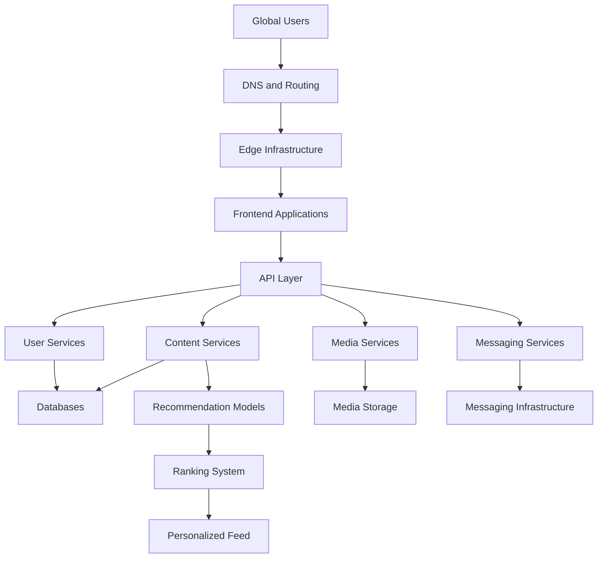

## 11.7 Microservices and Distributed Systems

Large platforms can divide functionality into independent services.

Examples:

- User service.
- Profile service.
- Feed service.
- Media service.
- Notification service.
- Messaging service.
- Advertising service.
- Recommendation service.

This makes it possible to scale different workloads independently.

## 11.8 Why Reliability Matters

A social media platform needs to remain available even when individual components fail.

Engineering systems therefore require:

- Replication.
- Load balancing.
- Caching.
- Fault tolerance.
- Monitoring.
- Rate limiting.
- Disaster recovery.
- Security controls.

---

# 12. Data Engineering and Infrastructure

Meta operates large data and computing systems.

Data engineering is essential because its applications generate substantial volumes of content and interaction events.

## 12.1 Data Sources

Meta's data sources can include:

- User interactions.
- Media uploads.
- Advertising events.
- Messaging events.
- Application logs.
- Platform integrity signals.
- Device and system telemetry.

## 12.2 Data Engineering Workflow

A typical large-scale data engineering workflow includes:

1. Event collection.
2. Data ingestion.
3. Data validation.
4. Data transformation.
5. Data storage.
6. Feature generation.
7. Analytics.
8. Model training.
9. Monitoring.

## 12.3 Example Data Pipeline

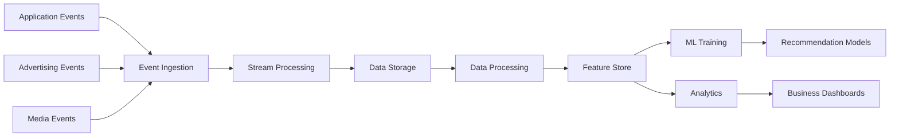

This is a conceptual architecture, not a disclosure of Meta's internal production pipeline.

## 12.4 Data Engineering Use Cases

| Use Case | Purpose |
|---|---|
| Feed Analytics | Understand content engagement |
| Advertising Analytics | Measure campaign performance |
| Recommendation Data | Support model training |
| Messaging Analytics | Improve reliability and operations |
| Content Moderation | Detect platform policy violations |
| Infrastructure Analytics | Monitor system performance |

## 12.5 Example Database Design

A simplified social media application might use the following tables.

### users

| Column | Type |
|---|---|
| user_id | BIGINT |
| username | VARCHAR |
| email | VARCHAR |
| created_at | TIMESTAMP |

### posts

| Column | Type |
|---|---|
| post_id | BIGINT |
| user_id | BIGINT |
| content | TEXT |
| created_at | TIMESTAMP |

### interactions

| Column | Type |
|---|---|
| interaction_id | BIGINT |
| user_id | BIGINT |
| post_id | BIGINT |
| interaction_type | VARCHAR |
| created_at | TIMESTAMP |

### follows

| Column | Type |
|---|---|
| follower_id | BIGINT |
| followed_id | BIGINT |
| created_at | TIMESTAMP |

## 12.6 SQL Example – Top 10 Posts

```sql
SELECT
    p.post_id,
    p.user_id,
    COUNT(i.interaction_id) AS total_interactions
FROM posts p
LEFT JOIN interactions i
    ON p.post_id = i.post_id
GROUP BY p.post_id, p.user_id
ORDER BY total_interactions DESC
LIMIT 10;
```

## 12.7 SQL Example – Daily Engagement

```sql
SELECT
    DATE(created_at) AS activity_date,
    interaction_type,
    COUNT(*) AS total_interactions
FROM interactions
GROUP BY DATE(created_at), interaction_type
ORDER BY activity_date;
```

## 12.8 Why Data Engineering Matters at Meta

Meta's applications depend on large-scale information processing.

Data engineering supports:

- Feed recommendations.
- Advertising.
- Analytics.
- Content moderation.
- AI training.
- Infrastructure monitoring.
- Product development.

The quality, availability and governance of data directly affect the quality of the systems built on top of it.

---

# 13. AI Hardware, Data Centers, Wearables and Reality Labs


Meta's AI strategy requires large amounts of computing infrastructure.

Its investments include:

- GPUs.
- Custom accelerators.
- Data centers.
- Networking.
- Storage.
- Power infrastructure.
- Cooling systems.
- Wearable hardware.

## 13.1 Why Meta Needs AI Infrastructure

Meta runs AI systems across its applications.

These systems require computing for:

- Model training.
- Model inference.
- Content recommendation.
- Advertising.
- Image generation.
- Video understanding.
- AI agents.

As model complexity and usage increase, infrastructure requirements also increase.

## 13.2 MTIA – Meta Training and Inference Accelerator

MTIA is Meta's family of custom AI accelerator chips.

It is designed to support workloads important to Meta's applications.

These include:

- Recommendation models.
- Ranking models.
- AI inference.
- Training workloads.

### Why develop custom chips?

1. Improve performance for selected workloads.
2. Optimize infrastructure cost.
3. Reduce dependence on general-purpose accelerators for every task.
4. Improve power efficiency.
5. Co-design hardware and software.
6. Support large-scale AI operations.

## 13.3 MTIA 300

In August 2026, Meta introduced MTIA 300.

Meta described it as its first in-house training chip with built-in network interface chiplets and communication-offloading engines.

Its design is focused on the communication demands of training recommendation and ranking models.

This is important because large AI systems require both computation and fast communication between accelerators.

## 13.4 CPU vs GPU vs MTIA

| Hardware | Primary Purpose |
|---|---|
| CPU | General-purpose computing |
| GPU | Parallel computing and AI workloads |
| MTIA | Specialized AI training and inference workloads |

Meta also uses GPUs for workloads where they provide suitable performance and flexibility.

## 13.5 AI Infrastructure Architecture

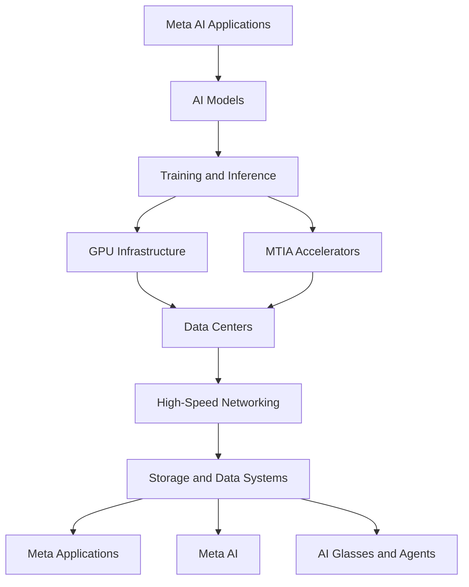

## 13.6 Meta Data Centers

Meta operates data centers to support its global applications and AI workloads.

Important infrastructure components include:

- Server racks.
- Computing accelerators.
- Networking equipment.
- Storage systems.
- Cooling.
- Power distribution.
- Security.
- Monitoring.

Meta's data center investment is an important part of its long-term AI strategy.

## 13.7 AI Glasses


Meta's AI glasses combine traditional eyewear with computing capabilities.

They can include:

- Camera.
- Microphones.
- Speakers.
- Voice assistant.
- Connectivity.
- AI features.
- Hands-free media capture.

Meta announced Ray-Ban Meta Gen 3 in September 2026 and its availability in India in October 2026.

### AI glasses workflow

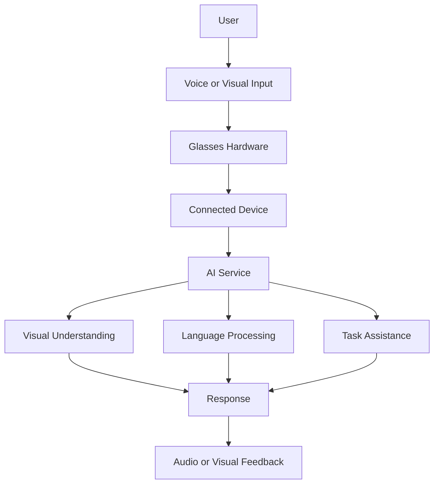

## 13.8 Meta Quest and Virtual Reality

Meta Quest provides an immersive computing platform.

Applications include:

- VR games.
- Virtual meetings.
- Fitness.
- Social experiences.
- Training.
- Entertainment.
- Immersive education.

## 13.9 Augmented Reality

Augmented reality overlays digital information on the physical world.

Potential applications include:

- Navigation.
- Object identification.
- Interactive instructions.
- Spatial computing.
- Hands-free assistance.

## 13.10 Reality Labs Business Model

Reality Labs invests in long-term computing platforms.

Its revenue comes from hardware, software and content.

However, the segment has reported substantial operating losses.

This makes Reality Labs one of Meta's highest-risk strategic investments.

---

# 14. Competitor Analysis

Meta competes in multiple markets.

Its competitors include social networks, video platforms, messaging services, AI companies and hardware companies.

| Competitor | Main Competition Area |
|---|---|
| TikTok | Short-form video |
| YouTube | Video and creators |
| Snapchat | Social communication and AR |
| X | Public conversations |
| Telegram | Messaging |
| WhatsApp alternatives | Messaging |
| Google | Advertising and AI |
| OpenAI | Consumer AI |
| Anthropic | AI models |
| Apple | Wearables and spatial computing |
| ByteDance | Social media and AI |
| Roblox | Immersive digital experiences |

## 14.1 Meta vs TikTok

| Area | Meta | TikTok |
|---|---|---|
| Social Networking | Facebook, Instagram | TikTok |
| Short Video | Reels | For You feed |
| Messaging | Messenger, WhatsApp | TikTok messaging |
| Advertising | Meta Ads | TikTok Ads |
| Creator Ecosystem | Instagram and Facebook | TikTok creators |
| AI Recommendations | Meta ranking systems | TikTok recommendation systems |

### Competitive advantage

Meta has a broader social networking and messaging ecosystem.

TikTok has strong short-form video discovery and creator engagement.

## 14.2 Meta vs Google

| Area | Meta | Google |
|---|---|---|
| Advertising | Meta Ads | Google Ads |
| Search | No major general search engine | Google Search |
| Video | Facebook and Instagram | YouTube |
| Messaging | WhatsApp, Messenger | Google Messages and related products |
| AI Assistant | Meta AI, Muse | Gemini |
| Foundation Models | Llama, Muse | Gemini, Gemma |
| Smart Devices | AI glasses, Quest | Pixel and other devices |
| Cloud Infrastructure | Internal infrastructure | Google Cloud |

## 14.3 Meta vs OpenAI

| Area | Meta | OpenAI |
|---|---|---|
| Consumer AI | Meta AI, Muse | ChatGPT |
| Model Development | Llama, Muse | GPT models |
| Social Distribution | Facebook, Instagram, WhatsApp | ChatGPT ecosystem |
| AI Agents | Muse | Agentic ChatGPT experiences |
| Open Models | Llama | Selected open-weight offerings |
| Wearables | AI glasses | Partner-dependent device ecosystem |

### Competitive advantage

Meta has direct distribution through its family of applications and AI glasses.

OpenAI has built a strong standalone AI assistant and developer ecosystem.

## 14.4 Meta vs Snap

| Area | Meta | Snap |
|---|---|---|
| Social Platform | Instagram, Facebook | Snapchat |
| Messaging | WhatsApp, Messenger | Snapchat |
| AR | Meta AI glasses and Quest | AR lenses and Spectacles |
| Advertising | Meta Ads | Snap Ads |
| Creator Ecosystem | Instagram creators | Snapchat creators |

## 14.5 Competitive Positioning

Meta's strongest advantages include:

- Massive user base.
- Advertising infrastructure.
- Social graph.
- AI recommendation systems.
- Messaging ecosystem.
- AI model development.
- Smart glasses partnerships.
- Custom AI hardware.

Its biggest challenge is turning AI and Reality Labs investments into sustainable revenue beyond traditional advertising.

---

# 15. SWOT Analysis

| Strengths | Weaknesses |
|---|---|
| Massive global user base | Heavy advertising dependence |
| Strong brand recognition | Privacy controversies |
| Instagram and WhatsApp | Reality Labs operating losses |
| Advanced recommendation systems | High AI infrastructure costs |
| Strong advertising technology | Regulatory scrutiny |
| AI research capabilities | Dependence on third-party hardware suppliers |
| Custom MTIA accelerators | Difficult hardware commercialization |

| Opportunities | Threats |
|---|---|
| Personal AI agents | OpenAI and Google competition |
| AI glasses | Apple and other wearable competitors |
| Enterprise AI | Changing advertising economics |
| WhatsApp business services | Privacy regulation |
| AI-powered advertising | Competition for user attention |
| AR and VR | High development costs |
| Llama ecosystem | AI model commoditization |
| New AI devices | Content safety and trust challenges |

## Strategic interpretation

Meta has a strong consumer distribution advantage.

Its applications reach billions of people.

The company's challenge is converting this distribution into new AI products and revenue while reducing dependence on advertising and managing the cost of infrastructure and Reality Labs.

---

# 16. Challenges and Risks

## 16.1 Advertising Dependence

Meta generates substantially all of its revenue from advertising.

This creates exposure to:

- Advertising market conditions.
- Economic downturns.
- Privacy changes.
- Competition.
- Advertiser demand.

## 16.2 Privacy and Data Protection

Meta handles large amounts of user information.

It must manage:

- Data protection.
- User consent.
- Account security.
- Cross-border data requirements.
- Advertising privacy.
- AI data governance.

## 16.3 Content Moderation

Social platforms face challenges involving:

- Misinformation.
- Harassment.
- Spam.
- Fraud.
- Impersonation.
- Harmful content.

AI can help identify problematic content, but automated moderation can make errors.

## 16.4 Competition

Meta competes with:

- TikTok.
- YouTube.
- Snapchat.
- Google.
- OpenAI.
- Apple.
- Other AI companies.

Competition for user attention is particularly important.

## 16.5 AI Infrastructure Costs

Meta's AI ambitions require significant spending on:

- Data centers.
- GPUs.
- Custom chips.
- Networking.
- Power.
- Cooling.
- Storage.

The return on these investments is uncertain.

## 16.6 Reality Labs Losses

Reality Labs has historically generated large operating losses.

Meta needs to demonstrate that virtual reality, augmented reality and wearable technology can become sustainable businesses.

## 16.7 AI Hallucinations

Generative AI can produce incorrect information.

Important applications require:

- Model evaluation.
- Guardrails.
- Source verification.
- Human review.
- Monitoring.

## 16.8 AI Agent Security

Personal agents may access sensitive applications and information.

Risks include:

- Unauthorized actions.
- Prompt injection.
- Data leakage.
- Credential exposure.
- Excessive permissions.
- Incorrect purchases or communications.

Secure execution environments, least-privilege access and approval workflows are important safeguards.

## 16.9 Regulatory Pressure

Meta faces regulatory scrutiny related to:

- Competition.
- Privacy.
- Advertising.
- Youth safety.
- Content moderation.
- Consumer protection.
- AI governance.

Its Q3 2026 financial results included a $9.89 billion charge associated with the announced agreement involving US state attorneys general.

---

# 17. Future Strategy

Based on Meta's public announcements, its future strategy focuses on several areas.

## 17.1 Personal Superintelligence

Meta has stated that it aims to make advanced AI useful and accessible to people.

Muse and Muse Wonder are important parts of this strategy.

## 17.2 AI Agents

Meta is moving from conversational assistants toward systems that can complete multi-step tasks.

Potential applications include:

- Personal planning.
- Business workflows.
- Research.
- Coding.
- Communication.
- Scheduling.
- Shopping assistance.

## 17.3 AI Glasses

Meta is investing in smart glasses as a new computing platform.

The goal is to make AI available through a wearable device that can understand the user's context.

## 17.4 AI Infrastructure

Meta continues investing in:

- Data centers.
- GPUs.
- MTIA.
- Networking.
- AI training infrastructure.

## 17.5 Recommendation Systems

Meta will likely continue improving AI-based discovery and recommendation across:

- Facebook.
- Instagram.
- Reels.
- Threads.

## 17.6 WhatsApp Business

WhatsApp offers opportunities for business messaging and AI-powered customer support.

## 17.7 Reality Labs

Meta continues to invest in:

- Virtual reality.
- Augmented reality.
- Spatial computing.
- Wearables.
- Immersive experiences.

## 17.8 Meta AI Developer Ecosystem

Meta can expand developer adoption through:

- Llama.
- Muse APIs.
- Model tooling.
- Open-source research.
- Developer platforms.

## Future strategy visualization

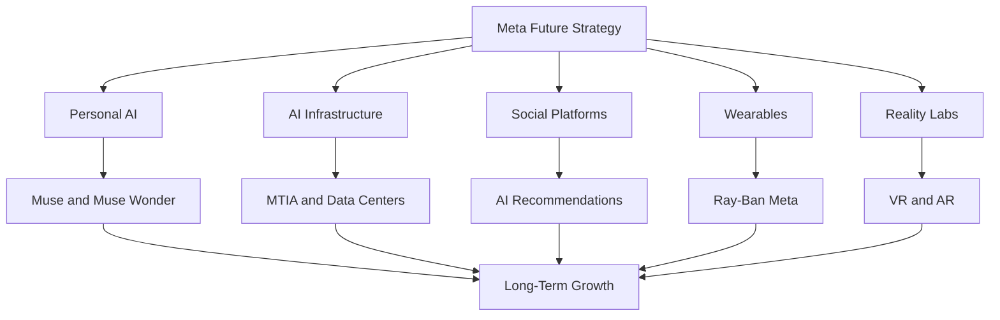

---

# 18. Career Opportunities

Meta hires across software engineering, AI, machine learning, data engineering, infrastructure, security and product development.

## 18.1 Software Engineer

Responsibilities:

- Develop scalable applications.
- Build backend services.
- Design APIs.
- Solve algorithmic problems.
- Improve reliability.
- Develop distributed systems.

Required skills:

- Python.
- C++.
- Java.
- JavaScript.
- Data Structures and Algorithms.
- Operating Systems.
- Computer Networks.
- Database Systems.
- System Design.

## 18.2 AI Engineer

Responsibilities:

- Build AI applications.
- Integrate foundation models.
- Develop RAG systems.
- Build AI agents.
- Evaluate model outputs.
- Deploy AI solutions.

Required skills:

- Python.
- LLMs.
- RAG.
- Vector Databases.
- Prompt Engineering.
- Agent Frameworks.
- APIs.
- AI Evaluation.

## 18.3 Machine Learning Engineer

Responsibilities:

- Develop recommendation models.
- Train machine learning systems.
- Build inference pipelines.
- Optimize model performance.
- Monitor models.

Required skills:

- Python.
- PyTorch.
- Deep Learning.
- Statistics.
- Machine Learning.
- Distributed Training.
- Model Optimization.
- MLOps.

## 18.4 Data Engineer

Responsibilities:

- Develop data pipelines.
- Process large datasets.
- Build data models.
- Maintain data quality.
- Support analytics and AI systems.

Required skills:

- Python.
- SQL.
- Spark.
- Distributed Systems.
- Data Warehousing.
- ETL.
- Streaming.
- Data Modeling.

## 18.5 Infrastructure Engineer

Responsibilities:

- Build infrastructure systems.
- Improve server performance.
- Manage distributed computing.
- Optimize networking.
- Support large-scale applications.

Required skills:

- Linux.
- C++.
- Python.
- Networking.
- Operating Systems.
- Distributed Systems.
- Performance Engineering.

## 18.6 Site Reliability Engineer

Responsibilities:

- Maintain application reliability.
- Monitor production systems.
- Automate operational tasks.
- Troubleshoot incidents.
- Improve system performance.

Required skills:

- Linux.
- Python.
- Networking.
- Monitoring.
- Distributed Systems.
- Automation.
- Incident Management.

## 18.7 Product Engineer

Responsibilities:

- Build product features.
- Work with design and product teams.
- Develop user-facing applications.
- Improve performance.
- Conduct experiments.

Required skills:

- React.
- JavaScript.
- TypeScript.
- Mobile Development.
- APIs.
- Database Systems.
- Product Thinking.

## Career learning matrix

| Role | Important Skills |
|---|---|
| Software Engineer | DSA, C++, Python, System Design |
| AI Engineer | Python, LLMs, RAG, Agents |
| ML Engineer | PyTorch, ML, Distributed Training |
| Data Engineer | SQL, Spark, Python |
| Infrastructure Engineer | Linux, C++, Networking |
| SRE | Linux, Automation, Monitoring |
| Product Engineer | React, TypeScript, APIs |
| Research Engineer | Python, PyTorch, Mathematics |

## Official career resources

- Meta Careers: https://www.metacareers.com/
- Meta Engineering: https://engineering.fb.com/
- PyTorch: https://pytorch.org/
- Meta AI: https://ai.meta.com/
- Meta for Developers: https://developers.facebook.com/

---

# 19. Engineering Project Ideas

The best way to understand Meta's technology is to build practical applications inspired by its products and infrastructure.

Here are six projects.

## Project 1 – Instagram-Style Social Media Platform

**Difficulty:** Advanced

### Problem

Users need a platform to share content, connect with others and interact.

### Solution

Build a social networking application with posts, likes, comments and followers.

### Technology

- Next.js.
- FastAPI.
- PostgreSQL.
- Redis.
- Docker.
- AWS EC2.
- S3.

### Features

- User authentication.
- User profiles.
- Create posts.
- Image uploads.
- Follow and unfollow.
- Likes.
- Comments.
- Feed.
- Notifications.

### Architecture

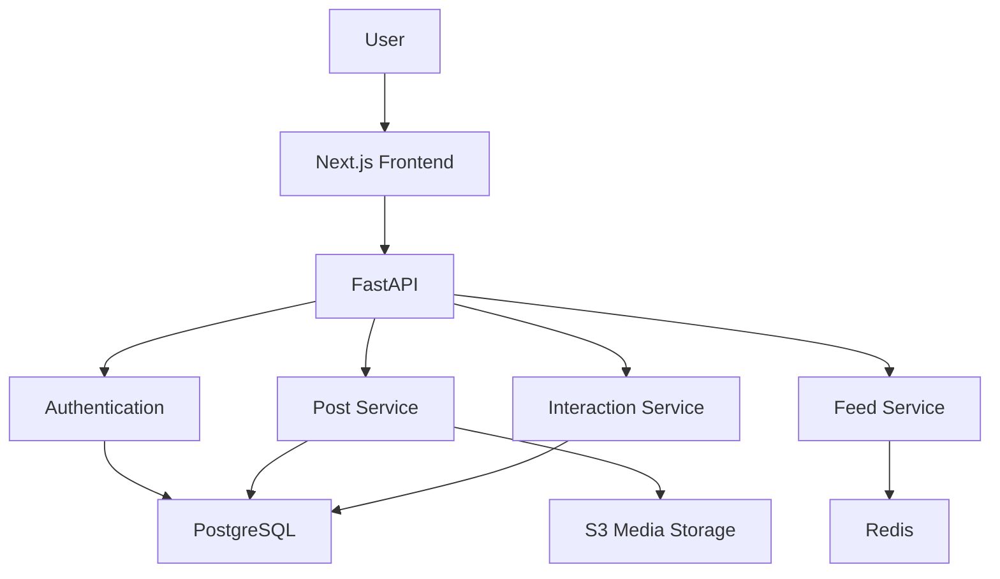

## Project 2 – AI Recommendation Engine

**Difficulty:** Advanced

### Problem

A social media platform needs to recommend relevant posts to users.

### Solution

Build a personalized content recommendation system.

### Technology

- Python.
- Pandas.
- Scikit-learn.
- PyTorch.
- FastAPI.
- PostgreSQL.
- Redis.

### Features

- User activity tracking.
- Content classification.
- User interest profiles.
- Recommendation ranking.
- Trending content.
- Model evaluation.

### Architecture

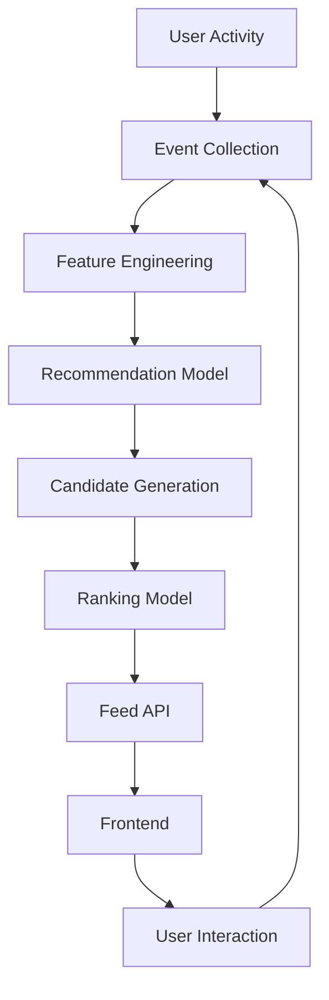

## Project 3 – WhatsApp-Style AI Customer Support

**Difficulty:** Advanced

### Problem

Businesses receive repetitive questions from customers.

### Solution

Build an AI-powered messaging application that answers questions using company documents and approved APIs.

### Technology

- Python.
- FastAPI.
- PostgreSQL.
- Redis.
- Gemini or a supported Llama model.
- FAISS.
- Next.js.

### Features

- Real-time messaging.
- Document ingestion.
- RAG.
- Order lookup.
- Customer support.
- Conversation history.
- Human handoff.
- Source citations.

### Architecture

```mermaid
flowchart TD
    A["Customer"] --> B["Messaging Interface"]
    B --> C["FastAPI"]

    C --> D["AI Agent"]
    D --> E["Foundation Model"]
    D --> F["Vector Database"]
    D --> G["Business API"]

    F --> H["Retrieved Documents"]
    G --> I["Business Data"]

    E --> J["Generated Response"]
    H --> E
    I --> E

    J --> K["Customer"]
```

## Project 4 – AI Content Moderation System

**Difficulty:** Advanced

### Problem

Social platforms need to detect spam, abusive content and policy violations.

### Solution

Build a system that classifies user-generated content and flags potentially problematic posts for review.

### Technology

- Python.
- PyTorch.
- FastAPI.
- PostgreSQL.
- Transformers.
- Docker.

### Features

- Text classification.
- Spam detection.
- Toxicity classification.
- Risk scoring.
- Moderation dashboard.
- Human review.
- Audit logs.

### Architecture

```mermaid
flowchart TD
    A["User Content"] --> B["Content API"]
    B --> C["Preprocessing"]
    C --> D["Classification Model"]

    D --> E["Risk Score"]
    E --> F{"Policy Threshold"}

    F -->|"Low Risk"| G["Publish"]
    F -->|"High Risk"| H["Human Review"]

    H --> I["Moderator Decision"]
    I --> J["Audit Log"]
```

A real moderation system requires carefully defined policies, evaluation datasets, appeals and safeguards against biased or incorrect classifications.

## Project 5 – AI-Powered Personal Assistant

**Difficulty:** Advanced

### Problem

Users need help organizing tasks, researching information and completing repetitive workflows.

### Solution

Build a personal AI agent that can use approved tools and ask for confirmation before sensitive actions.

### Technology

- Python.
- FastAPI.
- LLM API.
- PostgreSQL.
- Redis.
- Browser automation.
- Next.js.

### Features

- Conversational interface.
- Task planning.
- Memory.
- Tool calling.
- Browser research.
- Calendar integration.
- Permission management.
- Action history.

### Architecture

```mermaid
flowchart TD
    A["User Goal"] --> B["AI Agent"]
    B --> C["Planning"]

    C --> D["Task Breakdown"]
    D --> E["Tool Selection"]

    E --> F["Browser"]
    E --> G["Calendar API"]
    E --> H["Database"]

    F --> I["Result Collection"]
    G --> I
    H --> I

    I --> J["User Confirmation"]
    J --> K["Final Action"]
```

## Project 6 – Social Media Analytics Dashboard

**Difficulty:** Intermediate to Advanced

### Problem

Creators and businesses need to understand their social media performance.

### Solution

Build an analytics dashboard using available platform APIs and authorized datasets.

### Technology

- Python.
- Pandas.
- PostgreSQL.
- FastAPI.
- Power BI.
- Meta Graph API.

### Features

- Post performance.
- Engagement rate.
- Follower growth.
- Content category analysis.
- Campaign tracking.
- Time-based trends.
- Dashboard.

### Example SQL

```sql
SELECT
    DATE(created_at) AS activity_date,
    COUNT(*) AS total_posts,
    SUM(likes) AS total_likes,
    SUM(comments) AS total_comments,
    SUM(shares) AS total_shares
FROM post_analytics
GROUP BY DATE(created_at)
ORDER BY activity_date;
```

### Architecture

```mermaid
flowchart TD
    A["Authorized Platform APIs"] --> B["Python Ingestion"]
    B --> C["PostgreSQL"]

    C --> D["Data Transformation"]
    D --> E["Analytics Tables"]

    E --> F["Power BI"]
    F --> G["Business Dashboard"]
```

---

# 20. Key Business Lessons

## Lesson 1 – Distribution Is Powerful

Meta has a massive distribution network through Facebook, Instagram and WhatsApp.

It can introduce new products to existing audiences.

## Lesson 2 – Build an Ecosystem

Meta's applications reinforce one another.

Users can discover content, communicate and interact across multiple products.

## Lesson 3 – Recommendation Systems Create Value

AI recommendations improve content discovery and advertising opportunities.

## Lesson 4 – Monetize Attention Carefully

Advertising can create a large business, but user trust and product quality must be maintained.

## Lesson 5 – Acquisitions Can Expand Capabilities

Instagram, WhatsApp and Oculus helped Meta expand into new markets and technologies.

## Lesson 6 – Open Models Can Grow Developer Ecosystems

Llama helped Meta become an important participant in the wider AI developer ecosystem.

## Lesson 7 – Hardware Can Create New Computing Platforms

Meta's investment in AI glasses and Quest demonstrates its belief that computing may extend beyond smartphones and computers.

## Lesson 8 – AI Requires Infrastructure

Large AI systems require:

- Computing.
- Networking.
- Data centers.
- Accelerators.
- Storage.
- Model optimization.
- Software infrastructure.

## Lesson 9 – Long-Term Investments Carry Risk

Reality Labs demonstrates that large investments do not automatically produce profitable businesses.

## Lesson 10 – AI Must Become Useful

Muse demonstrates the shift from AI that answers questions toward AI that can help complete tasks.

The value of an AI system depends on whether it solves real problems reliably and safely.

---

# 21. Research Sources

The following official sources provide the foundation for this case study.

## Company and Financial Sources

| Source | Research Area | Link |
|---|---|---|
| Meta Official Website | Company information | https://about.meta.com/ |
| Meta Investor Relations | Financial information | https://investor.atmeta.com/ |
| Meta Q3 2026 Results | Latest quarterly financials | https://investor.atmeta.com/investor-news/press-release-details/2026/Meta-Reports-Third-Quarter-2026-Results/ |
| Meta 2025 Form 10-K | Annual financial analysis | https://www.sec.gov/Archives/edgar/data/1326801/000162828026003942/meta-20251231.htm |
| Meta Q4 and FY2025 Results | Annual results | https://investor.atmeta.com/investor-news/press-release-details/2026/Meta-Reports-Fourth-Quarter-and-Full-Year-2025-Results/ |

## AI and Research Sources

| Source | Research Area | Link |
|---|---|---|
| Meta AI | AI ecosystem | https://ai.meta.com/ |
| Meta AI Research | AI research | https://ai.meta.com/research/ |
| Llama | Foundation models | https://www.llama.com/ |
| PyTorch | Machine learning framework | https://pytorch.org/ |
| Meta AI Newsroom | AI announcements | https://about.fb.com/news/tag/ai/ |
| Muse Announcement | Personal AI agent | https://about.fb.com/news/2026/09/introducing-muse-personal-ai-agent/ |
| Muse Wonder | Agentic models | https://about.fb.com/news/2026/10/introducing-muse-wonder-models/ |

## Hardware and Infrastructure

| Source | Research Area | Link |
|---|---|---|
| Meta Engineering | Engineering research | https://engineering.fb.com/ |
| MTIA 300 | Custom AI hardware | https://engineering.fb.com/2026/08/24/networking-traffic/mtia-300-meta-training-chip-built-in-nics/ |
| Meta Data Centers | Infrastructure | https://datacenters.atmeta.com/ |
| Meta Reality Labs | VR and AR | https://about.meta.com/realitylabs/ |
| Meta Quest | Virtual reality | https://www.meta.com/quest/ |
| Ray-Ban Meta | AI glasses | https://www.ray-ban.com/usa/discover-ray-ban-meta-ai-glasses/clp |

## Products and Careers

| Source | Research Area | Link |
|---|---|---|
| Facebook | Social networking | https://www.facebook.com/ |
| Instagram | Visual social media | https://www.instagram.com/ |
| WhatsApp | Messaging | https://www.whatsapp.com/ |
| Threads | Social conversations | https://www.threads.com/ |
| Meta for Business | Advertising | https://www.facebook.com/business/ |
| Meta Developers | APIs and SDKs | https://developers.facebook.com/ |
| Meta Careers | Career opportunities | https://www.metacareers.com/ |

## Research Verification Notes

- Q3 2026 financial figures refer to the quarter ended September 30, 2026.
- The Q3 2026 earnings release was published on October 21, 2026.
- FY2025 financial figures refer to the year ended December 31, 2025.
- Meta reports Family of Apps and Reality Labs as its two operating segments.
- Advertising is the dominant revenue source.
- Reality Labs includes virtual and augmented reality-related hardware, software and content.
- The Q3 2026 reported operating income includes a $9.89 billion legal-related charge.
- Muse and Muse Wonder details are based on Meta's September and October 2026 announcements.
- MTIA 300 details are based on Meta Engineering's August 2026 technical announcement.
- Ray-Ban Meta Gen 3 India availability and pricing are based on Meta's October 2026 announcement.
- Technology architecture diagrams are educational reference architectures, not Meta's proprietary internal designs.
- Meta does not publicly disclose every production technology, model architecture or data pipeline.
- Career skill requirements are learning recommendations, not guaranteed hiring requirements.

---

# Final Assessment

| Research Dimension | Assessment |
|---|---|
| Business Model | Advertising + Business Messaging + Hardware |
| Main Revenue Source | Digital Advertising |
| Main Platforms | Facebook, Instagram, WhatsApp |
| AI Assistant | Meta AI |
| AI Agent | Muse |
| Foundation Model Families | Llama and Muse |
| AI Infrastructure | GPUs, MTIA and Data Centers |
| ML Framework | PyTorch |
| AI Hardware | MTIA |
| Wearable Technology | Ray-Ban Meta |
| VR Platform | Meta Quest |
| Main Growth Opportunity | AI Agents and AI Glasses |
| Main Financial Risk | AI and Reality Labs investment |
| Engineering Relevance | Very High |

# Final Conclusion

Meta is much more than a social media company.

It has built a global ecosystem around communication, content discovery, digital advertising, AI research and consumer hardware.

Its strongest competitive advantages include:

1. Billions of people using its applications.
2. A powerful advertising business.
3. Large-scale recommendation systems.
4. AI research and model development.
5. Llama's developer ecosystem.
6. Personal AI agents through Muse.
7. Custom AI hardware through MTIA.
8. Smart glasses and wearable technology.
9. Large-scale infrastructure.
10. Strong social and messaging networks.

Meta's Q3 2026 results demonstrate the strength of its advertising business, while its AI investments demonstrate its ambition to build the next generation of personal computing.

The central strategic question is whether Meta can turn its AI research, agents and wearable hardware into significant new businesses while continuing to grow its existing advertising ecosystem.

**The biggest lesson: A technology company can create enormous value by combining distribution, data, AI, infrastructure and products into one connected ecosystem.**

---

# Case Study Completion

- [x] Company history researched.
- [x] Meta organizational structure examined.
- [x] Products and services documented.
- [x] Business model analyzed.
- [x] FY2025 financial performance reviewed.
- [x] Q3 2026 financial performance reviewed.
- [x] Advertising business analyzed.
- [x] Family of Apps examined.
- [x] Reality Labs investigated.
- [x] AI strategy documented.
- [x] Llama model family examined.
- [x] Meta AI investigated.
- [x] Muse personal AI agent examined.
- [x] Muse Wonder analyzed.
- [x] Recommendation architecture documented.
- [x] Data engineering architecture documented.
- [x] MTIA 300 researched.
- [x] AI glasses examined.
- [x] Meta Quest and Reality Labs examined.
- [x] Competitors analyzed.
- [x] SWOT analysis completed.
- [x] Career opportunities documented.
- [x] Engineering project ideas prepared.
- [x] Research sources included.

**Day 07 / 100 – META PLATFORMS, INC.: COMPLETED**

**Next: Day 08 – Apple Inc.**

*100 Days. 100 Companies. Understand the Business. Understand the Technology. Build Like an Engineer.*
