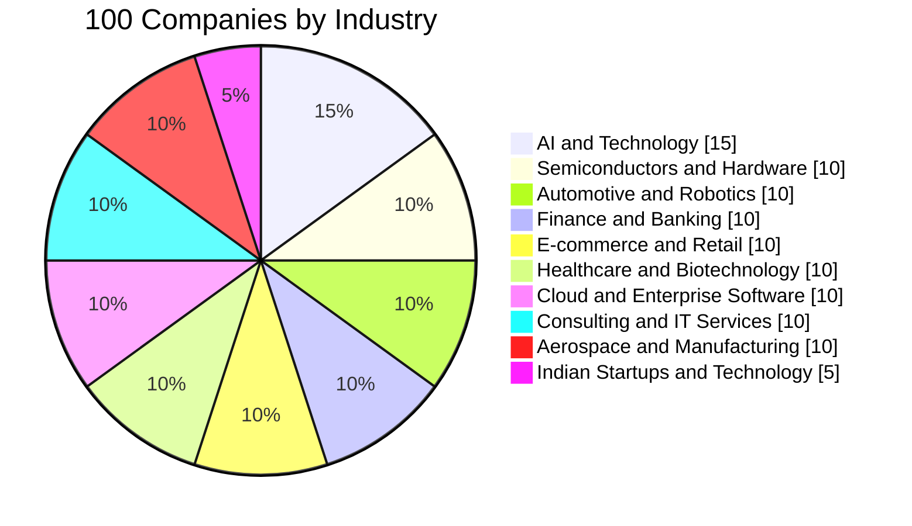
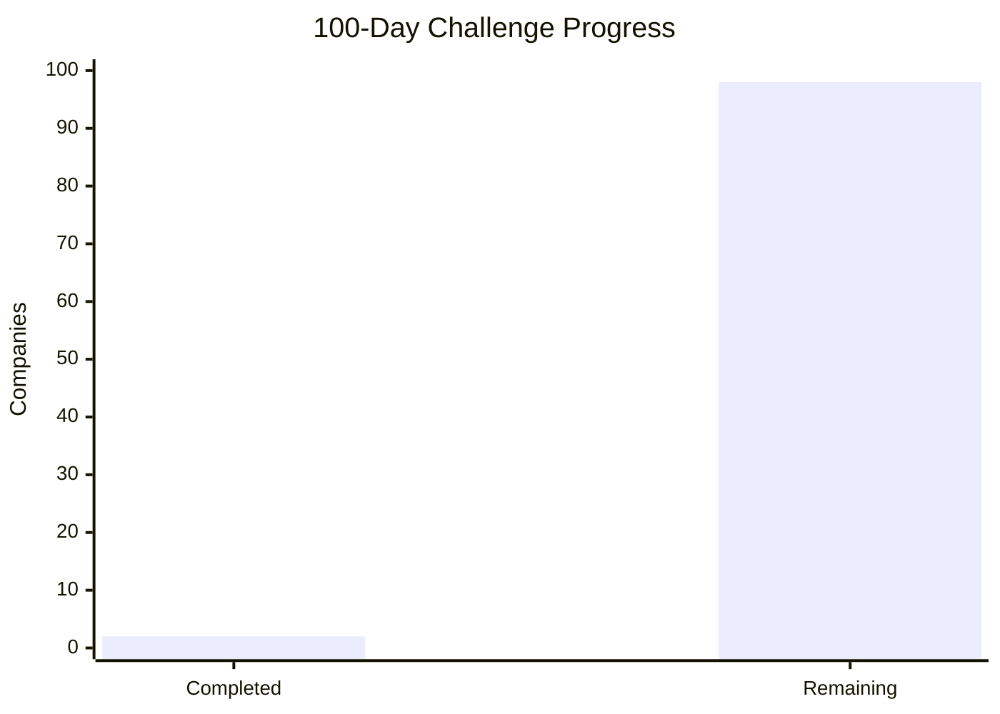

# 100 Days, 100 Companies
### A Deep Dive into Business Models, AI Strategies, Technology & Engineering

> **One company. One day. One detailed case study.**
>
> Understanding how the world's leading companies operate, make money, innovate, implement AI, build products, and solve real-world problems.

---

## Table of Contents

- [About the Challenge](#about-the-challenge)
- [Objectives](#objectives)
- [100-Day Roadmap](#100-day-roadmap)
- [Progress Dashboard](#progress-dashboard)
- [Case Study Framework](#case-study-framework)
- [Day 01 – Panasonic](#day-01--panasonic)
- [Day 02 – AMD](#day-02--amd)
- [Technology Learning Map](#technology-learning-map)
- [Key Takeaways](#key-takeaways)
- [Resources](#resources)

---

## About the Challenge

The objective of this challenge is to study 100 companies across different industries and understand how modern businesses operate.

This is not just a company research project. It is an exploration of the intersection of:

- Artificial Intelligence
- Business Strategy
- Software Engineering
- Data Engineering
- Cloud Computing
- Automation
- Product Development
- Innovation and Entrepreneurship

Each day focuses on one company, its business model, technology ecosystem, AI implementations, real-world projects, competitors, and engineering practices.

## Objectives

| Area | Learning Goal |
|---|---|
| Business | Understand how companies generate revenue |
| AI/ML | Explore real-world AI implementations |
| GenAI | Understand LLMs, RAG and AI agents |
| Engineering | Study architecture and technology stacks |
| Data | Understand data pipelines and analytics |
| Cloud | Explore infrastructure and deployment |
| Automation | Identify business process automation |
| Strategy | Understand competition and innovation |
| Career | Discover engineering roles and required skills |

---

# 100-Day Roadmap

The challenge covers 10 major industry categories.

## Industry Distribution

## Complete Company List

### 01. AI, Technology & Software

| Day | Company |
|---:|---|
| 01 | Panasonic |
| 02 | AMD |
| 03 | NVIDIA |
| 04 | Microsoft |
| 05 | Google |
| 06 | OpenAI |
| 07 | Meta |
| 08 | Apple |
| 09 | IBM |
| 10 | Oracle |
| 11 | Salesforce |
| 12 | Adobe |
| 13 | SAP |
| 14 | ServiceNow |
| 15 | Palantir |

### 02. Semiconductors & Hardware

| Day | Company |
|---:|---|
| 16 | Intel |
| 17 | Qualcomm |
| 18 | TSMC |
| 19 | Samsung Electronics |
| 20 | ASML |
| 21 | Broadcom |
| 22 | ARM |
| 23 | Micron |
| 24 | Texas Instruments |
| 25 | Supermicro |

### 03. Automotive, Robotics & Mobility

| Day | Company |
|---:|---|
| 26 | Tesla |
| 27 | Toyota |
| 28 | BMW |
| 29 | Mercedes-Benz |
| 30 | Hyundai |
| 31 | BYD |
| 32 | Waymo |
| 33 | Boston Dynamics |
| 34 | ABB |
| 35 | Siemens |

### 04. Finance, Banking & FinTech

| Day | Company |
|---:|---|
| 36 | JPMorgan Chase |
| 37 | Goldman Sachs |
| 38 | Morgan Stanley |
| 39 | Visa |
| 40 | Mastercard |
| 41 | PayPal |
| 42 | Stripe |
| 43 | Revolut |
| 44 | American Express |
| 45 | BlackRock |

### 05. E-commerce, Retail & Consumer

| Day | Company |
|---:|---|
| 46 | Amazon |
| 47 | Walmart |
| 48 | Alibaba |
| 49 | Flipkart |
| 50 | Shopify |
| 51 | IKEA |
| 52 | Walmart Labs |
| 53 | Nike |
| 54 | Unilever |
| 55 | Procter & Gamble |

### 06. Healthcare & Biotechnology

| Day | Company |
|---:|---|
| 56 | Johnson & Johnson |
| 57 | Pfizer |
| 58 | Roche |
| 59 | Moderna |
| 60 | Medtronic |
| 61 | Siemens Healthineers |
| 62 | GE HealthCare |
| 63 | Tempus AI |
| 64 | Recursion Pharmaceuticals |
| 65 | Insilico Medicine |

### 07. Cloud & Enterprise Infrastructure

| Day | Company |
|---:|---|
| 66 | Amazon Web Services |
| 67 | Google Cloud |
| 68 | Microsoft Azure |
| 69 | Cloudflare |
| 70 | Databricks |
| 71 | Snowflake |
| 72 | MongoDB |
| 73 | Confluent |
| 74 | HashiCorp |
| 75 | Datadog |

### 08. Consulting & IT Services

| Day | Company |
|---:|---|
| 76 | Accenture |
| 77 | Deloitte |
| 78 | TCS |
| 79 | Infosys |
| 80 | Wipro |
| 81 | HCLTech |
| 82 | Capgemini |
| 83 | Cognizant |
| 84 | Tech Mahindra |
| 85 | LTIMindtree |

### 09. Aerospace, Energy & Manufacturing

| Day | Company |
|---:|---|
| 86 | SpaceX |
| 87 | Boeing |
| 88 | Airbus |
| 89 | Lockheed Martin |
| 90 | GE Aerospace |
| 91 | Schneider Electric |
| 92 | Honeywell |
| 93 | Caterpillar |
| 94 | Hitachi |
| 95 | Bosch |

### 10. Indian Startups & Technology

| Day | Company |
|---:|---|
| 96 | Zoho |
| 97 | Freshworks |
| 98 | Razorpay |
| 99 | Zerodha |
| 100 | Jio Platforms |

*The roadmap is a planned sequence. Companies can be substituted if a more relevant case study emerges.*

---

# Progress Dashboard

## Challenge Completion

| Metric | Current Status |
|---|---:|
| Total Companies | 100 |
| Completed | 2 |
| Remaining | 98 |
| Completion | 2% |
| Current Day | Day 02 |
| Next Company | NVIDIA |

### Progress Chart

### Milestones

- [x] Day 01 – Panasonic
- [x] Day 02 – AMD
- [ ] Day 03 – NVIDIA
- [ ] Day 10 – First milestone
- [ ] Day 25 – Hardware milestone
- [ ] Day 50 – Halfway milestone
- [ ] Day 75 – Infrastructure milestone
- [ ] Day 100 – Final milestone

---

# Case Study Framework

Every company will be studied using the following framework.

| No. | Section | What to Investigate |
|---:|---|---|
| 01 | Company Overview | History, founders, headquarters and mission |
| 02 | Business Model | Revenue streams, customers and pricing |
| 03 | Products & Services | Main products and services |
| 04 | AI Strategy | AI, ML, GenAI and automation |
| 05 | AI Work Model | How AI is integrated into operations |
| 06 | Technology Stack | Languages, frameworks, cloud and databases |
| 07 | Architecture | System design, infrastructure and data flow |
| 08 | Real-World Projects | Major implementations and innovations |
| 09 | Competitors | Market competition and differentiation |
| 10 | Challenges | Failures, limitations and risks |
| 11 | Financial Overview | Revenue, growth and profitability |
| 12 | Career Opportunities | Roles, skills and engineering opportunities |
| 13 | Future Strategy | Roadmap and upcoming innovations |
| 14 | Key Learnings | Lessons for engineers and entrepreneurs |

---

**Founder:** Konosuke Matsushita

## 1. Company Overview
