# Day 01 – Panasonic Corporation
## Complete Company Case Study: Business Model, Artificial Intelligence, Technology, Operations & Future Strategy

| Information | Details |
|---|---|
| Company | Panasonic Holdings Corporation |
| Founded | 1918 |
| Founder | Konosuke Matsushita |
| Headquarters | Osaka, Japan |
| Industry | Electronics, Energy, Manufacturing, AI |
| CEO | Yuki Kusumi |
| Group CAIO | Akira Sakakibara |
| Employees | Approximately 183,685 (group profile) |
| Business presence | Global |
| Case study | Day 01 of 100 |
| Research date | November 2026 |

> **Central research question:** How is a traditional electronics and manufacturing company transforming itself into an AI-powered industrial technology and infrastructure business?

---

# Table of Contents

1. [Executive Summary](#1-executive-summary)
2. [History and Evolution](#2-history-and-evolution)
3. [Company Structure](#3-company-structure)
4. [Products and Services](#4-products-and-services)
5. [Business Model](#5-business-model)
6. [Financial Analysis](#6-financial-analysis)
7. [Artificial Intelligence Strategy](#7-artificial-intelligence-strategy)
8. [Real-World AI Implementations](#8-real-world-ai-implementations)
9. [Blue Yonder – Supply Chain AI](#9-blue-yonder--supply-chain-ai)
10. [AI Work Model](#10-ai-work-model)
11. [Technology Architecture](#11-technology-architecture)
12. [Data Engineering and Cloud](#12-data-engineering-and-cloud)
13. [AI and Robotics](#13-ai-and-robotics)
14. [Competitor Analysis](#14-competitor-analysis)
15. [SWOT Analysis](#15-swot-analysis)
16. [Challenges and Risks](#16-challenges-and-risks)
17. [Future Strategy](#17-future-strategy)
18. [Career Opportunities](#18-career-opportunities)
19. [Engineering Project Ideas](#19-engineering-project-ideas)
20. [Key Business Lessons](#20-key-business-lessons)
21. [Research Sources](#21-research-sources)

---

# 1. Executive Summary

Panasonic is a Japanese multinational company that started as an electrical products manufacturer and evolved into a global technology group.

Its business now extends across:

- Consumer electronics.
- Electric vehicle batteries.
- Industrial electronic components.
- Energy storage.
- Supply chain management software.
- Industrial automation.
- AI infrastructure.
- Enterprise software and services.

The important development is that Panasonic is repositioning itself around three business areas:

1. **Devices:** Products and components supporting AI infrastructure.
2. **Solutions:** AI-powered services and technologies supporting industrial and social operations.
3. **Smart Life:** Products and services improving everyday life.

Its AI transformation is not limited to building chatbots. It includes enterprise AI assistants, predictive analytics, supply chain optimization, data center power infrastructure and Physical AI.

### The central business transformation

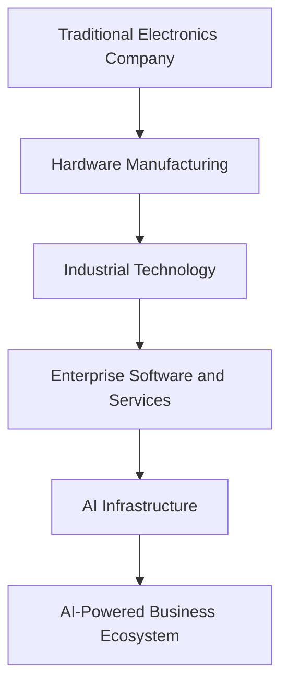

**Major strategic initiative:** Panasonic Go, announced in January 2025.

Its announced ambition is to make AI-driven hardware, software and solutions represent 30% of Panasonic Holdings' revenue by 2035.

---

# 2. History and Evolution

## 2.1 Foundation – 1918

Panasonic was founded in 1918 by Konosuke Matsushita in Osaka, Japan.

The business initially focused on manufacturing electrical components.

Its early products included electrical wiring devices and lighting-related equipment.

The company's founding philosophy was to use technology to improve people's lives.

## 2.2 Expansion – 1920s to 1960s

Panasonic expanded into consumer electrical products.

Important product categories included:

- Radios.
- Batteries.
- Household appliances.
- Electrical equipment.
- Television technology.

The company became one of Japan's major electronics manufacturers.

## 2.3 Global expansion – 1970s to 2000s

Panasonic expanded internationally and developed businesses across:

- Consumer electronics.
- Industrial equipment.
- Automotive electronics.
- Batteries.
- Audio and video technologies.

It became a global competitor in consumer electronics and industrial manufacturing.

## 2.4 Digital transformation – 2010s

Panasonic increasingly expanded into business-to-business markets.

Important developments included:

- Industrial automation.
- Automotive battery production.
- Enterprise software.
- Connected devices.
- Supply chain technologies.

One significant development was its acquisition of Blue Yonder, a supply chain software company.

## 2.5 AI transformation – 2020 to 2026

Panasonic began increasingly focusing on AI, cloud-connected solutions and digital transformation.

Important milestones:

| Year | Development |
|---|---|
| 2018 | Panasonic celebrated its 100th anniversary |
| 2021 | Acquisition of Blue Yonder completed |
| 2025 | Panasonic Go announced |
| 2025 | PX-AI employee assistant initiative publicized |
| 2026 | New organizational structure introduced |
| 2026 | Group Chief AI Officer position established |
| 2026 | AI infrastructure strategy expanded |

### Why this evolution matters

Panasonic's transformation illustrates how a manufacturing company can use its existing hardware, industrial knowledge and customer relationships to enter higher-value technology markets.

---

# 3. Company Structure

## 3.1 Panasonic Group

Panasonic Holdings Corporation is the group holding company.

Its business operations are conducted through operating companies and affiliated businesses.

The group reorganized its structure in April 2026.

For this case study, its current strategy is best understood through three major business areas.

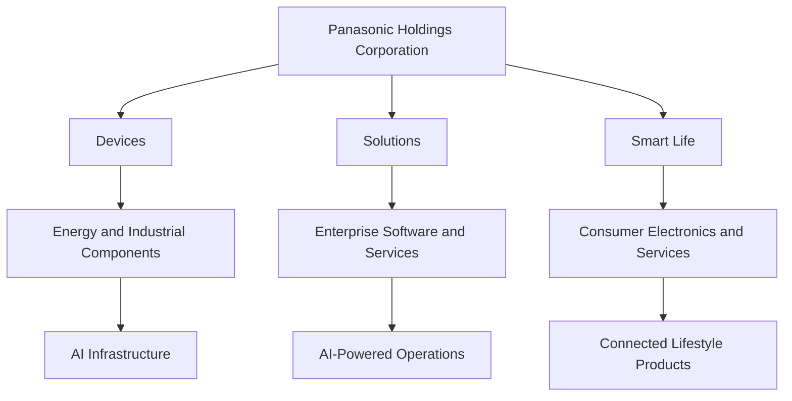

## 3.2 Devices Area

Focus: Supplying the components and energy infrastructure needed by modern technology systems.

Examples:

- Electronic components.
- High-performance PCB materials.
- Capacitors.
- EV batteries.
- Industrial batteries.
- Data center energy storage.

## 3.3 Solutions Area

Focus: Helping businesses improve their operations.

Examples:

- Supply chain management.
- Warehouse management.
- Industrial automation.
- Public-sector solutions.
- Avionics.
- Enterprise software.
- Equipment maintenance.

## 3.4 Smart Life Area

Focus: Improving consumer experiences through products and services.

Examples:

- Refrigerators.
- Washing machines.
- Air conditioners.
- Home appliances.
- Personal electronics.

---

# 4. Products and Services

## 4.1 Consumer Electronics

Panasonic manufactures consumer products for homes and individuals.

| Product | Purpose |
|---|---|
| Refrigerators | Food storage |
| Washing machines | Laundry automation |
| Air conditioners | Climate control |
| Televisions | Entertainment |
| Cameras | Photography and video |
| Personal appliances | Everyday convenience |

## 4.2 Energy and Batteries

Panasonic Energy develops and manufactures battery technologies.

Major applications:

- Electric vehicles.
- Energy storage systems.
- Industrial equipment.
- Consumer batteries.
- Data center backup power.

One important market is the electric vehicle industry.

Batteries are critical components of EV manufacturing because they directly influence:

- Driving range.
- Charging performance.
- Energy density.
- Vehicle cost.
- Safety.

## 4.3 Industrial Components

Panasonic Industry supplies components used in electronic and industrial systems.

Examples:

- Capacitors.
- Sensors.
- Electronic materials.
- Circuit board materials.
- Industrial automation equipment.

These components are especially important in AI data centers.

AI servers require high-speed signal transmission, reliable electrical power and efficient thermal management.

## 4.4 Enterprise Solutions

Panasonic Connect provides enterprise technologies.

Its solutions include:

- Supply chain software.
- Warehouse automation.
- Logistics management.
- Manufacturing solutions.
- Public services technology.
- Aviation entertainment systems.

---

# 5. Business Model

Panasonic operates multiple business models simultaneously.

## 5.1 B2C – Business to Consumer

Panasonic sells products directly or through retailers to consumers.

Example:

A customer purchases a Panasonic refrigerator.

Revenue is generated through the product sale.

## 5.2 B2B – Business to Business

Panasonic sells products and technologies to other businesses.

Example:

A technology company purchases electronic components for its servers.

Revenue comes from business contracts and product supply.

## 5.3 SaaS – Software as a Service

Blue Yonder provides enterprise supply chain software.

Businesses use its software to manage supply chains, forecast demand and optimize inventory.

Revenue can come from subscriptions, software licensing and related services.

## 5.4 Enterprise Services

Panasonic also generates business through installation, integration, maintenance, engineering and support.

## Business model visualization

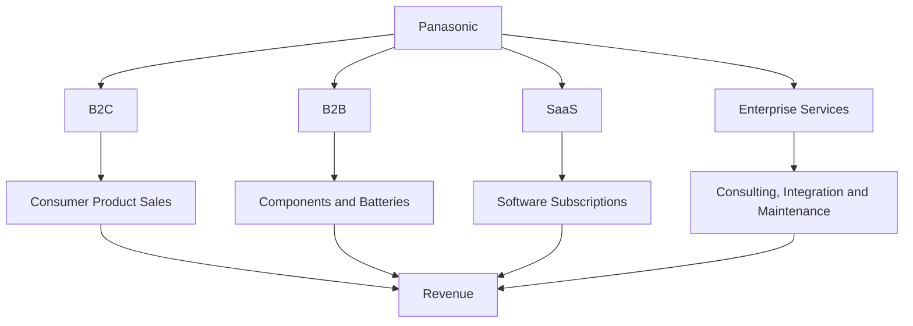

### The strategic shift

Traditional model:

Hardware sales → One-time transaction.

Evolving model:

Hardware + Software + AI + Services → Long-term customer relationship.

This is particularly important because recurring services can create more predictable revenue than relying entirely on hardware sales.

---

# 6. Financial Analysis

Financial performance helps us understand whether a company's strategy is supported by actual business results.

## 6.1 FY2025 Financial Performance

Panasonic's consolidated financial results for the financial year ended March 31, 2025:

| Financial Metric | FY2025 |
|---|---:|
| Net Sales | ¥8,458.2 billion |
| Operating Profit | ¥426.5 billion |
| Profit Before Tax | ¥486.3 billion |
| Net Profit Attributable to Owners | ¥366.2 billion |

Source: Panasonic FY2025 consolidated financial results.

## 6.2 Revenue Comparison

| Metric | FY2024 | FY2025 |
|---|---:|---:|
| Net Sales | ¥8,496.4B | ¥8,458.2B |
| Operating Profit | ¥361.0B | ¥426.5B |
| Net Profit | ¥444.0B | ¥366.2B |

### Revenue chart

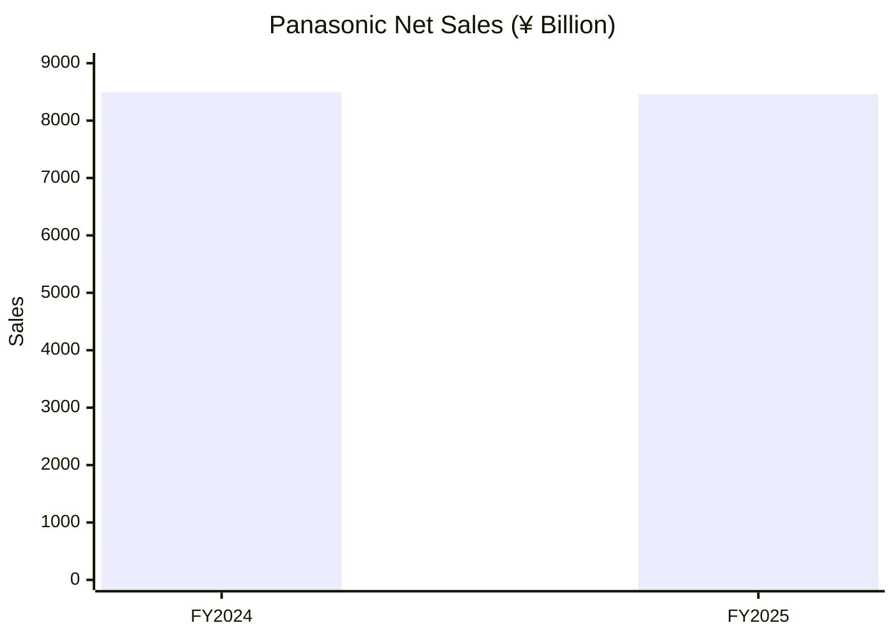

### Operating profit chart

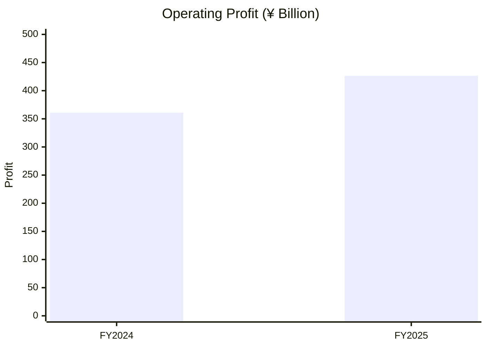

### Interpretation

Three observations:

1. Revenue declined slightly between FY2024 and FY2025.
2. Operating profit increased.
3. Net profit declined.

This demonstrates why revenue alone cannot determine whether a business is improving.

Operating costs, restructuring, investments, taxes and exceptional items can affect profitability.

## 6.3 Segment Financial Performance

FY2025 segment information, excluding the Automotive segment:

| Segment | Sales (¥B) | Adjusted Operating Profit (¥B) |
|---|---:|---:|
| Energy | 873.2 | 122.7 |
| Industry | 1,083.6 | 54.3 |
| Connect | 1,333.2 | 81.4 |
| Lifestyle | 3,584.2 | 136.2 |
| Total | 7,785.0 | 442.7 |

### Segment sales chart

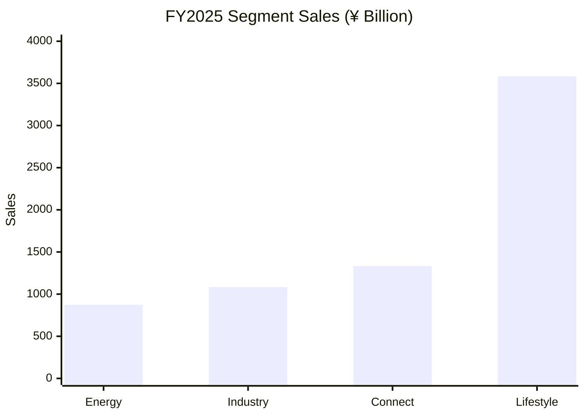

### Business interpretation

- Lifestyle was the largest of these four segments by sales.
- Energy generated the highest adjusted operating profit margin among these four segments.
- Connect is strategically important because it includes enterprise solutions and Blue Yonder.
- Industry provides components used in industrial and technology infrastructure.

**Important:** The segment table above excludes Automotive. It should not be directly treated as the complete consolidated group revenue.

---

# 7. Artificial Intelligence Strategy

Panasonic's AI strategy is one of the most important parts of this case study.

The company wants to use AI in two directions:

1. Improve its own internal business operations.
2. Build and sell AI-powered products, components and enterprise solutions.

## 7.1 Panasonic Go

Announced in January 2025 at CES.

Panasonic Go is a global corporate initiative focused on accelerating AI-driven transformation.

Its target is to make AI-driven hardware, software and solution businesses account for 30% of revenue by 2035.

### What does this mean?

Panasonic wants to move beyond being perceived primarily as a hardware manufacturer.

It wants to combine:

- Hardware.
- Software.
- Artificial intelligence.
- Cloud-connected systems.
- Enterprise services.
- Industrial expertise.

## 7.2 PX-AI

PX-AI is Panasonic's internal generative AI assistant initiative.

The company announced its rollout to approximately 180,000 employees.

### What is the purpose?

Employees can use enterprise AI assistants to improve productivity.

Potential use cases include:

- Summarizing documents.
- Drafting reports.
- Research assistance.
- Internal knowledge retrieval.
- Improving communication.
- Supporting routine office tasks.

### Example workflow

An employee needs to prepare a report about a manufacturing process.

Traditional workflow:

1. Find relevant documents.
2. Read multiple files.
3. Extract important information.
4. Organize findings.
5. Prepare a report.

AI-assisted workflow:

1. Provide relevant authorized documents.
2. Ask the AI assistant to summarize them.
3. Extract key findings.
4. Review and verify the output.
5. Prepare the final report.

### Important engineering concepts

- Large Language Models.
- Enterprise AI assistants.
- Retrieval-Augmented Generation.
- Document processing.
- Access control.
- Data security.
- Human-in-the-loop validation.

These are general technical concepts relevant to enterprise AI assistants, not a disclosure of PX-AI's complete internal implementation.

## 7.3 Physical AI

Physical AI refers to AI systems that interact with the physical world.

Examples:

- Industrial robots.
- Autonomous machines.
- Intelligent manufacturing equipment.
- Automated inspection systems.
- Robotics-assisted logistics.

Panasonic has a major advantage here: decades of manufacturing experience and operational data.

---

# 8. Real-World AI Implementations

This section distinguishes between publicly announced initiatives and potential applications.

## 8.1 Enterprise AI – PX-AI

| Attribute | Details |
|---|---|
| Application | Internal productivity |
| Technology | LLM-based AI assistant |
| Users | Approximately 180,000 employees in announced rollout |
| Purpose | Improve operational efficiency |
| Business value | Employee productivity |

## 8.2 Supply Chain AI – Blue Yonder

| Attribute | Details |
|---|---|
| Application | Supply chain management |
| Technology | Predictive AI and Generative AI |
| Customers | Retailers, manufacturers and logistics businesses |
| Purpose | Improve supply chain decisions |
| Business value | Better forecasting and operational planning |

Blue Yonder reports over 20 billion predictions daily across its supply chain platform.

## 8.3 AI Infrastructure

Panasonic supplies components and energy systems used in data center infrastructure.

This is a particularly interesting business model.

An AI data center needs more than GPUs.

It also needs:

- High-speed electrical components.
- Power management.
- Reliable energy storage.
- Backup power.
- Thermal management.
- Supporting infrastructure.

Panasonic participates in this market through its components and energy businesses.

## 8.4 Manufacturing AI

Relevant applications include:

- Automated quality inspection.
- Predictive maintenance.
- Production optimization.
- Defect detection.
- Manufacturing analytics.

These should be understood as industrial AI application areas; individual deployments need separate project-level evidence before being attributed to a specific Panasonic facility.

---

# 9. Blue Yonder – Supply Chain AI

Blue Yonder is one of the most important parts of Panasonic's enterprise software strategy.

Panasonic completed its acquisition of Blue Yonder in 2021.

Blue Yonder provides supply chain management software to large businesses.

## 9.1 What problem does Blue Yonder solve?

Imagine a retail company operating:

- 500 stores.
- 10 warehouses.
- Thousands of products.
- Multiple suppliers.
- Millions of customer transactions.

The company needs to answer:

- How much stock should each store maintain?
- Which products will sell next week?
- When should a warehouse reorder products?
- Which delivery routes are efficient?
- What happens if a supplier is delayed?

Managing this manually is difficult.

Blue Yonder uses software, data analytics and AI to help businesses make these decisions.

## 9.2 AI capabilities

| Capability | Business Problem |
|---|---|
| Demand Forecasting | Predict future customer demand |
| Inventory Optimization | Maintain appropriate stock levels |
| Logistics Optimization | Improve transportation efficiency |
| Warehouse Management | Manage warehouse operations |
| Supply Planning | Coordinate production and supply |
| Order Management | Manage customer orders |

## 9.3 How AI works in supply chain management

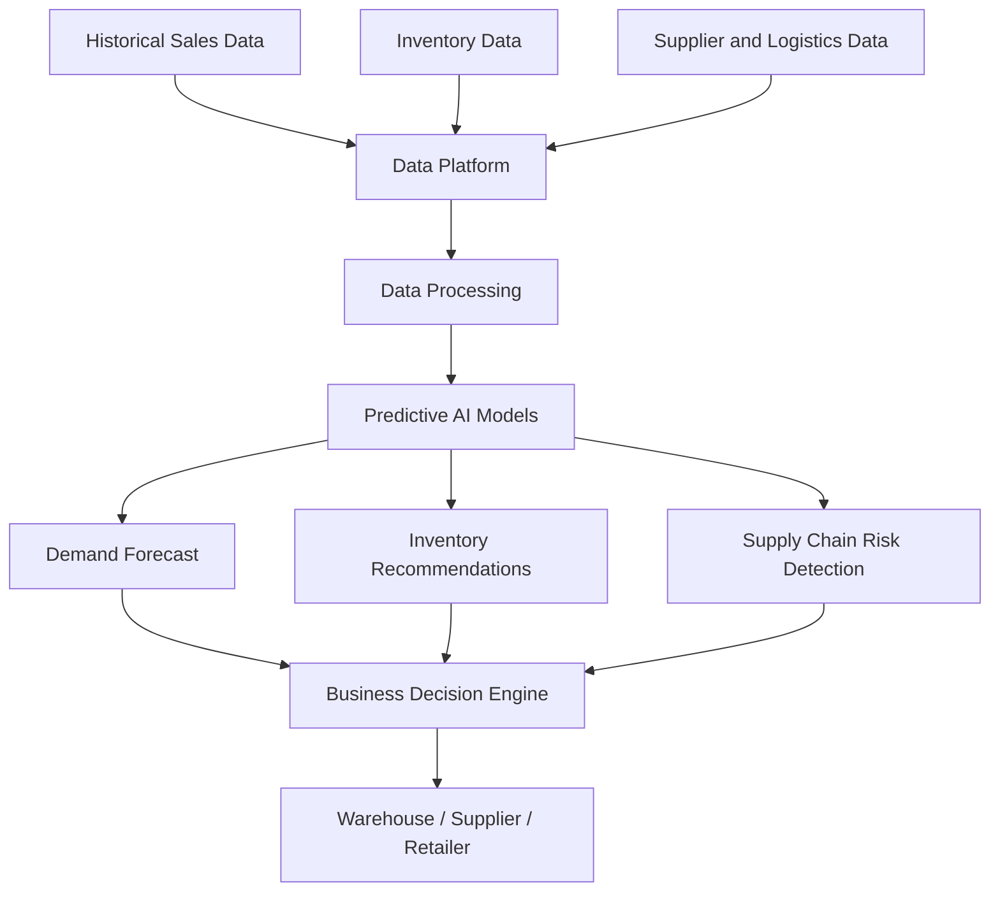

## 9.4 Example

A retailer sells 10,000 units of a product every month.

An AI model analyzes:

- Historical sales.
- Seasonal trends.
- Promotions.
- Weather patterns.
- Inventory availability.
- Supplier delivery times.

The system estimates future demand.

The retailer can then make better inventory and purchasing decisions.

### Why this is valuable

Without forecasting, the retailer may:

- Order too much stock.
- Run out of popular products.
- Waste warehouse space.
- Lose sales.
- Increase logistics costs.

AI helps reduce these operational problems.

## 9.5 Engineering Concepts

- Time-series forecasting.
- Machine learning.
- Data pipelines.
- Distributed computing.
- APIs.
- Cloud infrastructure.
- Event-driven architecture.
- Optimization algorithms.

---

# 10. AI Work Model

How does Panasonic use AI as part of its business?

There are four important layers.

## Layer 1 – Data Collection

Sources:

- Industrial sensors.
- Production machines.
- Business applications.
- Supply chain systems.
- Employee documents.
- Customer transactions.

## Layer 2 – Data Processing

Collected information must be processed.

Possible technologies:

- ETL pipelines.
- Data warehouses.
- Data lakes.
- Stream processing.
- Data validation.

## Layer 3 – Intelligence

AI models analyze the processed information.

Examples:

- Forecasting.
- Classification.
- Anomaly detection.
- LLM-based document processing.
- Recommendation systems.
- Optimization.

## Layer 4 – Business Action

The output must create real business value.

Examples:

- Reordering inventory.
- Alerting maintenance teams.
- Optimizing manufacturing schedules.
- Helping employees find information.
- Improving logistics planning.

### Overall AI workflow

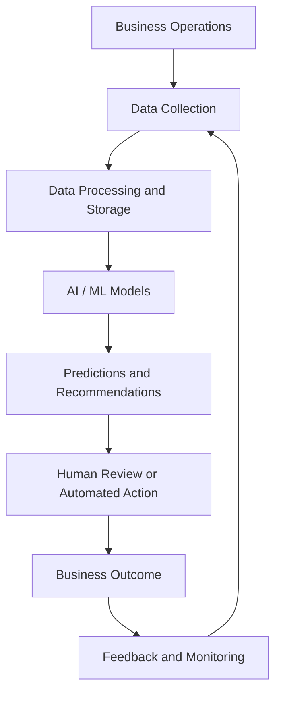

**Important:** This is a generalized enterprise AI reference architecture. It is not Panasonic's confidential internal system architecture.

---

# 11. Technology Architecture

Panasonic operates across hardware, enterprise software and AI systems.

Its complete internal technology stack is not publicly disclosed.

Therefore, the following is a technology map of the engineering capabilities involved in its businesses, not a verified inventory of every tool Panasonic uses internally.

## 11.1 Technology Stack Map

| Layer | Technologies / Concepts |
|---|---|
| Programming | Python, C++, Java |
| AI/ML | Machine Learning, Deep Learning |
| GenAI | LLMs, RAG, AI Agents |
| Data Engineering | ETL, Spark, Kafka |
| Databases | SQL, Distributed Databases |
| Cloud | Enterprise Cloud Platforms |
| Backend | REST APIs, Microservices |
| DevOps | Docker, Kubernetes, CI/CD |
| IoT | Industrial Sensors |
| Embedded | Firmware, Real-time Systems |
| Robotics | Computer Vision, Motion Control |
| Analytics | Forecasting, Optimization |

## 11.2 Enterprise AI System Architecture

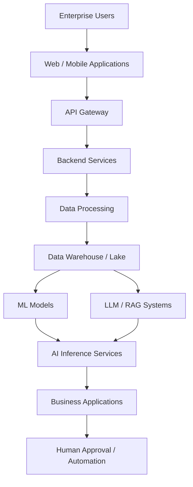

## 11.3 Security Requirements

Enterprise AI requires strong security.

Important considerations:

- Authentication.
- Role-based access control.
- Encryption.
- Data governance.
- Audit logging.
- Model access policies.
- Sensitive document protection.
- AI output validation.

For example, an employee should not be able to retrieve confidential HR or financial documents unless authorized.

---

# 12. Data Engineering and Cloud

This section is especially important for understanding how a Panasonic-scale business can operate AI systems.

## 12.1 Why Data Engineering Matters

AI models require high-quality data.

Consider a factory producing thousands of electronic components.

Every machine generates operational information:

- Temperature.
- Production speed.
- Machine status.
- Energy consumption.
- Error codes.
- Product quality measurements.

This data can be collected and processed to support analytics and predictive maintenance.

## 12.2 Example Data Pipeline

This is an illustrative architecture using common technologies.

## 12.3 Example Database Design

An industrial monitoring system might use the following tables.

**machines**

| Column | Type |
|---|---|
| machine_id | INT |
| machine_name | VARCHAR |
| factory_id | INT |
| status | VARCHAR |

**machine_sensor_data**

| Column | Type |
|---|---|
| record_id | BIGINT |
| machine_id | INT |
| temperature | FLOAT |
| vibration | FLOAT |
| energy_consumption | FLOAT |
| recorded_at | TIMESTAMP |

**maintenance_records**

| Column | Type |
|---|---|
| maintenance_id | INT |
| machine_id | INT |
| issue_type | VARCHAR |
| maintenance_date | DATE |
| status | VARCHAR |

## 12.4 Possible AI Application

An ML model analyzes historical sensor data.

If the temperature or vibration pattern changes abnormally, the system generates an alert.

This can help maintenance teams identify problems before equipment failure.

### Skills involved

- Python.
- SQL.
- Pandas.
- PySpark.
- Airflow.
- Kafka.
- Cloud storage.
- Machine learning.
- Monitoring and alerting.

---

# 13. AI and Robotics

Panasonic's future strategy includes Physical AI.

Physical AI connects artificial intelligence with machines and physical environments.

## Example: Intelligent Manufacturing

Imagine a production line where robots manufacture electronic products.

A computer vision system inspects products.

The system identifies possible defects and sends information to the production management system.

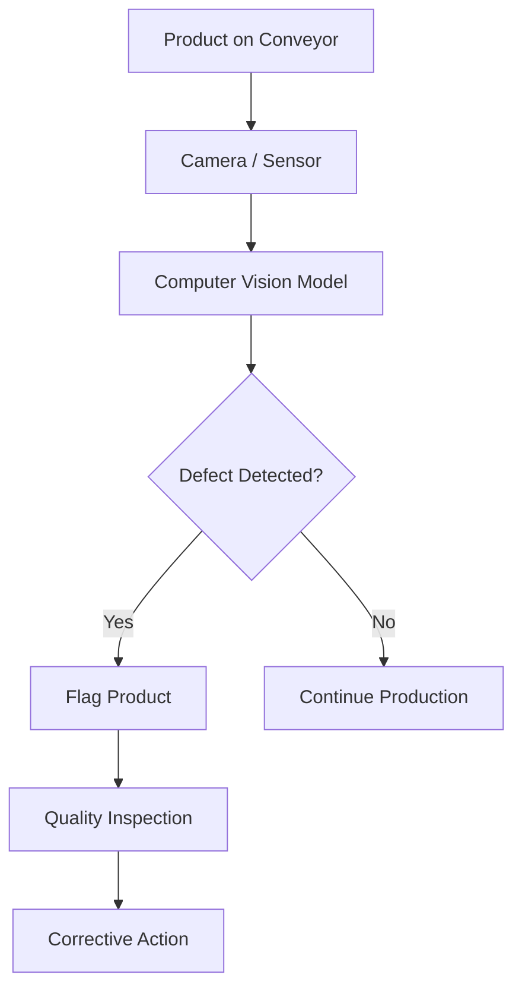

### Technologies involved

- Computer Vision.
- Deep Learning.
- Robotics.
- Industrial IoT.
- Edge Computing.
- Real-time processing.

The key benefit is the ability to connect AI decisions directly with physical operations.

---

# 14. Competitor Analysis

Panasonic competes across several different industries, so it does not have one universal competitor.

| Competitor | Industry | Competitive Area |
|---|---|---|
| Samsung | Electronics | Consumer and industrial electronics |
| LG | Electronics | Home appliances and displays |
| BYD | Batteries | EV batteries |
| CATL | Batteries | Energy storage and EV batteries |
| Siemens | Industrial | Automation and infrastructure |
| Schneider Electric | Energy | Power management |
| Honeywell | Industrial | Automation and enterprise solutions |
| Blue Yonder competitors | Supply chain software | Enterprise planning |

## Competitive Positioning

### Panasonic vs Samsung

Both operate in consumer and industrial electronics.

Samsung has major strengths in semiconductors, displays and mobile devices.

Panasonic has strengths in batteries, industrial components and enterprise solutions.

### Panasonic vs CATL

Both operate in battery markets.

CATL is a major global EV battery manufacturer.

Panasonic has significant battery technology and manufacturing relationships, particularly in the automotive sector.

### Panasonic vs Siemens

Both operate in industrial technology.

Siemens has a strong position in industrial automation, digital industries and infrastructure.

Panasonic competes through components, manufacturing expertise and industrial solutions.

### Panasonic vs NVIDIA

They are not direct competitors across their core businesses.

However, Panasonic supplies components and energy infrastructure that can support AI data centers, while NVIDIA provides AI computing hardware and software.

This demonstrates how companies in different parts of the technology value chain can benefit from the same AI market growth.

---

# 15. SWOT Analysis

| Strengths | Weaknesses |
|---|---|
| Established global brand | Complex business structure |
| Manufacturing expertise | Exposure to competitive hardware markets |
| Battery technology | Significant capital requirements |
| Industrial customer relationships | Dependence on supply chains |
| Enterprise software through Blue Yonder | Challenging business transformation |

| Opportunities | Threats |
|---|---|
| AI data center growth | Strong global competitors |
| Physical AI | Semiconductor supply constraints |
| Enterprise AI | Geopolitical risks |
| Energy storage | Raw material price volatility |
| Industrial automation | Rapid technology changes |

### Strategic interpretation

Panasonic has a valuable combination of physical manufacturing capabilities and enterprise technology.

Its challenge is converting these assets into sustainable, higher-margin growth.

---

# 16. Challenges and Risks

## 16.1 Competition

Panasonic operates in markets with strong global competitors.

Competition can reduce pricing power and profit margins.

## 16.2 AI Infrastructure Costs

Expanding production capacity for AI-related components and energy systems requires significant investment.

## 16.3 Supply Chain Risks

Battery manufacturing and electronic components depend on global suppliers and raw materials.

## 16.4 Enterprise AI Security

AI assistants and enterprise systems must protect sensitive company information.

## 16.5 AI Reliability

AI predictions are not always correct.

Manufacturing and supply chain decisions require validation, monitoring and human oversight.

## 16.6 Organizational Transformation

Integrating AI across a large multinational organization requires:

- Employee training.
- Leadership support.
- Technology modernization.
- Data governance.
- Change management.

---

# 17. Future Strategy

Panasonic's strategy focuses on addressing two major societal challenges:

1. Increasing energy efficiency.
2. Addressing shortages of frontline workers.

## 17.1 AI Infrastructure Growth

Panasonic wants to supply products and technologies that support AI data centers.

Its products can contribute to:

- Electrical power management.
- High-speed signal transmission.
- Energy storage.
- Backup power.
- Server infrastructure.

According to its updated growth strategy, Panasonic's AI infrastructure-related businesses have a FY2029 sales target of approximately ¥1.6 trillion, following an upward revision announced in October 2026.

## 17.2 Enterprise Solutions

Panasonic plans to expand services and engineering capabilities.

The idea is to move beyond selling equipment and help customers continuously improve their operations.

## 17.3 AI Revenue Target

Panasonic Go announced the ambition of making AI-driven hardware, software and solutions 30% of revenue by 2035.

## 17.4 Investment

Panasonic's strategy includes substantial investment in AI infrastructure-related businesses, manufacturing capacity and next-generation products.

### Future strategy visualization

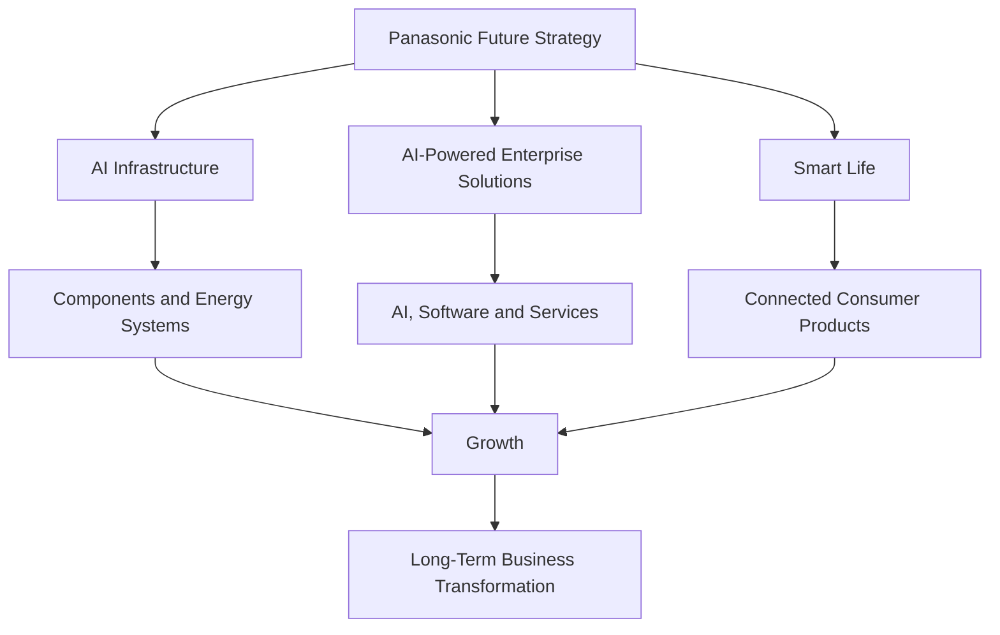

---

# 18. Career Opportunities

Panasonic operates in many technology areas, creating opportunities for different engineering specializations.

## 18.1 AI Engineer

Responsibilities:

- Develop AI models.
- Integrate LLMs.
- Build intelligent applications.
- Optimize model inference.
- Deploy AI solutions.

Required skills:

- Python.
- PyTorch.
- Machine Learning.
- LLMs.
- RAG.
- Model deployment.

## 18.2 Data Engineer

Responsibilities:

- Build data pipelines.
- Process industrial data.
- Develop ETL workflows.
- Manage databases.
- Build data infrastructure.

Required skills:

- Python.
- SQL.
- PySpark.
- Airflow.
- Kafka.
- Cloud platforms.

## 18.3 Cloud Engineer

Responsibilities:

- Manage cloud infrastructure.
- Deploy enterprise applications.
- Monitor systems.
- Implement security.
- Improve scalability.

Required skills:

- AWS / Azure / GCP.
- Linux.
- Docker.
- Kubernetes.
- Networking.
- CI/CD.

## 18.4 Backend Engineer

Responsibilities:

- Develop enterprise APIs.
- Integrate AI services.
- Build microservices.
- Manage databases.
- Improve application performance.

Required skills:

- Python / Java / C++.
- FastAPI / Spring Boot.
- PostgreSQL.
- REST APIs.
- Docker.

## 18.5 Robotics Engineer

Responsibilities:

- Develop automation systems.
- Integrate sensors.
- Implement computer vision.
- Control industrial robots.

Required skills:

- C++.
- Python.
- ROS.
- Computer Vision.
- Embedded Systems.

### Career learning matrix

| Role | Important Skills |
|---|---|
| AI Engineer | Python, LLMs, PyTorch |
| Data Engineer | SQL, Spark, Airflow |
| Cloud Engineer | AWS, Linux, Docker |
| Backend Engineer | APIs, Python, Databases |
| Robotics Engineer | C++, ROS, Computer Vision |
| ML Engineer | Model Training, MLOps |

---

# 19. Engineering Project Ideas

The best way to understand a company's technology is to build something inspired by its real business problems.

Here are five practical projects.

## Project 1 – AI Predictive Maintenance System

**Problem:** Manufacturing machines can fail unexpectedly.

**Solution:** Build an ML system that analyzes machine sensor data and predicts possible equipment failures.

Technology:

- Python.
- Pandas.
- Scikit-learn.
- FastAPI.
- PostgreSQL.
- Power BI.

Architecture:

## Project 2 – AI Supply Chain Forecasting

**Problem:** Businesses struggle to predict demand.

**Solution:** Build a forecasting model using historical sales data.

Features:

- Sales forecasting.
- Inventory recommendations.
- Low-stock alerts.
- Demand trend visualization.

Technology:

- Python.
- Pandas.
- Prophet or XGBoost.
- FastAPI.
- PostgreSQL.
- Power BI.

## Project 3 – Enterprise RAG Assistant

**Problem:** Employees spend time searching company documents.

**Solution:** Create an internal assistant that answers questions from authorized documents.

Features:

- PDF ingestion.
- Document chunking.
- Embeddings.
- Vector search.
- LLM-based answers.
- Source citations.
- Access control.

Technology:

- Python.
- FastAPI.
- FAISS.
- PostgreSQL.
- LLM API.
- Docker.

## Project 4 – Industrial Anomaly Detection

**Problem:** Unexpected changes in machine behavior can cause production issues.

**Solution:** Build an anomaly detection model using sensor data.

Features:

- Temperature monitoring.
- Vibration analysis.
- Abnormal pattern detection.
- Real-time alerts.

Technology:

- Python.
- Scikit-learn.
- Kafka.
- FastAPI.
- Grafana.

## Project 5 – Smart Energy Management

**Problem:** Data centers and industrial facilities need to manage energy consumption efficiently.

**Solution:** Build a dashboard and forecasting system for power consumption.

Features:

- Energy usage monitoring.
- Peak load forecasting.
- Power consumption analysis.
- Anomaly detection.
- Energy optimization recommendations.

Technology:

- Python.
- SQL.
- Time-series forecasting.
- Power BI.
- FastAPI.

---

# 20. Key Business Lessons

## Lesson 1 – AI Is Not Just ChatGPT

AI can improve forecasting, manufacturing, logistics, energy management and industrial automation.

## Lesson 2 – Hardware and Software Can Work Together

Panasonic demonstrates the value of combining physical products with software and enterprise services.

## Lesson 3 – Data Is a Business Asset

Manufacturing and supply chain data can create valuable insights when processed correctly.

## Lesson 4 – Recurring Revenue Matters

Software subscriptions and enterprise services can create longer-term customer relationships.

## Lesson 5 – AI Infrastructure Is a Business Opportunity

AI needs GPUs, servers, power systems, cooling, electronic components and data center infrastructure.

The companies supplying these systems can also benefit from AI adoption.

## Lesson 6 – Existing Businesses Can Become AI Businesses

A company does not need to develop its own foundation model to benefit from AI.

It can use existing industry knowledge, data, hardware and customers to develop AI-powered solutions.

---

# 21. Research Sources

The following are the primary research sources for this case study.

| Source | Research Area | Link |
|---|---|---|
| Panasonic Official Website | Company overview | https://holdings.panasonic/global/ |
| Panasonic Group Strategy | Business segments | https://holdings.panasonic/global/corporate/about/group-strategy.html |
| Panasonic Investor Relations | Financial information | https://holdings.panasonic/global/corporate/investors.html |
| Panasonic Integrated Report | Financial and business analysis | https://holdings.panasonic/global/corporate/investors/ |
| Panasonic Go Announcement | AI strategy | https://news.panasonic.com/global/es/press/en250108-11 |
| Panasonic CAIO Message | AI leadership and strategy | https://holdings.panasonic/global/corporate/technology/caio_message.html |
| Panasonic Blue Yonder | Supply chain technology | https://blueyonder.com/ |
| Panasonic Energy | Battery business | https://www.panasonic.com/global/energy/ |

### Research verification notes

- FY2025 financial figures refer to the financial year ended March 31, 2025.
- FY2025 segment information is presented separately from the Automotive segment.
- Panasonic Go's 2035 target is an announced strategic ambition, not an achieved result.
- PX-AI's approximately 180,000 employee rollout figure comes from Panasonic's 2025 announcement.
- The FY2029 AI infrastructure sales target reflects the October 2026 revision.
- Illustrative architectures in this document are learning models, not verified internal Panasonic designs.

---

# Final Assessment

| Research Dimension | Assessment |
|---|---|
| Business Model | Hardware + Software + Services |
| AI Strategy | Enterprise AI + Industrial AI + Infrastructure |
| Main AI Opportunity | Data Centers and Industrial Automation |
| Software Business | Blue Yonder |
| Internal AI Initiative | PX-AI |
| Long-Term Direction | AI-powered industrial ecosystem |
| Engineering Relevance | High |

## Final Conclusion

Panasonic is an excellent example of how an established manufacturing company can reposition itself for the AI economy.

Its competitive advantage does not come from AI software alone.

It comes from combining:

1. Manufacturing expertise.
2. Industrial hardware.
3. Battery and energy technology.
4. Enterprise software.
5. Operational data.
6. AI and automation.

**The biggest lesson: The AI revolution is not limited to companies that build AI models. It also creates opportunities for companies that build the infrastructure, hardware, software and systems that make AI useful in the real world.**

---

## Case Study Completion

- [x] Company history researched.
- [x] Business model analyzed.
- [x] Business segments studied.
- [x] Financial performance reviewed.
- [x] AI strategy investigated.
- [x] PX-AI examined.
- [x] Blue Yonder examined.
- [x] Technology architecture mapped.
- [x] Competitors analyzed.
- [x] Engineering project ideas documented.

**Day 01 / 100 – PANASONIC: COMPLETED**

**Next: Day 02 – AMD**

*100 Days. 100 Companies. Understand the Business. Understand the Technology. Build Like an Engineer.*
