# Day 002 – AMD (Advanced Micro Devices)
## Complete Company Case Study: Business Model, AI Strategy, GPU Architecture, ROCm, Data Centers & Engineering

| Information | Details |
|---|---|
| Full Name | Advanced Micro Devices, Inc. |
| Founded | May 1, 1969 |
| Founders | Jerry Sanders and seven co-founders |
| Headquarters | Santa Clara, California, USA |
| CEO | Dr. Lisa Su |
| Industry | Semiconductors and Computing |
| Stock Symbol | NASDAQ: AMD |
| Business Model | Semiconductor design and sales |
| Major Competitors | NVIDIA, Intel, Qualcomm |
| Case Study | Day 002 of 100 |
| Research Date | November 6, 2026 |

> **Central research question:** How did AMD evolve from a semiconductor startup into one of the major companies supplying CPUs, GPUs and infrastructure for the global AI industry?

---

# Table of Contents

1. Executive Summary
2. Company History
3. Leadership and Organizational Structure
4. What Does AMD Actually Do?
5. Products and Services
6. Business Model – How AMD Makes Money
7. Financial Analysis – Q3 2026
8. AI Strategy
9. AMD Instinct GPUs
10. AMD EPYC Processors
11. ROCm – AMD's AI Software Ecosystem
12. AMD Helios – Rack-Scale AI Infrastructure
13. Real-World AI Partnerships
14. AMD's AI Work Model
15. Technology Architecture
16. Data Center and Cloud Infrastructure
17. Semiconductor Manufacturing
18. Competitor Analysis
19. SWOT Analysis
20. Business Challenges and Risks
21. Future Strategy
22. Career Opportunities
23. Engineering Project Ideas
24. Key Business Lessons
25. Research Sources

---

# 1. Executive Summary

AMD is an American semiconductor company that designs high-performance computing products.

Its technology powers:

- Personal computers.
- Gaming systems.
- Enterprise servers.
- Cloud infrastructure.
- AI data centers.
- Supercomputers.
- Industrial and embedded systems.

AMD's business has changed significantly over the years.

Originally, it was primarily known for processors and computer components. Today, it is positioning itself as a full-stack AI infrastructure provider.

Its strategy combines four important elements:

1. **CPU:** General-purpose computing through EPYC and Ryzen.
2. **GPU:** AI training and inference through Instinct.
3. **Software:** GPU programming and AI frameworks through ROCm.
4. **Infrastructure:** Complete rack-scale computing designs through AMD Helios.

### AMD's AI business transformation

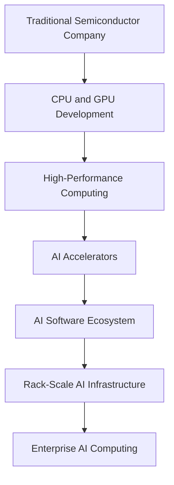

### The central idea

AMD does not primarily sell AI applications to consumers.

It sells the technology that allows companies such as OpenAI, Meta and other cloud providers to operate large-scale AI workloads.

---

# 2. Company History

## 2.1 Foundation – 1969

AMD was founded on May 1, 1969, by Jerry Sanders and seven other co-founders.

The company started as a semiconductor manufacturer.

Its early business focused on developing logic chips and other semiconductor products.

The initial objective was to create reliable, high-quality semiconductor technology.

## 2.2 Microprocessor Expansion – 1970s and 1980s

AMD expanded into microprocessors and semiconductor products.

A major development was its entry into the x86 processor market.

The company became an important alternative to Intel in PC computing.

## 2.3 Competition with Intel – 1990s and 2000s

AMD developed its own processor architectures and competed aggressively with Intel.

Important developments included:

- AMD K5.
- AMD K6.
- AMD Athlon.
- AMD Opteron.
- AMD64 architecture.

The introduction of AMD64 was particularly important because it brought 64-bit computing to the mainstream x86 ecosystem.

## 2.4 Acquisition of ATI – 2006

AMD acquired ATI Technologies in 2006.

This acquisition strengthened AMD's graphics technology business.

It allowed AMD to combine CPU and GPU development under one company.

This eventually contributed to AMD's accelerated processing units and integrated graphics products.

## 2.5 Lisa Su Era – 2014 onwards

Dr. Lisa Su became AMD's CEO in October 2014.

AMD subsequently focused on rebuilding its competitiveness in high-performance computing.

Important developments included:

- Zen CPU architecture.
- Ryzen processors.
- EPYC server processors.
- Radeon graphics.
- Instinct AI accelerators.
- ROCm software.
- Xilinx acquisition.
- Pensando acquisition.
- ZT Systems acquisition.

## 2.6 AI Infrastructure Era – 2023 to 2026

AMD accelerated its investment in AI computing.

Major milestones:

| Year | Development |
|---|---|
| 1969 | AMD founded |
| 1980s | Expansion into microprocessors |
| 2006 | ATI acquisition |
| 2014 | Lisa Su becomes CEO |
| 2017 | Ryzen and EPYC product families launch |
| 2022 | Xilinx acquisition completed |
| 2022 | Pensando acquisition completed |
| 2023 | MI300 accelerator family introduced |
| 2024 | MI325X introduced |
| 2025 | OpenAI 6 GW GPU partnership announced |
| 2025 | Helios rack-scale AI platform introduced |
| 2026 | Expanded Meta and Anthropic AI partnerships |
| 2026 | MI450 and MI455X infrastructure generation |

### Why AMD's history matters

AMD's transformation shows how a company can compete in an established technology market through architectural innovation, strategic acquisitions and ecosystem development.

---

# 3. Leadership and Organizational Structure

## 3.1 Leadership

| Person | Position |
|---|---|
| Dr. Lisa Su | Chair and CEO |
| Mark Papermaster | CTO and EVP, Technology and Engineering |
| Jean Hu | EVP, CFO and Treasurer |

AMD's leadership focuses on high-performance computing, product development, AI infrastructure and semiconductor engineering.

## 3.2 Business Segments

AMD currently reports three main business segments.

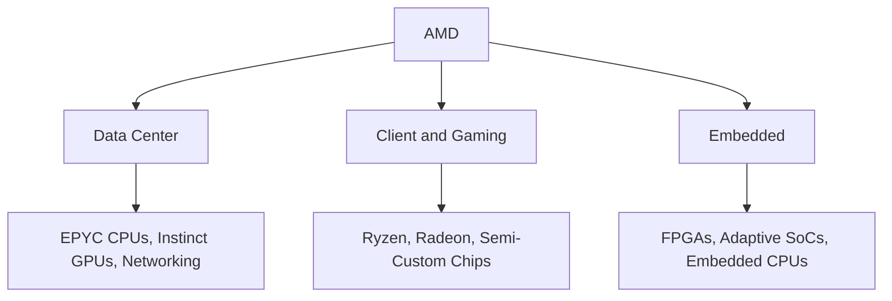

### A. Data Center

Products:

- EPYC processors.
- Instinct accelerators.
- Data processing units.
- AI networking products.
- Rack-scale infrastructure.

Customers:

- Cloud providers.
- AI companies.
- Enterprise data centers.
- Supercomputing organizations.

### B. Client and Gaming

Products:

- Ryzen CPUs.
- Radeon GPUs.
- Gaming processors.
- Semi-custom console chips.

Customers:

- PC manufacturers.
- Laptop manufacturers.
- Gaming companies.
- Consumers.

### C. Embedded

Products:

- FPGA.
- Adaptive SoCs.
- Embedded processors.
- Industrial computing components.

Applications:

- Industrial automation.
- Automotive systems.
- Aerospace.
- Telecommunications.
- Medical equipment.

---

# 4. What Does AMD Actually Do?

To understand AMD, first understand the difference between a CPU and a GPU.

## 4.1 CPU – Central Processing Unit

A CPU is a general-purpose processor.

It handles:

- Operating systems.
- Applications.
- Business software.
- Database operations.
- Server workloads.
- General computing.

Example: AMD EPYC processors power enterprise servers.

## 4.2 GPU – Graphics Processing Unit

A GPU performs large numbers of calculations in parallel.

Originally designed for graphics, GPUs have become essential for AI computing.

They are useful for:

- Neural network training.
- Deep learning.
- Image processing.
- Scientific computing.
- LLM inference.

Example: AMD Instinct GPUs accelerate AI workloads.

## CPU vs GPU

| Feature | CPU | GPU |
|---|---|---|
| Main purpose | General computing | Parallel computing |
| Core design | Fewer complex cores | Many parallel processing units |
| Strength | Sequential and varied workloads | Parallel mathematical workloads |
| AI role | System orchestration and data handling | Model training and inference |
| AMD product | EPYC | Instinct |

### Simple example

Imagine processing 10 million mathematical operations.

A CPU is designed to handle a wide variety of operations efficiently.

A GPU is designed to perform many similar operations simultaneously.

Deep learning involves enormous numbers of matrix calculations, which makes GPUs especially useful.

---

# 5. Products and Services

## 5.1 AMD Ryzen

Ryzen is AMD's processor family for desktop and laptop computers.

Use cases:

- Programming.
- Gaming.
- Video editing.
- Productivity.
- AI PC workloads.

## 5.2 AMD EPYC

EPYC is AMD's server processor family.

It is used in:

- Cloud computing.
- Enterprise databases.
- Virtualization.
- Web hosting.
- AI infrastructure.
- High-performance computing.

## 5.3 AMD Instinct

Instinct is AMD's GPU accelerator family.

It is designed for:

- AI model training.
- AI inference.
- Large language models.
- Scientific computing.
- High-performance computing.

## 5.4 AMD Radeon

Radeon is AMD's graphics product family.

Applications:

- Gaming.
- Graphics rendering.
- Workstations.
- Content creation.
- Selected AI workloads.

## 5.5 AMD Xilinx

AMD acquired Xilinx in 2022.

Xilinx technology includes:

- FPGA.
- Adaptive SoCs.
- Embedded systems.
- Programmable logic.

These products are used in industrial, aerospace, communications and automotive applications.

## 5.6 AMD ROCm

ROCm is AMD's software platform for GPU computing.

It helps developers build, train and deploy applications using AMD GPUs.

This is one of AMD's most strategically important technologies.

---

# 6. Business Model – How AMD Makes Money

AMD follows a semiconductor design and product sales business model.

Unlike companies that manufacture all their own chips, AMD primarily operates as a fabless semiconductor company.

This means it designs chips and relies on external manufacturing partners for fabrication.

## 6.1 Revenue Sources

| Business | Products | Revenue Source |
|---|---|---|
| Data Center | EPYC, Instinct | Enterprise and cloud sales |
| Client | Ryzen | PC and laptop processors |
| Gaming | Radeon and semi-custom chips | Gaming hardware sales |
| Embedded | FPGA and adaptive SoCs | Industrial and enterprise contracts |

## 6.2 B2B Business Model

AMD sells directly or through distribution and OEM channels to businesses.

Example:

A cloud provider needs processors and GPUs for its AI data center.

It purchases AMD EPYC CPUs and Instinct GPUs.

AMD generates revenue from those hardware sales.

## 6.3 OEM Business Model

OEM means Original Equipment Manufacturer.

Companies such as PC and server manufacturers integrate AMD processors into their products.

Examples include:

- Dell.
- HP.
- Lenovo.
- Supermicro.

## 6.4 AI Infrastructure Business Model

AMD increasingly offers complete computing platforms.

Rather than selling only a GPU, AMD combines:

- GPUs.
- CPUs.
- Networking.
- Software.
- Rack-scale reference designs.

This increases the value of its overall offering.

### Business model diagram

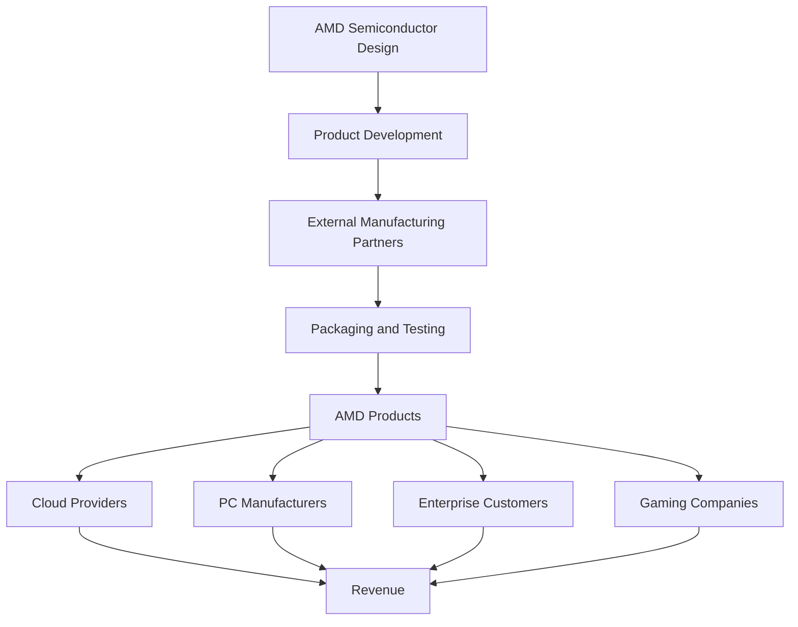

### Important business insight

AMD's competitive advantage depends on more than chip performance.

It also depends on:

- Software compatibility.
- Manufacturing capacity.
- Energy efficiency.
- Memory bandwidth.
- Networking.
- Developer adoption.
- Long-term customer partnerships.

---

# 7. Financial Analysis – Q3 2026

**Latest reported quarter as of November 6, 2026: Q3 2026**

AMD published its third-quarter results on November 3, 2026.

## 7.1 Financial Performance

| Metric | Q3 2025 | Q3 2026 |
|---|---:|---:|
| Revenue | $9.246B | $13.377B |
| Gross Margin (GAAP) | 52% | 54% |
| Operating Income | $1.270B | $2.832B |
| Net Income | — | $2.4B |
| Diluted EPS | $0.75 | $1.46 |

Revenue increased approximately 45% year over year.

Data Center was the primary growth driver.

## 7.2 Revenue Chart

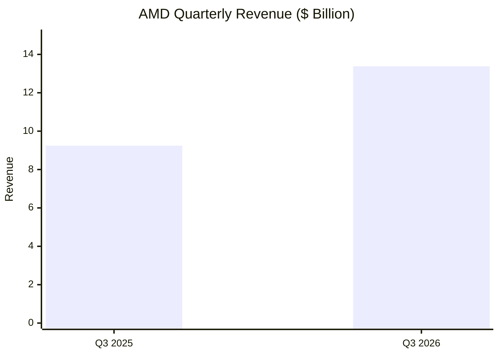

## 7.3 Segment Revenue

Q3 2026:

| Segment | Revenue |
|---|---:|
| Data Center | $8.546B |
| Client | $2.949B |
| Gaming | $0.773B |
| Embedded | $1.109B |
| **Total** | **$13.377B** |

### Segment Revenue Chart

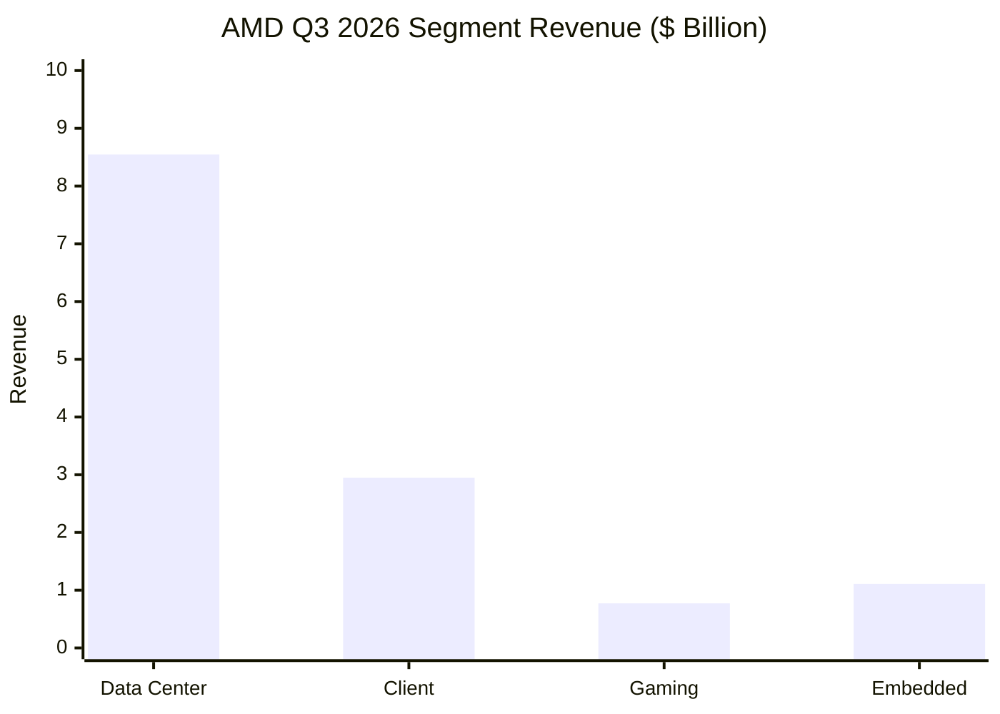

### Revenue Distribution

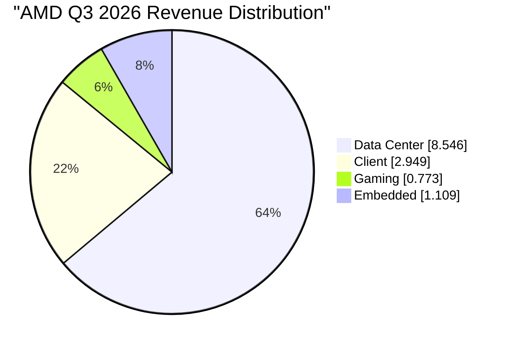

## 7.4 Data Center Growth

AMD's Data Center revenue reached $8.546 billion in Q3 2026.

It increased 97% year over year.

This growth was driven by strong demand for EPYC processors and Instinct GPUs.

### What does this tell us?

AMD is increasingly benefiting from demand for AI infrastructure.

However, gaming revenue declined year over year, demonstrating that different segments can perform very differently.

### Financial Interpretation

Three important observations:

1. Data Center is becoming the central growth engine.
2. AI infrastructure is creating new opportunities for AMD.
3. AMD still needs to manage competition and investment costs across its other businesses.

---

# 8. AI Strategy

AMD's AI strategy is to build an open and scalable alternative to proprietary AI infrastructure ecosystems.

It focuses on four layers.

## 8.1 AI Hardware

Develop powerful GPUs for training and inference.

Main product family: AMD Instinct.

## 8.2 AI CPUs

Provide server processors that work alongside accelerators.

Main product family: AMD EPYC.

## 8.3 AI Software

Build a developer ecosystem that makes AMD GPUs usable with mainstream AI frameworks.

Main platform: ROCm.

## 8.4 AI Infrastructure

Combine computing, memory and networking into complete rack-scale systems.

Main initiative: AMD Helios.

### AMD's AI strategy diagram

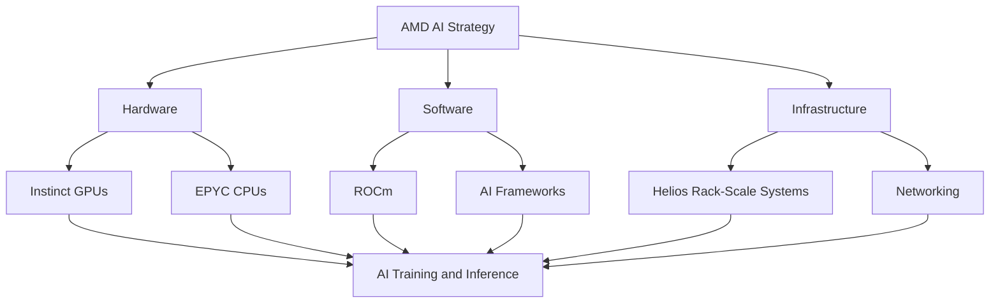

---

# 9. AMD Instinct GPUs

Instinct is AMD's accelerator product family for high-performance computing and AI.

## 9.1 Why AI Needs GPUs

Large language models contain billions or even trillions of parameters.

Training these models requires huge numbers of mathematical operations.

GPUs accelerate these operations through parallel processing.

## 9.2 GPU Product Evolution

| Product Generation | Focus |
|---|---|
| MI200 | High-performance computing and AI |
| MI300 | Advanced AI and HPC |
| MI325X | Higher memory capacity and AI performance |
| MI350 Series | Next-generation AI accelerators |
| MI400 Series | Advanced AI computing |
| MI450 Series | Large-scale AI infrastructure |

## 9.3 How GPUs Train an AI Model

Imagine training a neural network.

1. Load training data.
2. Convert data into tensors.
3. Perform matrix calculations.
4. Calculate model errors.
5. Update model parameters.
6. Repeat across many training batches.

GPUs accelerate the computationally intensive parts of this process.

### Simplified architecture

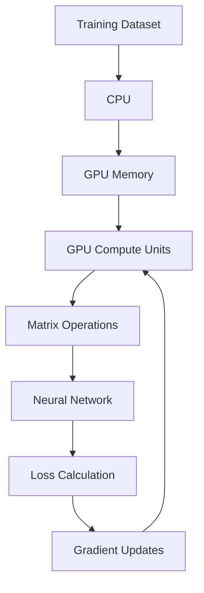

## 9.4 Training vs Inference

| Training | Inference |
|---|---|
| Teaches the model | Uses a trained model |
| Computationally intensive | Optimized for response generation |
| Updates parameters | Parameters remain fixed |
| Requires forward and backward passes | Primarily forward computation |

AMD Instinct products target both types of workloads.

---

# 10. AMD EPYC Processors

EPYC is AMD's server CPU family.

## Why EPYC matters for AI

AI data centers need more than GPUs.

They also need CPUs for:

- Operating systems.
- Scheduling.
- Data preparation.
- Networking management.
- Storage operations.
- Virtualization.
- Application orchestration.

A GPU cannot independently manage an entire data center.

CPUs and GPUs work together.

### CPU + GPU relationship

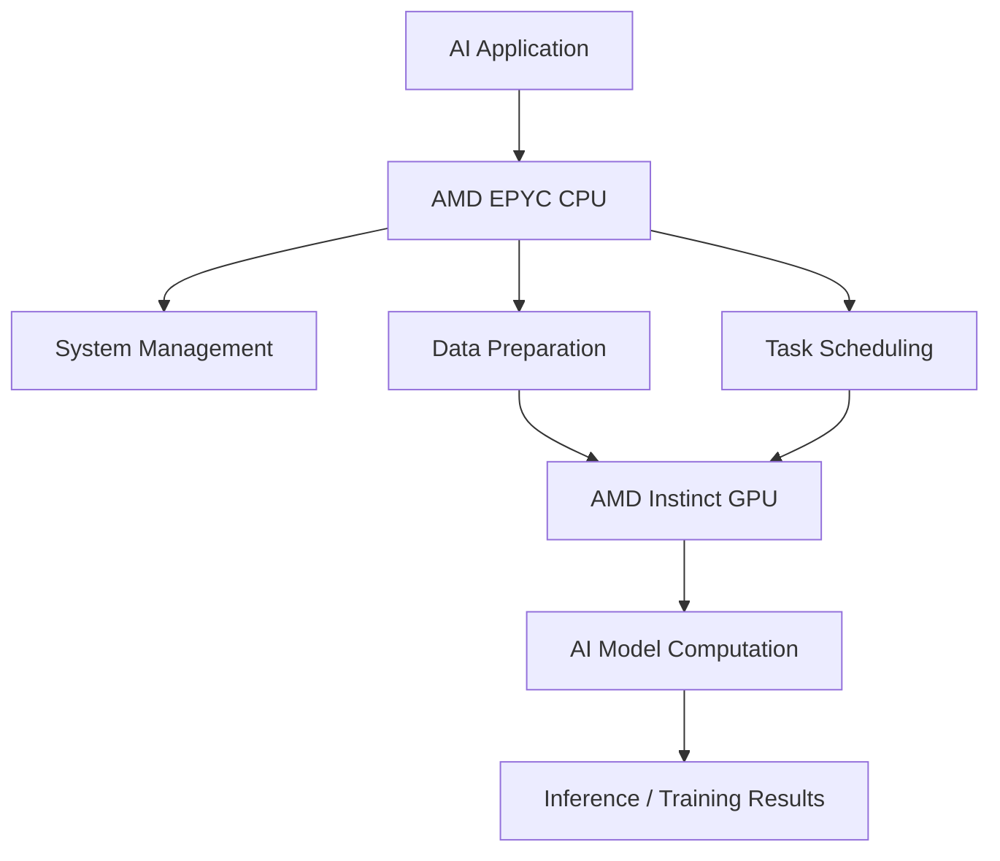

### Business lesson

AMD can sell both CPUs and GPUs to the same customer.

This creates opportunities for larger infrastructure contracts.

---

# 11. ROCm – AMD's AI Software Ecosystem

ROCm stands for Radeon Open Compute.

It is AMD's open software platform for GPU programming and computing.

This is one of the most important parts of AMD's strategy.

## 11.1 Why ROCm Exists

Imagine AMD sells a powerful GPU.

But developers cannot easily use it with PyTorch, TensorFlow or their existing AI code.

The hardware may be powerful, but developers will find it difficult to adopt.

That is why software compatibility matters.

ROCm provides tools and libraries that allow developers to run computing workloads on supported AMD GPUs.

## 11.2 ROCm Ecosystem

| Technology | Purpose |
|---|---|
| HIP | GPU programming interface |
| ROCm Runtime | GPU execution environment |
| rocBLAS | Optimized linear algebra |
| MIOpen | Deep learning primitives |
| RCCL | Collective communication |
| PyTorch | Deep learning framework |
| TensorFlow | Machine learning framework |
| JAX | Numerical computing |
| vLLM | LLM inference and serving |
| SGLang | LLM serving and execution |
| Triton | GPU kernel development |

## 11.3 ROCm Architecture

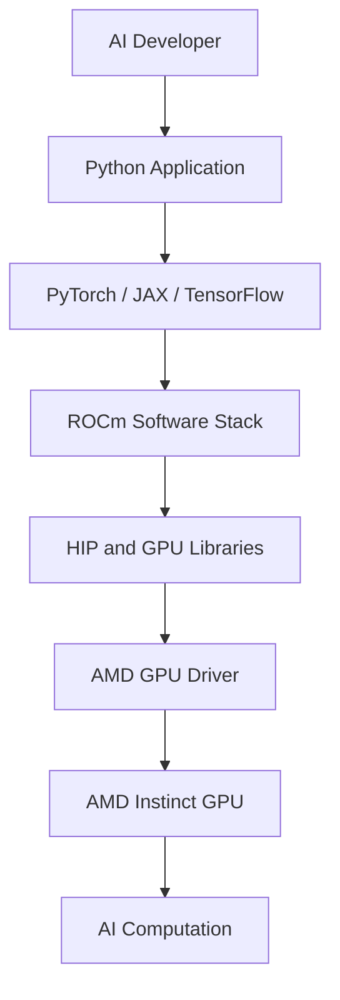

## 11.4 ROCm vs CUDA

CUDA is NVIDIA's GPU computing platform.

ROCm is AMD's GPU computing platform.

| Feature | AMD ROCm | NVIDIA CUDA |
|---|---|---|
| Company | AMD | NVIDIA |
| GPU ecosystem | AMD GPUs | NVIDIA GPUs |
| AI framework support | PyTorch, JAX and others | PyTorch, JAX and others |
| Developer ecosystem | Growing | Very established |
| Strategic approach | Open-source software ecosystem | Integrated proprietary platform |
| Main challenge | Adoption and compatibility | Platform dependence |

### Why ROCm matters to AMD

Hardware performance alone is not sufficient.

Developers need:

- Documentation.
- Libraries.
- Framework compatibility.
- Debugging tools.
- Optimized kernels.
- Stable releases.
- Community support.

ROCm is AMD's attempt to make its hardware easier to adopt.

## 11.5 Practical Developer Learning

A developer interested in AMD AI hardware should explore:

1. Python.
2. PyTorch.
3. Linux.
4. GPU architecture.
5. ROCm installation.
6. Model inference.
7. vLLM.
8. Distributed inference.

Official documentation:

https://rocm.docs.amd.com/

---

# 12. AMD Helios – Rack-Scale AI Infrastructure

Helios is AMD's rack-scale AI infrastructure reference design.

This is an important strategic move.

Instead of only selling processors and GPUs, AMD is designing how complete AI computing racks can be built.

## 12.1 What Is a Rack?

A server rack is a physical structure that holds computing equipment.

A data center can contain thousands of racks.

Each rack may include:

- Servers.
- GPUs.
- CPUs.
- Networking equipment.
- Power distribution.
- Cooling systems.

## 12.2 AMD Helios Components

The published Helios architecture integrates:

- AMD Instinct MI455X GPUs.
- AMD EPYC Venice CPUs.
- AMD Pensando Vulcano AI NICs.
- UALink connectivity.
- Open industry standards.

AMD describes a reference design integrating 72 MI455X GPUs in a rack-scale system.

The MI455X specification published by AMD includes 432 GB HBM4 memory per GPU and up to 23.3 TB/s memory bandwidth.

These are manufacturer-published specifications and peak figures, not guaranteed application performance.

## 12.3 Helios Architecture

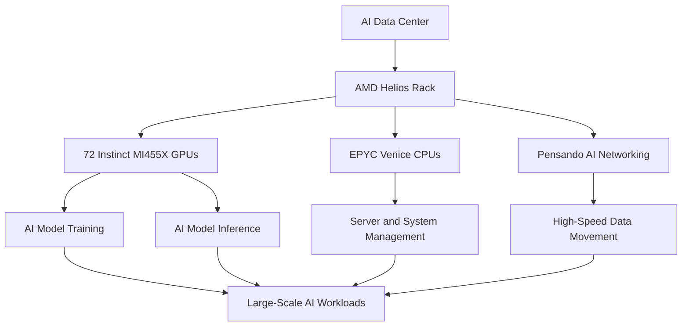

## 12.4 Why Helios Is Important

Modern AI models require large amounts of computing resources.

A single GPU may not be sufficient.

Multiple GPUs must communicate with one another efficiently.

This requires:

- High-bandwidth memory.
- GPU interconnects.
- Network infrastructure.
- Power management.
- Cooling.
- Distributed software.

Helios addresses this system-level problem.

### Important distinction

AMD Helios is a reference design, not simply a single retail GPU product.

It provides a blueprint for OEM and ODM partners to build complete systems.

---

# 13. Real-World AI Partnerships

AMD's AI business is strengthened by partnerships with major technology companies.

## 13.1 AMD + OpenAI

In October 2025, AMD and OpenAI announced a multi-year partnership involving up to 6 gigawatts of AMD GPU deployments.

The initial 1 GW deployment was planned around Instinct MI450 GPUs, beginning in the second half of 2026.

### What does this mean?

OpenAI requires massive computing infrastructure for:

- Training foundation models.
- Running inference.
- Serving users.
- Supporting advanced AI applications.

AMD becomes a strategic supplier of computing infrastructure.

Official announcement:

https://openai.com/index/openai-amd-strategic-partnership/

## 13.2 AMD + Meta

In February 2026, AMD and Meta announced an expanded partnership involving up to 6 GW of AMD Instinct GPUs.

The planned infrastructure includes:

- Custom MI450-based GPUs.
- Sixth-generation EPYC Venice CPUs.
- ROCm.
- AMD Helios rack-scale architecture.

The companies are coordinating their hardware, software and infrastructure roadmaps.

Official announcement:

https://newsroom.amd.com/news/amd-and-meta-announce-expanded-strategic-partnersh/

## 13.3 AMD + Anthropic

In July 2026, AMD and Anthropic announced a partnership involving up to 2 GW of Instinct MI450 GPUs.

The collaboration includes:

- AI infrastructure.
- ROCm development.
- Workload optimization.
- Use of Claude across AMD engineering and product development teams.

AMD also announced a potential strategic equity investment of up to $5 billion in Anthropic.

Official announcement:

https://newsroom.amd.com/news/amd-anthropic-strategic-partnership/

## Partnership Summary

| Company | Partnership Focus | Announced Scale |
|---|---|---|
| OpenAI | AI compute infrastructure | Up to 6 GW |
| Meta | AI infrastructure | Up to 6 GW |
| Anthropic | AI infrastructure and software collaboration | Up to 2 GW |

**Important:** These are announced multi-year deployment agreements or plans, not evidence that all the announced GPU capacity has already been installed or delivered.

## 13.4 Why These Partnerships Matter

They demonstrate that AMD is trying to become a long-term infrastructure partner rather than simply a chip supplier.

The customer benefits from:

- Additional computing supply.
- Hardware diversity.
- Potentially improved infrastructure economics.
- Greater flexibility.

AMD benefits from:

- Large enterprise contracts.
- Long-term demand visibility.
- Software ecosystem growth.
- Customer relationships.
- Product roadmap validation.

---

# 14. AMD's AI Work Model

AMD's work model is different from Panasonic's.

Panasonic uses AI to improve business operations and develops AI-enabled products.

AMD primarily provides the hardware and software platforms used by other companies to build AI applications.

## 14.1 How AMD's Technology Enables AI

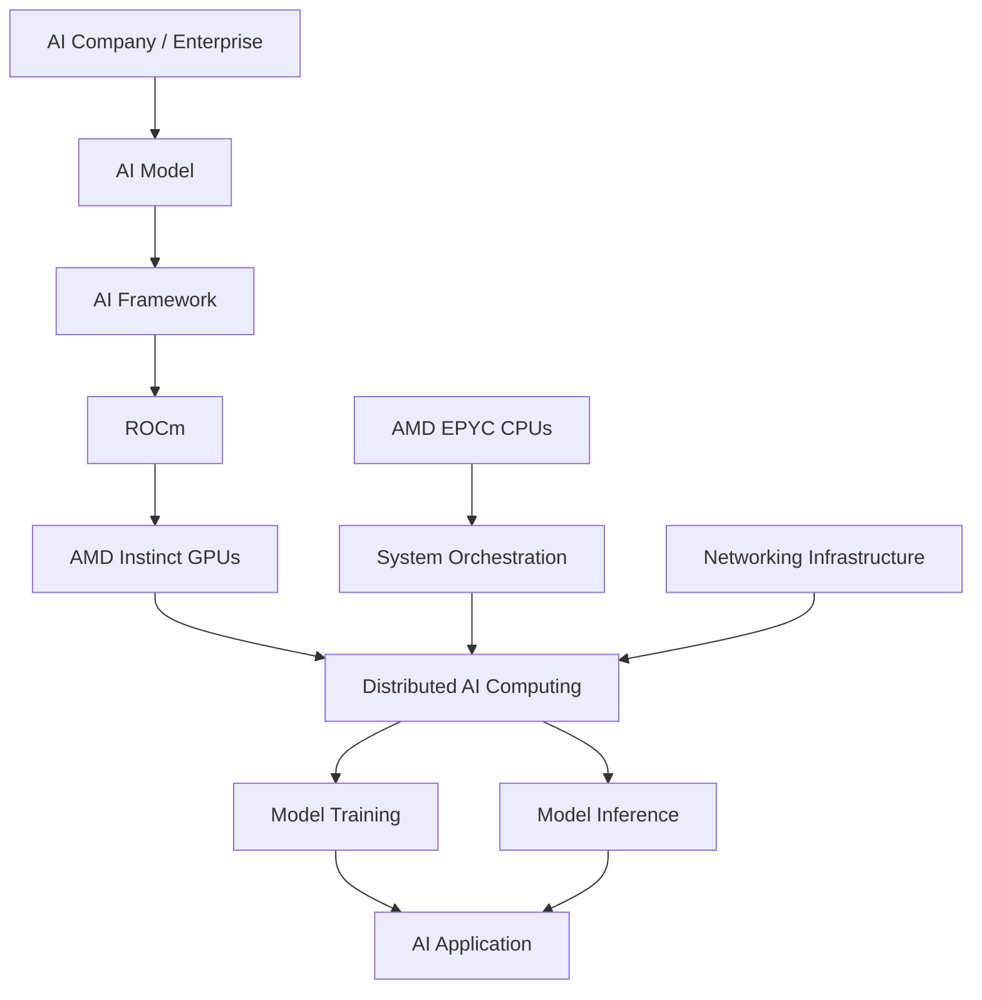

## 14.2 Example: Running an LLM

Imagine a company wants to deploy an open-weight language model.

The process:

1. Select an appropriate AI model.
2. Select compatible AMD GPU hardware.
3. Install supported GPU drivers and ROCm.
4. Configure PyTorch.
5. Load the model into GPU memory.
6. Optimize inference.
7. Deploy using vLLM or another supported serving engine.
8. Monitor throughput, latency and GPU utilization.

## 14.3 What AMD Actually Provides

AMD provides the computing platform.

The customer or AI developer generally supplies the model, application logic, data and business use case.

This distinction is important.

AMD is not the company operating every AI application built on its hardware.

It enables those applications.

---

# 15. Technology Architecture

AMD's technology ecosystem covers multiple layers.

## 15.1 Hardware Layer

- CPU.
- GPU.
- FPGA.
- Adaptive SoCs.
- Networking.
- Memory interfaces.

## 15.2 Software Layer

- ROCm.
- HIP.
- GPU libraries.
- PyTorch.
- TensorFlow.
- vLLM.
- JAX.

## 15.3 Infrastructure Layer

- Linux.
- Server systems.
- Data center networking.
- Rack-scale architecture.
- Distributed computing.

## 15.4 Application Layer

- Generative AI.
- LLM inference.
- Recommendation systems.
- Scientific computing.
- Computer vision.
- Enterprise AI.

### Complete architecture

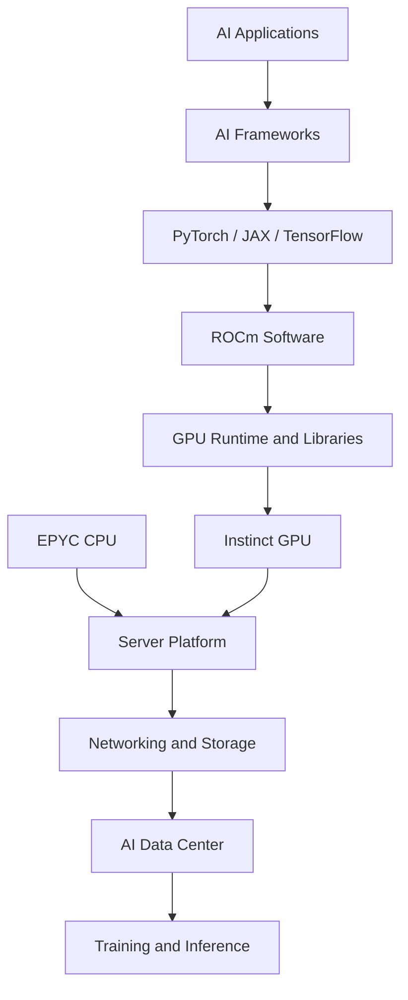

---

# 16. Data Center and Cloud Infrastructure

AI infrastructure is becoming one of the most important technology markets.

## 16.1 What Does an AI Data Center Need?

| Component | Purpose |
|---|---|
| CPU | General processing |
| GPU | AI computation |
| RAM | System memory |
| HBM | High-bandwidth GPU memory |
| Storage | Model and dataset storage |
| Networking | Communication between systems |
| Power | Electricity supply |
| Cooling | Temperature management |
| Software | Scheduling and orchestration |

## 16.2 Example AI Infrastructure Deployment

Imagine an enterprise wants to serve millions of AI requests.

A possible architecture:

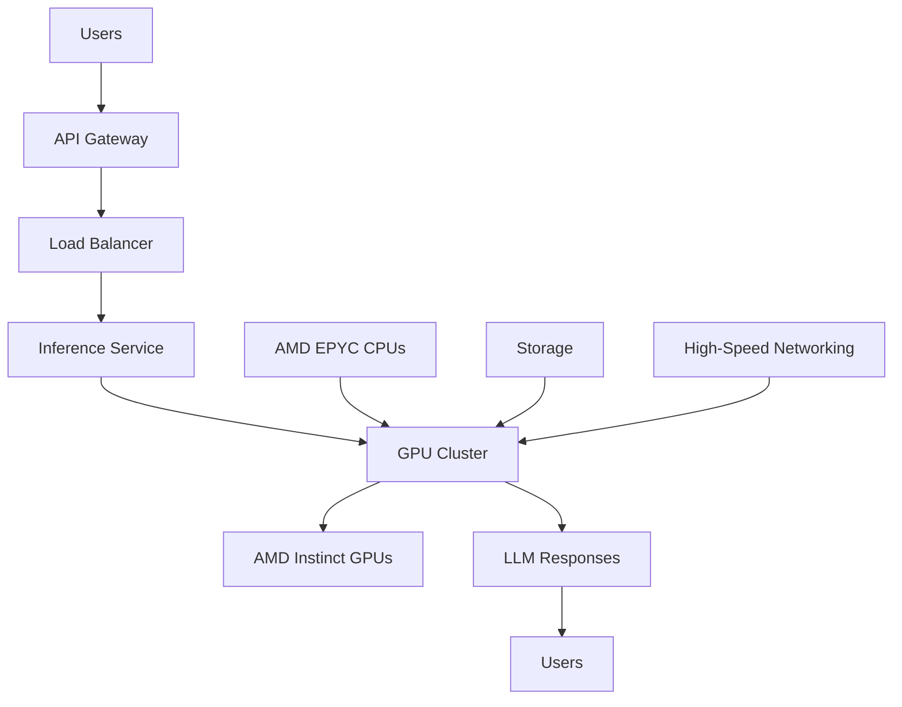

## 16.3 Important Engineering Concepts

- GPU scheduling.
- Distributed inference.
- Memory management.
- Model quantization.
- Kubernetes.
- Docker.
- Linux.
- Network optimization.
- Performance monitoring.

---

# 17. Semiconductor Manufacturing

AMD is primarily a fabless semiconductor company.

This means it focuses heavily on product architecture and chip design while relying on manufacturing partners.

## 17.1 What Is a Fabless Company?

A semiconductor company can design a processor without owning the fabrication facility that physically manufactures it.

AMD designs its products.

External foundries manufacture the chips.

TSMC is a major manufacturing partner for AMD's advanced processors.

## 17.2 Semiconductor Production Workflow

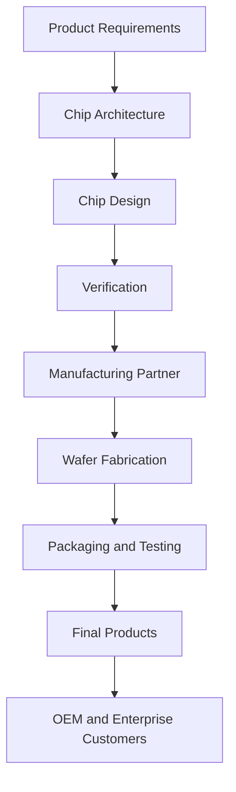

## 17.3 Why This Business Model Matters

Building a semiconductor fabrication plant requires enormous capital investment.

By focusing on chip design and working with foundries, AMD can allocate resources to:

- Research and development.
- Processor architecture.
- GPU design.
- Software.
- Product innovation.

However, reliance on external manufacturing partners also creates supply chain risks.

---

# 18. Competitor Analysis

AMD operates in several competitive markets.

## 18.1 AMD vs NVIDIA

| Category | AMD | NVIDIA |
|---|---|---|
| CPUs | EPYC, Ryzen | Grace and other CPU platforms |
| GPUs | Instinct, Radeon | GeForce, RTX, data center GPUs |
| AI Software | ROCm | CUDA |
| AI Infrastructure | Helios | DGX and rack-scale platforms |
| Market strength | CPUs and growing AI accelerator business | Established AI GPU ecosystem |
| Key challenge | Developer ecosystem adoption | Competition and infrastructure scale |

NVIDIA has a very established AI software ecosystem.

AMD's opportunity is to provide competitive hardware and a more open software ecosystem.

## 18.2 AMD vs Intel

| Category | AMD | Intel |
|---|---|---|
| Desktop CPUs | Ryzen | Core |
| Server CPUs | EPYC | Xeon |
| Graphics | Radeon | Arc |
| AI accelerators | Instinct | Gaudi and other AI products |
| Manufacturing | External foundries | Own foundry operations plus external partners |
| Main competition | CPUs and data center | CPUs and data center |

## 18.3 AMD vs Qualcomm

Qualcomm competes strongly in:

- Mobile processors.
- Embedded systems.
- AI-enabled edge devices.
- PC processors.

AMD competes in client computing, graphics and embedded markets, although the companies have different core strengths.

### Competitive positioning

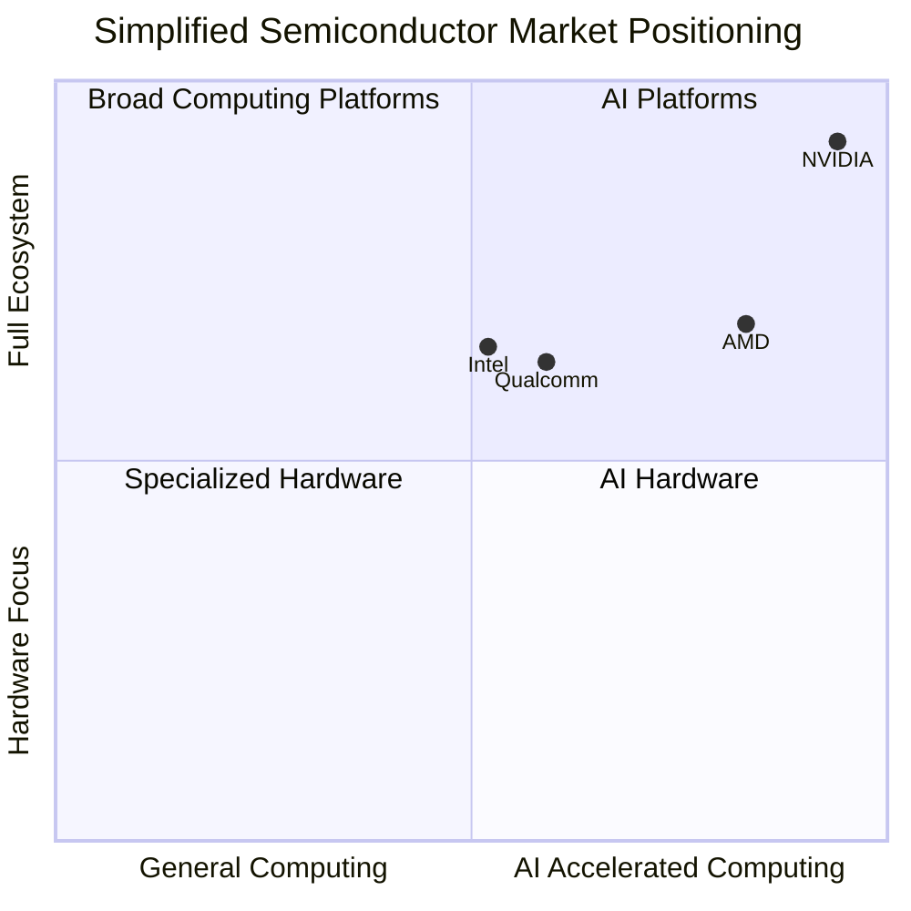

*Illustrative strategic positioning, not a measured market-share or performance ranking.*

---

# 19. SWOT Analysis

| Strengths | Weaknesses |
|---|---|
| Strong CPU technology | Smaller AI software ecosystem than NVIDIA |
| EPYC server business | Reliance on external foundries |
| Instinct GPU portfolio | Software compatibility challenges |
| ROCm ecosystem | Strong competition |
| Strategic AI partnerships | Significant R&D expenses |

| Opportunities | Threats |
|---|---|
| AI data center growth | NVIDIA competition |
| Enterprise AI | Custom AI chips |
| Cloud computing | Manufacturing supply constraints |
| Open AI software | Export restrictions |
| AI inference market | Semiconductor market cycles |

## Strategic Interpretation

AMD has a major opportunity in AI infrastructure.

But it must continue improving hardware performance, software compatibility, supply availability and customer adoption.

---

# 20. Business Challenges and Risks

## 20.1 NVIDIA's Software Advantage

CUDA has a large developer ecosystem.

Many AI applications have been optimized for NVIDIA hardware.

AMD must continue improving ROCm adoption.

## 20.2 Manufacturing Dependence

AMD relies on third-party manufacturing partners.

Any production delays can affect product availability.

## 20.3 AI Infrastructure Investment

Large AI systems require substantial capital investment.

Customers must justify their infrastructure spending through business results.

## 20.4 Energy Consumption

AI data centers require enormous amounts of electricity.

Power efficiency is becoming a critical consideration.

## 20.5 Customer Concentration

Large cloud and AI customers can represent significant business opportunities, but dependence on a small number of major customers can create risk.

## 20.6 Rapid Technology Changes

New chip architectures and software systems can make existing products less competitive.

AMD must continuously innovate.

---

# 21. Future Strategy

AMD's future strategy revolves around expanding its role in AI infrastructure.

## 21.1 Instinct GPU Development

Continue improving:

- Compute performance.
- Memory capacity.
- Memory bandwidth.
- Energy efficiency.
- Multi-GPU communication.

## 21.2 ROCm Expansion

Improve:

- Developer experience.
- Framework compatibility.
- AI inference performance.
- Distributed computing.
- Documentation.
- Open-source contributions.

## 21.3 Helios Infrastructure

Expand rack-scale systems through OEM and ODM partners.

## 21.4 Enterprise AI Partnerships

Develop deeper partnerships with AI model companies and cloud providers.

## 21.5 Data Center Growth

Continue expanding EPYC and Instinct adoption.

### Future strategy diagram

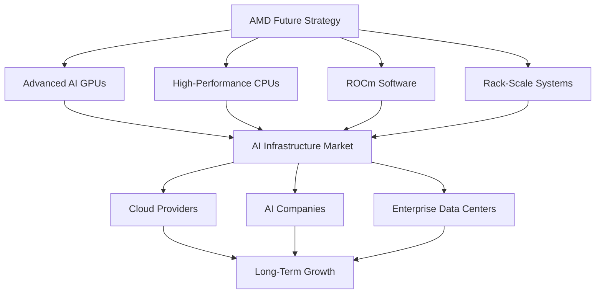

---

# 22. Career Opportunities

AMD is an interesting company to study for software and AI engineering careers.

Although it is a semiconductor company, its work requires many software engineering specializations.

## 22.1 AI Software Engineer

Responsibilities:

- Optimize AI frameworks.
- Improve GPU performance.
- Integrate AI libraries.
- Develop model execution systems.

Required skills:

- Python.
- C++.
- PyTorch.
- GPU programming.
- Linux.
- ROCm.

## 22.2 GPU Software Engineer

Responsibilities:

- Develop GPU kernels.
- Optimize parallel computation.
- Improve memory utilization.
- Debug GPU workloads.

Required skills:

- C++.
- HIP.
- CUDA concepts.
- Parallel programming.
- Computer architecture.

## 22.3 Data Center Engineer

Responsibilities:

- Build server infrastructure.
- Optimize compute workloads.
- Monitor systems.
- Manage deployment environments.

Required skills:

- Linux.
- Networking.
- Docker.
- Kubernetes.
- Cloud platforms.

## 22.4 AI Infrastructure Engineer

Responsibilities:

- Deploy large AI models.
- Optimize inference.
- Build distributed systems.
- Manage GPU clusters.

Required skills:

- Python.
- PyTorch.
- vLLM.
- ROCm.
- Distributed computing.
- Kubernetes.

## 22.5 Data Engineer

Responsibilities:

- Build data pipelines.
- Process large datasets.
- Manage storage and compute.
- Support AI training infrastructure.

Required skills:

- Python.
- SQL.
- Spark.
- Kafka.
- Cloud infrastructure.

### Career skill matrix

| Role | Main Skills |
|---|---|
| AI Engineer | Python, PyTorch, LLMs |
| GPU Engineer | C++, HIP, GPU architecture |
| Data Engineer | SQL, Spark, Airflow |
| Cloud Engineer | AWS, Linux, Kubernetes |
| Backend Engineer | Python, APIs, databases |
| AI Infrastructure Engineer | vLLM, ROCm, distributed systems |

---

# 23. Engineering Project Ideas

The best way to understand AMD is to build projects inspired by its computing ecosystem.

## Project 1 – LLM Inference Benchmarking

**Objective:** Compare the performance of AI models across different supported hardware environments.

Features:

- Model loading.
- Inference testing.
- Latency measurement.
- Throughput measurement.
- Memory usage.
- Benchmark dashboard.

Technology:

- Python.
- PyTorch.
- vLLM.
- ROCm-compatible GPU.
- FastAPI.
- PostgreSQL.

Metrics:

| Metric | Meaning |
|---|---|
| Latency | Time taken to produce a response |
| Throughput | Requests processed per second |
| GPU Utilization | Percentage of GPU usage |
| Memory Usage | GPU memory consumed |
| Tokens/sec | Generation speed |

## Project 2 – AI Data Center Monitoring Dashboard

**Objective:** Build a monitoring system for GPU servers.

Features:

- CPU utilization.
- GPU utilization.
- GPU memory.
- Temperature monitoring.
- Power consumption.
- Performance alerts.

Technology:

- Python.
- FastAPI.
- PostgreSQL.
- Grafana.
- Prometheus.
- Docker.

Architecture:

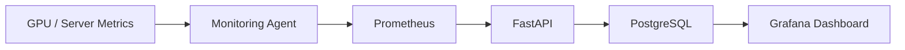

## Project 3 – Distributed LLM Inference System

**Objective:** Create a system that distributes inference requests across multiple GPU workers.

Features:

- Load balancing.
- Worker management.
- Request queuing.
- GPU monitoring.
- Response tracking.

Technology:

- Python.
- FastAPI.
- Redis.
- vLLM.
- Docker.
- Kubernetes.

## Project 4 – GPU Performance Analyzer

**Objective:** Build a tool that measures GPU workload performance.

Features:

- Benchmark execution.
- Runtime measurement.
- Memory tracking.
- Performance comparisons.
- Automated reports.

Technology:

- Python.
- C++.
- Linux.
- ROCm tools where supported.
- Power BI.

## Project 5 – AI Infrastructure Cost Calculator

**Objective:** Estimate the operating cost of deploying an AI model in a data center.

Inputs:

- Number of GPUs.
- GPU power consumption.
- Electricity price.
- Server costs.
- Data center utilization.
- Model inference demand.

Outputs:

- Estimated electricity cost.
- Cost per million tokens.
- Monthly infrastructure cost.
- GPU utilization estimates.

Technology:

- Python.
- FastAPI.
- PostgreSQL.
- Next.js.
- Power BI.

---

# 24. Key Business Lessons

## Lesson 1 – Hardware Alone Is Not Enough

A powerful GPU is valuable, but developers also need software, libraries and frameworks.

AMD's ROCm ecosystem is therefore strategically important.

## Lesson 2 – AI Infrastructure Is a Huge Business

AI companies need computing hardware, servers, memory, networking and energy.

The infrastructure providers can capture substantial value from AI adoption.

## Lesson 3 – Partnerships Create Long-Term Opportunities

AMD's partnerships with OpenAI, Meta and Anthropic demonstrate the importance of building relationships with major AI companies.

## Lesson 4 – Ecosystems Create Competitive Advantages

NVIDIA's CUDA ecosystem demonstrates how software adoption can strengthen hardware market position.

AMD is working to expand ROCm as an alternative.

## Lesson 5 – Specialization Matters

AMD does not need to own every part of the AI application market.

It can focus on providing high-performance computing infrastructure.

## Lesson 6 – System-Level Thinking Is Essential

A modern AI data center is not just a collection of GPUs.

It is a combination of:

- Compute.
- Memory.
- Networking.
- Storage.
- Power.
- Cooling.
- Software.
- Orchestration.

---

# 25. Research Sources

Primary sources should be prioritized when researching AMD.

| Source | Purpose | Link |
|---|---|---|
| AMD Official Website | Company overview | https://www.amd.com/ |
| AMD Investor Relations | Financial performance | https://ir.amd.com/ |
| AMD Q3 2026 Results | Latest financial data | https://newsroom.amd.com/news/amd-reports-third-quarter-2026-earnings/ |
| AMD Annual Reports | Business and risk analysis | https://ir.amd.com/financial-information/annual-reports-and-proxy |
| AMD Instinct | AI accelerators | https://www.amd.com/en/products/accelerators/instinct.html |
| AMD EPYC | Server processors | https://www.amd.com/en/products/processors/server/epyc.html |
| AMD ROCm | AI software | https://rocm.docs.amd.com/ |
| AMD Helios | Rack-scale infrastructure | https://www.amd.com/en/products/rackscale-solutions/helios.html |
| OpenAI Partnership | AI infrastructure agreement | https://openai.com/index/openai-amd-strategic-partnership/ |
| Meta Partnership | AI infrastructure agreement | https://newsroom.amd.com/news/amd-and-meta-announce-expanded-strategic-partnersh/ |
| Anthropic Partnership | AI infrastructure agreement | https://newsroom.amd.com/news/amd-anthropic-strategic-partnership/ |

### Research Verification Notes

- Financial figures are based on AMD's Q3 2026 earnings announcement.
- Segment revenue is based on AMD's reported financial statements.
- Helios is a reference design rather than a single retail product.
- Product specifications are manufacturer-published figures.
- Announced AI partnerships are not equivalent to completed deployments.
- The technology architectures in this case study are educational reference designs, not AMD's confidential internal architecture.

---

# Final Assessment

| Research Dimension | Assessment |
|---|---|
| Business Model | Fabless semiconductor design and sales |
| Main Business Growth Driver | Data Center |
| AI Strategy | Full-stack AI computing infrastructure |
| Key Hardware | Instinct GPUs and EPYC CPUs |
| Key Software | ROCm |
| Infrastructure | Helios |
| Main Competitor | NVIDIA in AI accelerators |
| Other Major Competitor | Intel in CPUs |
| Main Opportunity | AI data center expansion |
| Main Challenge | Software ecosystem adoption and competition |

## Final Conclusion

AMD is an excellent example of how a semiconductor company can become a major player in the AI economy.

Its strategy is not simply to produce faster processors.

It is to create an ecosystem where hardware, software, networking and infrastructure work together.

The company's future competitiveness will depend on how successfully it can:

1. Build competitive AI accelerators.
2. Expand ROCm adoption.
3. Deliver large-scale infrastructure.
4. Maintain strong relationships with AI companies.
5. Improve performance and energy efficiency.
6. Compete with established AI computing platforms.

**The biggest lesson: AI is not just about models and applications. Behind every major AI system is an infrastructure ecosystem involving processors, GPUs, software, networking, storage and data centers.**

---

# Case Study Completion

- [x] Company history researched.
- [x] Leadership examined.
- [x] Business model analyzed.
- [x] Products and services documented.
- [x] Q3 2026 financial performance reviewed.
- [x] AI strategy examined.
- [x] Instinct GPU architecture studied.
- [x] EPYC processor ecosystem studied.
- [x] ROCm software ecosystem studied.
- [x] Helios infrastructure examined.
- [x] OpenAI partnership studied.
- [x] Meta partnership studied.
- [x] Anthropic partnership studied.
- [x] Competitor analysis completed.
- [x] Engineering project ideas documented.

**DAY 002 / 100 – AMD: COMPLETED**

**NEXT: DAY 003 – NVIDIA**

*100 Days. 100 Companies. Understand the Business. Understand the Technology. Build Like an Engineer.*
