# Day 003 – NVIDIA Corporation
## Complete Company Case Study: AI Business Model, GPU Architecture, CUDA, AI Infrastructure, Data Centers & Agentic AI

| Information | Details |
|---|---|
| Company | NVIDIA Corporation |
| Founded | April 5, 1993 |
| Founders | Jensen Huang, Chris Malachowsky, Curtis Priem |
| Headquarters | Santa Clara, California, USA |
| CEO | Jensen Huang |
| CFO | Colette Kress |
| Industry | Semiconductors, AI and Computing |
| Stock Exchange | NASDAQ |
| Stock Symbol | NVDA |
| Main Products | GPUs, CPUs, Networking, AI Software |
| Main AI Platform | CUDA |
| Main Competitor | AMD |
| Other Competitors | Intel, Google, AWS, custom silicon providers |
| Case Study | Day 003 of 100 |
| Research Date | November 6, 2026 |

> **Central research question:** How did NVIDIA transform itself from a graphics-card company into one of the world's most important AI computing infrastructure companies?

---

# Table of Contents

1. Executive Summary
2. Company History
3. Leadership and Organization
4. What Does NVIDIA Actually Do?
5. Products and Services
6. Business Model – How NVIDIA Makes Money
7. Financial Analysis – Q2 FY2027
8. NVIDIA's AI Strategy
9. GPU Architecture
10. CUDA – NVIDIA's Biggest Competitive Advantage
11. Blackwell Architecture
12. Vera Rubin Architecture
13. NVIDIA DGX and AI Supercomputers
14. NVIDIA Networking and NVLink
15. AI Work Model
16. Technology Architecture
17. AI Software Ecosystem
18. Real-World AI Applications
19. Major Partnerships
20. Competitor Analysis
21. SWOT Analysis
22. Challenges and Risks
23. Future Strategy
24. Career Opportunities
25. Engineering Project Ideas
26. Key Business Lessons
27. Research Sources

---

# 1. Executive Summary

NVIDIA is an American technology company specializing in accelerated computing.

It designs GPUs, CPUs, networking systems and software platforms.

Originally, NVIDIA focused on computer graphics and gaming.

Today, its technologies power:

- Generative AI.
- Large language models.
- AI agents.
- Autonomous vehicles.
- Robotics.
- Scientific computing.
- Cloud infrastructure.
- Supercomputers.
- Industrial digital twins.
- Enterprise AI applications.

NVIDIA's most important business is now its Data Center business.

Its technology is used by major cloud providers and AI companies to train and deploy large AI models.

## NVIDIA's transformation

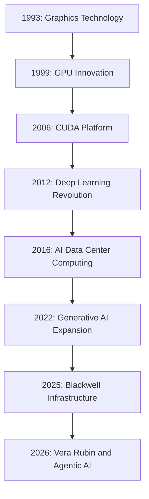

## What makes NVIDIA different?

NVIDIA does not simply sell GPUs.

It provides an entire computing ecosystem:

1. Hardware – GPUs and CPUs.
2. Software – CUDA and AI libraries.
3. Networking – NVLink, InfiniBand and Ethernet.
4. Systems – DGX and rack-scale platforms.
5. Enterprise software – AI development and deployment tools.

This integrated approach is one of its most important competitive advantages.

---

# 2. Company History

## 2.1 Foundation – 1993

NVIDIA was founded on April 5, 1993.

Its founders were:

- Jensen Huang.
- Chris Malachowsky.
- Curtis Priem.

The company initially focused on developing advanced graphics technology for personal computers.

Its vision was to improve 3D graphics and visual computing.

## 2.2 The GPU Revolution – 1999

NVIDIA introduced the GeForce 256 in 1999, which it marketed as the world's first GPU.

This helped establish the GPU as a distinct computing category.

Originally, GPUs were mainly used for:

- Gaming.
- 3D rendering.
- Graphics processing.
- Visual effects.

However, researchers later discovered that GPUs could also accelerate scientific and mathematical workloads.

## 2.3 CUDA – 2006

This was one of the most important turning points in NVIDIA's history.

NVIDIA introduced CUDA, a parallel computing platform and programming model.

CUDA allowed developers to use NVIDIA GPUs for general-purpose computing.

This expanded the GPU market beyond gaming.

New applications included:

- Scientific simulations.
- Deep learning.
- Medical research.
- Computer vision.
- Financial modelling.

## 2.4 Deep Learning Revolution – 2012

In 2012, AlexNet demonstrated the power of deep learning for image recognition.

The research used NVIDIA GPUs to train a deep neural network.

This became an important milestone in modern AI.

It demonstrated that GPU computing could dramatically accelerate deep learning.

## 2.5 AI and Data Center Expansion – 2016 onwards

NVIDIA expanded into enterprise AI infrastructure.

Important developments included:

- NVIDIA DGX systems.
- Tesla data center GPUs.
- Tensor Cores.
- AI software libraries.
- Networking technologies.
- Cloud partnerships.

## 2.6 Generative AI – 2022 onwards

The growth of generative AI dramatically increased demand for GPU computing.

Large language models require significant computing resources for training and inference.

NVIDIA became one of the major suppliers of this infrastructure.

## 2.7 Vera Rubin Era – 2026

NVIDIA introduced the Vera Rubin platform for next-generation AI infrastructure.

It combines GPUs, CPUs, networking, storage acceleration and rack-scale systems.

The focus is increasingly on agentic AI and large-scale inference.

### Historical Milestones

| Year | Milestone |
|---|---|
| 1993 | NVIDIA founded |
| 1999 | GeForce 256 GPU |
| 2006 | CUDA introduced |
| 2012 | AlexNet GPU-powered deep learning breakthrough |
| 2016 | DGX-1 introduced |
| 2018 | RTX architecture introduced |
| 2020 | Ampere architecture |
| 2022 | Hopper architecture |
| 2023 | H100 accelerated AI adoption |
| 2024 | Blackwell announced |
| 2025 | Blackwell infrastructure expansion |
| 2026 | Vera Rubin platform in production |

---

# 3. Leadership and Organization

## 3.1 Leadership

| Person | Position |
|---|---|
| Jensen Huang | Founder, President and CEO |
| Colette Kress | Executive Vice President and CFO |
| Chris Malachowsky | Founder and NVIDIA Fellow |

## 3.2 Business Areas

NVIDIA's operations cover several major technology markets.

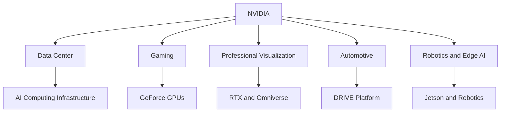

### A. Data Center

The most important business area.

Products:

- H100.
- H200.
- Blackwell.
- Vera Rubin.
- DGX.
- Networking systems.

Customers:

- Cloud providers.
- AI laboratories.
- Enterprise data centers.
- Research institutions.

### B. Gaming

NVIDIA develops GeForce graphics processors.

Products are used for:

- PC gaming.
- Rendering.
- Streaming.
- Video editing.
- AI-assisted graphics.

### C. Professional Visualization

NVIDIA RTX technology supports:

- 3D design.
- Animation.
- Simulation.
- Architecture.
- Engineering.
- Digital content creation.

### D. Automotive

NVIDIA develops technologies for autonomous driving and intelligent vehicles.

Its DRIVE platform supports:

- Perception.
- Planning.
- Simulation.
- Driver assistance.
- Autonomous driving development.

### E. Robotics and Edge AI

NVIDIA provides platforms for robotics and embedded AI.

Examples:

- Jetson.
- Isaac.
- Omniverse.
- Physical AI development tools.

---

# 4. What Does NVIDIA Actually Do?

To understand NVIDIA, we need to understand the difference between ordinary computing and accelerated computing.

## 4.1 Traditional Computing

Traditional computing relies heavily on CPUs.

CPUs handle:

- Operating systems.
- Applications.
- Databases.
- Business logic.
- Sequential operations.

## 4.2 Accelerated Computing

Accelerated computing combines CPUs with specialized processors such as GPUs.

The CPU manages general-purpose operations.

The GPU handles highly parallel workloads.

This approach is useful for:

- AI model training.
- Scientific computing.
- Computer vision.
- Video processing.
- Simulations.

## 4.3 CPU vs GPU

| Feature | CPU | GPU |
|---|---|---|
| Full Form | Central Processing Unit | Graphics Processing Unit |
| Main Role | General computing | Parallel computing |
| Core Design | Fewer complex cores | Many parallel processing units |
| Best For | General-purpose tasks | Large parallel calculations |
| AI Usage | Orchestration and data preparation | Neural network computation |
| NVIDIA Examples | Vera CPU | Rubin GPU |

### Simple Example

Imagine calculating the result of millions of matrix operations.

A CPU can process these operations, but it is not optimized to execute huge numbers of similar calculations simultaneously.

A GPU is designed for parallel workloads.

Deep learning relies heavily on matrix multiplication, so GPUs are extremely valuable.

---

# 5. Products and Services

## 5.1 GeForce GPUs

GeForce is NVIDIA's consumer graphics product family.

Applications:

- Gaming.
- 3D rendering.
- Video editing.
- Streaming.
- Local AI inference.

## 5.2 NVIDIA RTX

RTX technology supports advanced graphics and AI-assisted rendering.

Features include:

- Ray tracing.
- AI upscaling.
- Real-time graphics.
- Rendering acceleration.

## 5.3 NVIDIA H100 and H200

These are data center GPUs designed for AI and high-performance computing.

Applications:

- LLM training.
- Model inference.
- Scientific computing.
- Enterprise AI.

## 5.4 NVIDIA Blackwell

Blackwell is an advanced GPU architecture designed for generative AI and accelerated computing.

Products include:

- B200.
- GB200.
- GB300.
- Blackwell Ultra systems.

## 5.5 NVIDIA Vera Rubin

Vera Rubin is NVIDIA's next-generation AI computing platform.

It combines:

- Rubin GPUs.
- Vera CPUs.
- NVLink.
- Networking.
- Data processing infrastructure.

## 5.6 NVIDIA DGX

DGX systems are integrated AI computing systems.

They combine NVIDIA hardware and software to make AI development and deployment easier for enterprises.

## 5.7 NVIDIA Jetson

Jetson is a computing platform for edge AI and robotics.

Applications:

- Autonomous robots.
- Industrial automation.
- Computer vision.
- Smart cameras.
- Intelligent machines.

## 5.8 NVIDIA Omniverse

Omniverse is a platform for industrial digital twins and simulation.

Applications:

- Factory simulation.
- Robotics simulation.
- Product design.
- Digital environments.
- Industrial workflows.

---

# 6. Business Model – How NVIDIA Makes Money

NVIDIA operates primarily as a semiconductor and accelerated computing platform company.

It generates revenue from multiple product categories.

## 6.1 Data Center Hardware

NVIDIA sells:

- GPUs.
- CPUs.
- Networking equipment.
- Complete AI systems.
- Rack-scale infrastructure.

Customers include:

- AWS.
- Microsoft.
- Google.
- Oracle.
- Meta.
- AI research organizations.

## 6.2 Gaming Hardware

NVIDIA sells GeForce graphics cards through OEMs, distributors and retail channels.

## 6.3 Professional Visualization

NVIDIA sells workstation GPUs and related professional computing products.

## 6.4 Automotive

NVIDIA provides automotive computing platforms and software technologies.

## 6.5 Enterprise Software

NVIDIA also provides software and services for:

- AI development.
- Model deployment.
- Enterprise infrastructure.
- Simulation.
- Robotics.
- Digital twins.

## Business Model Diagram

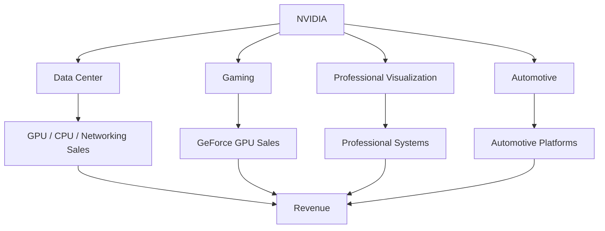

### Important Business Insight

NVIDIA's strongest advantage is the combination of hardware and software.

Customers are not simply buying a chip.

They are often adopting an entire development and infrastructure ecosystem.

This makes switching to another platform more complicated.

---

# 7. Financial Analysis – Q2 FY2027

**Latest available reported quarter as of November 6, 2026: Q2 FY2027.**

NVIDIA reported its results on August 26, 2026.

The quarter ended July 26, 2026.

## 7.1 Financial Performance

| Metric | Q2 FY2026 | Q2 FY2027 |
|---|---:|---:|
| Revenue | $46.743B | $96.221B |
| GAAP Gross Margin | 72.4% | 75.0% |
| GAAP Operating Income | $28.440B | $63.734B |
| GAAP Net Income | $26.422B | $59.688B |
| GAAP Diluted EPS | $1.08 | $2.46 |

Revenue increased 106% year over year.

## 7.2 Revenue Chart

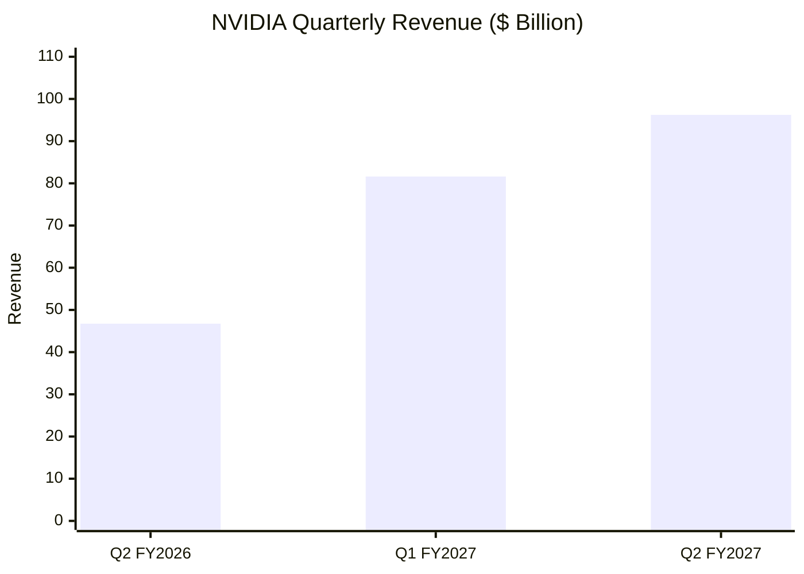

## 7.3 Data Center Revenue

Q2 FY2027 Data Center revenue:

**$89.0 billion**

Year-over-year growth:

**117%**

This demonstrates the importance of AI infrastructure to NVIDIA's business.

## 7.4 Revenue Distribution

Data Center represented approximately 92.5% of total revenue in Q2 FY2027.

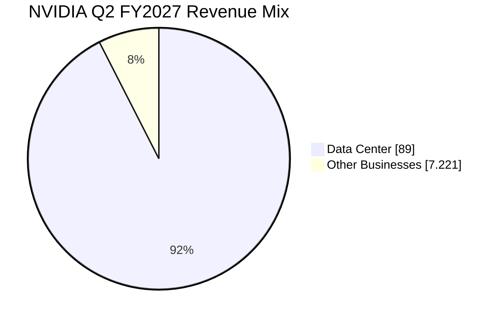

The remaining revenue includes gaming, professional visualization, automotive and other businesses.

## 7.5 Business Interpretation

Three major observations:

1. Data Center is NVIDIA's dominant revenue engine.
2. AI infrastructure demand is driving rapid growth.
3. NVIDIA has high gross margins, reflecting the value of its differentiated technology ecosystem.

**Important:** The remaining revenue in the chart is an aggregate calculation, not a separately reported business segment.

---

# 8. NVIDIA's AI Strategy

NVIDIA's strategy is to become the computing platform for the AI economy.

It wants to provide the infrastructure needed to build and operate AI systems.

Its strategy covers five major layers.

## 8.1 AI Hardware

Develop high-performance GPUs and CPUs.

Examples:

- H100.
- H200.
- B200.
- GB200.
- Rubin GPU.
- Vera CPU.

## 8.2 AI Software

Provide the software needed to develop and operate AI systems.

Examples:

- CUDA.
- cuDNN.
- TensorRT.
- NeMo.
- NIM.

## 8.3 AI Networking

Connect thousands of GPUs and servers.

Examples:

- NVLink.
- InfiniBand.
- Spectrum-X.
- ConnectX.
- BlueField.

## 8.4 AI Systems

Provide complete computing platforms.

Examples:

- DGX.
- HGX.
- GB200 NVL72.
- Vera Rubin NVL72.

## 8.5 AI Applications

Support:

- Generative AI.
- AI agents.
- Robotics.
- Autonomous vehicles.
- Healthcare.
- Industrial simulation.

### AI Strategy Architecture

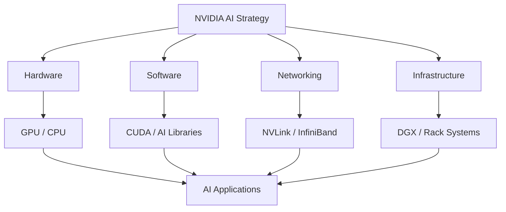

---

# 9. GPU Architecture

To understand NVIDIA's business, understanding GPU architecture is essential.

## 9.1 What Is a GPU?

A GPU is a processor designed to perform many calculations in parallel.

It contains many processing units that can execute similar operations across large datasets.

## 9.2 GPU Components

Important components include:

- Streaming Multiprocessors.
- CUDA Cores.
- Tensor Cores.
- GPU Memory.
- Memory Controllers.
- Interconnects.

## 9.3 CUDA Cores

CUDA Cores are processing units used for general GPU computation.

They execute parallel arithmetic and other operations.

## 9.4 Tensor Cores

Tensor Cores accelerate matrix operations used in AI workloads.

They support optimized operations with different numerical formats.

Examples:

- FP16.
- BF16.
- TF32.
- FP8.
- FP4.

## 9.5 GPU Memory

AI models require significant memory.

NVIDIA data center GPUs use High Bandwidth Memory.

HBM helps move data between GPU memory and computing units at very high speeds.

### Simplified GPU Architecture

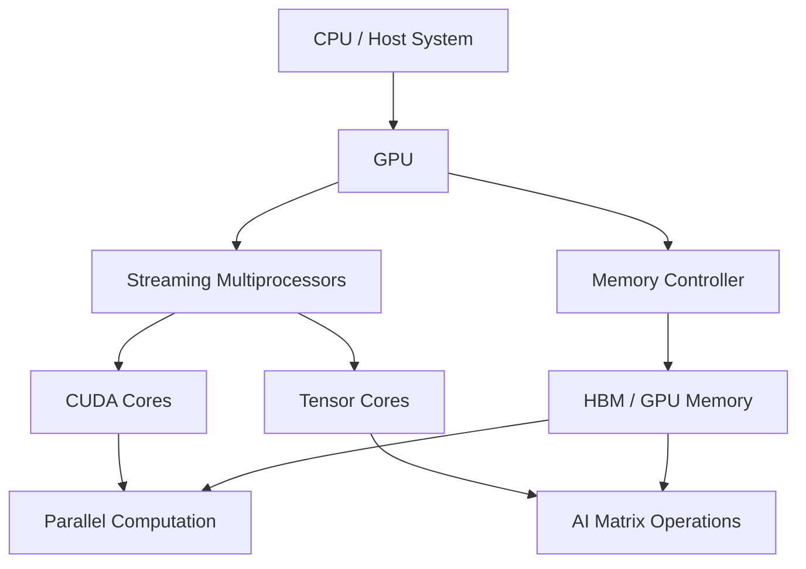

## 9.6 Why Tensor Cores Matter

Deep learning requires matrix multiplication.

Tensor Cores accelerate these operations.

This improves the performance of:

- Neural networks.
- Transformers.
- LLM training.
- LLM inference.

---

# 10. CUDA – NVIDIA's Biggest Competitive Advantage

CUDA stands for Compute Unified Device Architecture.

It is NVIDIA's parallel computing platform and programming model.

It allows developers to write software that uses NVIDIA GPUs for general-purpose computation.

## 10.1 Why CUDA Is Important

Imagine NVIDIA produces an extremely powerful GPU.

But developers cannot easily use it.

The GPU may be powerful, but it will be difficult for software companies to adopt.

CUDA solves this problem by providing:

- Programming tools.
- Libraries.
- Runtime support.
- Compiler tools.
- Developer documentation.
- Debugging tools.
- Performance optimization tools.

## 10.2 CUDA Ecosystem

| Technology | Purpose |
|---|---|
| CUDA Toolkit | GPU development environment |
| cuDNN | Deep learning primitives |
| cuBLAS | Linear algebra |
| TensorRT | AI inference optimization |
| NCCL | Multi-GPU communication |
| CUDA Runtime | GPU execution support |
| Nsight | Performance analysis |
| Triton | GPU kernel development |

## 10.3 CUDA Architecture

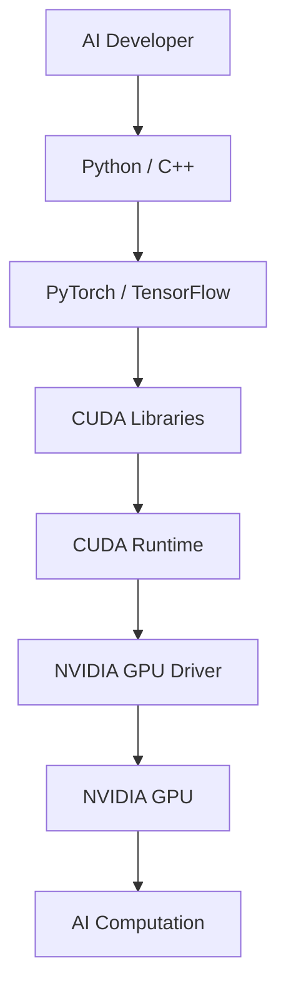

## 10.4 CUDA vs ROCm

| Feature | NVIDIA CUDA | AMD ROCm |
|---|---|---|
| Company | NVIDIA | AMD |
| GPU | NVIDIA GPUs | AMD GPUs |
| Main Purpose | GPU computing | GPU computing |
| AI Frameworks | PyTorch, JAX, TensorFlow | PyTorch, JAX, TensorFlow |
| Developer Adoption | Very established | Growing |
| Ecosystem | Extensive | Expanding |

## 10.5 Why CUDA Creates a Competitive Advantage

Consider an AI company with thousands of GPU servers.

Its engineering teams have built:

- Training pipelines.
- Custom GPU kernels.
- Model-serving systems.
- Performance optimizations.
- Infrastructure monitoring.

Moving to another GPU platform may require substantial software changes, testing and optimization.

This creates ecosystem switching costs.

**Important lesson:** Software ecosystems can become just as important as hardware performance.

---

# 11. Blackwell Architecture

Blackwell is NVIDIA's GPU architecture for advanced AI computing.

It supports:

- Generative AI.
- LLM training.
- LLM inference.
- AI reasoning.
- Scientific computing.

## 11.1 Blackwell Products

| Product | Purpose |
|---|---|
| B200 | Data center GPU |
| GB200 | Grace Blackwell superchip |
| GB300 | Blackwell Ultra platform |
| GB200 NVL72 | Rack-scale AI system |
| GB300 NVL72 | Advanced rack-scale AI system |

## 11.2 What Makes Blackwell Important?

Blackwell integrates multiple technologies.

Examples:

- Advanced Tensor Cores.
- High-bandwidth memory.
- NVLink.
- Transformer Engine.
- Confidential Computing.
- Advanced networking.

## 11.3 GB200 NVL72

The GB200 NVL72 is a rack-scale AI system.

It integrates:

- 72 Blackwell GPUs.
- 36 Grace CPUs.
- NVLink.
- Networking.
- Liquid cooling.

Instead of treating each GPU as an independent device, the rack integrates the GPUs into a high-bandwidth computing system.

### Blackwell Architecture

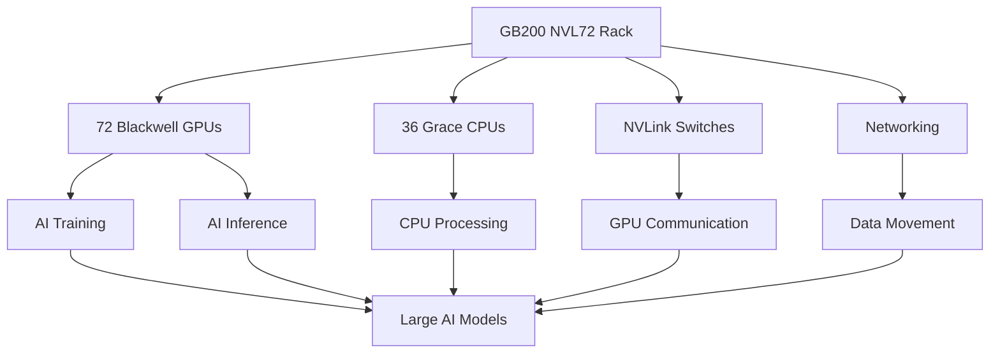

---

# 12. Vera Rubin Architecture

Vera Rubin is NVIDIA's next-generation AI computing platform.

It is designed to support large-scale AI training and agentic AI inference.

## 12.1 Why the Name Rubin?

The architecture is named after astronomer Vera Rubin.

## 12.2 Major Components

| Component | Function |
|---|---|
| Rubin GPU | AI computation |
| Vera CPU | General processing and orchestration |
| NVLink 6 | GPU communication |
| ConnectX-9 | High-performance networking |
| BlueField-4 | Data processing and infrastructure offload |
| Spectrum-X | Ethernet networking |
| Quantum-X800 | InfiniBand networking |
| Groq 3 LPX | Low-latency AI inference acceleration |

## 12.3 Vera Rubin NVL72

NVIDIA's Vera Rubin NVL72 platform combines:

- 72 Rubin GPUs.
- 36 Vera CPUs.
- NVLink 6.
- ConnectX-9 SuperNICs.
- BlueField-4 DPUs.

It is designed to function as a rack-scale AI supercomputer.

## 12.4 Why This Matters

As AI models grow, computing requirements become more complex.

AI systems need:

- More memory.
- Faster GPU communication.
- More efficient inference.
- Better networking.
- Lower energy consumption per token.

Vera Rubin addresses these infrastructure requirements.

### Vera Rubin Architecture

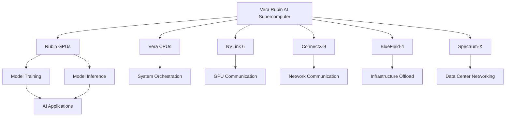

## 12.5 Blackwell vs Vera Rubin

| Category | Blackwell | Vera Rubin |
|---|---|---|
| GPU | Blackwell | Rubin |
| CPU | Grace | Vera |
| Memory | HBM3E in major systems | HBM4 |
| Interconnect | NVLink 5 | NVLink 6 |
| Main Focus | Generative AI | Agentic AI and advanced reasoning |
| Infrastructure | GB200 / GB300 | Vera Rubin NVL72 |

---

# 13. NVIDIA DGX and AI Supercomputers

## 13.1 What Is DGX?

NVIDIA DGX is an integrated AI computing platform.

It combines:

- NVIDIA GPUs.
- CPUs.
- Networking.
- Storage.
- AI software.

The goal is to simplify AI infrastructure deployment.

## 13.2 DGX Use Cases

- Foundation model training.
- Enterprise AI.
- Scientific research.
- LLM development.
- AI inference.
- Model experimentation.

## 13.3 DGX Architecture

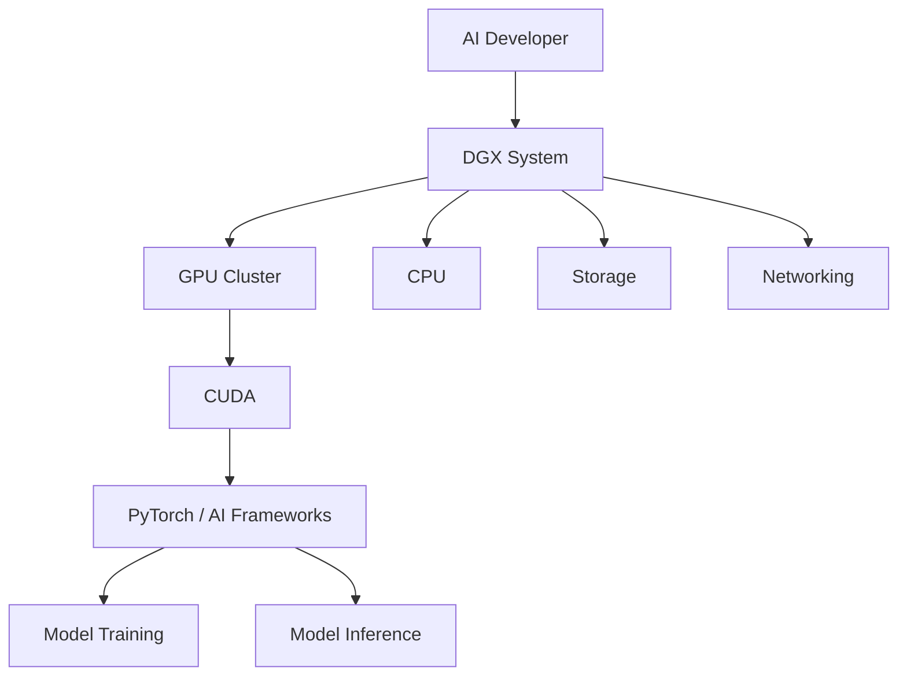

## 13.4 DGX vs Ordinary Server

| Ordinary Server | DGX System |
|---|---|
| General computing | AI-optimized computing |
| Standard CPU/GPU configuration | Integrated accelerated computing |
| General software stack | NVIDIA AI software ecosystem |
| General enterprise workloads | Large-scale AI workloads |

---

# 14. NVIDIA Networking and NVLink

A data center with thousands of GPUs needs efficient communication.

GPU performance alone is not enough.

## 14.1 Why Networking Matters

Imagine training a large language model using 1,000 GPUs.

Each GPU processes a portion of the workload.

The GPUs must exchange information.

If communication is slow, the entire training process can become inefficient.

## 14.2 NVLink

NVLink is NVIDIA's high-speed interconnect technology.

It allows GPUs and supported processors to communicate efficiently.

## 14.3 InfiniBand

InfiniBand is a high-performance networking technology used in supercomputers and large-scale data centers.

## 14.4 Spectrum-X

Spectrum-X is NVIDIA's Ethernet networking platform for AI infrastructure.

## 14.5 BlueField DPU

A DPU is a Data Processing Unit.

It offloads infrastructure tasks from CPUs.

Examples:

- Networking.
- Security.
- Storage processing.
- Infrastructure management.

### Networking Architecture

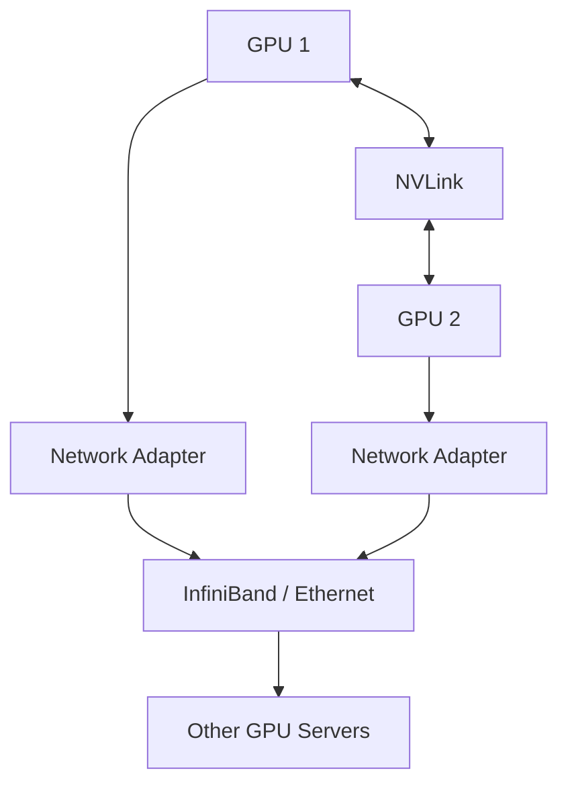

---

# 15. NVIDIA AI Work Model

NVIDIA's business model is fundamentally different from an AI application company.

NVIDIA builds the infrastructure that allows AI companies to create and deploy models.

## 15.1 AI Infrastructure Workflow

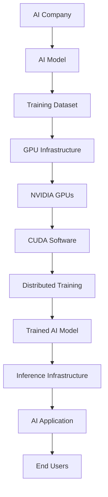

## 15.2 Example: Training an LLM

Imagine an AI company wants to train a large language model.

The workflow:

1. Collect training data.
2. Clean and preprocess the dataset.
3. Tokenize the data.
4. Select the model architecture.
5. Distribute training across GPUs.
6. Execute matrix operations.
7. Calculate loss.
8. Update model weights.
9. Repeat training.
10. Evaluate the final model.

NVIDIA provides the GPUs, software and infrastructure that support these operations.

## 15.3 Example: LLM Inference

Once a model is trained, it needs to generate responses.

Inference involves:

1. Receiving a user prompt.
2. Tokenizing the input.
3. Loading model parameters.
4. Running forward computation.
5. Generating output tokens.
6. Returning the response.

NVIDIA hardware and software help optimize inference performance and cost.

---

# 16. Technology Architecture

NVIDIA's ecosystem covers several technology layers.

## 16.1 Hardware Layer

- GPU.
- CPU.
- DPU.
- HBM.
- Networking.
- NVLink.

## 16.2 Software Layer

- CUDA.
- cuDNN.
- TensorRT.
- NCCL.
- NeMo.
- Triton Inference Server.

## 16.3 Infrastructure Layer

- DGX.
- HGX.
- NVLink.
- InfiniBand.
- Spectrum-X.
- BlueField.

## 16.4 Application Layer

- Generative AI.
- LLMs.
- AI agents.
- Computer vision.
- Robotics.
- Autonomous vehicles.
- Digital twins.

### Complete NVIDIA Architecture

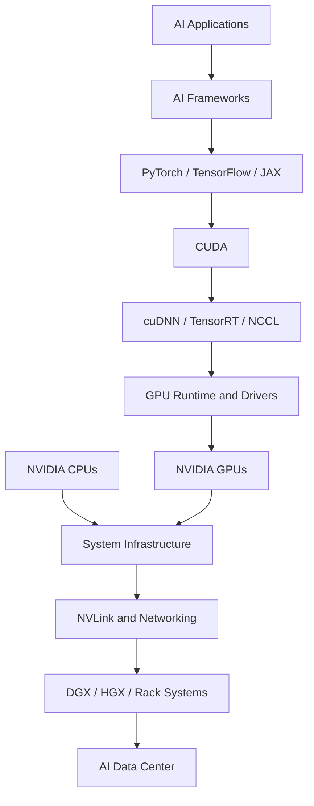

---

# 17. AI Software Ecosystem

NVIDIA has built a large ecosystem of AI software.

| Product | Purpose |
|---|---|
| CUDA | GPU computing |
| cuDNN | Deep learning acceleration |
| TensorRT | AI inference optimization |
| TensorRT-LLM | LLM inference optimization |
| NeMo | Generative AI development |
| Triton Inference Server | Model serving |
| NCCL | Multi-GPU communication |
| RAPIDS | GPU-accelerated data science |
| Isaac | Robotics development |
| Omniverse | Simulation and digital twins |
| NIM | AI inference microservices |
| Dynamo | Distributed AI inference infrastructure |

## 17.1 NVIDIA NeMo

NeMo provides tools for developing, customizing and deploying generative AI models.

Applications:

- LLM development.
- Model customization.
- Speech AI.
- Retrieval-Augmented Generation.
- Model evaluation.

## 17.2 TensorRT

TensorRT optimizes trained AI models for inference.

It helps improve:

- Latency.
- Throughput.
- Memory usage.
- Hardware utilization.

## 17.3 Triton Inference Server

Triton helps deploy and serve machine learning models.

It supports multiple frameworks and model formats.

## 17.4 NIM

NVIDIA NIM provides packaged AI inference microservices.

It simplifies the process of deploying supported AI models.

## 17.5 RAPIDS

RAPIDS provides GPU-accelerated data science libraries.

It can accelerate:

- Data processing.
- Machine learning.
- Analytics.

---

# 18. Real-World AI Applications

NVIDIA technology supports AI applications across several industries.

## 18.1 Healthcare

Applications:

- Medical imaging.
- Drug discovery.
- Genomics.
- Medical research.
- AI-assisted diagnostics.

## 18.2 Automotive

NVIDIA DRIVE supports automotive computing and autonomous vehicle development.

Applications:

- Perception.
- Object detection.
- Sensor fusion.
- Driving simulation.
- Driver assistance.

## 18.3 Robotics

NVIDIA Isaac provides tools for robotics development.

Applications:

- Robot simulation.
- Manipulation.
- Navigation.
- Computer vision.
- Physical AI.

## 18.4 Manufacturing

NVIDIA Omniverse can support industrial digital twins.

Example:

A manufacturer creates a virtual factory.

It can simulate:

- Production lines.
- Robots.
- Equipment.
- Manufacturing workflows.

Engineers can test changes virtually before implementing them physically.

## 18.5 Financial Services

Applications:

- Fraud detection.
- Risk modelling.
- Financial analytics.
- Document intelligence.
- Customer support automation.

### Industry Application Diagram

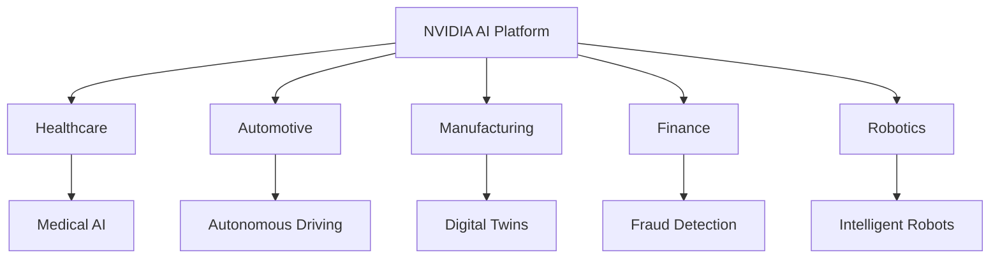

---

# 19. Major Partnerships

NVIDIA's infrastructure business depends on relationships with large technology companies.

## 19.1 NVIDIA + OpenAI

In September 2025, NVIDIA and OpenAI announced a strategic partnership to deploy at least 10 GW of NVIDIA systems.

NVIDIA also announced its intention to invest up to $100 billion progressively as systems are deployed.

The first gigawatt was targeted for the second half of 2026 using the Vera Rubin platform.

### Why is this important?

OpenAI requires computing infrastructure to:

- Train advanced AI models.
- Run inference.
- Serve enterprise customers.
- Support large-scale AI applications.

NVIDIA provides the hardware and software infrastructure.

Official announcement:

https://openai.com/index/openai-nvidia-systems-partnership/

## 19.2 NVIDIA + Meta

NVIDIA and Meta expanded their relationship in October 2026.

The partnership includes:

- Muse model optimization.
- Vera Rubin infrastructure.
- Vera CPUs.
- Spectrum-X networking.
- BlueField-4.
- AI agent security and monitoring.

NVIDIA also announced a $3 billion investment in Meta's equity offering.

Official announcement:

https://investor.nvidia.com/news/press-release-details/2026/NVIDIA-and-Meta-to-Expand-Collaboration-on-Muse-and-Muse-Family-of-Models-Amid-Robust-Growth/

## 19.3 NVIDIA + Microsoft

Microsoft uses NVIDIA technology in its cloud infrastructure.

This enables customers to deploy AI workloads using GPU-accelerated cloud services.

## 19.4 NVIDIA + Google Cloud

Google Cloud offers NVIDIA accelerated computing infrastructure for AI development and deployment.

## 19.5 NVIDIA + Oracle

Oracle Cloud Infrastructure uses NVIDIA GPUs and networking for large-scale AI workloads.

### Partnership Summary

| Company | Partnership Focus |
|---|---|
| OpenAI | Large-scale AI computing |
| Meta | AI infrastructure and model optimization |
| Microsoft | Cloud AI infrastructure |
| Google Cloud | GPU computing |
| Oracle | Enterprise AI infrastructure |
| CoreWeave | GPU cloud infrastructure |
| Anthropic | AI model and infrastructure collaboration |

**Important:** Announced partnerships and deployments should not automatically be interpreted as fully delivered infrastructure or completed investment transactions.

---

# 20. Competitor Analysis

NVIDIA operates in several markets.

Its most important competition in AI infrastructure comes from AMD, custom silicon developers and cloud providers developing their own chips.

## 20.1 NVIDIA vs AMD

| Category | NVIDIA | AMD |
|---|---|---|
| AI GPUs | Blackwell, Rubin | Instinct |
| CPUs | Vera, Grace | EPYC |
| GPU Software | CUDA | ROCm |
| AI Infrastructure | DGX, NVL72 | Helios |
| Networking | NVLink, Spectrum-X, InfiniBand | UALink and networking portfolio |
| Developer Ecosystem | Very established | Growing |
| Main Challenge | Competition and supply | Software ecosystem adoption |

## 20.2 NVIDIA vs Intel

| Category | NVIDIA | Intel |
|---|---|---|
| GPU | GeForce, Blackwell, Rubin | Arc and data center accelerators |
| CPU | Vera, Grace | Xeon |
| AI Platform | CUDA | oneAPI |
| Data Center | AI infrastructure | CPUs and accelerators |
| Market Strength | AI computing ecosystem | General computing and manufacturing |

## 20.3 NVIDIA vs Google TPU

Google develops Tensor Processing Units.

TPUs are specialized accelerators used within Google's AI and cloud ecosystem.

NVIDIA GPUs have a broad external developer and cloud ecosystem.

Google's TPU strategy provides an alternative for workloads optimized for its infrastructure.

## 20.4 NVIDIA vs AWS Trainium

AWS develops Trainium accelerators.

These are designed to support AI training and inference workloads within AWS infrastructure.

This can reduce dependence on external accelerator suppliers for selected workloads.

### Competitive Positioning

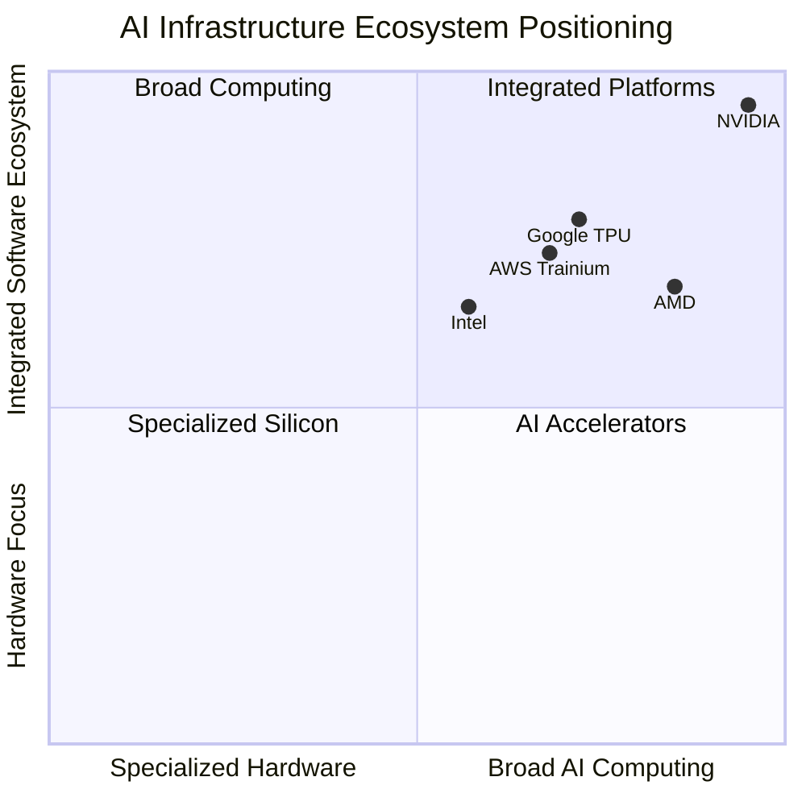

*Illustrative strategic positioning, not a quantitative market-share or performance ranking.*

---

# 21. SWOT Analysis

| Strengths | Weaknesses |
|---|---|
| Strong GPU architecture | Heavy dependence on data center demand |
| CUDA ecosystem | High product and infrastructure costs |
| Established developer community | Supply chain dependence |
| Strong AI partnerships | Significant customer concentration |
| Integrated hardware and software | Premium pricing |

| Opportunities | Threats |
|---|---|
| AI agent infrastructure | AMD competition |
| Robotics and Physical AI | Custom AI chips |
| Enterprise AI | Export restrictions |
| Autonomous vehicles | Geopolitical risks |
| Scientific computing | AI infrastructure spending cycles |
| Edge AI | Power availability and energy costs |

## Strategic Interpretation

NVIDIA's advantage is its ability to deliver an integrated platform.

However, its dominance also creates incentives for customers to explore alternative hardware and develop their own chips.

---

# 22. Challenges and Risks

## 22.1 AMD Competition

AMD is developing competing AI accelerators and an alternative software ecosystem through ROCm.

## 22.2 Custom AI Chips

Large cloud providers are developing custom processors.

Examples include:

- Google TPU.
- AWS Trainium.
- Microsoft Maia.

These products may reduce reliance on external GPU providers for selected workloads.

## 22.3 Export Restrictions

Semiconductor export controls can limit access to certain markets.

## 22.4 Manufacturing Dependence

NVIDIA depends on external semiconductor manufacturing and advanced packaging partners.

Production constraints can affect supply.

## 22.5 Energy Consumption

Large AI data centers require enormous amounts of electricity.

Energy efficiency is becoming a major competitive factor.

## 22.6 AI Market Sustainability

AI companies must generate sufficient economic value to justify their infrastructure investments.

If demand or investment slows, hardware suppliers may experience lower growth.

---

# 23. Future Strategy

NVIDIA's future direction is focused on building AI factories and supporting agentic AI.

## 23.1 AI Factories

An AI factory is a data center designed to produce AI output.

Instead of manufacturing physical products, it produces intelligence in the form of tokens, predictions, decisions and AI services.

## 23.2 Agentic AI

Agentic AI systems can:

- Understand objectives.
- Plan tasks.
- Use tools.
- Execute workflows.
- Evaluate results.
- Continue working toward goals.

NVIDIA is developing infrastructure to support these workloads.

## 23.3 Physical AI

Physical AI combines AI models with physical systems.

Examples:

- Robots.
- Autonomous vehicles.
- Industrial machines.
- Intelligent manufacturing.

## 23.4 Vera Rubin

The Vera Rubin platform is designed to improve AI training and inference economics.

## 23.5 Software Ecosystem

NVIDIA will continue investing in:

- CUDA.
- AI libraries.
- Inference systems.
- Developer tools.
- Robotics software.
- Enterprise AI.

### Future Strategy Diagram

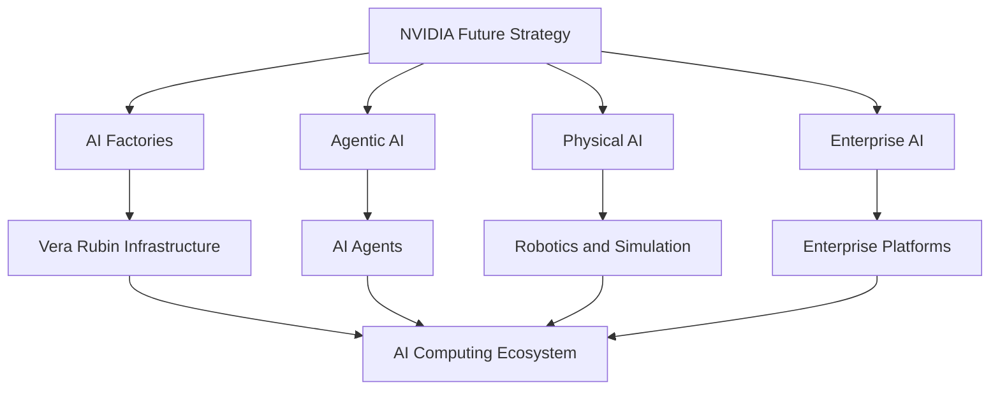

---

# 24. Career Opportunities

NVIDIA is an interesting company to study for AI, software, cloud and systems engineering careers.

## 24.1 AI Software Engineer

Responsibilities:

- Develop AI applications.
- Optimize models.
- Integrate AI libraries.
- Improve inference performance.

Skills:

- Python.
- PyTorch.
- CUDA concepts.
- LLMs.
- Deep Learning.

## 24.2 GPU Software Engineer

Responsibilities:

- Develop GPU kernels.
- Optimize parallel workloads.
- Improve memory performance.
- Debug GPU applications.

Skills:

- C++.
- CUDA C++.
- Computer Architecture.
- Parallel Programming.
- Linux.

## 24.3 AI Infrastructure Engineer

Responsibilities:

- Deploy GPU clusters.
- Manage AI inference systems.
- Optimize distributed computing.
- Monitor infrastructure.

Skills:

- Linux.
- Kubernetes.
- Docker.
- CUDA.
- Networking.
- Distributed Systems.

## 24.4 Data Engineer

Responsibilities:

- Develop data pipelines.
- Process training datasets.
- Manage large-scale storage.
- Optimize data processing.

Skills:

- Python.
- SQL.
- Spark.
- Kafka.
- Airflow.
- Cloud Platforms.

## 24.5 Backend Engineer

Responsibilities:

- Develop APIs.
- Integrate AI models.
- Build inference services.
- Manage databases.
- Develop scalable applications.

Skills:

- Python.
- FastAPI.
- REST APIs.
- PostgreSQL.
- Redis.
- Docker.

### Career Skill Matrix

| Role | Important Skills |
|---|---|
| AI Engineer | Python, PyTorch, LLMs |
| GPU Engineer | C++, CUDA, GPU architecture |
| Data Engineer | SQL, Spark, Airflow |
| Cloud Engineer | AWS, Linux, Kubernetes |
| Backend Engineer | Python, FastAPI, PostgreSQL |
| AI Infrastructure Engineer | CUDA, vLLM, Distributed Systems |
| Robotics Engineer | C++, ROS, Computer Vision |

---

# 25. Engineering Project Ideas

The best way to understand NVIDIA's ecosystem is to build projects inspired by its technologies.

## Project 1 – AI Model Inference API

**Problem:** AI models need scalable interfaces for applications.

**Solution:** Build an API that serves an open-weight LLM.

Features:

- Model loading.
- Prompt processing.
- Inference API.
- Response generation.
- Latency monitoring.
- Request logging.

Technology:

- Python.
- FastAPI.
- PyTorch.
- vLLM.
- Docker.
- PostgreSQL.

Architecture:

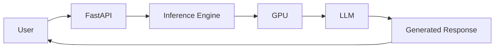

## Project 2 – GPU Monitoring Dashboard

**Problem:** GPU infrastructure needs continuous monitoring.

**Solution:** Develop a dashboard that tracks GPU performance.

Features:

- GPU utilization.
- GPU temperature.
- GPU memory.
- Power consumption.
- Model inference metrics.
- Alerts.

Technology:

- Python.
- Prometheus.
- Grafana.
- FastAPI.
- PostgreSQL.

## Project 3 – RAG-Based Enterprise AI Assistant

**Problem:** Employees need to search large document collections.

**Solution:** Build a RAG assistant using GPU-accelerated inference.

Features:

- PDF ingestion.
- Text chunking.
- Embeddings.
- Vector search.
- LLM answers.
- Source citations.

Technology:

- Python.
- FastAPI.
- FAISS.
- PostgreSQL.
- PyTorch.
- Docker.

## Project 4 – AI Agent System

**Problem:** Repetitive business tasks consume employee time.

**Solution:** Build an AI agent that can plan and execute controlled tasks.

Features:

- Task planning.
- Tool calling.
- API integration.
- Task execution.
- Result validation.
- Audit logs.

Technology:

- Python.
- LLMs.
- FastAPI.
- PostgreSQL.
- Redis.
- Docker.

## Project 5 – Digital Twin Simulation

**Problem:** Manufacturing companies need to test operations before implementing physical changes.

**Solution:** Build a simplified digital factory simulation.

Features:

- Factory layout.
- Production workflow.
- Machine states.
- Simulated robots.
- Production analytics.

Technology:

- Python.
- Simulation libraries.
- Three.js.
- APIs.
- PostgreSQL.

## Project 6 – AI Infrastructure Cost Calculator

**Problem:** Running AI models requires expensive GPU infrastructure.

**Solution:** Build a calculator to estimate infrastructure costs.

Inputs:

- GPU count.
- GPU power consumption.
- Electricity cost.
- Utilization.
- Server costs.
- Inference requests.

Outputs:

- Monthly operating cost.
- Electricity cost.
- Cost per million tokens.
- Estimated GPU utilization.

Technology:

- Python.
- FastAPI.
- Next.js.
- PostgreSQL.
- Power BI.

---

# 26. Key Business Lessons

## Lesson 1 – Build an Ecosystem, Not Just a Product

NVIDIA's competitive advantage is not limited to GPUs.

It combines hardware, software, networking and developer tools.

## Lesson 2 – Software Can Create Hardware Lock-In

CUDA made NVIDIA GPUs easier to adopt and created a large developer ecosystem.

## Lesson 3 – Infrastructure Is a Business

AI applications need expensive computing resources.

The infrastructure providers can capture value from AI growth.

## Lesson 4 – Developer Adoption Matters

Documentation, frameworks, libraries and community support are essential.

## Lesson 5 – Partnerships Accelerate Growth

NVIDIA's relationships with OpenAI, Meta and cloud providers help it expand its infrastructure business.

## Lesson 6 – Think Beyond Individual Machines

Modern AI systems require thousands of GPUs working together.

The data center itself becomes the computing platform.

## Lesson 7 – AI Is Moving Towards Physical Systems

Robotics, autonomous vehicles and industrial simulation represent important opportunities beyond software-only AI.

---

# 27. Research Sources

The following sources should be used for further verification and deeper research.

| Source | Research Area | Link |
|---|---|---|
| NVIDIA Official Website | Company information | https://www.nvidia.com/ |
| NVIDIA History | Company evolution | https://www.nvidia.com/en-us/about-nvidia/corporate-timeline/ |
| NVIDIA Investor Relations | Financial performance | https://investor.nvidia.com/ |
| NVIDIA Q2 FY2027 Results | Financial statements | https://investor.nvidia.com/news/press-release-details/2026/NVIDIA-Announces-Financial-Results-for-Second-Quarter-Fiscal-2027/ |
| NVIDIA CUDA | GPU computing | https://developer.nvidia.com/cuda-zone |
| NVIDIA Data Center | AI infrastructure | https://www.nvidia.com/en-us/data-center/ |
| NVIDIA Vera Rubin | Next-generation architecture | https://www.nvidia.com/en-in/data-center/vera-rubin-nvl72/ |
| NVIDIA Developer | AI development | https://developer.nvidia.com/ |
| NVIDIA NeMo | Generative AI | https://developer.nvidia.com/nemo |
| NVIDIA Omniverse | Digital twins | https://www.nvidia.com/en-us/omniverse/ |
| NVIDIA Robotics | Robotics development | https://developer.nvidia.com/isaac |
| NVIDIA OpenAI Partnership | AI infrastructure | https://openai.com/index/openai-nvidia-systems-partnership/ |

### Research Verification Notes

- Financial data uses NVIDIA's Q2 FY2027 results, published August 26, 2026.
- Q3 FY2027 results are not included because they had not been released as of November 6, 2026.
- NVIDIA's fiscal year differs from the calendar year.
- Architecture specifications are based on manufacturer documentation.
- Performance comparisons are vendor-published figures and may depend on workload and configuration.
- Partnership announcements do not necessarily represent completed deployments.
- System diagrams in this document are educational reference architectures, not confidential NVIDIA internal designs.

---

# Final Assessment

| Research Dimension | Assessment |
|---|---|
| Business Model | Accelerated computing platforms |
| Main Revenue Engine | Data Center |
| Main Hardware | GPUs and CPUs |
| Main Software | CUDA |
| AI Infrastructure | DGX, HGX, Vera Rubin |
| Networking | NVLink, InfiniBand, Spectrum-X |
| AI Strategy | AI factories and agentic AI |
| Major Competitor | AMD |
| Other Competitors | Intel and custom AI silicon |
| Main Opportunity | Global AI infrastructure growth |
| Main Challenge | Competition, supply and infrastructure economics |

## Final Conclusion

NVIDIA is one of the strongest examples of a company that successfully transformed its original technology into an entirely new computing ecosystem.

It started with graphics processing.

It expanded into parallel computing.

It developed CUDA.

It became essential to modern deep learning.

It is now building the infrastructure required for generative AI and agentic AI.

Its competitive advantage comes from the combination of:

1. GPU architecture.
2. CUDA software.
3. AI libraries.
4. High-speed networking.
5. Integrated AI systems.
6. Developer ecosystem.
7. Strategic partnerships.

**The biggest lesson: NVIDIA did not just sell faster GPUs. It helped create an ecosystem that developers, researchers, cloud providers and AI companies build upon.**

---

# Case Study Completion

- [x] Company history researched.
- [x] Leadership examined.
- [x] Business model analyzed.
- [x] Products and services documented.
- [x] Q2 FY2027 financial performance reviewed.
- [x] Data Center business examined.
- [x] GPU architecture studied.
- [x] CUDA ecosystem studied.
- [x] Blackwell architecture examined.
- [x] Vera Rubin architecture examined.
- [x] DGX infrastructure examined.
- [x] Networking technologies studied.
- [x] AI software ecosystem documented.
- [x] Real-world applications examined.
- [x] Partnerships researched.
- [x] Competitor analysis completed.
- [x] Engineering projects documented.

**DAY 003 / 100 – NVIDIA: COMPLETED**

**NEXT: DAY 004 – MICROSOFT**

*100 Days. 100 Companies. Understand the Business. Understand the Technology. Build Like an Engineer.*
